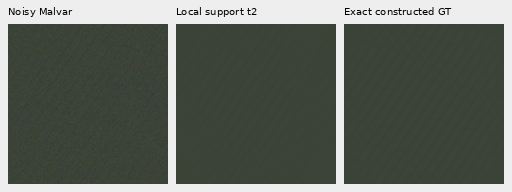
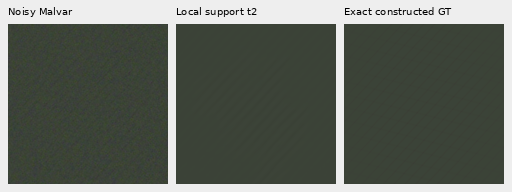
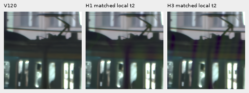

# Matching and harmonic shape in the input-only reconstruction

**Three harmonics increase weak response, but also increase quiet/increment
error and add conspicuous building color bands.** At fixed threshold 2,
far-edge weak response rises 2.80%→5.46%; quiet RMS rises 4.02596→4.06592 DN16.
One harmonic remains the default. The assignment fix is retained independently;
V120 remains the general full-model recommendation.

The [individual-harmonic and background follow-up](individual-wave-validation.md)
now tests the two proposed controls: far quiet/increment costs fall under
individual support, with less response, but conspicuous bands persist.
The expanded affine background raises quiet error further.

This follows the [local conditional-wave pilot](local-validated-waves.md)
on its identical development inputs. The [full three-prior panel](local-wave-full-panel.md)
and separate [V13220k comparison](v132-endpoint-quality.md) now complete under
their original frozen sources; no original process is restarted.
[Receipts, executed sources and publication](results/local-wave-shapes-pilot-v1/publication.json).

## Measured gain and its costs

These means cover **two source geometries**, RGGB/repeat 0, near/far placement,
the 400 prior and independent noise for each image role. They are descriptive
development results, not a broad photo score. H1/cardinality and H1/legacy
have identical finite-wire predictions at every threshold.

Far placement, primary threshold 2; response percentages are projections onto
the constructed increments, not restoration accuracy:

| Method | Strong % | Weak % | Quiet RMS DN16 | Weak-increment RMS DN16 | Full RMS DN16 |
| --- | ---: | ---: | ---: | ---: | ---: |
| V143 parent | 33.783 | 0.958 | 4.00857 | 11.78863 | 21.77841 |
| H1 local | 43.332 | 2.801 | 4.02596 | 11.80386 | 21.72125 |
| H3 local | 46.884 | 5.460 | 4.06592 | 11.89181 | 21.70823 |
| H3 global | 45.793 | 4.989 | 4.21220 | 11.99917 | 21.74178 |

H3 local raises quiet RMS **0.993%** and weak-increment RMS **0.745%** relative
to H1 local, despite slightly lower full-image error. Against the parent,
those two errors rise 1.430% and 0.875%. Weak orthogonal error also increases,
11.41457→11.52640 DN16. Local support retains a better tradeoff than the
same-candidate global support within H3, but the richer basis does not solve
faithful weak reconstruction.

Most response gain comes from source 1/far: weak response 4.592%→9.822%.
Source 0 changes only 1.011%→1.097%. Near the edge, mean weak response changes
3.611%→3.814%, while quiet RMS rises 7.03781→7.06775 DN16 and weak-increment
RMS rises 13.54121→13.57952 DN16.

The fixed sweep provides a useful caution: **H1 local at threshold 0** already
reaches 5.368% far weak response, near H3/t2's 5.460%, with lower quiet RMS
(4.03922 versus 4.06592) and weak-increment RMS (11.80625 versus 11.89181).
H3 has higher strong response in that comparison. H3/t0 extends the tested
weak-response ceiling to 8.595%, with quiet RMS 4.08449 and weak-increment RMS
11.90575. These are distinct costs, not an overall quality improvement or a
proof of Pareto dominance. All thresholds and per-source metrics are
[preserved](results/local-wave-shapes-pilot-v1/comparison-summary.json.gz).

Ordinary bark/fur remain visually close to V120. H3 local changes their sRGB
PSNR by −0.000316/+0.002162 dB relative to V120. All four ADC-only controls
are bit-identical to V120 for all six variants in both new arms.

## Native triplets show the response imbalance

Noisy Malvar → **H3 local t2 above V143** → exact constructed GT. Cells are
unchanged native 160 pixels, ROI `[176,176,160,160]` of each native 512
two-direction far image, RGGB/repeat 0. Shot/read `0.00008/2.56e−8`, ADC16/
black 0.03, exposure 2/contrast 1, identical WB/matrix/clipped-sRGB display.
Source 0 retains little weak response; source 1 carries most of the gain.





Direct H1/H3 local/global comparisons retain
[source 0](images/local-wave-shapes-pilot-v1/comparison/source0-far-role2-comparison.png),
[source 1](images/local-wave-shapes-pilot-v1/comparison/source1-far-role2-comparison.png),
[near source 0](images/local-wave-shapes-pilot-v1/comparison/source0-near-role2-comparison.png)
and [near source 1](images/local-wave-shapes-pilot-v1/comparison/source1-near-role2-comparison.png),
plus [bark](images/local-wave-shapes-pilot-v1/comparison/bark-RGGB-draw0-comparison.png)
and [fur](images/local-wave-shapes-pilot-v1/comparison/raccoon-fur-RGGB-draw0-comparison.png).
The H3 analytic model/configuration SHA256 is
`08a088b4ce346d60c08090ca7bcc93025b9bb5b06e667f431e36a21da69c3a47`;
H1/cardinality is
`adfcc9cb872f1d9549c7bd07397b91f2f3f9818aa6d2f1e3c06eaa3ff42254b5`.
[Native manifests with complete source/ROI/noise/display bindings](images/local-wave-shapes-pilot-v1/manifest.json).

## Protected real photos and the building failure

All four main DSCF3879/3880 contexts retain native 512 input/native 160 cells,
exposure 4 and nominal shot/read `.00128/6.5536e−6`:
[sky](images/local-wave-shapes-pilot-v1/comparison/main-overcast-sky-comparison.png),
[building](images/local-wave-shapes-pilot-v1/comparison/main-building-detail-comparison.png),
[foliage](images/local-wave-shapes-pilot-v1/comparison/main-foliage-comparison.png)
and [coarse fence](images/local-wave-shapes-pilot-v1/comparison/main-chain-link-fence-comparison.png).
Sky stays bit-identical to the parent. Building detail remains soft, foliage
painted and coarse mesh geometry already present in V120.

The extra artifact view below shows **new green/magenta bands across the
roof and poles**. Its ROI `[0,334,160,160]` centers on the largest native
camera-RGB H3-minus-H1 local-t2 change, 277.13 DN16. This post-inference stress
selection uses no reference; no exact or approximate GT is claimed at these
extra coordinates. The three cells share exposure 4/contrast 1 and unchanged
native pixels. The ordinary fixed building ROI alone misses this failure.



Both native 768 cab profiles retain exposure 16, both native 160 ROIs,
DSCF3842/3835 and both original-pixel SOOC JPEGs:

| Profile | Left ROI | Right ROI |
| --- | --- | --- |
| Nominal `.00128/6.5536e−6` | [Left](images/local-wave-shapes-pilot-v1/comparison/mesh-nominal-fine-green-mesh-left-comparison.png) | [Right](images/local-wave-shapes-pilot-v1/comparison/mesh-nominal-fine-green-mesh-right-comparison.png) |
| Nearby DSCF3879 `.0014635775921166604/1.0715704128646712e−6` | [Left](images/local-wave-shapes-pilot-v1/comparison/mesh-profile3879-fine-green-mesh-left-comparison.png) | [Right](images/local-wave-shapes-pilot-v1/comparison/mesh-profile3879-fine-green-mesh-right-comparison.png) |

H3 changes the periodic modulation without convincing new complete fine
crossings. Global support retains broad diagonal ripples; local support still
leaves incomplete structure. All six maximal-new-change stress selections are
[recorded](results/local-wave-shapes-pilot-v1/stress-manifest.json.gz); they
inspect artifacts, not representative quality or full-context correctness.

## Two distinct changes

The original fold assignment minimized the sum of both directional distances,
then discarded pairs outside 1.5 native frequency bins. An unrelated direction
could force a good partial match to be discarded. Among 196 saved discovery
tiles, this occurs once: the main building tile at `[128,0]` has a valid pair
at 0.25 bins, but the old assignment returns none. The new default maximizes
the number of valid pairs first, then minimizes accepted distance. It still
rejects every pair beyond 1.5 bins. This fixes assignment behavior; it does not
establish better image quality on its own.

The second change permits harmonics of each discovered frequency so the basis
can represent a thin periodic line more closely than a single sinusoid. The
trial uses up to three harmonics. Counts are fixed from the initial A-only
frequency, limited to radius 0.24, before sub-bin refinement. The A-only fit,
conditional null and parent projection include all columns in each family.
The complementary fold validates the **whole group**, independently per RGB
color and direction. It does not validate every harmonic separately.

The matched arms are H1/legacy (saved original), H1/cardinality (assignment
only), and H3/cardinality (richer waveform). Everything else remains fixed:
256 discovery tiles/128 stride, 129 validation windows/32 stride, identical
RAW/parent/noise inputs, splits and thresholds 0/2/4, with primary threshold 2.
All 24 cases in both new arms close before new GT/reference analysis. These
reused development sources are not an independent test cohort.

## Provenance and limits

The procedural parent is V143, SHA256
`96d146d017c54196288c585f8b7eddcf030e8a235061049c31e985b9380b7ce4`.
Material/GFX parents are V120, SHA256
`a9d9b6b4f974e24a6b11e5e740aab32314233a7f53c056cf37c7d2aac1c589fb`.
There are no new trained weights. Both arms reuse the original pilot's four
finite-wire triplets, two ordinary materials, four ADC-only controls, four
main GFX contexts and two native 768 cab profiles with both ROIs/JPEGs.

The real ISO100/AHD captures differ in aperture, exposure and movement and
are qualitative references, **not exact GT**. They receive no pixelwise
scores. Originals remain read-only; protected captures, JPEGs and siblings
remain outside training. No new source/noise draw, RAW decode, neural/DINO
forward or optimizer update occurs.

The current component also accepts even native axes instead of requiring
divisibility by four. Every discovery tile remains divisible by four and
starts at an even offset. Positive-noise exact-parent tests fit native 66×70
boundary tiles under all four Bayer layouts. Full 102MP integration, memory
and speed remain unverified for this NumPy correction.

Forty-three focused tests pass. Explicit legacy mode reproduces all 18 saved
prediction arrays byte-for-byte on finite source 1/far, building and cab
profile3879: 43 discovery tiles. New joint harmonic fitting retains all-CFA
NaN holdout invariance, direction null checks and exact-parent identity.

Both arms close all 24 cases/196 discovery tiles, taking 142.12 and 241.60
seconds on CPU while training continues. These mixed-input timings are not a
full-frame benchmark. Each independent audit reproduces 679 scalar fields
and 9,216,000 exact native RGB channels across 28 boards. Maximum scalar
discrepancy is 2.78e−15; finite-increment and PSNR discrepancies are zero.
The 14 combined boards recheck another 14,131,200 source-cell channels exactly.
All 14 combined boards, two H3 triplets and six extra stress boards were
actually viewed; the other standalone arm boards are covered by matching
pixel checks rather than a separate viewing claim.
[Audit H1](results/local-wave-shapes-pilot-v1/matching-independent-audit.json.gz) ·
[Audit H3](results/local-wave-shapes-pilot-v1/harmonics-independent-audit.json.gz) ·
[Viewing record](results/local-wave-shapes-pilot-v1/viewing.json.gz).

The publication preserves 37 archives and 76 unchanged native boards,
including executed source snapshots, original controls and the corrected
quality interpretation. All original pilot receipts remain intact. The
separate full-panel controller/worker, lineage watcher and V132 controller/
worker/reviewer were observed with their exact creation identities at
497/1,152 panel cases and V132 step 6,750; these are progress observations,
not completion evidence. The next hypothesis is to validate added harmonics
individually and improve the competing edge/background model. Neither is
claimed as a demonstrated remedy.

```python
from demosaic.local_validated_waves import LocalWaveConfig, restore_local_waves

outputs, evidence = restore_local_waves(
    parent_rgb, packed_raw, cfa_colors, shot=shot, read=read,
    config=LocalWaveConfig(harmonics=3), thresholds=(2.0,),
)
restored = outputs[("local", 2.0)]
```

`LocalWaveConfig()` retains one harmonic and the corrected assignment.
`LocalWaveConfig(matching="legacy")` reproduces original H1 inference.
The [study driver](../scripts/study_local_wave_shapes.py) freezes both arms and
checks legacy equivalence before prediction; the
[comparison reporter](../scripts/report_local_wave_shapes.py) retains exact
native source cells for both support modes. Scores remain empirical plug-in
predictive evidence, not calibrated probabilities or error guarantees.
