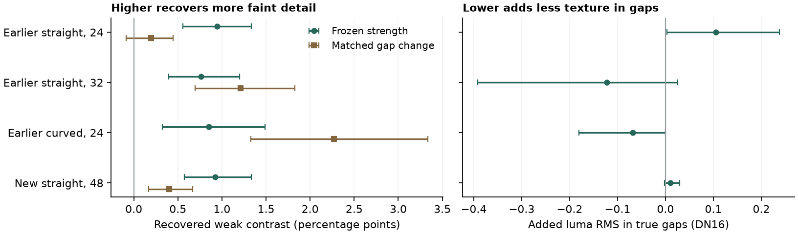
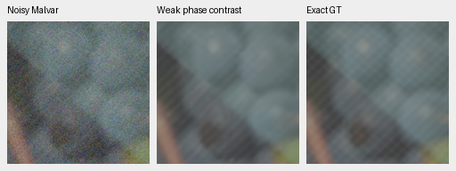
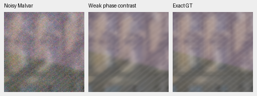

# Recovering weak contrast under a separate phase check

On 48 new ISO6400 photo-based fixtures, `weak-phase-contrast` recovers **0.921 percentage points** more faint contrast and lowers intact weak error by **0.694 DN16** versus the full weak posterior. Luma changes in true gaps rise from **0.046 to 0.056 DN16**. At equal added gap luma, the gain is **0.401 points**. All 48 ordinary-photo controls retain their parent pixels with their original RAW context. Both right cab crops use the existing phase-guard fallback and still lack fine crossings.

The [nearby phase follow-up](local-near-phase.md) tests a closer RAW collar when the distant fit fails and changes both right cab views, with fine crossings still incomplete.

## What limits the correction

The [weak posterior](local-conditional-posterior.md) first selects a delivery window from its presence probability. It then uses the same probability to scale the fitted amplitude and caps the update at the measured center amplitude. Across calibration and four evaluation panels the cap engages in **one of 1,634** admitted weak windows. Removing it leaves the new panel's response and gap scores identical. The median inclusion strength on admitted windows is 0.374 on that panel. Applying the full fitted amplitude to every admitted window without the exterior check gains 2.869 points and raises added gap luma from 0.046 to 0.166 DN16.

The new crop option keeps the original admission, measured-amplitude cap and strong direction. Where disjoint RAW patches can supply coherent phase, it uses the full fitted weak amplitude inside the same admitted windows. The [fixed phase guard](local-phase-extent.md) then tapers the increment from the combined check using 16-pixel local measurements. Ineligible phase uses the fixed phase guard's fallback. The donor phase is estimated outside the query. Local Bayer samples determine the fitted amplitude, original admission and taper value.

The comparison also tests a softer square-root ramp, two amplitude caps that account for noise and a fit that inflates the likelihood variance from neighboring spectral bands. The last option measures 12 nearby bands after removing the smooth background and both nominated directions. The noise audit verifies the expected mean energy under thermal noise and measures unchanged variance when adding the exact two fitted directions. The variance proxy increases with independent textured components. This treats residual structure as uncertainty while estimating the faint carrier.

For each family, 32 calibration images choose log odds and a blend that maximize recovered contrast under an added-gap budget from either the full weak posterior or the fixed guard. The packaged arm uses the first budget, admission log odds −5 and the full guarded amplitude. The tables use the calibration locks before any new evaluation. An equal-realized-gap comparison then scales down the higher-gap method on each test panel as a diagnostic.

## Fresh exact-target results

The 48 backgrounds cover strips, ellipses, smooth dips and contrast steps. Two independent draws per source use six roles, including flat, edge and uniform controls. The source audit excludes earlier evaluations and checks 559,808 recorded training visits. The capture uses σ 0.85 optical blur, ISO6400 shot/read `0.00128 / 6.5536e-6`, exposure 0.33, black offset 0.03 and 16-bit ADC. Parent inference uses CUDA IEEE FP32. Recovery measures the weak fundamental against its sharp reference. Gap metrics use the optically eroded missing regions on the 24 hard-gap photos.

| 48 new photos, locked strengths | Weak contrast recovered | Intact weak RMS (DN16) | False weak RMS in gaps (DN16) | Added gap luma RMS (DN16) |
| --- | ---: | ---: | ---: | ---: |
| Combined check | 11.766% | 37.901 | 2.730 | 0.000 |
| Full weak posterior | 13.751% | 36.481 | 2.730 | 0.046 |
| Fixed phase guard | 13.214% | 36.848 | 2.730 | 0.021 |
| Full amplitude, unguarded diagnostic | 16.620% | 34.536 | 2.729 | 0.166 |
| Guarded full amplitude | 14.672% | 35.787 | 2.731 | 0.056 |
| Guarded softer ramp | 14.637% | 35.813 | 2.731 | 0.055 |
| Guarded off-band variance | 14.286% | 36.065 | 2.731 | 0.054 |
| Guarded full amplitude, tighter gap budget | 13.367% | 36.719 | 2.730 | 0.031 |

The packaged fit gains **0.921 points** `[+0.575, +1.335]` over the full weak posterior and lowers intact RMS by **0.694 DN16** `[−1.069, −0.390]`. Added gap luma rises **0.010 DN16** `[−0.002, +0.030]`. The false weak projection differs by +0.0006 DN16 and continuing strong error by less than 0.001 DN16. Added gap luma counts all changes from the combined check. False weak projection measures the error specifically in the missing direction. The lowest-strength 24 fixtures gain **0.234 points** `[+0.129, +0.348]`, with a −0.0003 DN16 added-gap difference. Paired intervals resample photos within each geometry family with both draws kept together.

At the same measured gap luma, the new panel gains **0.401 points** `[+0.170, +0.668]` after scaling the guarded increment to 82.1%. On the three earlier panels, the same frozen mode gains 0.762–0.948 points. Added gap luma changes by +0.105 DN16 on the earlier 24 straight photos, −0.122 on the earlier 32 straight photos and −0.069 on the 24 curved photos. The matched-gap gains on those panels are +0.198, +1.211 and +2.273 points. The first interval spans zero. Four quiet-crop changes in the new panel are inherited from the combined check, including the largest 2.568 DN16 flat-core change.

The additional ordinary-photo control reuses the 48 backgrounds with the planted wires removed and a new sensor draw. With natural context, the frequency search finds zero pairs and all restores match their parents. In the deliberate mismatch, only the exterior is replaced by the planted RAW. All 48 searches nominate pairs and 16 weak fits are admitted. The full guarded amplitude changes these crops by mean **1.185 DN16 RGB RMS** versus Local 50k, between **1.101** for the fixed phase guard and **1.590** for the full weak posterior. Mean luma error rises 0.011 DN16 versus the parent. This test measures sensitivity to an incorrect exterior with identical local RAW and exact target.

## Native exact comparisons

Both 160×160 triplets use BGGR, draw zero, `[48,48,160,160]` in the `[128,128,256,256]` query and the ISO6400 capture conditions above. Each panel uses display exposure ×2 followed by sRGB. The public crop option composes with Local 50k EMA SHA256 `62f4e9ce84075c8df1a254a1889033b5787133e8c98c63e0ec3d174a94734959`. GT is the exact scene after blur and before Bayer sampling. The weaker strands remain soft. The package adds slight contrast in parts of the ellipse comparison.

The strip uses Fischer.H's Dornfelder photograph at bin-four crop `[2,196,512,512]`, adapted by binning, adding wires and simulating optics and noise. [All methods](assets/local-weak-contrast-v1/weak-contrast-01-comparison.png) · [Source](https://commons.wikimedia.org/wiki/File:Dornfelder_P1240238.jpg) · [CC BY-SA 4.0](https://creativecommons.org/licenses/by-sa/4.0).

The ellipse uses Moonik's Domaine de Vert-Mont photograph at bin-four crop `[182,10,512,512]` with the same adaptation. [All methods](assets/local-weak-contrast-v1/weak-contrast-13-comparison.png) · [Source](https://commons.wikimedia.org/wiki/File:Domaine_de_Vert-Mont.jpg) · [CC BY-SA 3.0](https://creativecommons.org/licenses/by-sa/3.0).

## Standing GFX100S comparisons

All 12 boards were viewed at native scale. Sky, building and foliage reproduce Local 50k. The coarse fence preserves connected crossings with very little change from the fixed phase guard. The new mode changes it by 4.601 DN16 RGB RMS relative to the combined check, versus 4.596 for the fixed guard. The left cab rank is ambiguous under both priors. The right cab uses the fixed guard's fallback under both priors, with the same incomplete crossings and transferred-profile mottle. No new repeating color is apparent.

The main 160-pixel crop origins are sky `[5800,1400]`, building `[5790,2690]`, foliage `[8890,5570]` and coarse fence `[2240,6000]`. Cab origins are `[806,6489]` and `[1026,6449]`. The parent is the Local 50k EMA above. V120 Small EMA SHA256 `a9d9b6b4f974e24a6b11e5e740aab32314233a7f53c056cf37c7d2aac1c589fb` supplies the general-model comparison. Nominal shot/read is `0.00128 / 6.5536e-6`. The transferred cab uses `0.0014635775921166604 / 1.0715704128646712e-6`. The independent ISO100 AHD and camera JPEGs are qualitative references with different exposure, aperture and moving subjects. The boards call the packaged arm “Guarded full amplitude.”

| RAW and profile | Native boards |
| --- | --- |
| DSCF3879 nominal ×4 | [Sky](assets/local-weak-contrast-v1/main-overcast-sky-main-overcast-sky-x4.png) · [Building](assets/local-weak-contrast-v1/main-building-detail-main-building-detail-x4.png) · [Foliage](assets/local-weak-contrast-v1/main-foliage-main-foliage-x4.png) · [Coarse fence](assets/local-weak-contrast-v1/main-chain-link-fence-main-chain-link-fence-x4.png) |
| DSCF3842 nominal | [Left ×4](assets/local-weak-contrast-v1/mesh-nominal-fine-green-mesh-left-x4.png) · [Right ×4](assets/local-weak-contrast-v1/mesh-nominal-fine-green-mesh-right-x4.png) · [Left ×16](assets/local-weak-contrast-v1/mesh-nominal-fine-green-mesh-left-x16.png) · [Right ×16](assets/local-weak-contrast-v1/mesh-nominal-fine-green-mesh-right-x16.png) |
| DSCF3842 transferred | [Left ×4](assets/local-weak-contrast-v1/mesh-profile3879-fine-green-mesh-left-x4.png) · [Right ×4](assets/local-weak-contrast-v1/mesh-profile3879-fine-green-mesh-right-x4.png) · [Left ×16](assets/local-weak-contrast-v1/mesh-profile3879-fine-green-mesh-left-x16.png) · [Right ×16](assets/local-weak-contrast-v1/mesh-profile3879-fine-green-mesh-right-x16.png) |

## Packaged crop fit

Use `method="weak-phase-contrast"` with the same 160×160 linear parent crop, 192×192 parent context and packed Bayer scene as `weak-phase-guard`. It matches the research arm within 0.002 DN16 peak on 576 synthetic and eight real crops. On GB10 single-thread CPU after the parent forward, the median is 27.13 ms across all synthetic crops and 45.75 ms on 66 crops eligible for the additional correction. The fixed guard takes 26.95 and 43.36 ms on the same groups. [Crop usage](usage.md#repeating-mesh-crops).

This crop study uses frozen weights. The fixed 427-photo and known/unseen camera panels are outside its scope. [Source-level results](results/local-weak-contrast-v1/summary.json) · [Native provenance](assets/local-weak-contrast-v1/manifest.json) · [Publication hashes](results/local-weak-contrast-v1/publication.json) · [Frozen evidence](results/local-weak-contrast-v1/evidence.tar.xz).
