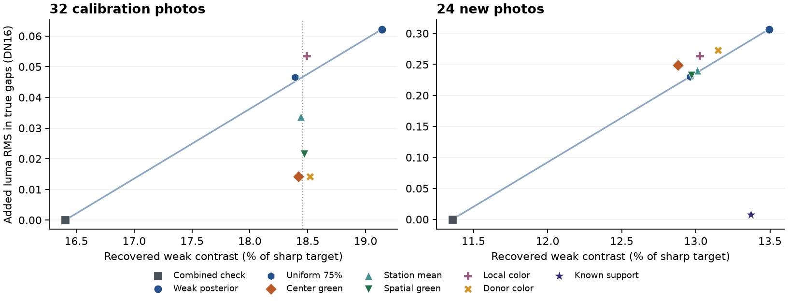
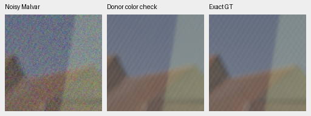
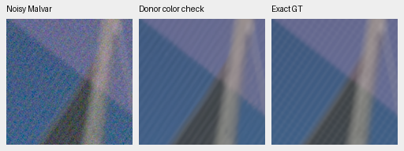

# Locating the weak Bayer correction

The [exterior-phase follow-up](local-phase-extent.md) checks a waveform fixed entirely outside the query. A 16-pixel local check reduces several large gap errors at equal recovery, while wider pooling gives little benefit on 32 new photos.

On 24 new ISO6400 photo-based fixtures, the [weak-only posterior](local-conditional-posterior.md) recovers **2.135 percentage points** more weak contrast than the combined check and lowers intact weak error by **1.576 DN16**. It adds **0.307 DN16** luma RMS in true gaps. Tests using reciprocal green or independent red and blue measurements leave as much or more added gap texture as uniformly scaling the weak correction at equal recovery. Supplying the true spatial support in a diagnostic lowers added gap RMS to **0.008 DN16** at nearly the full recovery.

## Measuring local support

The [combined broad and central check](local-nested-support.md) supplies the strong correction for every arm. Each method tapers the same weak-posterior increment. The reciprocal green check estimates a candidate from one Bayer green lattice and the disjoint 64-pixel ring, then tests its predicted gain on the other lattice. It removes smooth and strong-carrier terms and includes nuisance prediction uncertainty. The score is conditional on the same 192-pixel ranking, which sees both green lattices. Tests score either one 32-pixel delivery window or its four 16-pixel subwindows. The station-mean control uses a single weight, while the spatial arm bilinearly interpolates the same four weights.

The color checks keep the green estimate fixed. One learns the complex red/blue phase and amplitude relative to green from the ring. The other uses four exterior 128-pixel RAW patches with a phase-coherence check. Both score the fixed waveform against center red/blue residuals after projecting out the common nuisance, with the contribution of each color weighted by its estimated noise. Perturbation audits verify that changing held values leaves the corresponding fitted waveform unchanged. Replacing the whole query leaves the exterior frequency and color fit unchanged in the four audited layouts.

The 32-source calibration locks thresholds and blend weights at 75% of the full weak gain, or 18.457% recovered contrast. The best center and donor checks reduce added gap RMS from 0.047 to 0.014 DN16 on calibration, where their false weak projection rises by about 0.004 DN16. All held panels use the frozen weights. The equal-response checks reported below recompute the comparison dose after evaluation to isolate the effect of taper shape.

## Exact-target results

The 24 new sources cover strips, ellipses, smooth dips and contrast steps. Each uses two independent noise draws and six roles including the exact flat, edge and uniform controls. The source audit excludes earlier evaluation photos and matches against 559,808 recorded Local 50k training photo visits. The source recipe uses all four Bayer layouts, pre-Bayer blur σ 0.85, ISO6400 shot/read `0.00128 / 6.5536e-6`, exposure 0.33, black offset 0.03 and 16-bit ADC. Four frequency donors sit at least 48 pixels beyond the query, and the frozen parents use CUDA IEEE FP32.

| 24 new photos | Weak contrast recovered | Intact weak RMS (DN16) | False weak RMS in gaps (DN16) | Added gap luma RMS (DN16) |
| --- | ---: | ---: | ---: | ---: |
| Combined check | 11.359% | 42.699 | 3.112 | 0.000 |
| Weak posterior | **13.494%** | **41.123** | 3.199 | 0.307 |
| Uniform 75% of weak correction | 12.960% | 41.516 | 3.176 | 0.230 |
| Reciprocal green, whole center | 12.881% | 41.578 | 3.182 | 0.248 |
| Reciprocal green, station mean | 13.010% | 41.478 | 3.180 | 0.240 |
| Reciprocal green, spatial | 12.972% | 41.505 | 3.178 | 0.232 |
| Local ring color | 13.026% | 41.468 | 3.186 | 0.263 |
| Exterior donor color | 13.150% | 41.378 | 3.189 | 0.273 |

The full weak gain over combined is **+2.135 points** `[+1.355, +2.956]` with intact error **−1.576 DN16** `[−2.235, −0.960]` and false weak projection **+0.088 DN16** `[0.000, +0.257]`. Continuing strong error changes by −0.0004 DN16. Trials retain the same three nonzero flat-core changes already produced by the combined check, with 0.518 DN16 the maximum. All edge-only and uniform outputs match the parent. Intervals resample sources with both noise draws together, stratified by geometry. Gap metrics use the 12 photos with a true gap and average over the exact missing mask. False weak RMS measures projection onto that missing direction. Added luma RMS measures all pixel changes caused by the weak increment in that mask.

At exactly equal recovered contrast on the new panel, the spatial green check adds **+0.001 DN16** gap luma RMS versus uniform `[−0.012, +0.014]`. The exterior check is **+0.016 DN16** `[+0.0002, +0.044]`. It can score all 320 selected windows across the six fixture roles, up from 151 with the local color relation. On the prior 24-source panel, each taper also adds more gap luma RMS on average than the equal-response uniform control. On its largest outlier (`weak-side-07`, draw 0), the combined false projection is 4.117 DN16, the full weak fit is 5.980, the 75% control is 5.505 and the exterior color check is 5.771. The spatial green check does reduce equal-response gap luma RMS by 0.022 DN16 on the earlier retained 32 photos.

The **known-support diagnostic** averages the planted support within the same four 16-pixel subwindows and interpolates those weights. It uses the measured frequency, rank and weak correction, with access to the clean support map only for tapering. It recovers **13.370%** weak contrast with **0.008 DN16** added gap RMS. A uniform taper adjusted to 13.370% adds **0.289 DN16**. The paired difference is **−0.281 DN16** `[−0.793, −0.003]`. The large difference within the same spatial layout makes local support estimation a promising target.

The blue line shows uniform scaling from zero to the full weak correction. Calibration markers at the dotted line share a single recovered contrast and are offset slightly for readability. Each panel has its own axis scales. The purple star uses the clean support map.

## Native exact comparisons

Both native triplets use BGGR draw zero, a `[48,48,160,160]` crop in the `[128,128,256,256]` query, the ISO6400 conditions above and display exposure ×2 followed by sRGB. The restoration is the exterior donor color check over Local 50k EMA SHA256 `62f4e9ce84075c8df1a254a1889033b5787133e8c98c63e0ec3d174a94734959`. Exact GT is post-optics and pre-Bayer. The faint direction remains softer than GT and delivery differences among the tapers are subtle.

The strip uses Moonik's Church of Notre-Dame in Chatou photograph at bin-four crop `[24,226,512,512]`, adapted by binning, adding wires and simulating optics and noise. [All methods](assets/local-weak-support-v1/weak-support-01-comparison.png) · [Source](https://commons.wikimedia.org/wiki/File:Church_of_Notre-Dame_in_Chatou_004.jpg) · [CC BY-SA 3.0](https://creativecommons.org/licenses/by-sa/3.0).

The ellipse uses Tadeusz Hare's Broadmead sail photograph at bin-four crop `[102,418,512,512]` with the same adaptation. [All methods](assets/local-weak-support-v1/weak-support-09-comparison.png) · [Source](https://commons.wikimedia.org/wiki/File:Broadmead_sail_-_DSC_6823.jpg) · [CC BY-SA 4.0](https://creativecommons.org/licenses/by-sa/4.0).

The largest prior gap outlier uses Pudelek's Petronell bath photograph at bin-four crop `[52,6,512,512]` with the same adaptation and a GBRG mosaic. Faint irregular traces persist with the donor color check. [Triplet](assets/local-weak-support-v1/weak-side-07-triplet.png) · [All methods](assets/local-weak-support-v1/weak-side-07-comparison.png) · [Source](https://commons.wikimedia.org/wiki/File:Open_air_museum_Petronell_-_Basilica_thermarum_(beds).JPG) · [CC BY-SA 3.0](https://creativecommons.org/licenses/by-sa/3.0).

## Standing GFX100S comparisons

Sky, building and foliage are pixel-identical to Local 50k for every taper. The coarse chain-link keeps its connected crossings and subtle contrast differences. Relative to the combined check, the spatial taper changes the coarse fence by 3.87 DN16 RGB RMS and the donor color check by 4.22. The left cab uses the combined check in both profiles because the rank is ambiguous. On the right, the donor color check changes the combined output by 4.40 DN16 nominal and 4.88 DN16 transferred, compared with 3.70 and 4.11 for uniform 75%. The boards show minor diagonal contrast changes and no obvious added false color. The fine crossings remain incomplete and the transferred profile retains visible background mottle.

All 12 fixed native boards were visually reviewed. The 160-pixel main crop origins are sky `[5800,1400]`, building `[5790,2690]`, foliage `[8890,5570]` and fence `[2240,6000]`. Cab origins are `[806,6489]` and `[1026,6449]`. The Local 50k EMA is as above, with V120 Small EMA SHA256 `a9d9b6b4f974e24a6b11e5e740aab32314233a7f53c056cf37c7d2aac1c589fb` as the recommended-model comparison. Nominal shot/read is `0.00128 / 6.5536e-6`. The transferred cab uses `0.0014635775921166604 / 1.0715704128646712e-6`. The independently demosaiced ISO100 AHD crops and the two cab camera JPEGs are qualitative references. Their different exposure, aperture and moving subjects rule out pixelwise scoring. The native manifest binds RAWs, coordinates and display transforms.

| RAW and profile | Native boards |
| --- | --- |
| DSCF3879 nominal ×4 | [Sky](assets/local-weak-support-v1/main-overcast-sky-main-overcast-sky-x4.png) · [Building](assets/local-weak-support-v1/main-building-detail-main-building-detail-x4.png) · [Foliage](assets/local-weak-support-v1/main-foliage-main-foliage-x4.png) · [Coarse fence](assets/local-weak-support-v1/main-chain-link-fence-main-chain-link-fence-x4.png) |
| DSCF3842 nominal | [Left ×4](assets/local-weak-support-v1/mesh-nominal-fine-green-mesh-left-x4.png) · [Right ×4](assets/local-weak-support-v1/mesh-nominal-fine-green-mesh-right-x4.png) · [Left ×16](assets/local-weak-support-v1/mesh-nominal-fine-green-mesh-left-x16.png) · [Right ×16](assets/local-weak-support-v1/mesh-nominal-fine-green-mesh-right-x16.png) |
| DSCF3842 transferred | [Left ×4](assets/local-weak-support-v1/mesh-profile3879-fine-green-mesh-left-x4.png) · [Right ×4](assets/local-weak-support-v1/mesh-profile3879-fine-green-mesh-right-x4.png) · [Left ×16](assets/local-weak-support-v1/mesh-profile3879-fine-green-mesh-left-x16.png) · [Right ×16](assets/local-weak-support-v1/mesh-profile3879-fine-green-mesh-right-x16.png) |

This crop replay uses frozen weights. Both the fixed 427-photo panel and the known/unseen camera panels are outside its scope. The existing [weak-posterior crop option](local-conditional-posterior.md#use-the-crop-option) remains the supported implementation from this line of experiments.

[Paired results](results/local-weak-support-v1/summary.json) · [Native manifest](assets/local-weak-support-v1/manifest.json) · [Publication hashes](results/local-weak-support-v1/publication.json) · [Frozen evidence](results/local-weak-support-v1/evidence.tar.xz).
