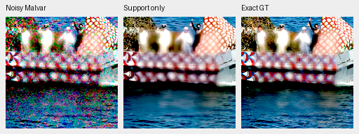
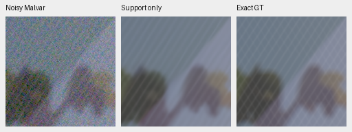

# Learning where to apply a weak-wire correction

Training the confidence gate on paired wire continuations and double gaps
recovers **0.52 weak-wire response points** above the frozen parent and
adds **0.18 DN16** of exact-flat wire error. At nearly the same measured
response as the earlier gain-floor head, this cuts the flat penalty by
**0.17 DN16**. Adding a dense signed target to the proposal reduces its
amplitude and most of the recovery. The main GFX scene keeps a smooth
sky and coherent coarse crossings. Fine cab crossings remain incomplete.

[Machine results](results/local-phase-support-v1/publication.json) ·
[Native crop provenance](images/local-phase-support-v1/manifest.json) ·
[Frozen drivers and receipts](results/local-phase-support-v1/evidence.tar.xz).

The [exterior RAW follow-up](wire-exterior-verification.md) tests actual
Bayer evidence for a continuation in place of a learned gate and compares
the delivered luma changes on the frozen parent.

## Matched training

Both arms freeze the aligned-control EMA
`e1e706a7c5a49da96dfb77a7779126504a2aa85d8626567a09d4690b0b30b9ec`.
They share the same 74,088-parameter native luminance head and
post-gate band filter. Its local guide uses the Bayer residual, camera
noise, CFA phase, restored luminance and neighborhood contrast. The
delivered correction is neutral in linear working RGB. Both sigmoid
gates can go to zero. [Parent and earlier correction study](local-factored-wire.md).

Each of 240 wire backgrounds supplies a pair with identical exterior,
photographic background and weak wire. Only the existing strong wire
inside the localized gap changes between pair members. Another 240
sources provide the same natural present/absent contrast controls as
before. The sources come from the approved 90,692-photo manifest and
are disjoint from the earlier local trial schedules. The 32 cells
balance content, nominal ISO400 and ISO6400, the four CFA patterns,
and coupled or independent Bayer noise. Each update uses two draws of
the pair, one exact-flat crop and one ordinary crop. Eight separate
photos qualify the run.

Both heads receive signed paired response, independent-repeat, absolute
reconstruction and quiet-region losses. A 0.0015-weight confidence loss
opens the gate around the exact strong change and penalizes activation
on the corresponding double gap and exact flat. In the signed-phase arm,
an additional loss of weight 2 teaches the ungated proposal the clean
signed difference scaled by the fraction of the waveform missing from
the frozen parent's redraw-averaged response. This loss reaches the
proposal even if the gate is closed. Both outputs share the head's
features. All targets and redraws enter training only. Inference uses
one noisy Bayer frame and its conditioning.

The earlier gain floor uses a different source schedule and pairs with a
weak-direction intervention. Its comparison describes the net effect of
the newer recipe. The two current arms share schedules, source inputs and
labels, which isolates the added ungated signed loss.

| Correction | Updates | Native observations | Checkpoint SHA256 |
| --- | ---: | ---: | --- |
| Support only | 480 | 2,880 | `18ae7cca2c9e5fb57243ddc96c96f70a258416c130c7516400ae80047e78b5ed` |
| Signed phase and support | 480 | 2,880 | `bd6dd14abbee216032515e392f12f092c253873e1d1fdb36777e1f04e107e6b4` |

The interleaved run takes 499.40 s including observation preparation,
using BF16 neural arithmetic and FP32 sensor arithmetic and losses.
464 paired cores pass the full-band validity check. The checkpoints
store raw and EMA weights separately. Evaluation uses the composed
correction EMA and frozen parent EMA in CUDA IEEE FP32.
[Training audit](results/local-phase-support-v1/training.json).

## Fixed exact ISO6400 replay

| Metric | Aligned control | 0.25 gain floor | Support only | Signed phase and support | V120 |
| --- | ---: | ---: | ---: | ---: | ---: |
| Strong response, 12 gaps | 46.88% | 47.19% | 47.34% | 46.91% | 53.65% |
| Weak response, 24 wires | 24.91% | 25.40% | 25.43% | 24.97% | 31.83% |
| Total gap RMS | 170.26 | 169.94 | 169.93 | 170.23 | 171.20 |
| Intact wire RMS | 168.17 | 168.69 | 168.81 | 168.22 | 187.93 |
| Exact-flat wire RMS | 19.19 | 19.54 | 19.37 | 19.21 | 22.56 |
| Natural fine response, 24 crops | 56.92% | 57.10% | 57.24% | 56.96% | 58.22% |
| Natural fine-increment RMS | 134.81 | 134.86 | 134.94 | 134.82 | 137.34 |
| Natural exact-flat fine RMS | 4.11 | 4.31 | 4.31 | 4.13 | 5.73 |

RMS is in DN16. The full-trunk continuing-wire loss recovers 63.74%
strong response with 159.65 DN16 total gap RMS and 23.83 DN16 exact-flat
wire RMS. The support-only head keeps more of the aligned parent's
quiet behavior. Its weak response changes by +0.023 points relative to
the gain floor, with 0.168 DN16 lower exact-flat wire RMS and 0.115 DN16
higher intact-wire RMS. The paired interval for the weak response
change is −0.072 to +0.116 points, and the flat-error interval is
−0.203 to −0.133 DN16. Its natural flat fine RMS is close to the gain
floor, with stronger fine response and higher increment RMS.
Both new heads preserve the parent's flat chroma in this exact replay.

The signed-phase objective reduces median delivered luma RMS from
3.27 to 0.24 DN16 on wires, while the median confidence logits are
−2.47 and −2.38. The exact continuing direction accounts for 5.31% of
pooled correction energy with support only and 6.64% with signed phase.
The mean aligned lift nevertheless falls from 0.91 to 0.07 DN16.
Matching natural flat error with a 7.24× scalar on the signed-phase
lift still gives lower held-out wire response than support only
(25.30% versus 25.43% weak, 47.13% versus 47.34% strong), with nearly
identical wire-flat RMS. The signed objective's reduction in response
is mostly explained by amplitude, with a remaining shortfall after
matching flat error. [Aligned energy](results/local-phase-support-v1/phase-attribution.json) ·
[Amplitude diagnostic](results/local-phase-support-v1/matched-lift.json).

The triplets below show the unchanged native pixels of noisy Malvar,
support-only EMA and exact GT. Each panel is a 160×160 crop at
`(48,48,160,160)` within the recorded 256×256 query. The ISO6400
shot/read are `0.00128/6.5536e-6`, with black 0.03 and 16-bit ADC.
*Navy Day Sevastopol 2012 G15.jpg* uses query `(524,234,256,256)`,
display exposure ×3.03, and contrast ×2 around the reference mean.
The wires on *Swinhoe's minivet2.jpg* use query `(128,128,256,256)`,
display exposure ×2 and contrast ×1. The manifest binds the source,
noise, viewing transform and both composed checkpoint identities.

## Counterfactual continuation and independent redraws

On 16 separate double-gap backgrounds, support only raises true strong
response from 67.20% to 68.03% and lowers false strong-line RMS from
17.15 to 16.70 DN16. Exact-flat RMS rises from 11.19 to 11.44 DN16.
The earlier gain floor reaches 67.65%, 17.05 DN16 false-line RMS and
11.62 DN16 flat RMS. The signed-phase head has 67.31% response,
17.09 DN16 false-line RMS and 11.22 DN16 flat RMS.
Relative to the gain floor, the support-only continuation gain is
0.382 points [0.077, 0.715]. The false-line RMS change is −0.346 DN16
[−0.746, +0.007] and flat RMS changes −0.186 DN16 [−0.266, −0.108].

The gate opens more in textured regions than in flat controls. Over
locations weighted by the exact signal difference, support-only mean
gain is 24.63% with a continuing wire, 24.48% with a double gap and
3.94% on the exact flat. The true-minus-double difference is
0.159 percentage points with a paired 95% interval of 0.003 to 0.313.
The gate learns a much larger distinction between flat and busy
regions than between a real wire and a continuation through the same
busy background.

On 16 other backgrounds with three independent redraws, support only
recovers 25.91% weak response, close to the gain floor's 25.92%. Its
total gap RMS is 144.37 versus 144.41 DN16 in the eight cases with
gaps, and its flat RMS is 17.53 versus 17.70 DN16. RMS associated
with draw variance is essentially unchanged at 142.92 versus 142.85
DN16. The signed-phase arm stays close to the frozen parent at 25.44%
response and 17.38 DN16 flat RMS.

## Standing GFX100S comparisons

Both heads use the fixed DSCF3879 ISO6400 and DSCF3880 ISO100 scene,
native coordinates, nominal `0.00128/6.5536e-6` conditioning and ×4
display exposure. Support-only luma change is 0.63 DN16 RMS in the
overcast sky, 4.35 in building detail, 7.74 in foliage and 2.96 in the
coarse fence. The sky stays smooth. Coarse crossings remain coherent
and small cables, bracing and leaf subdivisions remain soft against
the independently demosaiced ISO100 reference.

- [Sky](images/local-phase-support-v1/standing/main-overcast-sky-main-overcast-sky.png)
- [Building detail](images/local-phase-support-v1/standing/main-building-detail-main-building-detail.png)
- [Foliage](images/local-phase-support-v1/standing/main-foliage-main-foliage.png)
- [Chain-link fence](images/local-phase-support-v1/standing/main-chain-link-fence-main-chain-link-fence.png)

The fine green DSCF3842 and DSCF3835 cab mesh uses both native ROIs,
the nominal and transferred DSCF3879 profile, both camera JPEGs and
the independent low-ISO AHD reference. Both the configured ×4 and
brighter ×16 comparison retain exact crop pixels. The support-only
lift spans 0.44–1.29 DN16 luma RMS. The transferred right view retains
the clearest existing diagonals. Both heads leave the same obvious
missing crossings and the nominal left remains largely unresolved.
The low-ISO views are qualitative references with differences in
aperture, exposure time and the scene's movement.

| Display | Nominal conditioning | Transferred conditioning |
| --- | --- | --- |
| ×4 configured | [Left](images/local-phase-support-v1/configured/mesh-nominal-fine-green-mesh-left-configured.png) · [Right](images/local-phase-support-v1/configured/mesh-nominal-fine-green-mesh-right-configured.png) | [Left](images/local-phase-support-v1/configured/mesh-profile3879-fine-green-mesh-left-configured.png) · [Right](images/local-phase-support-v1/configured/mesh-profile3879-fine-green-mesh-right-configured.png) |
| ×16 brighter | [Left](images/local-phase-support-v1/standing/mesh-nominal-fine-green-mesh-left.png) · [Right](images/local-phase-support-v1/standing/mesh-nominal-fine-green-mesh-right.png) | [Left](images/local-phase-support-v1/standing/mesh-profile3879-fine-green-mesh-left.png) · [Right](images/local-phase-support-v1/standing/mesh-profile3879-fine-green-mesh-right.png) |

[Main capture configuration](../configs/gfx-qualitative-20231231.json) ·
[Cab mesh configuration](../configs/gfx-green-mesh-20231231.json).

## Fixed camera panels

All 72 known and 90 unseen measured-CFA crops use the canonical
Bayer arrays and conditioning. The frozen parent reproduces the saved
fingerprints on all 54 batches. Scores are mean sensor PSNR in dB.

| Composed endpoint | Known camera | Unseen camera |
| --- | ---: | ---: |
| V120 EMA | 54.31272 | 54.00872 |
| Aligned control EMA | 54.24247 | 54.03699 |
| Full-trunk continuing-wire loss EMA | 54.22001 | 53.90793 |
| Earlier 0.25 gain-floor EMA | 54.24268 | 54.03296 |
| Support-only EMA | 54.24343 | 54.03278 |
| Signed phase and support EMA | 54.24227 | 54.03658 |

Support only changes the known mean by +0.00096 dB and the unseen mean
by −0.00421 dB against the frozen parent. Its worst unseen per-crop
change is −0.05526 dB. V120 leads the known mean by 0.06929 dB and
trails the unseen mean by 0.02406 dB. V120 is the general-use
recommendation.

Training, scoped numerical evaluation and native-image viewing are
complete. The fixed 427-photo measurement is absent for this
frozen-component study. The camera scores are recorded with their
scoped receipts and the full-model panels retain their coverage in
[PSNR history](performance-history.md).
