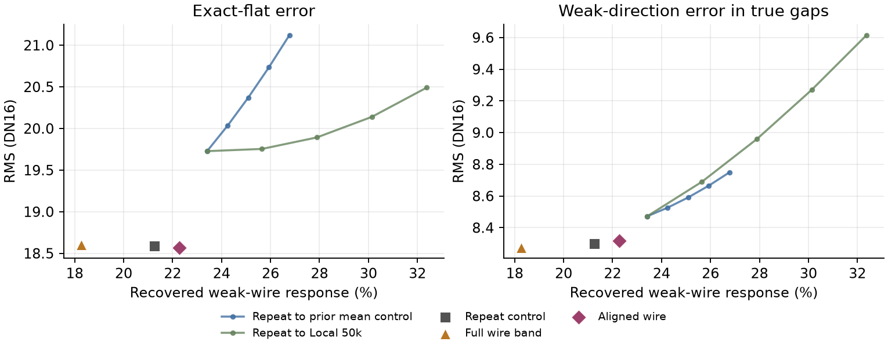
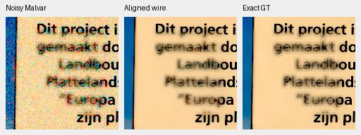
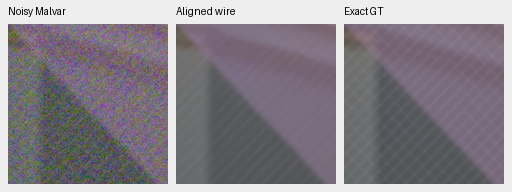

# Signed supervision for faint wire recovery

Supervising the clean weak-wire direction directly recovers **1.02 more
percentage points** of weak-wire response than a matched repeat-loss
continuation. Exact-flat RMS changes by **−0.021 DN16**, and weak-direction
error in true gaps changes by **+0.017 DN16**. Both intervals include zero.
The aligned model recovers 1.13 fewer points than its starting checkpoint,
with lower intact-wire and flat error and higher total gap error. The
fine cab crossings remain incomplete.

[Machine results](results/local-wire-response-v1/publication.json) ·
[Native provenance](images/local-wire-response-v1/manifest.json) ·
[Previous repeat-loss experiment](local-redraw-stability.md).

## Method

The three arms start from the repeat-loss EMA
`cc5a3cd5d33096f9696d250627d380ecc2f0ed53971da8c2d3f9772550cf9a7a`.
Each arm updates the full local trunk and context projections with frozen
DINO. Every update uses two independently redrawn present/absent pairs, one
exact-flat crop and one ordinary crop. The 320 source photos are split
across natural and wire targets, ISO400 and ISO6400, all four Bayer layouts,
and coupled and independent noise inside a pair. The eight qualification
photos and the new schedule avoid both earlier redraw schedules. All are
from the approved scene-continuation corpus.

The three arms retain absolute reconstruction on all six observations,
the 0.8-weighted band loss on the mean signed increment error, and the
0.5-weighted repeat penalty on independent-noise pairs. On wire updates,
**Full wire band** adds a second full-band mean loss with weight 1.6.
**Aligned wire** uses the same weight on a signed projection of the mean
error along the exact weak increment. **Repeat control** uses the shared
losses alone.

The aligned loss forms the Hann-windowed Fourier coefficients of the clean
luminance increment. Within each existing band, it projects the error onto
that target vector and divides by its RMS. The result has the same units as
band RMS. The shared losses still penalize off-template errors, noise that
changes between draws, and errors in absolute color and gaps. Clean phase
and the redraws are training targets. All three inference paths take a
single noisy Bayer input with the same architecture.

| Arm | Updates | Native observations | Checkpoint SHA256 |
| --- | ---: | ---: | --- |
| Repeat control | 320 | 1,920 | `2bad84bdb90e98811fa34e2a6991edf9e661961db9139d3396e09ff17bca7e9a` |
| Full wire band | 320 | 1,920 | `6af82eaed3b9b9f5a1b07bef09db8b4c0b2caea96b09bc246e5114cc91cc4d2e` |
| Aligned wire | 320 | 1,920 | `964c9dd75d2cd75d12a57391a978e1505dd7ece47e3df4565b441356cafadd6e` |

The interleaved GB10 training loop took 1,067.96 s including data and
hashing. It used BF16 neural forwards and FP32 camera arithmetic and
losses. Three hundred and ten of 320 clean paired cores were valid for
the frequency losses. The eight-update qualification confirms identical
initial predictions and finite gradients. Each checkpoint stores raw
and EMA weights. The evaluations use the EMA with CUDA IEEE FP32.
The aligned loss was about 9% of the full-band loss in the repeat
control’s median active wire update, before multiplying by 1.6.
[Training audit](results/local-wire-response-v1/training.json) ·
[Frozen protocol and receipts](results/local-wire-response-v1/evidence.tar.xz).

## Where the repeat parent loses the wire

Sixteen reserved backgrounds have crossed planted wires, with ellipse gaps,
strip gaps, smooth contrast dips and contrast steps. The four geometry
families cross the four Bayer layouts once each. Every target has three
independent ISO6400 Bayer draws at `0.00128/6.5536e-6`, exposure ×0.33.
The source photos are separate from the fixed 48-source comparison. Eight
contain a region where the absent weak direction is exactly zero.

The repeat parent recovers **23.32%** of the weak increment. On intact wire
pixels, **0.113%** of the draw-sensitive variance lies along the exact weak
increment, with a source-bootstrap interval of [0.039%, 0.239%]. That
same direction accounts for **93.07%** of the error shared across draws
[88.82%, 97.35%]. The along-template error is consistent attenuation. The
noise penalty mostly sees errors outside the true increment. The two
components come from squared projections of the physically redrawn errors
and cross-products of separate draws on the same clean target.

Two fixed blends of earlier outputs establish comparison curves on 24 other
wire fields. Mixing 25% Local 50k into the repeat parent recovers **2.24
points** more weak-wire response [2.00, 2.45] while adding **0.027 DN16** of
exact-flat RMS [−0.091, 0.137]. Error along the absent weak direction
inside gaps rises **0.218 DN16** [0.080, 0.370]. The same fraction of the
earlier mean control gains 0.84 points and adds 0.308 DN16 of flat RMS.
Those blends measure a tradeoff on exact held-out targets.
[Three-draw parent analysis](results/local-wire-response-v1/parent-variance.json) ·
[Earlier output curves](results/local-wire-response-v1/prior-wire-curve.json).

## Fixed exact ISO6400 observations

The unchanged panel includes 24 natural and 24 wire fields. Half the
wire fields contain an exact weak-wire gap. Natural RMS pools squared
errors by source. Wire RMS averages source measurements. Intervals in the
text use source-paired bootstraps.

| EMA | Natural fine response | Natural fine increment RMS (DN16) | Weak-wire response | Intact wire RMS (DN16) | Wire flat RMS (DN16) | Weak gap RMS (DN16) | Total gap RMS (DN16) |
| --- | ---: | ---: | ---: | ---: | ---: | ---: | ---: | ---: |
| V120 | 58.224% | 137.344 | 31.834% | 187.930 | 22.557 | 9.463 | 171.203 |
| Corpus 100k | 58.314% | 137.447 | 32.230% | 187.859 | 22.196 | 9.801 | 169.208 |
| Local 50k | 58.010% | 136.335 | 32.377% | 188.074 | 20.490 | 9.615 | 168.488 |
| Repeat parent | 59.531% | 135.909 | 23.409% | 171.479 | 19.728 | 8.471 | 165.577 |
| Repeat control | 56.652% | 135.210 | 21.264% | 160.195 | 18.590 | 8.299 | 174.965 |
| Full wire band | 54.650% | 135.693 | 18.257% | 154.261 | 18.601 | 8.274 | 181.885 |
| Aligned wire | 56.691% | 135.198 | 22.284% | 161.192 | 18.569 | 8.316 | 173.966 |

The aligned gain over the matched repeat control spans +0.851 to +1.203
points on wires. Intact increment RMS rises 0.997 DN16 [0.719, 1.260]
and total gap RMS falls 0.999 DN16 [−1.414, −0.568]. The changes in exact
flat error and weak-direction gap RMS span zero. Natural fine response
changes +0.039 points [−0.035, 0.108] with a 0.039 DN16 increase in
natural exact-flat fine RMS. Full-band supervision reduces wire response
by 3.01 points and natural fine response by 2.00 points while lowering
total intact-wire RMS.

The new endpoints fall below the prior fixed mixture curves in response.
A second comparison uses an interpolation from the new repeat control
back to its starting checkpoint. Twelve sources set the mixture to 42.17%
of the starting checkpoint at the aligned arm's mean response. On the
other twelve, the residual response difference is +0.23 points with an
interval [−0.11, +0.61]. The aligned arm lowers intact-wire RMS by 3.58
DN16 [−4.12, −3.01] and exact-flat RMS by 0.478 DN16 [−0.668, −0.289].
On the six gaps in that half, weak-direction gap RMS rises 0.063 DN16
[0.025, 0.102] and total gap RMS rises 4.71 DN16 [2.05, 7.77].
[Disjoint mixture calibration](results/local-wire-response-v1/matched-repeat-parent.json).

## Transfer to three wire redraws

The reserved backgrounds from the parent diagnostic are independent
of the fixed 48-field panel. Each row here averages 16 source scores.
True-gap columns use the eight sources with a zero weak component.

| EMA | Weak response | Intact RMS (DN16) | Draw-sensitive variance (DN16²) | Shared error (DN16²) | Exact-flat RMS (DN16) | Weak gap RMS (DN16) | Total gap RMS (DN16) |
| --- | ---: | ---: | ---: | ---: | ---: | ---: | ---: | ---: |
| Repeat parent | 23.321% | 165.561 | 20,394.2 | 7,700.9 | 17.730 | 8.108 | 143.638 |
| Repeat control | 20.181% | 155.223 | 16,469.7 | 8,207.2 | 16.731 | 7.789 | 150.445 |
| Full wire band | 16.879% | 149.230 | 13,920.7 | 8,852.2 | 16.672 | 7.640 | 159.590 |
| Aligned wire | 21.442% | 155.936 | 16,949.9 | 7,974.4 | 16.725 | 7.814 | 149.460 |

Aligned supervision gains **1.260 points** [1.035, 1.475] against the
matched repeat control and lowers shared error by 232.8 DN16²
[−288.7, −177.7]. Draw-sensitive variance increases 480.2 DN16²
[373.6, 594.2], or 2.9%. The clean-template component contributes
just 1.19 DN16² of that increase. Total gap RMS falls 0.984 DN16
[−1.483, −0.500]. Exact-flat RMS changes by −0.005 DN16 [−0.066, 0.060]
and the weak-direction gap component changes +0.025 DN16 [−0.062, 0.106].

Relative to its starting checkpoint, the aligned model reduces variance
by 16.9% and intact RMS by 9.62 DN16. It recovers 1.88 fewer response
points and adds 5.82 DN16 of total gap error. The weak-direction gap
component falls 0.294 DN16. Total gap RMS measures the full gap luminance residual. [Fresh source-level measurements](results/local-wire-response-v1/publication.json).

### Which detail is lost inside the gaps

On the 12 exact gaps in the fixed panel, the aligned endpoint adds
2,711 DN16² of mean luminance MSE versus the starting repeat checkpoint.
Projection shows +3,497 DN16² [2,246, 5,084] in the continuing strong
wire's frequency subspace, compared with −3.4 DN16² in the absent weak
subspace. Background and edge error changes by +93 DN16² and the
remaining error falls 875 DN16². The strong-subspace change is mainly
attenuation. Clean-target response along its continuing shape falls
from 52.15% to 42.90%, a change of −9.24 points [−12.02, −6.90]. The
strong band's error orthogonal to that target falls 336 DN16². The
matched repeat continuation falls to 41.99% while the broader band
loss falls to 36.83%.
[Gap error by frequency and background](results/local-wire-response-v1/gap-attribution.json) ·
[Signed strong-band response](results/local-wire-response-v1/gap-signed.json).

A diagnostic replaces only the new model's projection along the exact
clean strong component by the starting model's projection. Orthogonality
lets the other errors retain their measured values. Mean gap RMS would
fall from 173.97 to 161.67 DN16, 3.91 DN16 below the starting model
[−5.79, −2.24]. The calculation uses the known clean gap and confirms
how much the lost strong response matters. [Component replacement calculation](results/local-wire-response-v1/gap-component-bound.json).

## Natural photos across three draws

Sixteen other source-disjoint photographs replay the established natural
faint-texture panel with three complete redraws per noise law. Under
independent noise, aligned changes fine response by −0.008 points and
draw variance by +15.0 DN16² versus the repeat control. Both intervals
include zero. Fine-increment RMS rises 0.108 DN16 [0.060, 0.162], and
exact-flat fine RMS rises 0.036 DN16 [0.022, 0.050]. Under coupled noise,
its increment RMS change is −0.012 DN16 [−0.100, 0.080]. The full-band
arm loses 1.51 points of independent natural response and 1.52 points
of coupled response relative to the repeat control.
[Per-source natural results](results/local-wire-response-v1/publication.json).

## Native exact-target triplets

Each cell contains 160 × 160 unchanged pixels at `[48,48,160,160]`
in the 256-pixel query. The triplets show noisy Malvar, the aligned
wire EMA `964c9dd7…356cafadd6e` and the exact target. All use ISO6400
shot/read `0.00128/6.5536e-6`, capture exposure ×0.33, 16-bit ADC,
black 0.03 and RGGB Bayer. The four comparison boards show the
extrema of aligned-vs-repeat changes in natural fine-increment RMS
and weak-direction gap RMS.

**Oostvaardersplassen sign**, Dominicus Johannes Bergsma, CC BY-SA 4.0.
The query begins at `[134,200]`. Display exposure is ×3.03 and
contrast is ×2 about the linear target mean. Fine lettering and the
blue frame remain soft. [All methods](images/local-wire-response-v1/exact/45-natural-iso6400-comparison.png).

**Crossed wires on a Rhodes church background**, A.Savin, CC BY-SA 3.0.
The query is `[128,128,256,256]` inside the field. Display exposure ×2,
contrast ×1. The surviving strong wire remains visible. Much of the
weak crossing direction is lost. [All methods](images/local-wire-response-v1/exact/16-wire-iso6400-comparison.png).

[Razor line detail](images/local-wire-response-v1/exact/29-natural-iso6400-comparison.png) ·
[Wire field over a dune](images/local-wire-response-v1/exact/04-wire-iso6400-comparison.png) ·
[Sources, licenses and coordinates](images/local-wire-response-v1/manifest.json).

## Standing GFX100S comparisons

All eight 160-pixel crops were reviewed at native scale. Main DSCF3879
uses nominal `0.00128/6.5536e-6` and display ×4. The sky stays smooth.
Coarse chain-link crossings remain coherent. Fine bracing, cables and
leaf subdivisions stay soft, particularly in the full-band arm. The
aligned crop changes 2.77–19.02 DN16 RGB RMS against the parent across
these four fields.

The DSCF3842 cab uses display ×16, both established noise profiles and
both camera JPEGs. Both left views retain a mostly unresolved lattice.
The right views keep soft diagonals, clearest under the transferred
profile `0.0014635775921166604/1.0715704128646712e-6`. The stronger
full-band weight softens several existing traces. The aligned arm and
matched repeat control look alike and leave fine crossings incomplete.
No conspicuous new colored patches or periodic sky texture were visible.
DSCF3880/DSCF3835 ISO100 AHD and camera JPEGs are qualitative references
from different exposure, aperture and moments.

| Capture and conditioning | Native comparisons |
| --- | --- |
| Main DSCF3879, nominal | [Sky](images/local-wire-response-v1/standing/main-overcast-sky-main-overcast-sky.png) · [Building](images/local-wire-response-v1/standing/main-building-detail-main-building-detail.png) · [Foliage](images/local-wire-response-v1/standing/main-foliage-main-foliage.png) · [Coarse fence](images/local-wire-response-v1/standing/main-chain-link-fence-main-chain-link-fence.png) |
| Cab DSCF3842, nominal | [Left](images/local-wire-response-v1/standing/mesh-nominal-fine-green-mesh-left.png) · [Right](images/local-wire-response-v1/standing/mesh-nominal-fine-green-mesh-right.png) |
| Cab DSCF3842, transferred | [Left](images/local-wire-response-v1/standing/mesh-profile3879-fine-green-mesh-left.png) · [Right](images/local-wire-response-v1/standing/mesh-profile3879-fine-green-mesh-right.png) |

[Main comparison map](gfx-qualitative.md) · [Cab comparison map](gfx-green-mesh.md) ·
[Native provenance](images/local-wire-response-v1/manifest.json).

## Fixed camera panels

Both measured-CFA panels are complete. The 72 known and 90 unseen
crops use the fixed Bayer arrays and scoring borders with CUDA IEEE FP32.
V120 and the repeat parent reuse their archived, byte-matched case
receipts. The eight-case qualification also replays V120 and agrees
with the saved CPU reference scores within 0.000008 dB.

| EMA | Known CFA PSNR | Unseen CFA PSNR |
| --- | ---: | ---: |
| V120 | 54.31272 dB | 54.00872 dB |
| Corpus 100k | 54.33708 dB | 53.97826 dB |
| Repeat parent | 54.19868 dB | 54.01346 dB |
| Repeat control | 54.22980 dB | 54.00495 dB |
| Full wire band | 54.22485 dB | 54.03753 dB |
| Aligned wire | 54.24324 dB | 54.00481 dB |

Aligned supervision gains 0.04456 dB known over the starting model and
loses 0.00865 dB unseen. Against its matched control it gains 0.01344 dB
known and changes the unseen result by −0.00014 dB. Against V120 it
trails by 0.06948 dB known and 0.00392 dB unseen. The full-band arm leads
V120 by 0.02881 dB unseen, with weaker fine-detail recovery on both
exact wire cohorts. The unseen comparison covers five scenes.

The canonical 427-photo worker is running on the three listed EMAs.
V120 and Corpus 100k have completed fixed photo results. The three
new full427 scores remain pending. [Camera summary](results/local-wire-response-camera-v1/publication.json) ·
[Per-case camera evidence](results/local-wire-response-camera-v1/evidence.tar.xz) ·
[Comparable PSNR history](performance-history.md).
