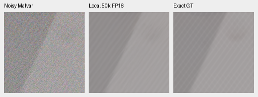
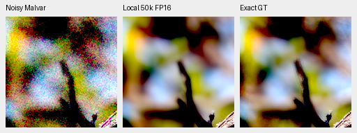

# Guarding near-saturated tiles during FP16 inference

On the full 102 MP DSCF3879 RAW, the local 50k EMA restores in **89.76 s
with eager FP16, 182.25 s with a near-saturation guard, and 561.10 s
with IEEE FP32**. The guard routes 131 of 520 tiles to FP32. Within
five pixels of a near-saturated RAW sample, every guarded RGB16 code
matches the IEEE FP32 export within one DN16. The pure FP16 export
differs by as much as 47 codes in that region.

[Machine results](results/local50000-guarded-v1/publication.json) ·
[Frozen drivers and receipts](results/local50000-guarded-v1/evidence.tar.xz) ·
[Native crop provenance](images/local50000-guarded-v1/manifest.json).

## Runtime and precision policy

All three arms use local 50k EMA SHA256
`62f4e9ce84075c8df1a254a1889033b5787133e8c98c63e0ec3d174a94734959`,
Bayer RGGB, shot/read `0.00128/6.5536e-6`, 512-pixel tiles,
64-pixel overlap and batches of four. The guarded arm splits a batch
only when its tiles take different paths. Any tile containing a
normalized Bayer sample at or above 0.98 uses IEEE FP32. Other tiles
use the standard FP16 autocast path. Tile coordinates, native FP32
camera arithmetic, overlap blending and unsigned 16-bit encoding
are shared.

| Policy | Restore and blend | RGB16 export | FP32 tiles |
| --- | ---: | ---: | ---: |
| IEEE FP32 | 561.10 s | 1.10 s | 520 |
| Eager FP16 | 89.76 s | 1.15 s | 0 |
| Guarded FP16 | 182.25 s | 0.74 s | 131 |

These are single sequential runs on a shared GB10 with other
evaluations active. They measure the end-to-end restore and RGB16
stage separately. The 12-repeat, interleaved resident test measures
FP16 at 6.19× the IEEE FP32 throughput for this checkpoint.
The guard is an experimental driver. The supported Corpus 100k CLI
continues to use ordinary `--precision float16`.
[Matched resident FP16 timings](local-50000-scoped.md#fp16-inference-at-fixed-geometry) ·
[Corpus 100k CLI quality and throughput](corpus100k-fp16-throughput.md).

## Output fidelity

The table compares exported camera-RGB codes to the full IEEE FP32
TIFF. Near saturation means within a square five-pixel radius of a
Bayer sample at or above 0.98. The same input mask is used for both
policies. It covers 1,105,584 channel codes out of 305,987,556.

| Policy | Whole-frame RMS, DN16 | Near-saturation RMS, DN16 | Maximum near saturation | Whole-frame codes within one DN16 |
| --- | ---: | ---: | ---: | ---: |
| Eager FP16 | 0.304 | 2.494 | 47 | 99.806% |
| Guarded FP16 | 0.215 | 0.046 | 1 | 99.947% |

The guarded full-frame maximum is 29 DN16 away from the
near-saturation mask. Four canonical overexposure batches, one per
Bayer layout, route all sixteen cases to IEEE FP32 and produce exactly
the same outputs as the IEEE FP32 replay. Those cases include the
canonical excerpt where eager FP16 moves the most affected batch by
38.26 DN16 RGB RMS. The guard's full-frame timing and output metrics
cover one photograph. The FP16 canonical checks cover a fixed excerpt
of the photo and camera panels.
[Canonical FP16 excerpt](results/local50000-fp16-v1/fixed-panel-excerpt.json) ·
[Guarded highlight receipt](results/local50000-guarded-v1/publication.json).

## Native crops

The sky stays smooth, coarse fence crossings remain coherent, and the
fine building cables and foliage look similarly soft in all three
full-frame restores. The largest pure FP16 difference is at magenta
signage, at native ROI `[8323,3346,160,160]` and display ×1. The
largest guarded difference is near a blue point at
`[4231,4798,160,160]`, also at display ×1. Both retain their apparent
shape. See the standing report for the independent ISO100 references
and the separate fine cab crop comparisons.
[Standing and largest-change sheet](images/local50000-guarded-v1/native-sheet.png) ·
[Main and cab references](local-50000-scoped.md#standing-gfx100s-comparisons).

The two exact-target FP16 triplets below use this same EMA, display
transforms and fixed 160-pixel ROI. The wire source, woodpecker source,
shot/read and complete query coordinates are recorded with the same
checkpoint's FP16 crop review.
[Exact target provenance](images/local50000-fp16-v1/manifest.json) ·
[Sources and exposure](local-50000-scoped.md#fp16-inference-at-fixed-geometry).

