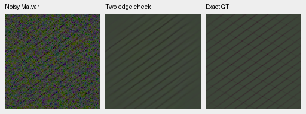
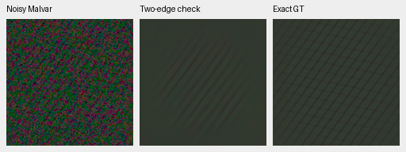

# Validating localized RAW detail beside rails and edges

Matching smaller regions finds repeatable donor signals where only
part of a patch contains the same surface. It also makes edge
artifacts easier to mistake for a carrier. On the independent
rail-only diagnostic, a two-edge background model lowers false
guide acceptance from **23/24 to 2/24** compared with the refined
single-edge fit. The positive-noise GFX cab views still have missing
fine crossings. Returning to V120 when no guide passes removes the
diagonal banding left by the older fallback.

The [window-search follow-up](scene-window-donors.md) lifts the
fixed-bracket constraint and compares full and near appearance
against spectral ranking with the same confirmation.

## Fixed brackets and reserved samples

The real donor boxes are fixed by the saved
[appearance-first run](affinity-first-donors.md). The experiment
compares their whole-patch spectra with half-width and three-quarter
width windows inside them, keeping the relative orientation and
opposing-side constraints. One window pair is selected from the
screening RAW sites. Both reserved folds in both donors must confirm
each proposed direction after refitting the background on the
opposite fold. A lower screening threshold on the quieter donor is
tested separately, with the same held-out requirement.

The refined-edge arm searches the complete offset range and then
refines the angle of an affine-plus-step nuisance fit. The query
screening arm uses the same local candidates and orders them by
A-only query spectral benefit. Each family's contribution is
`log(1 + max(0, benefit - 2))`, with donor score breaking ties.
Both arms reserve the same Bayer samples for final query testing.

The two-edge check keeps the refined donor nominations. Within each
validation fit it optimizes a second boundary parallel to the first
and considers three nearby angles. It uses the two-boundary model if
the training residual drops by more than 12 approximate noise
variance units. The wave and nuisance-only predictors share that
background model. The second boundary is fitted without looking at
the reserved test samples. An unsuccessful test returns the original
neural parent.

## Edge and rail controls

The larger control panel has 72 independently corrupted examples
across flat fields, single oblique steps, and bright narrow bands.
Each shape has 12 source geometries per noise level. The observations
use area averaging, separately keyed Poisson/read draws, Bayer
sampling, and ADC rounding. The table counts guide approvals even
when a later query-local fit would deliver zero correction.

| ISO and true structure | Whole donor | Local donor | Unequal local | Refined edge | Query-screened | Two-edge check |
| --- | ---: | ---: | ---: | ---: | ---: | ---: |
| ISO400 flat | 0/12 | 0/12 | 0/12 | 0/12 | 0/12 | 0/12 |
| ISO400 step | 10/12 | 12/12 | 12/12 | 1/12 | 0/12 | 0/12 |
| ISO400 rail | 12/12 | 10/12 | 10/12 | 11/12 | 10/12 | 2/12 |
| ISO6400 flat | 0/12 | 0/12 | 0/12 | 0/12 | 0/12 | 0/12 |
| ISO6400 step | 9/12 | 11/12 | 11/12 | 0/12 | 0/12 | 0/12 |
| ISO6400 rail | 12/12 | 12/12 | 12/12 | 12/12 | 10/12 | 0/12 |

On four earlier edge-only brackets from the occlusion replay, the
three coarse nuisance fits approve all four. Each refined fit
rejects all four. In a separate check with the original independent
no-wire query roles, the unequal local control adds at most 0.0067
DN16 quiet RMS correction. The refined single-edge and query-screened
arms both deliver zero correction in that check. The dedicated rail
panel evaluates the donor gate only.

## Exact-target comparison

The occlusion replay uses the 16 source 88–95 query observations,
V143 EMA and exact targets from the
[fresh appearance-first study](affinity-first-donors.md#fresh-fields-with-a-same-paint-control).
The intended donor locations are held fixed. Each keeps its original
RAW inside one 128×128 square of a 256×256 region. The rest uses the
independently corrupted competing wire field. All arms see the same
occlusion. This measures validation and delivery once a bracket is
given.

All comparison arms share quiet-RMS limits of 2.44570 DN16 at ISO400
and 7.59270 DN16 at ISO6400. V143 EMA is shown at its native output,
which falls inside both limits. Weak response is the signed
projection onto the exact faint-wire increment, as a percentage of
its amplitude. Increment RMS measures error against that increment
after subtracting the paired strong-only output.

| Arm | ISO400 weak response | ISO400 increment RMS (DN16) | ISO6400 weak response | ISO6400 increment RMS (DN16) |
| --- | ---: | ---: | ---: | ---: |
| V143 EMA | 0.89% | 11.2020 | 0.67% | 25.4279 |
| Whole donor | 8.90% | 11.1481 | 0.72% | 25.4315 |
| Local donor | 8.28% | 11.1570 | 0.80% | 25.4294 |
| Unequal local | 8.28% | 11.1570 | 0.80% | 25.4294 |
| Refined edge | 8.71% | 11.1543 | 0.87% | 25.4291 |
| Query-screened | 6.38% | 11.1916 | 0.84% | 25.4432 |
| Two-edge check | 8.71% | 11.1543 | 0.87% | 25.4291 |

The two-edge check preserves the refined-edge result across the
positive panel and gives up 0.19 percentage points of ISO400 weak
response against the whole-donor fit. At ISO6400, response remains
below 1% and increment error slightly exceeds V143's. Query
screening lowers overall RGB RMS on these queries (7.587 versus
7.934 DN16 at ISO400, 13.215 versus 13.490 at ISO6400), with poorer
faint-wire recovery and higher increment error. Localizing the donor
alone also loses response at ISO400 despite the supplied quarter
windows containing the matching material.

The two native 160×160 triplets show noisy Malvar, the two-edge
result and exact GT. Both use ROI `[176, 176, 160, 160]`, ISO400
conditioning (shot `8e-5`, read `2.56e-8`), 16-bit ADC, exposure
×2 and contrast ×5. V143 EMA checkpoint SHA256 is
`96d146d017c54196288c585f8b7eddcf030e8a235061049c31e985b9380b7ce4`.
The fixed display scale is 0.82212 at gate threshold 2. Both crops
recover primarily one family. The faint crossing family seen in the
exact target remains largely absent.

| Source | Native triplet | All arms |
| --- | --- | --- |
| 88 RGGB, same paint |  | [Comparison](images/localized-donor-parallel-v1/iso400-source88-RGGB-comparison.png) |
| 89 BGGR, distinct paint |  | [Comparison](images/localized-donor-parallel-v1/iso400-source89-BGGR-comparison.png) |

## Native GFX100S comparisons

All crops use the fixed native 160×160 ROIs and a common transform
within each scene. The train/platform takes exposure ×4 under the
nominal profile (shot `0.00128`, read `6.5536e-6`). The green
cab mesh takes exposure ×16 under that profile and the transferred
DSCF3879 profile (shot `0.0014635775921166604`, read
`1.0715704128646712e-6`). These paths compose each guide method
with V120 EMA, SHA256
`a9d9b6b4f974e24a6b11e5e740aab32314233a7f53c056cf37c7d2aac1c589fb`.
DSCF3880 and DSCF3835 ISO100 AHD and the two cab camera JPEGs are
independent qualitative references.

| Positive-noise RAW | Native comparisons |
| --- | --- |
| DSCF3879, nominal | [Overcast sky](images/localized-donor-parallel-v1/main-overcast-sky.png) · [Building](images/localized-donor-parallel-v1/main-building-detail.png) · [Foliage](images/localized-donor-parallel-v1/main-foliage.png) · [Coarse chain link](images/localized-donor-parallel-v1/main-chain-link-fence.png) |
| DSCF3842, nominal | [Left](images/localized-donor-parallel-v1/mesh-nominal-left.png) · [Right](images/localized-donor-parallel-v1/mesh-nominal-right.png) |
| DSCF3842, transferred | [Left](images/localized-donor-parallel-v1/mesh-profile3879-left.png) · [Right](images/localized-donor-parallel-v1/mesh-profile3879-right.png) |

The sky, building and coarse fence are bit-exact V120 after the
two-edge check. The sky remains smooth, the building removes the
prior experimental adjustment, and existing coarse-fence crossings
remain intact. Foliage changes by 1.223 DN16 RGB RMS from V120
with fine leaves still soft. The left nominal cab crop changes by
0.396 DN16 and the other three cab views return to V120. In the
transferred left view the old appearance-first output differs from
the fallback by 7.212 DN16 and shows visible diagonal banding.
Returning to V120 removes those bands. In all four cab views the
mesh remains incomplete, with very few clear fine crossings.

## Reproducibility and scope

The CPU replays run in 95.62 seconds for local donor selection,
125.44 seconds for refined and query-screened ranking, and 49.71
seconds for the two-edge follow-up. The last run verifies 144
retained arrays bit for bit. The time covers case collection and
excludes scoring and visual review. The runs reuse the saved EMA
predictions and have no new training, neural calls, full427 evaluation
or known/unseen camera panels. Two ISO400 rail examples still pass the
donor gate. The gate's decline on constructed rails and the missing
real crossings keep this a component diagnostic.

[Board manifest and calibration](images/localized-donor-parallel-v1/manifest.json) ·
[Matched metrics](results/localized-donor-parallel-v1/summary.json) ·
[Negative-control counts](results/localized-donor-parallel-v1/null-summary.json) ·
[Publication hashes](results/localized-donor-parallel-v1/publication.json) ·
[Frozen evidence, scripts and logs](results/localized-donor-parallel-v1/evidence.tar.gz)
