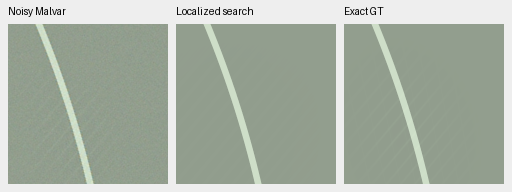
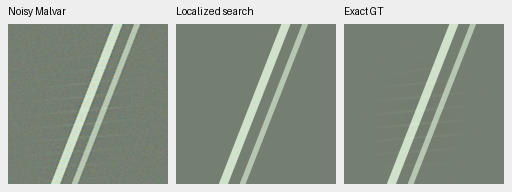

# Testing companion frequencies inside a measured footprint

Localizing the reserve search to the stronger wire's footprint does not
repair the faint frequency in the tested scenes. The correct frequency
is available in each constructed search, and its held-out prediction
fails the carrier-absent check. On the archived whole-image panels,
guide accuracy and delivered weak response stay near the fixed guides.
[Executed measurements and native crops](results/localized-guide-frequency-v1/publication.json).

## Candidate geometry and validation

The [narrow-profile study](finite-wire-profiles.md) recovers more of a
faint companion when support, spacing and phase are accurate. Before
replaying RAW, a constructed diagnostic used the true stronger frequency
to rotate and scale the original donor pair together, up to a displacement
of two native bins in each direction. This adds no one-bin hit on any of
the four archived panels, including when the unchanged and transported
candidates are pooled among the shortlist brackets that support both
directions. In these observations, donor errors are rarely explained by
a shared rotation and scale.

The RAW replay holds the first active carrier's frequency fixed. Its
screened fit can supply a native cosine-tapered footprint even when the
second direction is inactive. The companion's list contains the original
frequency, bounded radial and tangential moves up to two native DFT
bins, and the previous donor-confirmed alternatives where available.
The same candidate set is used for the uniform and the localized search.
Where the footprint is absent, the localized policy uses the uniform
result. A manufactured perpendicular placeholder gets no search around
it when the guide contains only one actual donor frequency.

The first two harmonics of each candidate are fit on each half of the
RAW screening reserve. The held-out test compares the fitted prediction
against both a carrier-absent model and the original companion, with
screened rail nuisance, the stronger carrier and independent color
amplitudes. The original and proposed companion use the same spatial
support in each comparison. Both held-out margins must exceed one in
each half. When multiple candidates pass, combined whitened squared
error selects the replacement. The separate delivery stage applies the
same focused narrow-profile fit and per-color local gates to both
search arms, using the complementary RAW.
[Frequency selector](../src/demosaic/localized_guide_frequency.py) ·
[Replay driver](../scripts/probe_localized_guide_frequency.py).

## Constructed shifted guides

The 24 analytic rail-and-wire pairs reuse the original independent
strong-only and two-direction noise draws. They give the first carrier
its exact center and both directions their exact quadratic terms, with
a one-bin radial error on the faint companion. This construction
isolates center frequency and retains the true frequency in the bank.
The stronger carrier supplies a footprint on all 12 ISO400 and five
of 12 ISO6400 two-direction observations.

The exact candidate fails to improve over the carrier-absent prediction
in both folds on every constructed pair, even where it does improve on
the displaced guide. The two searches accept the same wrong move on
one ISO400 same-plane case. Neither gets any of the 12 cases per noise
prior within half a bin of truth. Across the six ISO400 same-plane
pairs, quiet-capped weak recovery changes from **0.214% to 0.222%** and
increment RMS from 6.192 to 6.186 DN16. The other ISO400 geometries and
all ISO6400 groups reproduce the fixed focused result for their summary
metrics. Localization alone does little to strengthen the evidence
needed to choose the correct weak frequency.

## Archived wires and no-wire controls

The archived tests reuse the V143 EMA
`96d146d017c54196288c585f8b7eddcf030e8a235061049c31e985b9380b7ce4`
and the previous donor-confirmed shortlist. In each profile there
are eight main and eight separate geometries. The localized search
admits no move where a footprint is available. The main ISO400
uniform search admits two two-direction moves with no new one-bin
hit. The main ISO6400 whole-image guide still has no one-bin hit.

| Whole-image guides | Fixed focused | Uniform search | Localized search |
| --- | ---: | ---: | ---: |
| Main ISO400 | 4.241% | 4.172% | 4.174% |
| Main ISO6400 | 0.661% | 0.661% | 0.661% |
| Separate ISO400 | 6.459% | 6.459% | 6.459% |
| Separate ISO6400 | 2.464% | 2.464% | 2.464% |

The table gives weak-increment projection at the quiet RMS of the
fixed focused arm. Main ISO400 increment RMS rises from 11.185 to
11.193 DN16 with localized search. The exact-center main control
keeps its original fitted frequencies and outputs at both noise
levels. On the 48 existing forced-guide controls, the search admits
no frequency move. Flat correction stays at 0.416 DN16 RMS and
15.35 DN16 peak. The straight and complex rail corrections remain
near 0.447 and 1.313 DN16 RMS.
[Fixed and quiet-matched metrics](results/localized-guide-frequency-v1/summary.json).

## Native synthetic crops

Cases 0 and 3 use the RGGB and GBRG layouts, respectively. The triplets
show noisy Malvar, localized search and exact GT. Each cell is native
160×160 at ROI `[48,48,160,160]` with exposure ×4, contrast 1, identity WB
and matrix, clipped sRGB, ISO400 shot/read `8e-5/2.56e-8`, ADC16 and black
0.03. The analytic rail parent has no learned checkpoint. The restored
rail edges remain sharp, while the faint crossings in both targets are
mostly absent even in the full method comparisons.
[Native crop manifest](images/localized-guide-frequency-v1/manifest.json).

[Case 0 methods](images/localized-guide-frequency-v1/iso400-case0-comparison.png) ·
[Case 3 methods](images/localized-guide-frequency-v1/iso400-case3-comparison.png).

## Native GFX100S review

Both standing sets use V120 EMA
`a9d9b6b4f974e24a6b11e5e740aab32314233a7f53c056cf37c7d2aac1c589fb`,
same-side validation, gate 2 and both guide families. The main DSCF3879
ISO6400 crops use `.00128/6.5536e-6` shot/read and exposure ×4. DSCF3880
ISO100 AHD is a qualitative reference from a separate capture.

The sky is pixel-identical to V120. The coarse fence keeps its original
crossings and the 9.00 DN16 scene-guided correction. Foliage stays soft.
In the building crop, the uniform spectral search admits a replacement
without an accepted footprint. The localized policy uses that fallback.
Its correction increases from 2.94 to 6.05 DN16 RMS relative to V120,
with no clear new hardware detail.
[Sky](images/localized-guide-frequency-v1/main-overcast-sky.png) ·
[Building](images/localized-guide-frequency-v1/main-building-detail.png) ·
[Foliage](images/localized-guide-frequency-v1/main-foliage.png) ·
[Coarse fence](images/localized-guide-frequency-v1/main-chain-link-fence.png).

Both DSCF3842 fine cab ROIs match the conditioned V120 crop. Fine
crossings remain missing in both noise profiles at exposure ×16.
DSCF3835 ISO100 AHD and the camera JPEGs are qualitative references.
The separate ISO100 capture differs in aperture, exposure time and motion.

| Cab profile | Shot/read | Boards |
| --- | --- | --- |
| Nominal | `.00128/6.5536e-6` | [Left](images/localized-guide-frequency-v1/mesh-nominal-left.png) · [Right](images/localized-guide-frequency-v1/mesh-nominal-right.png) |
| DSCF3879 profile | `.0014635775921166604/1.0715704128646712e-6` | [Left](images/localized-guide-frequency-v1/mesh-profile3879-left.png) · [Right](images/localized-guide-frequency-v1/mesh-profile3879-right.png) |

This scoped CPU replay uses existing checkpoints. Broad photo and
held-out camera panels are separate. V120 remains the general recommendation.
