# V63 original 20k endpoint: interim native CPU comparison

Current architecture and recommendations: [current model guide](current-model.md).
The versioned study below retains its measured results and original protocol.

The control completed its original 20,000-update schedule. On eight fixed saved
observations, progress from step 4,000 is mixed: the fabric photograph regresses,
the building photograph improves slightly, and both selected uniform colors
improve. Fine fabric cords remain missing; GFX building, foliage and fence detail
remain soft. **Do not promote this endpoint from these selected cases.** The
expanded-data arm is now training; the full two-arm benchmark/hue/real-camera
review remains pending. V43 was the reference for this experiment.

[Executed comparisons, arrays, independent audits, native views and full metadata](results/long-commons-v63-control-original20k-CPU-review.json).
[Original matched schedules and queued full review](long-commons-v63-v64-full20k.md).

[Saved-error decomposition](control-original20k-error-decomposition.md) attributes
88.36% of the selected fabric example's added camera-RGB MSE to channel-mean
bias; its finest two Haar error bands improve slightly. This is a post hoc
diagnosis of these outputs, without a new forward or an inference correction.

The closed control boundary verifies 91 finite model tensors, 91 EMA tensors and
89 finite Adam states,
complete RNG, original source/data/recipe/initialization lineage, unchanged
normalization buffers and all 802 training rows: 161 original plus 641 resumed.
All logged learning rates follow the original 20k schedule, ending at 1e-6.
All 89 model and EMA parameter tensors changed. The original 4k state is preserved;
no optimizer reset, new schedule or normalization augmentation enters this run.

Checkpoint SHA256:

- Step 4,000: `5f29bd7efb94b72491cff22575c0565995326644823bcb802444214c8f2c6bd6`.
- Step 20,000: `ed70952dd33c5d7da39199bf1306b58b579862920fb0cccd6b222f19871bc9b5`.

Both ordinary EMA models use the same archived source bundle
`c9058d90d7d77e61ad7ec53293b805d8ea72da173318e38d1329e138215544c8`.
The final checkpoint was loaded only after the actual control trainer exited,
the boundary audit passed and the immutable checkpoint's hash verified. The
expanded trainer then started as PID169989/creation1792243965.62. These identifiers
record that transition; check actual process identity before acting on live work.

## Exact-target measurements

Eight genuine forwards per checkpoint use CPU FP32, contiguous tensors, batch1
and two Torch threads. The operator, cached observations, noise, dimensions, CFA,
WB/matrix, ROI and display transforms match. All eight paired noisy and reference
160px panels are bitwise identical. Model state and Torch RNG stay unchanged
during each execution; CUDA is never initialized. No new noise draws, fitting,
training, GPU work or original JPEG/RAW reads occur in this comparison.

PSNR scores use the native256 observation after trimming eight pixels per edge.
Camera-RGB RMSE uses the separate native160 displayed ROI, without clipping.
These four selected targets do not estimate broad photographic quality.

| Fixed observation | sRGB PSNR4k | sRGB PSNR20k | Change | ROI camera RMSE4k →20k |
| --- | ---: | ---: | ---: | --- |
| Fabric photograph |35.63443|33.69030|−1.94413|.016645→.021254|
| Building photograph |35.70298|35.76606|+.06308|.009373→.009318|
| Uniform orange |36.09412|38.79340|+2.69928|.011925→.007153|
| Uniform magenta |22.95583|29.27794|+6.32211|.068932→.029131|

The fabric ROI's signed red-channel mean error worsens from−.021047 to−.030043.
The selected magenta field improves substantially but retains signed RGB errors
`[−.044053,−.005979,−.022322]` and visible coarse variation. Its full-context
red CFA mean error also improves, from−.100542 to−.052481. The observed CFA
means are input-consistency diagnostics; no mean correction is applied. Their
unclipped iid Poisson–Gaussian uncertainty proxies do not account for clipping,
quantization, correlation or noise-fit error.

Independent NumPy64 arithmetic covers 32 camera-error scalars and 16 PSNR values
across both checkpoints. Maximum differences are1.39e-17 camera units and
.0000241dB. SSIM remains the production metric and is not independently
recomputed. Array/PNG hashes, native panel bounds and paired metadata also pass.
All sixteen native originals were actually viewed.

## Native exact-GT photographic crops

Every image below contains noisy WB-aware Malvar → model → exact saved simulated
GT. Each panel is160×160 at100%, with no resizing. The ROI is`[48,48,160,160]`
within the saved native256 observation. Both photographs use RGGB,
WB`[2,1,1.5]`, the fixed protocol matrix, shot=.00256/read variance=.0000262144,
ADC16/black.03 and display×1/0EV. PNGs are8-bit sRGB previews; measurements use
unquantized predictions. Observation SHA256 and complete transforms accompany
every crop in the receipt.

Sources: [Roy Egloff](https://commons.wikimedia.org/wiki/File:CH.VD.Villeneuve_2007-08-25_Vertigo-Swiss-Riviera_2392_3x2-R_4K.jpg),
source`0014aa4e075b1827f91ef8a02069e1e318f040ba`, and
[Dietmar Rabich](https://commons.wikimedia.org/wiki/File:Vancouver_(BC,_Canada),_Coal_Harbour_Seaside_Park,_Blick_in_den_Himmel_--_2022_--_2158.jpg),
source`002fc6eeadf637e81d5a327f117b79abb86becd9`;
[CC BY-SA4.0](https://creativecommons.org/licenses/by-sa/4.0/), modified by8×
binning, crop, simulated noise and restoration. Validation seed42, indices0/1.
These targets are exact for the saved simulation, not sensor ground truth.

Fabric,4k then20k:

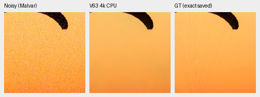

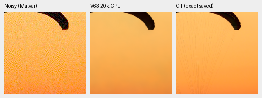

Building photograph,4k then20k:

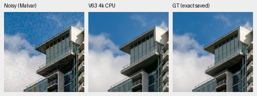

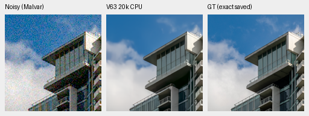

## Selected color failures

The two constant camera-RGB targets are respectively
`[.44608265,.42244270,.09690847]` and
`[.42244270,.09690847,.44608271]`, derived from the fabric mean and a channel
permutation. Their saved noisy draws, native256/ROI160, noise and display are
fixed across checkpoints. Both use the same photographic protocol transforms.
They were selected in earlier diagnostics; this is not a blind hue benchmark.

Orange,4k then20k:

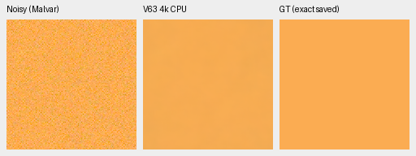

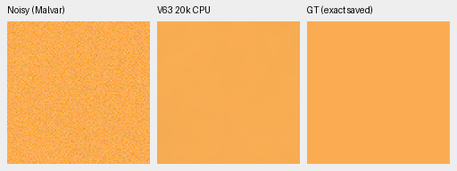

Magenta,4k then20k:

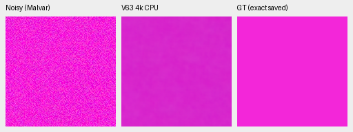

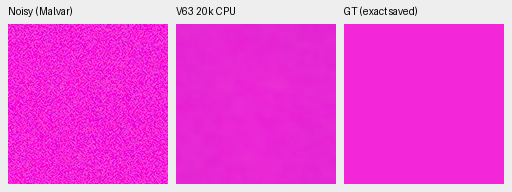

## Standing GFX native crops

DSCF3879 ISO6400/f1.7 is the noisy source; DSCF3880 ISO100/f5.6 is an independently
demosaiced AHD reference, **not exact GT and never a scoring target**. Aperture,
exposure and moving subjects differ, with3m38s between captures. The scene and
siblings stay out of training. Existing locally cached F32 contexts avoid any
new RAW decode or access to the source hard drives.

Source RAF SHA256:

- DSCF3879: `15b98ea5d27a88a698cc8fd350fa433ff953aa570b379d7feab975c4a8b60634`.
- DSCF3880: `10afc189888370bec67499e9ea6fe28a4ffe925e3296c288580efd7b6c4d08cb`.

Native512 contexts use RGGB, shared WB`[1.51324503,1,2.21523179]`, the recorded
camera matrix, shot=.0014635775921166604/read variance=1.0715704128646712e-6 and
display×4/+2EV for every panel. The model ROI is`[176,176,160,160]` inside each
context; reference arrays already contain the separate native160 crop.
Integer reference offsets were chosen from input/reference correlation before
these outputs; no warp or resampling is applied. The saved source report
SHA256 is`52a164b9f8f3d791cb10ac3c3d8dcc31fdcbcbebcc5f8f95e9ee55d90cf20577`.
All context/reference array hashes and full RAW metadata are in the receipt.

| Region | Noisy sensor ROI(x,y,w,h) | ISO100 reference ROI | ROI camera-RGB RMS output change4k→20k |
| --- | --- | --- | ---: |
| Sky |5800,1400,160,160|5800,1400,160,160|.0000891|
| Building |5790,2690,160,160|5791,2690,160,160|.0001591|
| Foliage |8890,5570,160,160|8890,5570,160,160|.0001460|
| Chain-link fence |2240,6000,160,160|2241,6000,160,160|.0002149|

These output differences are small and do not score real-photo quality. The
native views remain very similar: smooth sky, soft structural lattice, smeared
foliage and soft fence wires relative to the sharper f/5.6 reference. Their
appearance does not isolate aperture blur from denoising loss.

Sky,4k then20k:

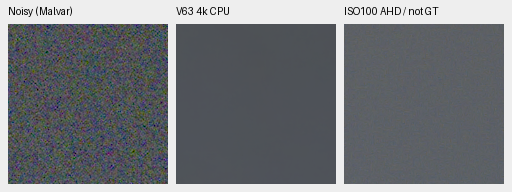

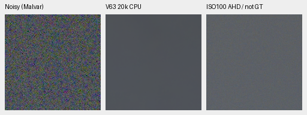

Building detail,4k then20k:

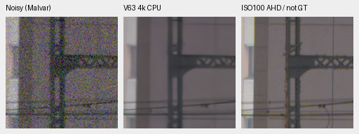

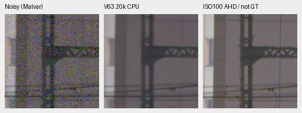

Foliage,4k then20k:

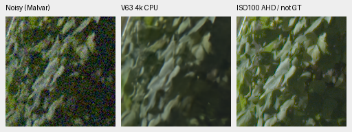

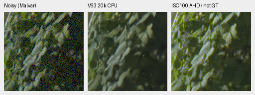

Chain-link fence,4k then20k:

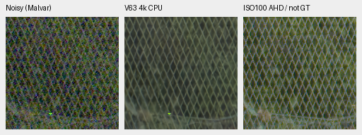

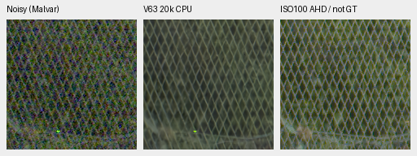

This is an interim comparison along one original training trajectory. It does
not measure the extra-data effect, training-seed uncertainty, full427 quality,
full-frame runtime or superiority to RawNIND. The complete prospective hue and
two-arm primary review will follow both original endpoints. The top-level
README retains its small reviewed working-reference set. SOTA, decisive real
quality superiority and100MP within10seconds remain unmet/unproven.
