# Expanded Commons data: completed first 4,000-update comparison

Extra training improves photo averages versus V60, but extra Commons membership
gives a small, mixed effect at this boundary. Expanded V64 gains .01495dB photo
sRGB PSNR over control V63, with a source interval spanning zero, and loses
.01989/.01278dB on known/unseen measured-CFA accuracy. Native fine detail stays
soft. **Neither is promoted; V43 remains the working reference.** Both whole
states remain frozen at 4,000 under their original 20,000 schedules, without
automatic continuation. This does not establish convergence or rule out benefits
from more data with another budget or architecture.

[Complete scores, hashes, independent audits and 58 native crop receipts](results/long-commons-v63-v64-first4k-review.json).
[Declared comparison and launch records](longer-commons-data-stage.md).

## Controlled intervention

Only Commons training membership differs: **40,170 versus 66,934** reviewed 4×
sources. Both start from V60 full 4k EMA with fresh AdamW/EMA, seed49,
LR1e-5/warmup200, B16/native 256/BF16 and planned 20k/first-review4k. Both retain
native 128/paired32, fractions .25/.25, the 8-stop smooth-color palette, loss0,
4×→geometry/PSF→area2, original 8× validation and frozen DINOv3 ConvNeXt context.
The later reviewed 75,806-source corpus is not substituted.

| Checkpoint | SHA256 |
| --- | --- |
| Parent V60 full4k | `1e9812afcfaa5322593c9d2c2314fa0d8ae5458c4e116be0f516c992c880b47e` |
| V63 control first4k | `5f29bd7efb94b72491cff22575c0565995326644823bcb802444214c8f2c6bd6` |
| V64 expanded first4k | `c0a00177b676caddea39b225f2fba1bcdc0b57d6fd543500363c8c908d83df81` |

All 161 logged domain choices/LRs match. Native/paired input hashes match;
79 Commons/procedural-domain hashes differ as allowed. Both states have finite
91 model/91 EMA tensors and 89 AdamW states at 4000, complete RNG and original
source/data/config. Parent comparisons include extra updates and an optimizer
reset; only V64−V63 isolates declared membership within this seed.

## Scores and uncertainty

427 photos have exact simulated targets;16 procedural sources are separate.
Known development uses 4 scenes/8 pairs/72 crops per method; unseen development
uses 5 scenes/10 pairs/90 crops. Paired CFA is primary; independently
AHD-demosaiced RGB is auxiliary, not exact RGB GT. Means balance sources.
Neural inference uses FP16 with physical FP32.

| Model | Photo PSNR / SSIM | Procedural PSNR / SSIM | Known CFA PSNR | Unseen CFA PSNR |
| --- | --- | --- | ---: | ---: |
| Parent V60 full 4k | 35.66428 / .961908 | 34.33768 / .971300 | 54.21125 | 53.76025 |
| V63 control | 35.76802 / .962439 | 34.51492 / .973547 | 54.22358 | 53.82088 |
| V64 expanded | 35.78297 / .962449 | 34.56875 / .973496 | 54.20369 | 53.80810 |

| V64−V63 | Difference |95% paired source interval |
| --- | ---: | --- |
| Photo sRGB PSNR,dB | +.014953 | [−.000798,+.033204] |
| Photo linear PSNR,dB | +.043791 | [+.022616,+.066395] |
| Photo sRGB SSIM | +.00000999 | [−.00001781,+.00003874] |
| Procedural sRGB PSNR,dB | +.053826 | [−.012809,+.122910] |
| Known CFA PSNR,dB | −.019893 | [−.036990,−.002795] |
| Unseen CFA PSNR,dB | −.012780 | [−.023223,−.002475] |

Photo gains versus V60 are +.10373dB for V63 and +.11869dB for V64, with
positive source intervals. Auxiliary unseen AHD PSNR improves +.03509dB for
expanded versus control while primary CFA falls. All 84 comparisons, including
retained V58/V43, are in the receipt. Source bootstrap uses 1,000 draws/seed42;
it measures evaluation-source variation, not training/selection uncertainty.
Twenty-one classical witnesses check historical observation comparability under
the existing bounds.

## Native exact-GT photographic triplets

Each model has two distinct native 160×160 photographic triplets below:
noisy WB-aware Malvar→denoised→exact simulated GT at the 8×-binned evaluation
resolution, without resizing. Both use identical ROI[48,48,160,160], RGGB,
WB[2,1,1.5], protocol matrix, shot=.00256/read variance=.0000262144,
ADC16/black.03 and display exposure×1. PNGs are8-bit sRGB previews; scores use
unquantized predictions. Full provenance accompanies every crop in the receipt.

Sources: [Roy Egloff](https://commons.wikimedia.org/wiki/File:CH.VD.Villeneuve_2007-08-25_Vertigo-Swiss-Riviera_2392_3x2-R_4K.jpg)
and [Dietmar Rabich](https://commons.wikimedia.org/wiki/File:Vancouver_(BC,_Canada),_Coal_Harbour_Seaside_Park,_Blick_in_den_Himmel_--_2022_--_2158.jpg),
[CC BY-SA4.0](https://creativecommons.org/licenses/by-sa/4.0/), modified by binning,
crop, simulated noise and restoration.

0014aa4e075b1827f91ef8a02069e1e318f040ba / iso12800-prior / RGGB / 0:dino-convnext-wide-long-control-b16-v63:step-4000:

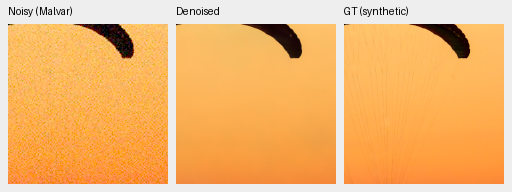

002fc6eeadf637e81d5a327f117b79abb86becd9 / iso12800-prior / RGGB / 0:dino-convnext-wide-long-control-b16-v63:step-4000:

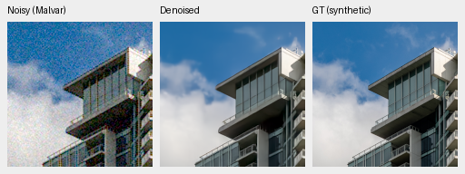

0014aa4e075b1827f91ef8a02069e1e318f040ba / iso12800-prior / RGGB / 1:dino-convnext-wide-long-expanded-b16-v64:step-4000:

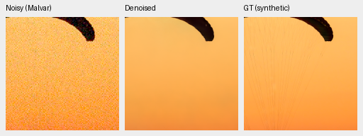

002fc6eeadf637e81d5a327f117b79abb86becd9 / iso12800-prior / RGGB / 1:dino-convnext-wide-long-expanded-b16-v64:step-4000:

Both erase fine cords visible in GT and soften cloud wisps/facade detail. These
fixed sources show no convincing visible advantage for expanded data.

## Fixed colors and weak detail

The prospective grid has 147 colors/grays×2 conditions×4 CFAs=1,176 observations.
It was motivated by earlier failures, not a blind photo benchmark. Only 2,352
new predictions run;2,352 audited parent/released-reference arrays are reused.
Independent Torch64 checks cover 4,704 arrays/28,224 fields (maximum difference
4.44e-16); separate arithmetic checks cover 72 groups/864 scalars.

For high noise at peak.9, each cell gives mean/p95 maximum absolute camera-channel
mean bias across 96 hue/CFA cases. These are descriptive quantiles, not intervals.

| Saturation | V60 parent | V63 control | V64 expanded | Released RAW+Malvar |
| ---: | --- | --- | --- | --- |
| .50 | .024435/.090322 | .019829/.072351 | .019288/.073951 | .001260/.003650 |
| .98 | .007657/.027676 | .016812/.071913 | .011773/.049465 | .016283/.061519 |

Expanded improves highly saturated bias versus control but remains worse than
the parent. Moderate bright colors still shift substantially in all three CNNs.
The released RAW cascade has mixed photo/color results; this table does not
establish a general winner. The separate64-array selected-color CPU audit checks
384 fields, maximum difference2.22e-16.

control-data-stage-first4k / h030-s0.98-l0.90:

control-data-stage-first4k / h315-s0.98-l0.90:

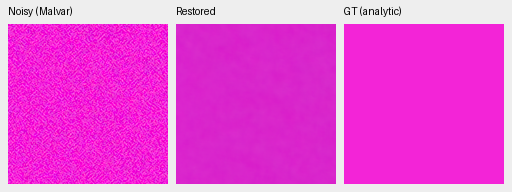

expanded-data-stage-first4k / h030-s0.98-l0.90:

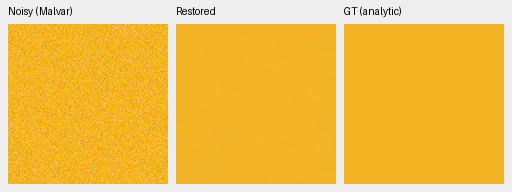

expanded-data-stage-first4k / h315-s0.98-l0.90:

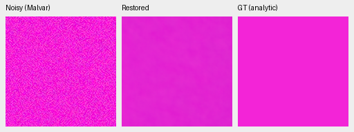

Both show broad mottling/color shift, particularly in magenta. Neutral fields
are smooth. High-noise level.18/contrast.02/period16 in-phase carrier gain is
.51898→.48219 for V63→V64; dark level.01/contrast.1/period8 is .00695→.00706.
Both nearly erase the dark signal. Means span four CFAs/four draws. Independent
analytic coverage/arithmetic checks cover 1,344 cases/84 groups/2,256 scalars,
maximum error2.22e-16. This recomputes summary arithmetic, not every per-case
metric from unsaved analytic predictions.

carrier-l0.01-c0.1-p8-draw0 / 0:dino-convnext-wide-long-control-b16-v63:step-4000:

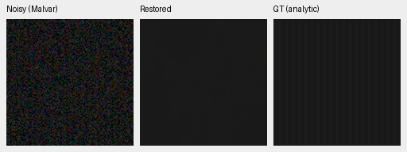

carrier-l0.01-c0.1-p8-draw0 / 1:dino-convnext-wide-long-expanded-b16-v64:step-4000:

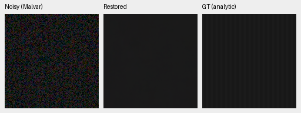

carrier-l0.18-c0.02-p16-draw0 / 0:dino-convnext-wide-long-control-b16-v63:step-4000:

carrier-l0.18-c0.02-p16-draw0 / 1:dino-convnext-wide-long-expanded-b16-v64:step-4000:

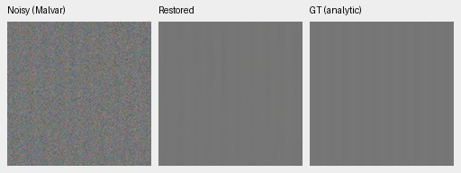

## Standing full-frame GFX test

DSCF3879 ISO6400 f/1.7→denoised→DSCF3880 ISO100 f/5.6, display×4/+2EV,
native 160×160 crops from each full 101.996MP restoration. Sources stay locally
cached and outside training. The independent low-ISO AHD reference differs in
aperture, exposure time and moving subjects, taken 3m38s later; **not GT**.
Shared WB/matrix, coordinates and noise conditioning accompany each crop.
Shot=.0014635775921166604/read variance=.0000010715704128646712.
Both methods share noisy/reference coordinates, with fixed one-pixel reference
x offsets for building/fence recorded; no resampling or warp.

overcast-sky / 0:dino-convnext-wide-long-control-b16-v63:step-4000:

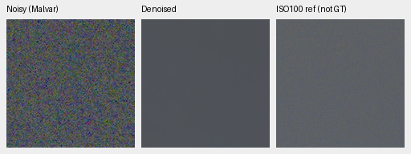

building-detail / 0:dino-convnext-wide-long-control-b16-v63:step-4000:

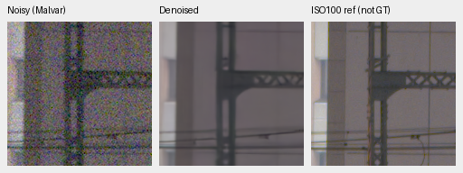

foliage / 0:dino-convnext-wide-long-control-b16-v63:step-4000:

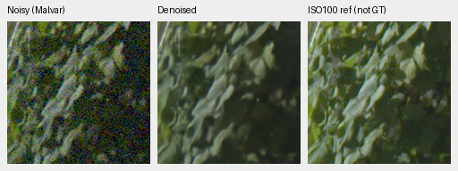

chain-link-fence / 0:dino-convnext-wide-long-control-b16-v63:step-4000:

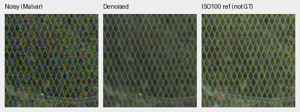

overcast-sky / 1:dino-convnext-wide-long-expanded-b16-v64:step-4000:

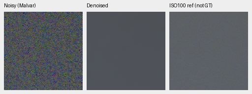

building-detail / 1:dino-convnext-wide-long-expanded-b16-v64:step-4000:

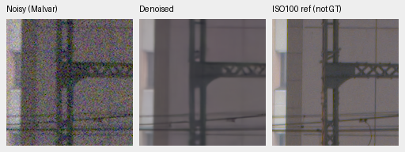

foliage / 1:dino-convnext-wide-long-expanded-b16-v64:step-4000:

chain-link-fence / 1:dino-convnext-wide-long-expanded-b16-v64:step-4000:

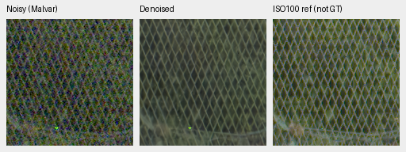

Both smooth sky noise but soften leaf veins/edges, truss openings and wire
crossings. Twelve additional Q2/Sony/GFX50R native triplets were viewed: concrete
texture survives better than RawNIND, while Q2/Sony detail stays soft. The data
arms look very similar; RawNIND is a comparator, not GT.

| Full101.996MP output | Restoration seconds | Peak CUDA allocation |
| --- | ---: | ---: |
| V63 | 37.311 | 2.278GB |
| V64 | 35.910 | 2.278GB |

Both produce full camera-linear16-bit and display-sRGB16-bit RGB TIFFs. Timing
covers tiled restoration/blending on the shared GB10, tile512/overlap64/B4/FP16;
it is not a controlled speed comparison or total file decode/encode time. The
10-second target is unmet. Allocation is not total RAM. All four TIFF hashes/
headers are checked; all eight GFX denoised PNG panels match their full sRGB16
TIFF ROI exactly at 8-bit preview precision.

The integrity review covers 38 primary PNGs/26 saved F32 arrays/four RGB16 files.
Noisy/reference pixels and transform metadata match retained V60 exactly. The
three-camera rerender uses the predeclared preview-only one-code/16-channel-value
bound; every discrepancy is retained. In total 52 new native PNGs were actually
viewed and six identical old hue PNGs verified/reused. Protected-final model
scores remain unused. SOTA, large real-photo quality gains and speed remain open.
