# Original20k native crop gallery

All58 original PNGs were actually viewed at native100%. Each panel is160×160;
no crop pixels are resized. Columns are noisy, model output, and the labeled
reference/GT. Real ISO100/AHD and RawNIND panels are qualitative references or
comparators, never exact RGB GT. Exact targets apply only to the configured
synthetic/analytic observation.

[Performance analysis](long-commons-v63-v64-original20k-review.md).
[Per-image source/ROI/checkpoint/noise/display metadata and actual-view receipt](results/long-commons-v63-v64-original20k-review.json).

The photographic sources/CC BY-SA4.0 attribution are recorded in the performance
report. Personal RAW crops are used with permission. Known/unseen dataset
attribution, reference construction and licensing remain in the source summaries
linked by the receipt. All panels share coordinates and display transforms
across methods; the noisy/reference panels match bitwise in all26 groups.

## Exact simulated photographic targets (4)

0014aa4e075b1827f91ef8a02069e1e318f040ba / iso12800-prior / RGGB / 0:dino-convnext-wide-long-control-b16-v63-full20k:step-20000

002fc6eeadf637e81d5a327f117b79abb86becd9 / iso12800-prior / RGGB / 0:dino-convnext-wide-long-control-b16-v63-full20k:step-20000

0014aa4e075b1827f91ef8a02069e1e318f040ba / iso12800-prior / RGGB / 1:dino-convnext-wide-long-expanded-b16-v64-full20k:step-20000

002fc6eeadf637e81d5a327f117b79abb86becd9 / iso12800-prior / RGGB / 1:dino-convnext-wide-long-expanded-b16-v64-full20k:step-20000

## Known cameras: approximate AHD references (4)

2pilesofplates / ISO 12800 / 0:dino-convnext-wide-long-control-b16-v63-full20k:step-20000

2pilesofplates / ISO 12800 / 1:dino-convnext-wide-long-expanded-b16-v64-full20k:step-20000

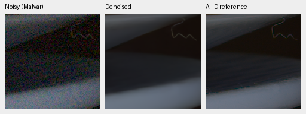

7D-1 / ISO 12800 / 0:dino-convnext-wide-long-control-b16-v63-full20k:step-20000

7D-1 / ISO 12800 / 1:dino-convnext-wide-long-expanded-b16-v64-full20k:step-20000

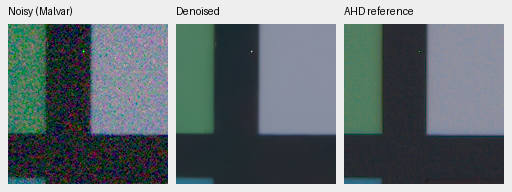

## Unseen cameras: approximate AHD references (4)

LucieB_3apples / ISO 6400 / 0:dino-convnext-wide-long-control-b16-v63-full20k:step-20000

LucieB_3apples / ISO 6400 / 1:dino-convnext-wide-long-expanded-b16-v64-full20k:step-20000

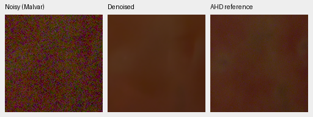

LucieB_Coulicoco / ISO 12800 / 0:dino-convnext-wide-long-control-b16-v63-full20k:step-20000

LucieB_Coulicoco / ISO 12800 / 1:dino-convnext-wide-long-expanded-b16-v64-full20k:step-20000

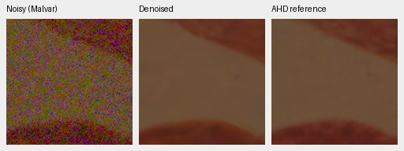

## Exact analytic targets (6)

carrier-l0.01-c0.1-p8-draw0 / 0:dino-convnext-wide-long-control-b16-v63-full20k:step-20000

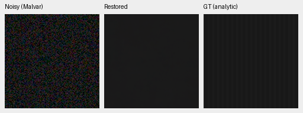

carrier-l0.01-c0.1-p8-draw0 / 1:dino-convnext-wide-long-expanded-b16-v64-full20k:step-20000

carrier-l0.18-c0.02-p16-draw0 / 0:dino-convnext-wide-long-control-b16-v63-full20k:step-20000

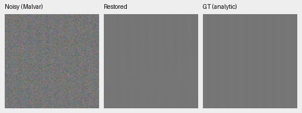

carrier-l0.18-c0.02-p16-draw0 / 1:dino-convnext-wide-long-expanded-b16-v64-full20k:step-20000

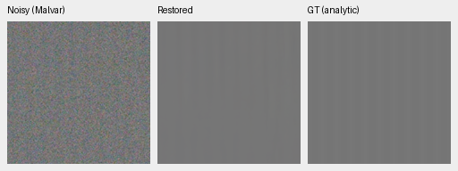

flat-l0.18-draw0 / 0:dino-convnext-wide-long-control-b16-v63-full20k:step-20000

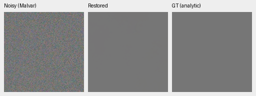

flat-l0.18-draw0 / 1:dino-convnext-wide-long-expanded-b16-v64-full20k:step-20000

## Standing GFX100S: independent ISO100 reference (8)

overcast-sky / 0:dino-convnext-wide-long-control-b16-v63-full20k:step-20000

building-detail / 0:dino-convnext-wide-long-control-b16-v63-full20k:step-20000

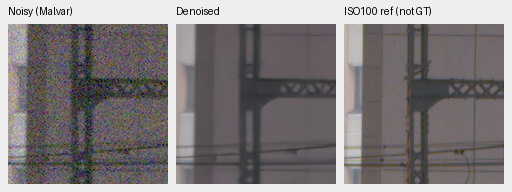

foliage / 0:dino-convnext-wide-long-control-b16-v63-full20k:step-20000

chain-link-fence / 0:dino-convnext-wide-long-control-b16-v63-full20k:step-20000

overcast-sky / 1:dino-convnext-wide-long-expanded-b16-v64-full20k:step-20000

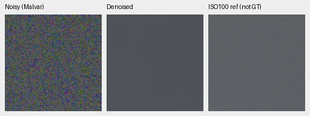

building-detail / 1:dino-convnext-wide-long-expanded-b16-v64-full20k:step-20000

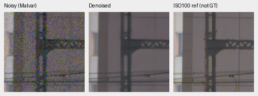

foliage / 1:dino-convnext-wide-long-expanded-b16-v64-full20k:step-20000

chain-link-fence / 1:dino-convnext-wide-long-expanded-b16-v64-full20k:step-20000

## Other real cameras: RawNIND comparator (12)

LEICA Q2 / Q2 rocks and shadows / upper-left / dino-convnext-wide-long-control-b16-v63-full20k, step 20000 / RawNIND:CFA-channel

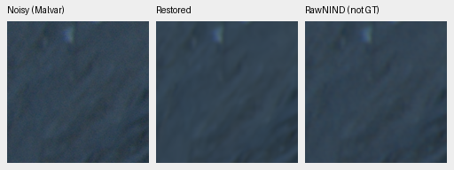

LEICA Q2 / Q2 rocks and shadows / upper-left / dino-convnext-wide-long-expanded-b16-v64-full20k, step 20000 / RawNIND:CFA-channel

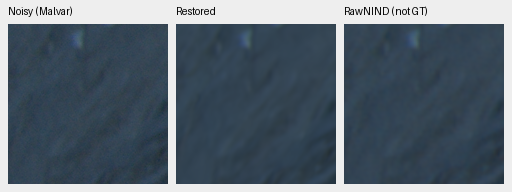

LEICA Q2 / Q2 rocks and shadows / lower-right / dino-convnext-wide-long-control-b16-v63-full20k, step 20000 / RawNIND:CFA-channel

LEICA Q2 / Q2 rocks and shadows / lower-right / dino-convnext-wide-long-expanded-b16-v64-full20k, step 20000 / RawNIND:CFA-channel

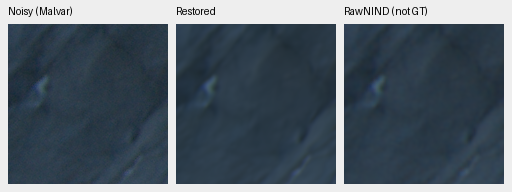

ILCE-7RM2 / a7R II airplane fuselage detail / upper-left / dino-convnext-wide-long-control-b16-v63-full20k, step 20000 / RawNIND:CFA-channel

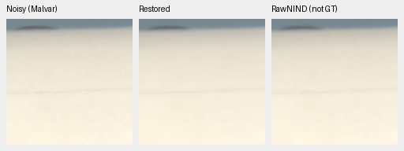

ILCE-7RM2 / a7R II airplane fuselage detail / upper-left / dino-convnext-wide-long-expanded-b16-v64-full20k, step 20000 / RawNIND:CFA-channel

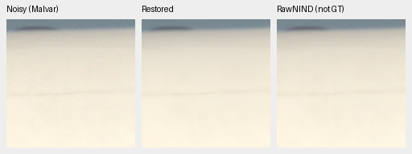

ILCE-7RM2 / a7R II airplane fuselage detail / lower-right / dino-convnext-wide-long-control-b16-v63-full20k, step 20000 / RawNIND:CFA-channel

ILCE-7RM2 / a7R II airplane fuselage detail / lower-right / dino-convnext-wide-long-expanded-b16-v64-full20k, step 20000 / RawNIND:CFA-channel

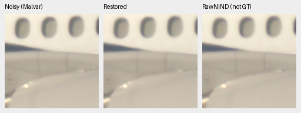

GFX 50R / GFX 50R architecture / upper-left / dino-convnext-wide-long-control-b16-v63-full20k, step 20000 / RawNIND:CFA-channel

GFX 50R / GFX 50R architecture / upper-left / dino-convnext-wide-long-expanded-b16-v64-full20k, step 20000 / RawNIND:CFA-channel

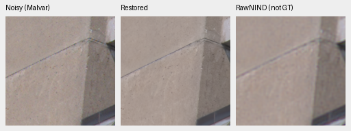

GFX 50R / GFX 50R architecture / lower-right / dino-convnext-wide-long-control-b16-v63-full20k, step 20000 / RawNIND:CFA-channel

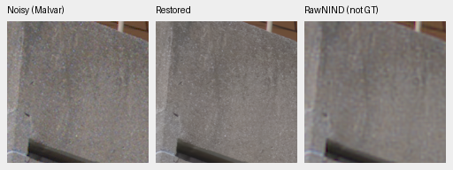

GFX 50R / GFX 50R architecture / lower-right / dino-convnext-wide-long-expanded-b16-v64-full20k, step 20000 / RawNIND:CFA-channel

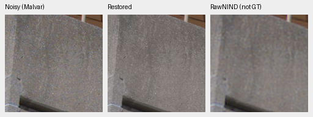

## Selected exact CPU color targets (4)

color-flat-neutral / dino-convnext-wide-long-control-b16-v63-full20k:step20000 / CPU FP32

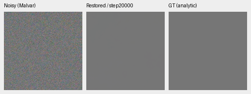

color-flat-fabric-mean / dino-convnext-wide-long-control-b16-v63-full20k:step20000 / CPU FP32

color-flat-neutral / dino-convnext-wide-long-expanded-b16-v64-full20k:step20000 / CPU FP32

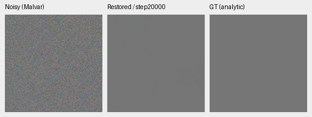

color-flat-fabric-mean / dino-convnext-wide-long-expanded-b16-v64-full20k:step20000 / CPU FP32

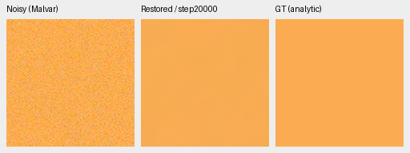

## Prospective exact hue targets (12)

wide-additional4k / gray-l0.18

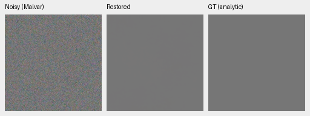

wide-additional4k / h030-s0.98-l0.90

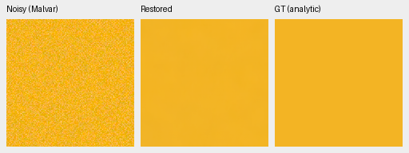

wide-additional4k / h315-s0.98-l0.90

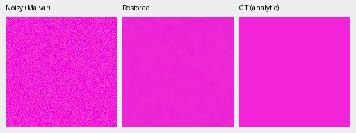

control-original20k / gray-l0.18

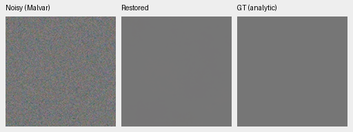

control-original20k / h030-s0.98-l0.90

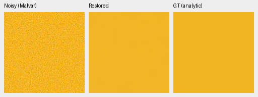

control-original20k / h315-s0.98-l0.90

expanded-original20k / gray-l0.18

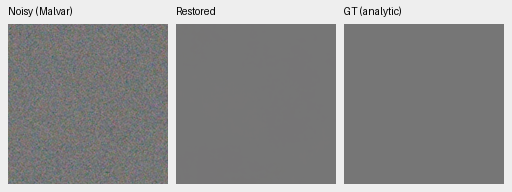

expanded-original20k / h030-s0.98-l0.90

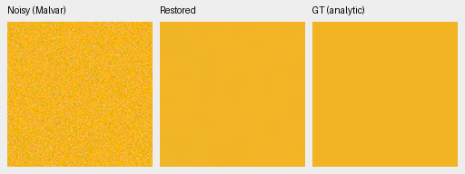

expanded-original20k / h315-s0.98-l0.90

NonlocalMatchFilter2026+Malvar:authors-RAW / gray-l0.18

NonlocalMatchFilter2026+Malvar:authors-RAW / h030-s0.98-l0.90

NonlocalMatchFilter2026+Malvar:authors-RAW / h315-s0.98-l0.90

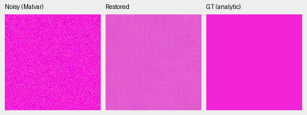

## Supplementary GFX neon and platform: independent ISO100 reference (4)

colored-neon-sign / dino-convnext-wide-long-control-b16-v63-full20k:step20000

illuminated-platform-boundary / dino-convnext-wide-long-control-b16-v63-full20k:step20000

colored-neon-sign / dino-convnext-wide-long-expanded-b16-v64-full20k:step20000

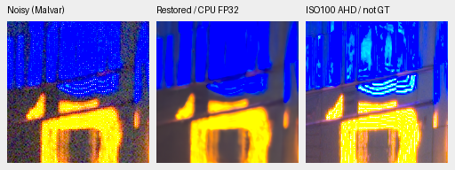

illuminated-platform-boundary / dino-convnext-wide-long-expanded-b16-v64-full20k:step20000

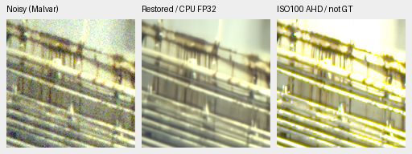
