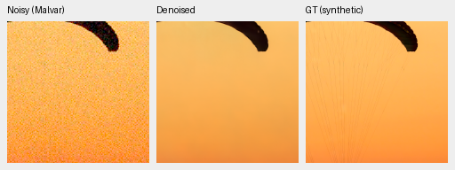
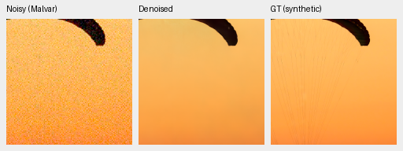
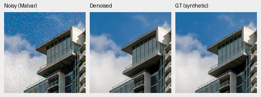
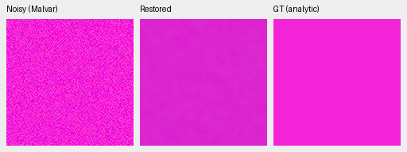
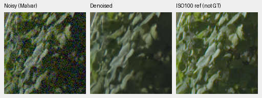
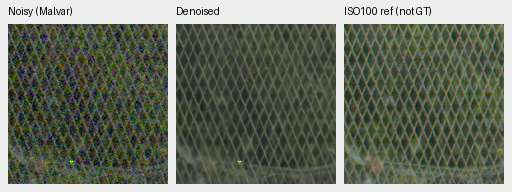

# Original20k Commons comparison: small data gain, persistent detail/color failures

Current architecture and recommendations: [current model guide](current-model.md).
The versioned study below retains its measured results and original protocol.

Completing the original schedules improves photographic PSNR by **.16507dB for
V63 and.17610dB for V64** over their own4k boundaries. Expanded Commons membership
adds **.02598dB**,95% source interval[+.01779,+.03467], at20k. The known-series/site
exclusions barely change this effect. These are useful average gains, but fine
fabric cords remain missing, GFX detail stays soft and saturated-color errors
persist. **Neither endpoint is promoted; V43 was the reference for this experiment.**

[Complete comparisons, metadata, actual58-view review and audit recovery](results/long-commons-v63-v64-original20k-review.json).
[All58 original native crops](long-commons-v63-v64-original20k-native-gallery.md).
[Training closure and original recipes](long-commons-v63-v64-full20k.md).

## Completed matched schedules

Both models resume their genuine step4,000 model/EMA/Adam/RNG states and finish
their originally planned20,000 updates. They share the V60 initializer, seed49,
B16/native256/BF16, original learning-rate schedule, native128/paired32 data,
25% paired/25% native fractions, wide8 palette and4×→geometry/PSF→area2 path.
Only Commons membership differs:40,170 versus66,934 training images. The larger
future quarantined corpus and the new normalization augmentation are unused.

Both actual trainers and the training controller exited successfully. Immutable
checkpoint SHA256:

- V63 control: `ed70952dd33c5d7da39199bf1306b58b579862920fb0cccd6b222f19871bc9b5`.
- V64 expanded: `69d08a3bacf8ea436d807512c7a5fd61cb7f119d1f869bd5eab555c2473efe6d`.

The state audits verify91 model/91 EMA tensors,89 Adam states, complete RNG,
exact source/data/recipe/lineage and unchanged normalization buffers. All802
logged step/domain/LR rows match across arms; all375 logged paired/native input
hashes match. Both original4k checkpoints and their report remain unchanged.

## Full primary results

The frozen evaluation covers427 photos and16 procedural sources, seven
noise/exposure conditions and four CFAs, with paired noise and original8×
targets. Its62,020 cases include two neural models and three classical methods.
Known/unseen camera panels add360/450 cases. Comparison statistics retain
1,000 paired source-bootstrap draws/seed42 and the existing numerical bounds.

| Arm / original update | Photo sRGB PSNR | Photo SSIM | Procedural sRGB PSNR | Procedural SSIM |
| --- | ---: | ---: | ---: | ---: |
| V63 /4,000 |35.76802|.962439|34.51492|.973547|
| V64 /4,000 |35.78297|.962449|34.56875|.973496|
| V63 /20,000 |35.93309|.963290|35.07653|.976322|
| V64 /20,000 |35.95907|.963317|35.01644|.976396|

The own4k-to20k photographic intervals are[+.15098,+.17983]dB and
[+.15378,+.19858]dB. Procedural means also improve along both original
trajectories. The20k data-only procedural PSNR difference is−.06009dB,
interval[−.15393,+.02467]; it does not establish a broad procedural gain or loss.
The corresponding photo linear-PSNR difference is+.04653dB[+.03420,+.06050]
and SSIM difference+.00002664[+.00000596,+.00004567].

Known-camera measured-CFA means are54.20366/54.18217dB for V63/V64; unseen means
are53.84298/53.84652dB. Own4k-to20k differences are−.01992/−.02152dB known and
+.02209/+.03842dB unseen; all four scene-bootstrap intervals include zero.
These small panels contain four/five scenes and use measured reference samples;
their independently demosaiced AHD previews are approximate references, not exact
RGB GT. Historical V60/V58/V43 comparisons remain in the108-comparison receipt,
with their differing training histories. Progress is not a convergence proof.

Known/unseen source: Benoit Brummer and Christophe De Vleeschouwer,
[Raw Natural Image Noise Dataset (2025)](https://doi.org/10.14428/DVN/DEQCIM),
[CC BY-SA4.0](https://creativecommons.org/licenses/by-sa/4.0/); individual scene
credits and CC0 grants are recorded in the dataset's permissions file. Preview
crops are modified through restoration and rendering.

### Predeclared source sensitivities

[All81 comparisons and independent arithmetic](results/commons-source-sensitivity-original20k-v1.json).
The content policy/source IDs were frozen before either20k full-photo panel.
The original427 results are preserved. Removing known series/site sources gives:

| Photo cohort | Sources | V64−V63 sRGB PSNR, dB[95% source interval] |
| --- | ---: | --- |
| Original |427|+.02598[+.01779,+.03467]|
| Known capture series excluded |418|+.02585[+.01801,+.03531]|
| Known series and sites excluded |416|+.02600[+.01806,+.03535]|

All27 original full-panel photo statistics reproduce exactly before the subset
analysis. Independent Decimal60 accumulation rebuilds251,076 metric values,
8,967 source-metric means and540 bootstrap statistic fields, with maximum
discrepancies0 and4.44e−16, respectively. The operator performs no inference.
These are source-ID sensitivities, not certified scene-independent cohorts.
Unknown aliases, ancestor/foundation exposure, training-seed variability and
selection uncertainty remain outside these intervals.

## Native exact-GT photographic triplets

All four triplets below were actually viewed at native100%. Each panel is
160×160 with no resizing: noisy WB-aware Malvar → endpoint → exact configured
simulated GT. Both photographs use ROI`[48,48,160,160]` in native256, RGGB,
WB`[2,1,1.5]`, the recorded fixed camera matrix, shot`.00256`, read variance
`.0000262144`, ADC16/black`.03`, and display×1/0EV. Models use the unchanged
CUDA FP16/physical-FP32 evaluation operator. Metrics use unquantized predictions;
PNGs are8-bit sRGB previews. Hashes and full transforms accompany every crop.

Fabric: [Roy Egloff, Vertigo Swiss Riviera](https://commons.wikimedia.org/wiki/File:CH.VD.Villeneuve_2007-08-25_Vertigo-Swiss-Riviera_2392_3x2-R_4K.jpg),
source`0014aa4e075b1827f91ef8a02069e1e318f040ba`. V63 then V64; both still miss
the fine cords. The selected fabric regression despite improved population mean
is also documented in the [control endpoint diagnosis](control-original20k-error-decomposition.md).

Building/clouds: [Dietmar Rabich, Vancouver Coal Harbour](https://commons.wikimedia.org/wiki/File:Vancouver_(BC,_Canada),_Coal_Harbour_Seaside_Park,_Blick_in_den_Himmel_--_2022_--_2158.jpg),
source`002fc6eeadf637e81d5a327f117b79abb86becd9`. V63 then V64; fine facade
detail and clouds remain soft, with little visible difference between arms.

Both sources are[CC BY-SA4.0](https://creativecommons.org/licenses/by-sa/4.0/),
modified by binning, crop, noise simulation and restoration. Exact GT applies to
the configured saved simulation, not real sensor ground truth.

## Weak texture and color are still unresolved

The1,344-case analytic suite separates signed carrier response from unrelated
residual energy. At the high-noise prior, the selected bright weak period16
carrier has mean gain.33258/.34600 for V63/V64. The dark period8 carrier is
almost erased, gain.00397/.00265. Each row averages16 fixed cases. Residual noise
is low, but that does not imply recovered texture. All six native analytic
triplets were viewed and are included in the gallery.

The prospective hue panel executes2,352 new predictions and reuses2,352
separately verified V60/nonlocal-reference arrays. Independent checks rebuild
28,224 case fields and864 group scalars. This grid has one draw per case and
does not provide population confidence intervals.

At peak.9/high-noise prior, the descriptive averages across96 hue/CFA cases are:

| Saturation | Model | Mean max absolute channel bias | Mean camera-RGB RMSE | Mean centered camera-RGB RMS |
| ---: | --- | ---: | ---: | ---: |
|.5|V60|.024435|.016413|.002953|
|.5|V63|.014340|.010282|.002612|
|.5|V64|.015745|.011158|.002912|
|.98|V60|.007657|.005654|.002030|
|.98|V63|.005735|.004511|.001839|
|.98|V64|.008586|.006312|.001770|

V63 improves these two bright-color groups over V60. V64's highly saturated
group retains lower spatial variation but worse bias/RMSE than V60. The selected
magenta native views below show coarse variation and a stronger violet shift
in V64. Other grid groups and the nonlocal comparator remain in the full receipt
and gallery; no universal color improvement is inferred.

## Standing GFX and other real-camera checks

All GFX images use locally cached DSCF3879 ISO6400/f1.7 and DSCF3880 ISO100/f5.6,
3m38s apart. They differ in aperture, exposure and moving subjects. The reference
is independently AHD demosaiced, **not exact GT or a scoring target**. Shared
display×4/+2EV, WB`[1.51324503,1,2.21523179]`, the recorded matrix and input-only
shot`.0014635775921166604`/read variance`1.0715704128646712e−6` remain fixed.
The scene and its siblings stay out of training. Original RAF hashes:

- DSCF3879: `15b98ea5d27a88a698cc8fd350fa433ff953aa570b379d7feab975c4a8b60634`.
- DSCF3880: `10afc189888370bec67499e9ea6fe28a4ffe925e3296c288580efd7b6c4d08cb`.

| Region | Noisy sensor ROI(x,y,w,h) | Independent ISO100 reference ROI |
| --- | --- | --- |
| Sky |5800,1400,160,160|5800,1400,160,160|
| Building |5790,2690,160,160|5791,2690,160,160|
| Foliage |8890,5570,160,160|8890,5570,160,160|
| Chain-link fence |2240,6000,160,160|2241,6000,160,160|
| Neon |9060,2050,160,160|9060,2050,160,160|
| Platform |10320,4520,160,160|10321,4520,160,160|

Foliage, V63 then V64, cropped from blended full-frame FP32 outputs:

Fence, V63 then V64:

Sky is smooth; foliage, building lattice, fence wires, neon boundaries and
platform structure remain soft. The sharper f/5.6 reference does not isolate
denoising loss from optical differences. The12 Q2/a7RII/GFX50R comparisons show
some crisper GFX50R seams/variation than the supplied RawNIND comparator, but
dark Q2 detail and Sony structures remain soft. Broad decisive real-photo
superiority is unproven. All raw references/comparators are labeled accurately.

## Full-frame execution and review integrity

Both101.995852MP GFX outputs produce verified linear16 and sRGB16 TIFFs:
four files total. Restoration-stage times are37.4428s and36.2482s, including
tiling/blending but excluding RAW decode and TIFF encoding. Each uses520 tiles,
native512/overlap64/B4, CUDA FP16 with physical FP32 and channels-last. Peak CUDA
allocation is2.278GB; this is not total unified RAM. These are individual shared
machine observations, not a controlled speedup result. The10-second target is unmet.

The final review preserves108 statistical comparisons,27 classical witnesses,
38 primary PNGs,26 F32 arrays and four RGB16 files. All1,483 frozen guards pass.
The unchanged supplementary auditor initially ran from the current checkout
instead of the producer's frozen checkout and failed its relative source-hash
check. The original failed workflow/log remains unchanged. Running the exact
same auditor from the producer directory verifies all37 source hashes and four
supplementary triplets, without new inference, altered outputs or relaxed bounds.
The separate completed review receipt records this recovery explicitly.

All58 native originals were actually viewed:38 primary,12 hue,4 supplementary
and4 selected CPU-color previews. This corrects earlier prose estimating56.
All26 shared observation groups retain bitwise identical noisy/reference panels
and equal ROI/noise/display/WB/matrix metadata across methods. Integrity and
manual quality review are separate evidence; neither establishes SOTA.

The next controlled quality question is the already
[prepared normalization augmentation](normalization-augmentation.md). Its CPU
engineering checks do not establish trained quality. The working reference,
data memberships and original schedules remain unchanged. SOTA, decisive real-photo
superiority and100MP within10s still require evidence.
