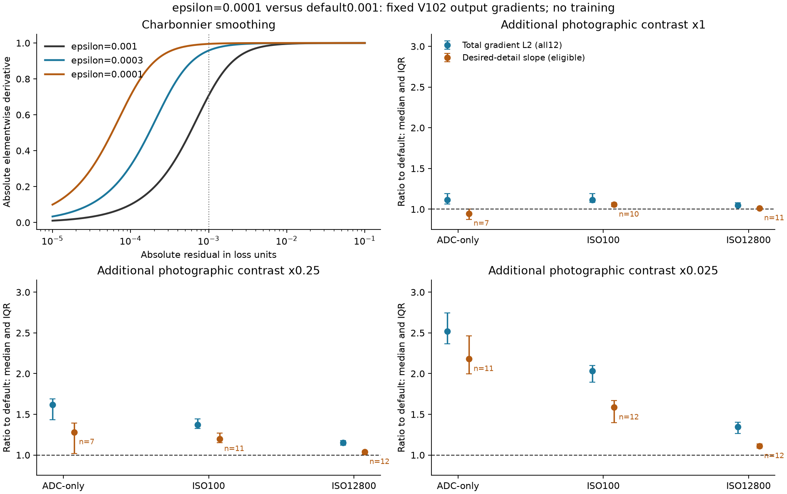

# Loss smoothing and faint detail

**Current V120 Small retains Charbonnier epsilon .0003.** The
[completed V111/V112 comparison](loss-scale-training.md) established this scale
on the cleaned corpus, with36.90238dB for V112 and lower tested color tails.
The [completed Tiny/Small continuations](v114-v115-quality.md) and the
[current V120 recommendation](v120-v121-primary.md) keep the same scale.

The fixed-V102 diagnosis below motivated that comparison: smaller epsilon
strengthens faint low-noise supervision while increasing the overall output
gradient more. It measures output-space sensitivity, independently of the later
trained-quality results.

The [contrast-normalized band diagnosis](contrast-normalized-band-supervision.md)
reused all108 saved predictions with the .0003 baseline. Its output-gradient
change motivated the [completed V117/V118 training comparison](v117-v118-quality.md).
The trained band term lowered weak natural-detail response and worsened the
ADC color tail, so it remains off. Output-space diagnostics alone do not
establish a better trained model.

The library default remains `sqrt(error² + 1e-6)`, with epsilon **0.001**;
V112 and its current continuation recipes explicitly select **0.0003**.
Its elementwise derivative is `error / sqrt(error² + epsilon²)`. Errors below
epsilon still contribute; their gradients are weaker than the limiting L1
gradient. Linear-camera and rendered losses each use their own numeric units.



[Standalone SVG](images/charbonnier-loss-gradients/charbonnier-output-gradients.svg) ·
[Figure data and definitions](images/charbonnier-loss-gradients/figure.json) ·
[All grouped results, execution receipts and hashes](results/charbonnier-detail-output-gradients-v1.json).
Bars show descriptive interquartile ranges, not confidence intervals.

## Actual inputs and measured gradients

The twelve sources are the previously fixed clean-reader checks for the
90,864-source corpus: six newly eligible photographs and all six original
reviewed fine-detail ROIs. Targets use the actual native256 training reader,
including its geometry, binning and any already-selected contrast attenuation.
Additional mean-preserving contrast factors **1, .25 and .025** operate on the
same targets without changing their mean, exposure or geometry.

Each has ADC-only, ISO100-prior and ISO12800-prior observations: **108 actual
CPU FP32 restorations**, with V102 final20k EMA, fixed RGGB/WB/matrix, exposure1
and declared physical shot/read conditioning. Every prediction then receives
the same three output-loss checks: epsilon **.001/.0003/.0001**. Only the
Charbonnier kernels change; loss coefficients, validity masks and the separate
absolute highlight penalty remain fixed. There is no optimizer update.

The default loss terms and output gradients reproduce the actual production
implementation exactly on all 108 cases. Independent NumPy F64 central
differences verify all 324 directional gradients, maximum absolute difference
**below 1.9e-10**. Saved input/prediction hashes are rechecked independently; weights,
frozen encoder, model configuration, parameter identities and Torch RNG stay
unchanged. The diagnostic initializes no CUDA.

The exact-target analysis band is the reflected 3×3 mean minus 9×9 mean in camera
RGB, with the outer 8 pixels omitted. Projecting target-minus-prediction onto
that band defines a corrective direction. A negative loss derivative means
that correction lowers the objective. The slope ratios below include positive
missing-band coefficients and negative default/alternative slopes; the displayed
counts expose excluded cases. All total-gradient statistics retain 12 sources.
The target band is available only for analysis.

## What smaller epsilon changes

Median ratios for **epsilon .0001 versus .001**:

| Additional contrast | Condition | Total gradient L2 | Missing-detail correction slope | Eligible cases |
| --- | --- | ---: | ---: | ---: |
| 1 | ADC-only | 1.117× | .947× | 7/12 |
| 1 | ISO100 | 1.117× | 1.057× | 10/12 |
| 1 | ISO12800 | 1.051× | 1.012× | 11/12 |
| .25 | ADC-only | 1.618× | 1.281× | 7/12 |
| .25 | ISO100 | 1.373× | 1.198× | 11/12 |
| .25 | ISO12800 | 1.150× | 1.039× | 12/12 |
| .025 | ADC-only | 2.522× | 2.180× | 11/12 |
| .025 | ISO100 | 2.034× | 1.585× | 12/12 |
| .025 | ISO12800 | 1.344× | 1.110× | 12/12 |

The .025 follow-up was chosen after the original 72-case analysis to include
signals near/below epsilon. Nine of the twelve source contexts have target-band
RMS at most .001; the median is **.000678**. This extra contrast reduction is
stronger than the current augmentation's .125–.5 range. It is a stress case,
with the original 72 results preserved.

At that faint contrast, the median fraction of camera-channel residuals below
.001 is 98.4% ADC-only, 92.7% ISO100 and 52.6% ISO12800. Smaller epsilon therefore
changes substantial low-noise supervision. The milder .0003 alternative raises
the ADC-only correction slope 1.760× and total gradient 1.831× in this group.
At high noise, the correction-slope increase is smaller than the total-gradient
increase. Median alignment of the negative gradient with the target-band
correction decreases in every group. Stronger gradients do not isolate useful
detail or prove a better training outcome.

These are selected training sources, one noise draw per case and a fixed
camera transform. They do not measure held-out quality, broad-camera/paired
loss behavior, gradients through the network or generalization after training.
The chosen band also does not cover every fine structure. The completed matched
training comparison tests the idea while holding architecture, data,
initializer and budget fixed. The [current fitted Small/Tiny comparison](small-aligned-training.md)
uses V112's .0003 scale; the earlier unlaunched zero-gate capacity recipes keep
their original settings and receipts.

## Configurable training scale

The current trainer exposes this experimental setting:

```yaml
reconstruction_charbonnier_epsilon: 0.0003
```

The default is **0.001**, including legacy checkpoints with no field. The
setting applies to synthetic Commons/native camera-linear, rendered, spatial
gradient and auxiliary reconstruction penalties. Paired RAW retains its
existing **0.0001** scale. Reference-white interval, noise-normalized and
multiscale sensor penalties also retain their separate definitions. Under
`image-log-mse-v1`, the primary log-MSE terms stay fixed while the Charbonnier
gradient/auxiliary terms use the chosen epsilon.

The value must be positive with a finite normal FP32 square. Checkpoints store
the validated value; resume rejects a changed epsilon. Use a fresh source-frozen
plan for a new comparison. Existing V104 and capacity preparations retain their
original code and settings. Inference has no new option or weight transform.

Implementation checks pass **139 targeted tests**. The API exactly reproduces
all 324 archived losses, terms and complete output-gradient tensors, totaling
**63,700,992 gradient elements**. Actual eight-update V102 CPU continuations
with the default reproduce archived model/EMA/Adam, Python/Torch RNG and logged
values exactly. A .0003 continuation matches a 4+4 resumed run exactly, and a
changed-epsilon resume fails before any learned forward.
[Source hashes, actual training states and complete evidence](results/reconstruction-epsilon-implementation-v1.json).
These are discarded implementation fixtures, without a quality conclusion.
Use fixed image metrics and native crops for trained comparisons; raw loss
values differ across epsilon settings.

The .0003 setting also passes eight actual CUDA updates from original V102
at native256/B16/configured BF16. Initial EMA and official frozen Tiny identity
match, with all91 model/EMA tensors and89 Adam states finite. All three data
domains execute. [Actual CUDA preflight](results/reconstruction-epsilon-CUDA-v1.json).
The fixture overlaps V104 and is not a throughput or quality measurement.
