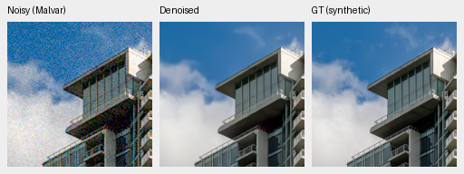
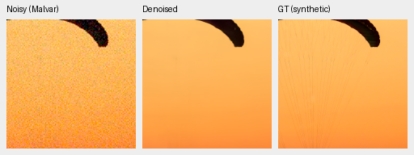
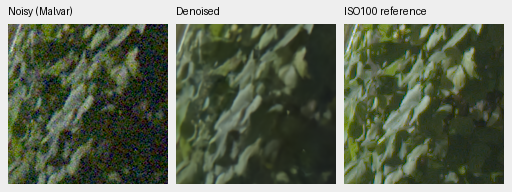
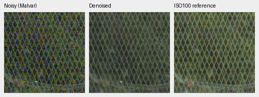
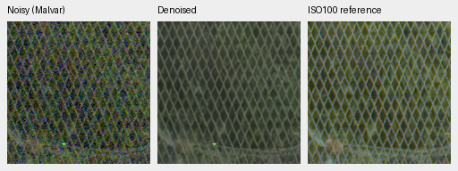

# V32/V33: lower learning rate and paired-data balance

V32 improves the full 427-photo synthetic PSNR by **.17289 dB** over V30.
V33 gives the best auxiliary rendered real-camera means of these three models,
but loses **.12672 dB** unseen-camera measured-CFA PSNR versus V30. These are
different tradeoffs; neither establishes the project's qualitative quality goal.
[Complete metrics, native crops and output verification](results/low-lr-paired-v32-v33-1k-review.json).

Both arms initialize from the same V30 step 1000 EMA, with fresh AdamW/EMA,
batch 16, seed 46, LR 3e-5 and a planned 3,000-step schedule. This review stops both
after 1,000 updates. V32 uses 25% paired RAW / 25% native RAW / 50% Commons; V33 changes
that to 50% / 25% / 25%. All 27 logged same-domain intersections match byte hashes
(41 logged batches per arm); unlogged observations were not separately hashed.
Both use the original frozen 8× corpus and cached Poisson integration grid.
The new 4×→augmentation→2× path and newly downloaded images are separate trials.

Checkpoint SHA256, step 1000:

- V30: `3a529117f127b2b48c203d6d23d154aeea0924f1aeb7ca649b1778ac8c0686c6`
- V32: `bd3f1d05d04ca1a8609f44d01a38ae8fcfe894c31f17097aece04ad70348fe9a`
- V33: `c09c608773ff5465708a06db392e2920085f7301466b55c2c20d92036ee08ce3`

## Real development

| Panel | Method | Measured-CFA PSNR | AHD RGB PSNR | AHD SSIM |
| --- | --- | ---: | ---: | ---: |
| Known4 | V30 | 54.25796 | 39.87232 | .929979 |
| Known4 | V32 | 54.22962 | 39.93072 | .930351 |
| Known4 | V33 | **54.26923** | **39.98100** | **.931180** |
| Known4 | RawNIND global CFA-LS | 54.06860 | 39.67805 | .928811 |
| Known4 | RawNIND channel CFA-LS | 54.08474 | 39.71710 | .928831 |
| Unseen5 | V30 | 53.75824 | 38.07829 | .915793 |
| Unseen5 | V32 | 53.76552 | 38.35791 | .917477 |
| Unseen5 | V33 | 53.63152 | 38.43170 | .919532 |
| Unseen5 | RawNIND global CFA-LS | 53.56220 | 38.14484 | .918380 |
| Unseen5 | RawNIND channel CFA-LS | **53.76822** | **38.56191** | **.922127** |

Means first average crops/captures within scenes. Known: 8 pairs / 72 crops;
unseen: 10 pairs / 90 crops. Primary reference is registered low-noise measured
CFA. AHD is independently demosaiced auxiliary RGB, **not exact RGB GT**.
Noise fits use noisy inputs only, with shared coordinates and display transforms.

V33 exceeds globally calibrated RawNIND on all six displayed means, with small
margins on these development panels. Channel-calibrated RawNIND still leads all
three unseen-camera means, so broad superiority is not established. Against V30,
V33 unseen AHD PSNR improves .35341 dB (scene-bootstrap 95% interval
[+.21569,+.46674]); SSIM improves .003740 ([+.001131,+.006795]). Its primary
PSNR difference is −.12672 dB ([−.27843,+.01740]). Known primary differences
and V32's primary differences also have intervals crossing zero. Full paired
comparisons are in the receipt. Both RawNIND calibrations fit only the noisy
measured CFA, without target access.

## Full synthetic suite and exact-GT native crops

All 427 photographs and 16 procedural sources use the same seven conditions,
four Bayer patterns, observations and display protocol. Means are source-balanced;
scores use unquantized predictions. This is synthetic noise on binned rendered
images, not a substitute for real-camera validation.

| Method | Photo sRGB PSNR | Photo SSIM | Procedural PSNR | Procedural SSIM |
| --- | ---: | ---: | ---: | ---: |
| V30 | 33.78382 | .947305 | 32.66484 | .954630 |
| V32 | **33.95672** | **.950119** | **33.10339** | **.962757** |
| V33 | 33.83358 | .949587 | 33.07927 | .958854 |
| RawNIND global CFA-LS | 26.69578 | .790028 | 24.97426 | .720411 |
| RawNIND channel CFA-LS | 26.68357 | .789899 | 24.98568 | .720500 |

V32−V30 photo PSNR 95% source-bootstrap interval: **[+.13318,+.21321] dB**.
V33−V30: +.04975 dB, interval[−.00088,+.09416]. V32−V33: +.12314 dB,
interval[+.10067,+.14663]. The separate 16-photo screen is retained in the
receipt; its higher absolute means must not be substituted for the full 427 means.

Each row is noisy Malvar → restored → **exact synthetic GT**. Native 160×160
panels, ROI[48,48,160,160] within the same 256px evaluation tile; no resizing.
RGGB, nominal ISO12800 prior (`shot=.00256`, `read=.0000262144`), ×1 display,
WB[2,1,1.5] and fixed protocol matrix. PNGs are 8-bit sRGB previews; the receipt
records complete source/cache/checkpoint hashes, ROI, noise and display metadata.

V32:

V33, identical inputs, targets and rendering:

Sources: [Roy Egloff](https://commons.wikimedia.org/wiki/File:CH.VD.Villeneuve_2007-08-25_Vertigo-Swiss-Riviera_2392_3x2-R_4K.jpg)
and [Dietmar Rabich](https://commons.wikimedia.org/wiki/File:Vancouver_(BC,_Canada),_Coal_Harbour_Seaside_Park,_Blick_in_den_Himmel_--_2022_--_2158.jpg),
[CC BY-SA 4.0](https://creativecommons.org/licenses/by-sa/4.0/). Modified by
linear binning, crop, simulated Bayer/noise, restoration and rendering;
derivative previews retain that license. Fine detail remains imperfect.

## Standing GFX test and full 102 MP files

DSCF3879 ISO6400 → restored → separate DSCF3880 ISO100 f/5.6. Same native 160px
ROIs, shared +2EV display, WB/matrix and input-only conditioning
(`shot=.001463577592`, `read=.000001071570413`). These crops come from the
**blended full 102 MP FP32 output**, before RGB16 encoding. The aperture,
3m38s time difference and motion make the last panel a qualitative reference,
**not GT**. No output-derived alignment or per-method display adjustments.

V32 foliage [8890,5570] and fence [2240,6000] (reference fence x2241):

V33, same source/ROIs:

Both retain recognizable mesh, but its thickness/shape is irregular, foliage
is soft and a colored point remains. These do not demonstrate a decisive
visual gain. All four regions, matched V30/RawNIND and separate 512px-context
results are retained in the receipt. PNG hashes/dimensions and identical
noisy/reference panel bytes were verified across matched methods.

Full outputs are in
`/mnt/external/demosaic/evaluation/gfx-3879-3880-low-lr-v32-v33-1k-full/`:
`restored-{0,1,2,3}-{linear16,srgb16}.tiff`, respectively V30/V32/V33/RawNIND.
All eight files passed SHA/size, 8746×11662×3, uint16, 16-bit sample-tag and
greater-than-256 sampled-code checks; all sRGB files carry ICC profiles.
Restoration times were **36.14/35.42/35.77/18.42 seconds**, respectively,
tile 512 / overlap 64 / batch 4. These are successive shared-machine runs, excluding
decode/model loading/rendering/encoding. The 10-second target remains unmet.

V33 continues with its unchanged original 3,000-step recipe to step 2,000 for a
new development review gate. V32 is retained as the stronger synthetic reference
and matched control for the forthcoming 4×→augmentation→2× trial. Neither
continuation nor the new corpus has yet established an additional quality gain.
GFX/siblings and protected-final sources remain outside training; final remains
unscored during development.
