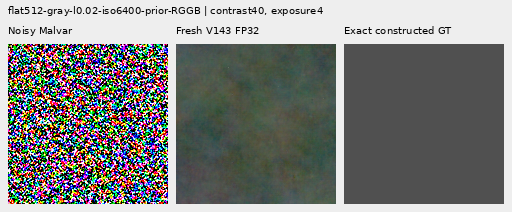
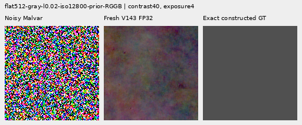
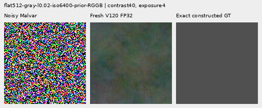
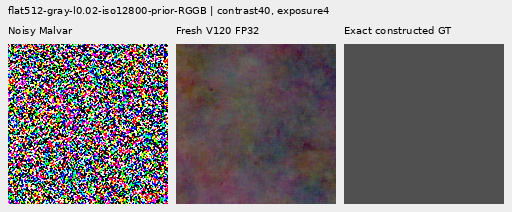

# V155: matched parents retain different strengths

**V120 is not a generally cleaner parent on the current weak-detail controls.**
Fresh paired evaluations lower native512 coarse noisy-flat error 1.59–2.36%
versus V143, but raise total noisy-flat RMS 2.31–5.11%. Quiet-mask RMS improves
only 0.39–0.91%, with worse ISO6400 quiet spatial error. ADC sloped-field full
RMS rises 33.26% and block32 error 112.65%. Neither parent restores convincing
new fine cab crossings or removes the broad native flat-field mottle.

The [V154 result](robust-spectral-objective.md) motivated testing a cleaner
parent before more weak-error reweighting. This comparison runs both fixed
parents afresh on exactly the same 822 cached RAW inputs under one deterministic
FP32 policy. All 1,644 outputs, independent metrics and 64 actual native views
are complete. No training, new noise or source/RAW lookup occurs.

Retain V143 as the matched noisy-detail research control, and V120's coarse
noisy-field and ADC-photo strengths as explicit comparators. **V120 Small stays
the general recommendation** on its broader completed 427-photo/camera/frame
evidence. This finite patch comparison does not reverse that broader choice or
freeze future architecture/parent choices. [Current useful implementations](current-model.md).

## Mesh response and actual empty-field errors

256 present and 256 absent cases, four related CFAs per recipe. RMS is full
scene-linear camera RGB error in DN16. Template response uses exact constructed
GT and is a diagnostic projection, not a calibrated recovery probability.
Added blank error below means difference from the **fresh V143 output**, not
a learned correction or the true blank error.

| Method | Present full RMS | Response | Actual blank RMS | Blank spatial RMS | Added blank RMS |
| --- | ---: | ---: | ---: | ---: | ---: |
|Fresh V143|9.111243|0.02202090|5.523323|5.343113|0.00000000|
|Fresh V120|9.160725|0.02313194|5.606164|5.390054|1.17892781|

V120 response is 5.05% higher, reaching 2.31% of GT versus V143's 2.20%.
Present full RMS is 0.54% higher and actual blank RMS 1.50% higher.
Absent-case full RMS is 5.33006 versus 5.23791, 1.76% worse. Neither parent
recovers the weak crossing family in the two native mesh examples.

## Noisy flats and natural texture

Each flat group below contains24 cases. Spatial RMS removes full-image DC.
Block32 RMS measures errors after 32×32 averaging, retaining broad variation.
The results separate total noise from the coarse-error advantage that motivated
the parent comparison.

|Flat test|Fresh V143|Fresh V120|
| --- | ---: | ---: |
|Native512 ISO6400 full RMS|18.546808|19.494485|
|Native512 ISO6400 spatial RMS|18.235130|19.174940|
|Native512 ISO6400 block32 RMS|13.440562|13.227367|
|Native512 ISO12800 full RMS|24.071892|24.627620|
|Native512 ISO12800 spatial RMS|23.596863|24.197112|
|Native512 ISO12800 block32 RMS|17.932544|17.509667|
|Older native256 ISO12800 full RMS|27.233552|27.318559|
|Older native256 ISO12800 spatial RMS|26.017195|26.108069|
|Older native256 ISO12800 block32 RMS|19.539876|18.840398|

V120 native512 full/spatial RMS is 5.11/5.15% higher at ISO6400 and
2.31/2.54% higher at ISO12800. Coarse block32 RMS falls 1.59/2.36%, and crop
block32 RMS falls 1.85/0.36%. The older256 noisy group also has lower coarse
error with higher total RMS. This is a scale-dependent tradeoff, not a clean
field. Native contrast40 views retain large colored patches in both parents.

Each photo group has32 cases. Band response/error uses native scene-linear
sRGB-luma DCT bands, with the same exact constructed target and ROI.

|Photo test|Fresh V143|Fresh V120|
| --- | ---: | ---: |
|Retained512 faint full RMS|33.963754|34.006633|
|Retained512 faint band error|0.824639|0.827266|
|Retained512 faint band response|0.298560|0.289620|
|Retained512 dark full RMS|29.097715|29.103643|
|Retained512 dark band error|0.661447|0.661915|
|Retained512 dark band response|0.531446|0.531633|
|Organic384 faint full RMS|37.469061|37.529444|
|Organic384 faint band error|0.924117|0.925102|
|Organic384 faint band response|0.150701|0.142135|
|Organic384 dark full RMS|33.685796|33.666841|
|Organic384 dark band error|0.781612|0.781371|
|Organic384 dark band response|0.398945|0.397566|

V120 faint-photo response falls 2.99% on retained512 and 5.68% on organic384;
their full RMS rises 0.13/0.16%. Organic-dark full RMS and band error improve
slightly, while retained-dark full RMS/band error worsen. Texture remains
visibly soft; changing the parent alone does not restore weak natural detail.

## Quiet regions beside structure

Sixteen cases per prior contain steps, a narrow bar or a patterned patch beside
an exact quiet dark region. Whole-image and quiet-mask errors stay separate.

| Prior | Method | Whole RMS | Quiet RMS | Quiet spatial RMS |
| --- | --- | ---: | ---: | ---: |
|ISO6400|Fresh V143|27.105631|3.898845|3.268502|
|ISO6400|Fresh V120|27.184291|3.863360|3.283522|
|ISO12800|Fresh V143|36.747466|6.152652|5.341833|
|ISO12800|Fresh V120|35.969222|6.128911|5.284367|

V120 quiet RMS falls 0.91% at ISO6400 and 0.39% at ISO12800. Quiet spatial RMS
instead rises 0.46% at ISO6400 and falls 1.08% at ISO12800. Whole-scene error
worsens at ISO6400 and improves at ISO12800. Both parents retain broad colored
blobs in the quiet stress crops. A lower full quiet RMS can reflect DC changes
without reducing spatial mottle.

## ADC-only controls

Eight photo cases and16 sloped512 fields use zero shot/read noise. Forty-eight
constant ADC fields are also retained: V120 full RMS is 4.09–5.12% higher than
V143 across native512/256, despite lower worst DC and mixed coarse results.

|ADC test|Fresh V143|Fresh V120|
| --- | ---: | ---: |
|Photo full RMS|18.149871|18.041360|
|Photo band error|0.101855|0.100756|
|Photo band response|0.968329|0.973201|
|Sloped512 full RMS|3.771369|5.025604|
|Sloped512 spatial RMS|3.397249|4.249430|
|Sloped512 block32 RMS|0.574652|1.221982|
|Sloped512 crop block32 RMS|0.088145|0.156655|
|Sloped512 worst absolute DC|11.176981|15.210547|

V120 ADC photo RMS is 0.60% lower, with 1.08% lower relative band error and
0.50% higher band response. [V150's approximately3.06% gain](objective-floor-training.md)
on the same source/CFA set remains stronger. V120 sloped full RMS rises 33.26%,
spatial RMS 25.08%, block32 RMS 112.65%, crop block32 RMS 77.72%, and worst
absolute DC 36.09%. These results prevent treating V120 as a uniformly safer
coarse/affine parent.

## Native 100% comparisons

All64 figures were actually viewed at original detail in16 unscaled sheets.
The [manifest](images/v155-matched-parents-v1/manifest-v1.json) binds source/ROI,
checkpoint SHA256, noise conditioning, exposure, anchor and contrast. Every
cell is160×160 original pixels; none is resized. Forty-eight boards plus16
repeated-cell triplets contain19,046,400 independently checked RGB channels.

Two noisy-flat triplets for **each parent** document the small coarse advantage
and total-noise cost: noisy Malvar → restored → exact constructed GT. Native512
RGGB, gray level .02, ROI `[176,176,160,160]`, exposure4, camera-linear contrast40
about the same exact target means. ISO6400 shot .00128/read6.5536e-6;
ISO12800 shot .00256/read2.62144e-5. The shared stress display clips noisy pixels.
These ROIs/transforms were inherited before the parent comparison.

| Fixed parent | Mesh2302 | Mesh2309 | Faint photo | Dark photo | ADC bark | ADC fur |
| --- | --- | --- | --- | --- | --- | --- |
|V143|[native](images/v155-matched-parents-v1/comparison-00-V143-triplet.png)|[native](images/v155-matched-parents-v1/comparison-02-V143-triplet.png)|[native](images/v155-matched-parents-v1/comparison-24-V143-triplet.png)|[native](images/v155-matched-parents-v1/comparison-25-V143-triplet.png)|[native](images/v155-matched-parents-v1/comparison-42-V143-triplet.png)|[native](images/v155-matched-parents-v1/comparison-43-V143-triplet.png)|
|V120|[native](images/v155-matched-parents-v1/comparison-00-V120-triplet.png)|[native](images/v155-matched-parents-v1/comparison-02-V120-triplet.png)|[native](images/v155-matched-parents-v1/comparison-24-V120-triplet.png)|[native](images/v155-matched-parents-v1/comparison-25-V120-triplet.png)|[native](images/v155-matched-parents-v1/comparison-42-V120-triplet.png)|[native](images/v155-matched-parents-v1/comparison-43-V120-triplet.png)|

Mesh triplets: native512 RGGB, ROI `[176,176,160,160]`, shot .00128/read6.5536e-6,
exposure8, contrast1. ADC bark/fur: native256 RGGB, ROI `[48,48,160,160]`,
shot/read0, black .03, exposure1/contrast40 around exact target means.
Bark: Derek Ramsey (Ram-Man), CC BY-SA2.5, SHA1
`0ae232278265dabbdd54f52c34045a3d03323aa7`; fur: Korall, CC BY3.0, SHA1
`2b5a51667b9906eecead8f82e08c7ba11750f8c6`. These are exact constructed targets
from licensed images, not exact real-capture GT.

The noisy [feather](images/v155-matched-parents-v1/comparison-13.png) view uses
Alexis Lours, CC BY4.0, SHA1 `02a76fd33b5e1414a0504f0b3f0aeb03a569b6f4`,
native384, ROI `[112,112,160,160]`, exposure 14.388348 and contrast 8.
The [dark bird/branch](images/v155-matched-parents-v1/comparison-25.png) uses
Andrew Mercer, CC BY-SA4.0, SHA1 `3e638bbb56ed80abc88939468783e3bf9b92ee77`,
native512, ROI `[176,176,160,160]`, exposure 80.995917 and contrast 1.
Both use shot .00128/read 6.5536e-6. Fine texture remains missing.

Standing DSCF3879 ISO6400/DSCF3880 ISO100 views retain
[sky](images/v155-matched-parents-v1/comparison-05.png),
[building](images/v155-matched-parents-v1/comparison-06.png),
[foliage](images/v155-matched-parents-v1/comparison-07.png) and
[chain-link fence](images/v155-matched-parents-v1/comparison-08.png), exposure 4.
DSCF3842/3835 fine cab mesh retains both windows under
[nominal left](images/v155-matched-parents-v1/comparison-09.png),
[nominal right](images/v155-matched-parents-v1/comparison-10.png),
[profile3879 left](images/v155-matched-parents-v1/comparison-11.png) and
[profile3879 right](images/v155-matched-parents-v1/comparison-12.png) priors.
Native768 contexts, left/right ROIs `[206,229,160,160]` / `[426,189,160,160]`,
exposure 16 and contrast 1. Both SOOC JPEGs stay native unboosted sRGB8.
Independent ISO100/AHD/JPEG references differ in aperture, shutter, processing
and motion: **qualitative references, not exact GT**, never pixelwise scored.
No convincing new fine cab wires appear. Protected captures, JPEGs and siblings
remain excluded from training; originals stay read-only and `/mnt/dataz` untouched.
The [quiet ROI](images/v155-matched-parents-v1/comparison-26.png) at 40× and
[whole-edge view](images/v155-matched-parents-v1/comparison-27.png) at 1× retain
the same coordinates across methods.

## Matched evaluation and retained failures

Both checkpoints are fixed EMA exports, with the official frozen DINOv3
ConvNeXt-Small backbone SHA256
`691963f0f796aac860d818d59d9d14287a4675612829fbe9467c7f5df8ce5b14`.

| Parent | Checkpoint | SHA256 |
| --- | --- | --- |
| V1435k | `/mnt/external/demosaic/models/v143-final5000.pt` | `96d146d017c54196288c585f8b7eddcf030e8a235061049c31e985b9380b7ce4` |
| V12020k | `/mnt/external/demosaic/models/v120-final20000.pt` | `a9d9b6b4f974e24a6b11e5e740aab32314233a7f53c056cf37c7d2aac1c589fb` |

All86 neural sources and both model/backbone states are unchanged during
evaluation. Actual input fingerprints, per-case physical noise, output shape,
dtype, finite values, full-array hashes and RNG are checked. Both use IEEE FP32,
channels-last, no AMP/TF32, deterministic algorithms and cuDNN benchmarkFalse.
Targets and independent references never enter forward. The 822 cases include
related CFAs/reused recipes: this is adaptive development, not822 independent
scenes or blind validation. Native patches do not constitute a new full-frame
or broad camera benchmark.

The first replay-only attempt wrongly required old V143 quality arrays to match
bitwise across evaluation settings. It stopped after one actual root/DINO call
at0.001709 DN16 maximum difference. The old collector used benchmarkTrue.
Rather than adopt an almost-equal archive, the corrected run evaluated **both
parents afresh**. Fresh V143 has the same complete model-state hash as the old
retained model;56 newer deterministic control arrays are exact and766 older
arrays differ, with overall maximum0.09375 DN16. The policy difference may
explain these small changes; it was not separately isolated as the sole cause.
Paired quality metrics use the new arrays exclusively.

Two CPU reporting attempts are also preserved: the first lacked a transitive
metric-import helper; the second reached a stale six-endpoint row-count
assertion. The final revision adds the exact helper and changes only that
assertion to1,644/1,644. Metric arithmetic is unchanged. Both parent runs
completed once and were never restarted. All13 recorded successful/failed
controller and worker owners are terminal.

The [independent audit](results/v155-matched-parents-v1/independent-metrics-audit-v1.json)
checks14,036 scalars over1,644 rows, maximum discrepancy3.98e-13, plus180 Decimal
reductions. All12 real rows remain unscored. Actual work is1,644 paired parent
root calls and1,644 nested DINO calls, plus one preserved failed-replay call of
each: **1,645 parent calls /1,645 DINO calls total**, zero training/noise draws.
Each parent peaks at1.805GiB allocated CUDA; per-process quota12GiB, RAM guards
52GiB launch/32GiB runtime, local/external reserves96/208GiB.

Each full-array archive uses2.211GiB: V143 local, V120 external. No older evidence
was deleted or moved. Original personal media remains read-only, all protected
captures/JPEGs/siblings stay excluded from training, and `/mnt/dataz` is unused.
The [publication](results/v155-matched-parents-final-v1.json) preserves32 receipts
byte-exact, including failed plans/status/log/trace/source evidence. The
[publication verifier](results/v155-matched-parents-publication-verification-v1.json)
checks public bytes,86 neural sources, all1,644 saved output fingerprints,
8,220 input fingerprints,64 native PNGs/16 triplets,80 rounded table cells and
document links. Historical machine UTC timestamps remain unchanged.

## Next quality work

The coarse-error advantage alone does not justify replacing the current noisy
research parent. Next investigate localized spatial/coarse error control and
weak-detail supervision together. A correction limited to an affine-removed
frequency band cannot directly repair parent DC/out-of-band mottle. A candidate
must improve true quiet neighbors while retaining weak-wire/natural responses;
standalone-flat or whole-scene averages alone are insufficient. This describes
the next hypothesis, not an implemented V156 improvement.

The fine-dark-detail and clean-sky goal remains active. See the
[local-time diary](../diary/2026-11-03-19-51-59-v155-matched-cleaner-parent.md).
