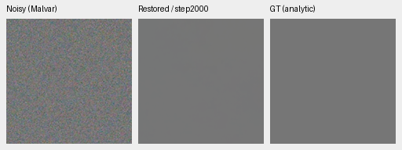
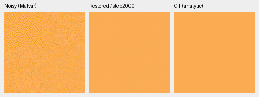
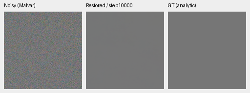
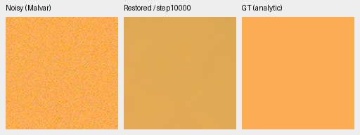
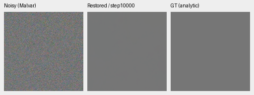
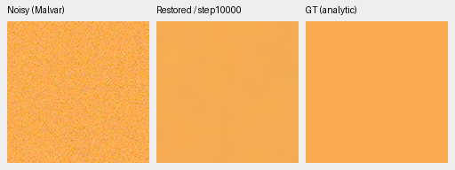
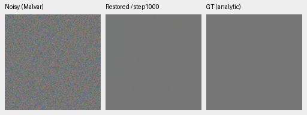
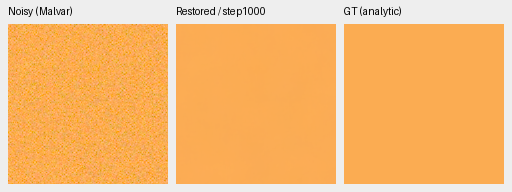
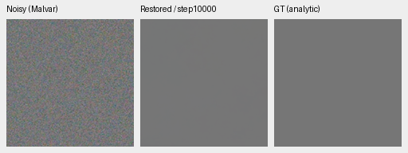
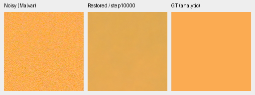

# Mature checkpoints still shift some saturated flat colors

ConvNeXt's original 10,000-update checkpoint develops large color errors on two
selected uniform saturated fields, despite the neutral field remaining accurate.
The error also occurs with ADC-only input. Its selected photographic fabric crop
looks closer to GT than the older no-context model's late crop, so that visual
improvement does not establish that color fidelity has been repaired.
[Complete observations, predictions, crop receipts and independent audit](results/mature-color-flat-review.json).

This extends the [original no-context diagnosis](colored-flat-camera-diagnostic.md)
on exactly the same 32 saved observations: four chosen colors, four CFAs and two
noise conditions, with one draw per case. Inference uses EMA, CPU FP32, batch 1.
V43 has a different initialization and training history; this small post-hoc
palette cannot establish a general photographic ranking or a training cause.
The full ConvNeXt quality evaluation was still running when this diagnosis was
completed. No model is promoted from this diagnostic.

## Uniform camera-RGB errors

Each value is the **largest absolute per-channel mean error across all four
CFAs**, in normalized, unclipped camera RGB. This is neither a PSNR score nor an
average over CFAs. Means are measured on native ROI[48,48,160,160] of each saved
256×256 field. ADC-only has shot=read=0; both conditions retain 16-bit ADC
quantization with black=.03. The high-noise protocol prior uses shot=.00256 and
read variance=.0000262144.

| Checkpoint | Condition | Neutral | Warm | Cyclic GBR | Cyclic BRG |
| --- | --- | ---: | ---: | ---: | ---: |
| V43 retained2k | adc-only | 0.000157 | 0.007939 | 0.006116 | 0.001550 |
| V43 retained2k | iso12800-prior | 0.000630 | 0.001537 | 0.002077 | 0.000560 |
| ViT-S10k | adc-only | 0.000102 | 0.018625 | 0.056743 | 0.017736 |
| ViT-S10k | iso12800-prior | 0.000589 | 0.103168 | 0.139113 | 0.002070 |
| ViT-B10k | adc-only | 0.000255 | 0.071028 | 0.005762 | 0.001382 |
| ViT-B10k | iso12800-prior | 0.000666 | 0.044809 | 0.032800 | 0.004829 |
| ConvNeXt1k | adc-only | 0.000426 | 0.002006 | 0.003285 | 0.001614 |
| ConvNeXt1k | iso12800-prior | 0.001046 | 0.002764 | 0.003786 | 0.001900 |
| ConvNeXt10k | adc-only | 0.000251 | 0.033465 | 0.077301 | 0.001329 |
| ConvNeXt10k | iso12800-prior | 0.000714 | 0.092458 | 0.120555 | 0.002396 |

The mature S and ConvNeXt warm fields visibly darken and lose saturation. B has a
smaller selected high-noise warm shift but a larger ADC-only warm error. The
high-noise warm mean errors averaged across CFAs are approximately
[-.09279,-.02197,-.00374] for S, [-.02554,-.00221,-.00102] for B, and
[-.08795,-.02160,-.00635] for ConvNeXt. ConvNeXt1k is
[+.00122,+.00055,+.00260]. The neutral cases stay close throughout.

The [smooth-palette coverage check](colored-flat-camera-diagnostic.md#a-testable-smooth-color-coverage-gap)
provides one testable hypothesis for the two difficult hues. The current smooth
branch already draws colored fields; its direct RGB tint ratio is limited to 5.
That coverage association does not prove the cause, and wider tints still need a
matched training trial and complete photo/real review.

## Native noisy / denoised / exact-GT triplets

Each panel is 160×160 at one image pixel per PNG pixel, with no resizing. All
methods use identical RGGB observations, ROI[48,48,160,160], WB[2,1,1.5], the
recorded camera matrix and display exposure×1. Left: noisy Malvar. Middle:
denoised. Right: exact uniform analytic GT. These are 8-bit sRGB previews;
metrics use retained unquantized float32 predictions. The ISO12800 prior above
is a synthetic protocol condition, not a real-camera ISO calibration.

### Retained V43, step2000

Neutral:

Warm:

### Frozen ViT-S, step10000

Neutral:

Warm:

### Frozen ViT-B, step10000

Neutral:

Warm:

### ConvNeXt, step1000

Neutral:

Warm:

### ConvNeXt, step10000

Neutral:

Warm:

## Provenance and verification

| Checkpoint | SHA256 |
| --- | --- |
| dino-anchored-native-diverse-b16-v43:step2000 | `0d74cf31fb1c7e3f97fc692c855a2ca0ee3ebf562b454e4f8b135c28fc0aa5c5` |
| dino-anchored-native-fresh-b16-v44:step10000 | `ae74bc17012c85d5253f24da4dbaaec4486ed430aa143d852442754288d56bad` |
| dino-base-anchored-native-fresh-b16-v51:step10000 | `dcf3e96591d7ede1890482f874b0233a1ba9516bb9e31a042e5efa82e242ced1` |
| dino-convnext-pyramid-fresh-b16-v58:step1000 | `afc0806d0c99a38bed33364bbf93ab94302080e4d78e1da044a2b782a97c7dfa` |
| dino-convnext-pyramid-fresh-b16-v58:step10000 | `cc1fb5e6d3e0d042c95495dd7bf1bd07c900cb6f7e3b61541f78c9e08098fea3` |

All 32 observation hashes and 160 full float32 predictions passed shape, finite
value and checksum checks. An independent Torch64 reconstruction of 960 NumPy64
metric fields differs by at most 4.45e-16. All ten native PNGs were actually
viewed, and all 30 image panels rerender byte exactly from the retained arrays.
No new noise draws, output correction, RAW decoding or CUDA context was needed.
[Evaluator](../scripts/evaluate_saved_color_flats.py); frozen sources, inputs,
execution metadata and individual ROI/conditioning records are linked in the
machine-readable receipt. The warm target reuses only the earlier fabric ROI's
three channel means, not its photographic pixels.

The [optional wider-palette intervention](wide-flat-palette.md) passes CPU/CUDA
numerical and restart checks. Both matched V59/V60 recipes have completed
their original 4,000 updates. The [selected CPU diagnosis](wide-flat-palette-full4k-selected-colors.md)
finds uneven color changes. The [complete final4k review](wide-flat-palette-full4k-review.md)
finds a small photo gain and stronger high-saturation groups, with persistent
moderate-saturation and paired-real limitations.
