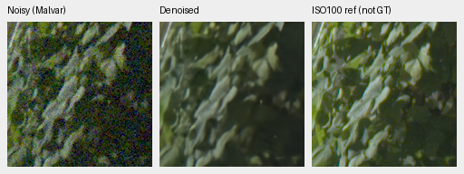
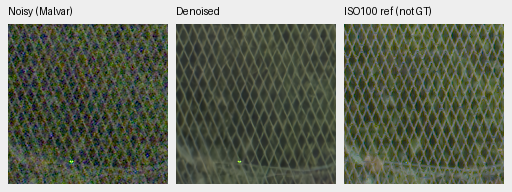
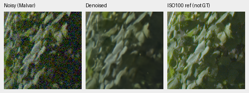
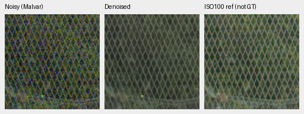

# Same GFX pixels, different input windows

Changing the mature V63 input window from256 to512 sensor pixels produces no
clear broad native detail recovery in the four standing GFX regions. Sky,
building and fence structure look very similar, foliage remains soft, and a
bright fence point changes. This is a small unchanged-model context diagnostic;
it does not establish the effect of training on larger patches.

[Complete source/checkpoint/input/ROI/display bindings, actual native views,
independent difference arithmetic and data-size counts](results/mature-context-window-GFX-v1.json).
The [separate input-gain method is rejected](mature-input-cfa-gain.md).

## Exact matched sensor regions

All methods use the same genuine V63 original20k EMA, SHA256
`ed70952dd33c5d7da39199bf1306b58b579862920fb0cccd6b222f19871bc9b5`.
One new B4/native256 CUDA IEEE-FP32/channels-last forward uses the exact central
256px input of each cached512 context. The512-context and full-frame512/64
outputs are verified saved original FP32 predictions, not newly rerun methods.
Every512 context's CFA input matches the cached normalized full RAW exactly.
The model state hash is unchanged. No new noise, RAW decode or source drive read.

All12 triplets/20 unique native cells in the
[complete comparison board](images/mature-window-GFX-native.png) were actually
viewed at original resolution. No crop pixels were resized. Method-specific
sensor input extents and full-frame flags are inside each model record; sensor
ROI, noisy/reference pixels, conditioning and display remain common.

DSCF3879 ISO6400/f1.7/1/240s is compared with separate DSCF3880 ISO100/f5.6/3s,
3m38s later. The latter is a qualitative independently demosaiced reference,
**not GT**. Native160px ROIs remain sky[5800,1400], building[5790,2690],
foliage[8890,5570], fence[2240,6000]; separate reference x coordinates are
5791 for building and2241 for fence. No resampling/warping is applied.
WB[1.5132450331125828,1,2.2152317880794703], the recorded common matrix,
shot=.0014635775921166604/read variance=1.0715704128646712e−6 and display×4/+2EV
are unchanged. This scene/siblings stay excluded from training.

The unquantized256-minus512 camera-RGB differences are descriptive:

| Region | Maximum absolute difference | RMS difference |
| --- | ---: | ---: |
| Sky |.00070467|.00015877|
| Building |.00115875|.00012579|
| Foliage |.00081199|.00005333|
| Fence |.02800882|.00046571|

The fence maximum concerns a local bright point; the larger windows do not
visibly recover broad missing foliage texture. Different input windows are
intentional here, so these are context differences rather than a numerical
precision replay gate or a quality score. All12 pairwise region comparisons
(921,600 scalar differences/60 summary fields) pass independent scalar
`math.fsum`/max/mean/RMS arithmetic within1e−12.

256 input, noisy → restored → separate ISO100 reference, **not GT**:

512 input, same sensor ROI/display:

## Larger training contexts change data availability

The current84,867-source training recipe bins4×, performs geometry/PSF at twice
the target size, then downsamples2×. Increasing target size without upscaling
requires a correspondingly larger source cache. The frozen reviewed manifest
has these eligible training-file counts:

| Native target | Required minimum4× cache side | Files | Share |
| --- | ---: | ---: | ---: |
|256|512|84,867|100%|
|320|640|50,912|59.99%|
|384|768|21,709|25.58%|
|448|896|7,504|8.84%|
|512|1024|1,305|1.54%|

These are audited-manifest dimension counts, not a new per-cache integrity audit
or a training result. A blanket512 setting would sharply reduce scene diversity.
A future context experiment needs a matched eligible-subset control or an
explicit mixed-size recipe; the current metadata do not justify stretching
small images or silently changing membership. Batch-size throughput remains a
separate question already measured under the current native256 recipe.

Nineteen native-board tests pass, including exact pixel preservation and
shared sensorROI versus method-specific input-window metadata. Ruff passes.
The first launch stopped before CUDA/model loading because the plan passed a
checkpoint receipt containing an extra`step` field to a path/hash equality
check. All input hashes matched. Its source/plan/log remain unchanged; the
second plan normalizes only that file reference and relocates output paths,
with identical worker bytes. The corrected actual forward and native review
complete successfully. No model/default/patch-size change, new full-frame
restore/export, timing or general real-quality gain is claimed.
