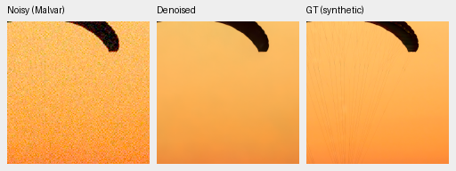
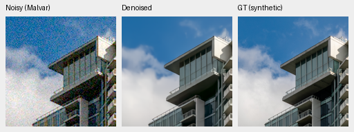
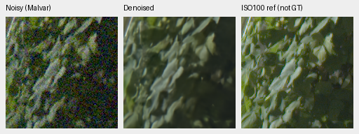
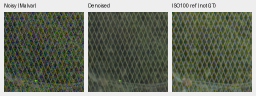

# Mature FP32 full-frame autotuning and CLI validation

Opt-in cuDNN autotuning reduces the observed warmed 101.996MP restore from
206.88→118.22s for V43 and 209.35→120.48s for V63. Both complete unquantized
outputs pass the original 1DN16 maximum/.25DN16 RMS limits. A separate fresh
run through the actual new CLI takes 166.67s for the restore, including search.
These are different timing scopes. Existing quality limitations remain;
neither a new model nor the 100MP/10s objective is achieved here.

[Complete plans, case/source/checkpoint/output hashes, numerical and export checks,
native crop metadata and actual view records](results/mature-cudnn-fullframe-v1.json).
The [earlier context probes](mature-cudnn-autotune.md) and
[complete 160k-example quality comparison](packed-isotropic-mixed16-quarter-review.md)
remain separate evidence.

## Full-frame result and startup

Four fresh processes run serially with the genuine mature EMA checkpoints,
the same cached DSCF3879 RAW, 512px tiles, 64px overlap, B4 and channels-last.
All neural and physical operations use IEEE FP32, without AMP/TF32 or hidden
autocast. Each process has a 16GiB CUDA allocator cap. Policy order is reversed
between models. There is one full observation per case on a shared GB10;
these ratios have no repeat-run confidence interval.

| Model | Original seconds | Autotuned seconds | Observed ratio | Maximum DN16 | RMS DN16 |
| --- | ---: | ---: | ---: | ---: | ---: |
| V43 step2000 | 206.882 | 118.217 | 1.750× | .121092 | .000817 |
| V63 step20000 | 209.352 | 120.478 | 1.738× | .085936 | .000718 |

The comparison covers all **611,975,112 camera-linear RGB values**, before
clipping, rendering or quantization. Independent float64 reductions and
`math.fsum` agree with the original helper exactly on maximum error and within
1e−12 DN on RMS arithmetic. Neither bound was relaxed. Model/DINO states,
parameter identities, checkpoint bytes, source files and CPU/Python/CUDA RNG
remain unchanged.

Three forwards on the first four actual full-frame tiles precede each restore:

| Model / policy | First forward seconds | Second seconds | Third seconds |
| --- | ---: | ---: | ---: |
| V43 original | 1.895 | 1.394 | 1.402 |
| V43 autotuned | 21.734 | .855 | .863 |
| V63 original | 2.045 | 1.446 | 1.433 |
| V63 autotuned | 22.919 | .862 | .862 |

The first forward includes library initialization and algorithm search; it is
not a pure search measurement. Full-frame times include validation, allocations,
packing/transfers, neural execution and blending across all 520 tiles. They
exclude these warmups, RAW decoding, model loading, array saving and TIFF export.
These inference measurements do not establish a training-speed gain; training
already enables cuDNN benchmarking.

## Actual CLI and bounded backend settings

```bash
source scripts/env.sh
uv run --no-sync demosaic infer /mnt/external/demosaic/models/v43-step2000.pt \
  .cache/gfx-qualitative-20231231/2023-12-31-17-13-27_DSCF3879_0412de8b8eaac075351e2fe2605cd2558376d7f4.raf \
  /mnt/external/demosaic/output/CHOOSE-NEW-linear16.tiff \
  --preview /mnt/external/demosaic/output/CHOOSE-NEW-srgb16.tiff \
  --shot 0.0014635775921166604 --read 0.0000010715704128646712 \
  --tile 512 --overlap 64 --batch-size 4 --precision float32 --cudnn-benchmark
```

`infer --cudnn-benchmark` enables a search limit of 10 and a 16GiB PyTorch CUDA
allocator cap, preserving any stricter existing quota. It requires CUDA and
FP32 for the base and refinement branches, and rejects checkpoints forcing
hidden half precision. Prior backend settings, precision and quota are restored
on success or failure. The sidecar records the effective policy. The cap does
not describe total unified RAM; restoring settings does not clear algorithm
caches. The flag defaults off and does not change training or benchmark commands.

The actual CLI ran on the cached RAF with the same V43 checkpoint/noise/tile
settings. A wrapper called the original restore unchanged, then captured its
returned float32 array. All **305,987,556** values pass the original limits
against the original full-frame baseline: maximum **.105467DN16**, RMS
**.000779DN16**, also independently checked. Actual IEEE flags, unchanged
state/RNG, the allocator cap and restoration of settings were checked.

This fresh CLI restore takes **166.674s**, including search and without the
benchmark's three preparatory forwards. Its instrumented 178.201s end-to-end
time includes extra capture/hash/save work and is not a normal CLI benchmark.
Do not substitute the warmed 118.217s for first-run latency or interpret the
separately measured 21.734s initial forward as all CLI search overhead.

Both entire CLI TIFFs match their declared float32 clip/scale/round-to-even
quantization, uint16 RGB shape and metadata. Linear and sRGB exports have
9,422/25,612 sampled distinct codes; the preview has the required sRGB ICC.
The preview uses exposure 1 (0EV). The two frozen full-frame autotuned linear
TIFFs also match every encoded value, with 9,420/9,468 sampled codes. All full
float32 arrays and TIFFs remain preserved.

Twenty targeted CPU tests pass, covering quota/settings restoration on success
and error, stricter quotas, disabled behavior, active CUDA device resolution,
invalid CLI combinations, hidden half precision and inference alignment. Ruff
passes for the production changes and new tests. An initial verification harness
failed before CLI/inference because PyTorch's quota getter rejects an unindexed
`cuda` device. That failure is preserved; the helper now resolves the active
index and a strict mock guards the regression. The corrected actual CLI succeeds.

## Two exact-GT photographic crops per model

Each panel below is native 160×160, without resizing: noisy Malvar → restored →
exact saved synthetic GT. Four fresh processes run the original/autotuned V43
and V63 on both fixed CPU-generated observations, using GPU B1/native256 and
IEEE FP32. No new noise is drawn. All **786,432** unquantized RGB values pass
the original 1/.25DN limits; worst maximum/RMS are .058593/.006311DN16.
Independent float64 arithmetic agrees within 1e−15 DN. Repeated outputs within
each case are byte-identical; states, inputs and RNG remain unchanged.

Both observations use RGGB, ISO12800 prior shot=.00256/read variance=.0000262144,
WB `[2,1,1.5]`, the recorded common matrix and display exposure 1 (0EV).
The displayed ROI is `[48,48,160,160]` in each saved 256px observation at the
8×-binned evaluation resolution. Source/cache hashes, validation indices/seed,
observation hashes and full transforms accompany each crop in the registry.
Replaying the native validation crop gives cache contexts `[189,3,256,256]`
and `[195,89,256,256]`, so the displayed cache ROIs are `[237,51,160,160]`
and `[243,137,160,160]` respectively, without scaling.
These CPU noise draws differ from the historical README's FP16/GPU draws.

V43, fabric and building/sky:


V63, the same observations and transforms:





Sources: [Roy Egloff](https://commons.wikimedia.org/wiki/File:CH.VD.Villeneuve_2007-08-25_Vertigo-Swiss-Riviera_2392_3x2-R_4K.jpg)
and [Dietmar Rabich](https://commons.wikimedia.org/wiki/File:Vancouver_(BC,_Canada),_Coal_Harbour_Seaside_Park,_Blick_in_den_Himmel_--_2022_--_2158.jpg),
[CC BY-SA 4.0](https://creativecommons.org/licenses/by-sa/4.0/), modified by
binning, crop, simulated noise and restoration. The [complete photo board](images/mature-cudnn-GT-photos-native.png)
contains all eight triplets/twelve unique cells, actually viewed at original
resolution. Original/autotuned pairs have no visible difference. Both lose
fine canopy cords/folds; differing V43/V63 tones remain a model limitation.
No population-quality score is inferred from these selected views.

## Full-frame GFX foliage and fence

The [complete GFX board](images/mature-cudnn-fullframe-native.png) contains all
16 triplets/24 unique native160px cells, covering sky, building, foliage and
chain-link fence for both checkpoints/policies. All were actually viewed.
Noisy and ISO100 panels are byte copies from the fixed standing report;
the middle panels come from these new full float32 restores.

V43, foliage and fence:


V63, the same regions and transforms:





Original/autotuned views look unchanged: clean sky/building, continuous fence
structure and foliage still soft relative to the sharper separate exposure.
Display exposure is 4 (+2EV), WB `[1.5132450331,1,2.2152317881]`, with the
recorded shared matrix. Conditioning is shot=.0014635775921166604/read
variance=.0000010715704128646712. Native noisy/reference origins are sky
`[5800,1400]`/same, building `[5790,2690]`/`[5791,2690]`, foliage
`[8890,5570]`/same, fence `[2240,6000]`/`[2241,6000]`; every ROI is160px square.

DSCF3879 is ISO6400/f1.7/1/240s; DSCF3880 is ISO100/f5.6/3s, captured3m38s
later and independently AHD-demosaiced. The last panel is a qualitative
reference, **not GT**: aperture, motion and exposure time differ. Both RAFs
are locally cached; originals remain read-only and the scene/siblings remain
excluded from training.

Checkpoint SHA256 values:

- V43 step2000: `0d74cf31fb1c7e3f97fc692c855a2ca0ee3ebf562b454e4f8b135c28fc0aa5c5`.
- V63 step20000: `ed70952dd33c5d7da39199bf1306b58b579862920fb0cccd6b222f19871bc9b5`.

All workers exited successfully. V43 remains the working experimental quality
reference. This validates an optional execution policy; SOTA quality, decisive
real-photo superiority and sub10s full-frame inference remain unmet/unproven.
