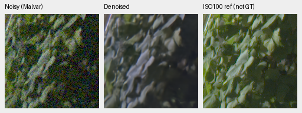
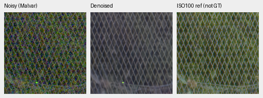

# Input-CFA channel gain is rejected on photographs and the standing GFX scene

The completed full427 test loses **1.10760dB** photo sRGB PSNR,95% source
interval **[−1.16876,−1.03704]**, and.005190 SSIM against the unchanged V63
parent. Both fixed source-exclusion subsets confirm the loss. A global GFX fit
also turns sky/building purple and removes green foliage. **Reject both the
native256 correction and the global-frame policy; do not integrate either.**
V43 remains the working reference and inference defaults stay unchanged.

[Complete photo statistics, independent audits, source sensitivities and all52
actually viewed native cells](results/mature-input-CFA-gain-complete-v1.json).
The earlier flat-field screen improved selected color errors, which did not
transfer to the complete photographic protocol or standing real capture.
The [completed objective trial](reconstruction-objective-first1k-review.md)
remains stopped at1k after failing its separate original continuation threshold.

## Fixed algorithm and scope

For each sample and RGB channel, sample the prediction at that channel's Bayer
phases and fit `g = sum(predicted_CFA * observed_CFA) /
max(sum(predicted_CFA**2),1e-12)`. Multiply the corresponding output channel
by`g`. Both green phases contribute. The fit uses all native256 input/prediction
pixels, separately for each image. There are no masks, gain bounds, output
clamps, shrinkage, target/reference inputs or fitted display transforms.
FP64 accumulation/multiplication precedes one FP32 cast. This is the existing
RawNIND channel-adapter expression applied to our own prediction; it is not a
new learned architecture. Signed/clipped observations remain as supplied, so
clipping and noise correlation remain possible sources of bias.

Parent SHA256:
`ed70952dd33c5d7da39199bf1306b58b579862920fb0cccd6b222f19871bc9b5`.
The saved predictions are native256/B1 IEEE FP32 from the completed objective
review. The grid has147 colors, two conditions/four CFAs and one draw per cell.
No checkpoint was loaded, CUDA initialized, neural forward executed or new
noise drawn in the CPU grid test. The primary objective-trial source/audit
bindings establish the reused predictions and fixed observations.

## Complete photographic result

Both variants share one fresh unchanged-model IEEE-FP32 network forward and
exactly the same observation. All62,020 records cover427 photographs plus16
procedural targets, seven conditions/four CFAs and three fresh classical
controls. Results balance source images; no historical neural scores are reused.

| Variant | Photo sRGB PSNR | SSIM | Linear PSNR | Procedural sRGB PSNR | SSIM |
| --- | ---: | ---: | ---: | ---: | ---: |
| V63 parent, fresh FP32 |35.93298|.963290|41.35986|35.07531|.976318|
| Input-CFA channel gain |34.82537|.958100|39.26660|34.36306|.970362|

Photo linear PSNR loses2.09325dB,[−2.17686,−1.99418]. The procedural sRGB
loss is.71225dB,[−.84098,−.59254]. Photo chroma MAE rises.0071313→.0101846;
highlight-boundary chroma MAE.0141803→.0240458 and RGB MAE.0179701→.0292733.
These adverse changes accompany the primary failure.

The fixed418/416-source sRGB effects are−1.10452dB,[−1.16121,−1.04075],
and−1.10548dB,[−1.16215,−1.03862]. Ancestor exposure to related series remains
a limitation; these subsets do not establish complete scene independence.
Intervals describe source variation, not training-repeat uncertainty.

The full predeclared condition breakdown is descriptive:

| Condition | Corrected − parent sRGB PSNR, dB |
| --- | ---: |
| ADC-only |+.04620|
| ISO100 prior |+.13343|
| ISO1600 prior |+.09816|
| ISO12800 prior |+.03699|
| Shadows |−.01257|
| Highlights |−8.14730|
| Legacy noise |+.09187|

The highlight loss dominates. The existing simulator's reference-white target
clips exposed linear sRGB before returning camera RGB, while the noisy sensor
observation comes from the exposed scene. Fitting to all sensor samples can
therefore conflict with that target around highlights. The condition pattern
is consistent with that issue; it does not isolate every source of the loss or
establish a corrected fitting policy. The rejected formula remains unchanged.

The predeclared.05dB/positive-interval photo gate and.0001 SSIM limit all fail.
Known/unseen camera tests were not launched after the photographic and standing
real failures; no new camera score or full-frame promotion is claimed.

## Uniform-field diagnostic

Normalized camera-RGB bias means the maximum absolute channel-mean error of
one native160 ROI. These bright groups contain96 cases each at ISO12800 prior
and peak.90; statistics describe this fixed grid rather than confidence intervals.

| Saturation | Parent mean bias | Corrected mean bias | Parent worst bias | Corrected worst bias | Parent / corrected RGB RMSE |
| --- | ---: | ---: | ---: | ---: | ---: |
|.50|.014350|.001688|.057548|.008752|.010289 / .003028|
|.98|.005739|.001920|.039979|.009527|.004512 / .002381|

Seventeen of18 group mean biases decrease. The dark noisy neutral group rises
slightly,8.06e−5→8.72e−5. Gains do not remove spatial variation; the selected
magenta fields still show coarse residual variation. These uniform fields
cannot establish fine-detail, clipped-edge, real-camera or seam behavior.

Before executing the grid, the plan required at least25% relative reduction
in mean maximum-channel bias in both bright saturation groups and no increase
in either worst case before considering full photographic evaluation. Both
pass. The formula and thresholds are unchanged after seeing these scores.

An independent NumPy phase-slice/dot-product fit checks all1,176 gain triplets,
maximum absolute difference2.15e−14 versus the fixed2e−12 relative/absolute
bounds. Corrected FP32 pixels differ by at most5.96e−8 versus2e−7. Original
per-case metrics reproduce exactly from the saved arrays. Seven focused tests
pass, including all CFA layouts, separate batch fits, both greens, zero
predictions, signed/unbounded inputs and one-shared-forward/no-GT-access checks.
Ruff passes. No training or inference default is changed.

## Native flat examples

Noisy Malvar → gain-corrected parent → exact analytic GT. Each panel is native
160×160, with no resizing. ROI[48,48,160,160], RGGB, shot=.00256,
read variance=.0000262144, WB[2,1,1.5], unchanged protocol matrix,
display×1/0EV. Palette IDs are`h030-s0.98-l0.90` and`h315-s0.98-l0.90`;
full target/source/noise/checkpoint/ROI/display bindings accompany every PNG
in the registry. These are exact uniform simulation targets, not photographs.

The [complete parent/corrected native board](images/mature-input-cfa-gain-grid-native.png)
contains all seven preselected palettes, including moderate saturation, darker
colors and neutral gray. Every native cell was opened at original resolution.
Board metadata places method-specific gains inside the model record; source PNG
pixels, noise, targets and display remain unchanged.

## Global full-frame GFX policy is rejected

[Complete saved-frame fit, source/ROI/display identities, all-pixel checks and
actual native views](results/mature-global-CFA-gain-gfx-v1.json).
A single gain triplet was fitted to all101,995,852 measured CFA samples of the
existing mature V63 original FP32 DSCF3879 restore. Numerator/denominator sums
use35 even256-row chunks and divide once after aggregation; this is not an
average of tile gains. RGB gains are**[1.166430,1.007698,1.399052]**.
Independent NumPy phase-slice/dot sums agree within5.04e−14. All305,987,556
virtual corrected RGB values are finite. No new neural forward, RAW decode,
corrected full-frame array or RGB16 export was created.

The [complete native board](images/mature-global-CFA-gain-gfx-native.png) contains
all four standing regions before/after,8 triplets/16 unique cells, all viewed
at original resolution. The corrected sky and building turn conspicuously
purple, and foliage/fence lose green appearance. Fine detail is not recovered.
**Reject this unmasked global least-squares policy; do not integrate it.**
All four original panels rerender byte-exact from the saved RGB with the same
WB/matrix/exposure, verifying the display path. Its flat-field success does not
establish real-photo color fidelity. A global
fit removes differences between tile gains by construction, but does not
repair the underlying model's spatially varying color/detail errors.

There is also a simple analytical reason to avoid treating noisy-input gain
matching as a universal correction. With independent zero-mean Gaussian signal
varianceτ² and noise varianceσ², the scalar posterior mean is`p=k*y`, where
`k=τ²/(τ²+σ²)`. The fitted gain becomes`1/k`, so it returns the noisy observation
and undoes optimal shrinkage. A fixed CPU fixture withτ=.1/σ=.2 gives gain5,
measured-CFA MSE.007956→.039863. This counterexample establishes a limitation
of the fitting principle; it does not identify the cause of the nonlinear
GFX model's particular color regression.

Noisy → globally corrected saved output → separate ISO100 reference, **not GT**:

DSCF3879/3880 are the standing ISO6400/f1.7 versus ISO100/f5.6 pair, with
separate timing/motion/framing. ROIs remain foliage[8890,5570] and
fence[2240,6000] (reference fence x2241), native160 pixels. WB/matrix,
shot=.0014635775921166604/read variance=1.0715704128646712e−6 and display×4/+2EV
are shared across methods. Full source/checkpoint hashes accompany each PNG.
Eight focused tests check all CFA layouts, edge chunks, read-only inputs,
energy-weighted global fitting and invalid data. No full-frame promotion or
new end-to-end speed claim follows from this CPU diagnostic.

## Completed execution and native photographic views

The standalone evaluator uses genuine unchanged V63 original20k EMA on all427
development photos and16 procedural targets, seven conditions/four CFAs,
native256/B4/channels-last/IEEE FP32. The original and corrected predictions
share one network forward per batch and exactly the same observation. Three
fresh classical controls accompany the pair. The completed grid uses3,108
network forwards, shared between variants. Existing source-balanced metrics,
noise seed20261014, validation crop seed42 and fixed native photographic ROIs
remain unchanged. The worker retains original/corrected native GT triplets and
all input-only gains. Both the inference and CPU-closure owners exited
successfully. Complete coverage/summary arithmetic checks all62,020 records,
280 groups,10 overall rows and60 paired comparisons, maximum7.11e−15.
The independent Decimal/scalar source audit rebuilds71,736 raw metrics,2,562
source scalars and60 comparison fields across9 cohort comparisons; source
difference0 and comparison maximum4.44e−16. All early native PNG/metadata/board
hashes were revalidated after successful producer exit. No camera/GPU
continuation or alternative formula was launched by the closure.
[The earlier queue snapshot](results/mature-input-gain-closure-queue-v1.json)
remains dated evidence; the complete registry supplies terminal closure.

The plan sets24GiB CUDA allocator and two-hour limits, with successful producer
exit, actual native inspection and statistical review required before a decision.
Eligibility before any full-frame promotion additionally requires at least.05dB
photo gain with a positive source95% interval, SSIM regression at most.0001,
known/unseen measured-CFA regressions at most.05dB each, fixed418/416-source
sensitivities and complete real/detail/color/highlight review. There is no
automatic model/default promotion.

The [dated execution snapshot and first native photo views](results/mature-input-cfa-gain-photo-progress-v1.json)
record the then-live owner after real network forwards. The first two fixed source/ROI
triplets were viewed as eight unique native cells. The canopy broad color
moves slightly toward GT while fine cords remain absent; building/cloud detail
looks nearly unchanged. Original producer PNG/metadata and the viewed board
now pass the required post-exit recheck. These selected views do not substitute
for the adverse complete-population result.

Corrected output: noisy → restored → exact synthetic GT, native160 without
resizing. The cache contexts are[189,3,256,256] and[195,89,256,256], with
ROIs[237,51,160,160] and[243,137,160,160]. Conditioning/display match the
ISO12800 examples above. Noise uses the existing GPU source/condition/CFA draw
seed20261014; crop seed42 is separate.

The [parent/corrected photo board](images/mature-input-cfa-gain-photo-native.png)
retains identical noisy/GT panels. Photographic sources:
[Roy Egloff](https://commons.wikimedia.org/wiki/File:CH.VD.Villeneuve_2007-08-25_Vertigo-Swiss-Riviera_2392_3x2-R_4K.jpg)
and [Dietmar Rabich](https://commons.wikimedia.org/wiki/File:Vancouver_(BC,_Canada),_Coal_Harbour_Seaside_Park,_Blick_in_den_Himmel_--_2022_--_2158.jpg),
[CC BY-SA4.0](https://creativecommons.org/licenses/by-sa/4.0/). Modified by
binning, crop, synthetic noise, restoration, input-CFA gain and common rendering.
These are exact simulation targets rather than clean RAW measurements.

Across this complete study,26 native triplets/52 unique cells were actually
viewed: color grid14/28, fixed photographs4/8 and global GFX8/16.
The fixed formula is not pursued further.39 focused source/global/closure tests
pass, with the original seven input-fit/shared-forward checks retained.
No new corrected full-frame RGB16 export or end-to-end timing is claimed. Ancestor scene-series exposure is not
undone by new source exclusions. One seed and development data do not establish
SOTA or decisive real-photo superiority. V43 remains the working reference;
the protected-final scenes remain closed.
