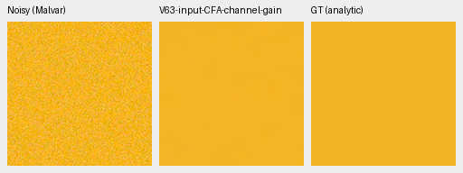
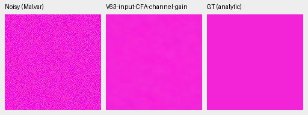
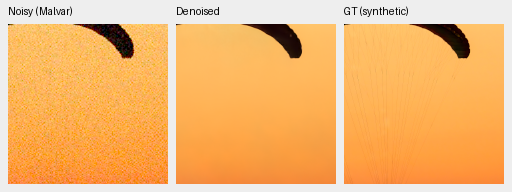
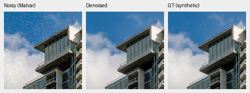

# Mature-parent input-CFA gain: color screen passes, photo review running

A fixed input-only per-channel least-squares gain reduces the mature V63
parent's bright flat-field mean color bias by88.2% at saturation.50 and66.5%
at.98. Both worst-case errors also decrease. The entire1,176-observation saved
grid passes independent numerical checks, and all14 native triplets/28 cells
were actually viewed. **This is a color diagnostic, not photographic quality
or a promoted model.** A fresh full427-photo paired FP32 test is running.

[Grid results, fixed plan, independent gain oracle and native evidence](results/mature-input-cfa-gain-grid-v1.json).
The [completed objective trial](reconstruction-objective-first1k-review.md)
remains stopped at1k after failing its original continuation threshold.

## Fixed algorithm and scope

For each sample and RGB channel, sample the prediction at that channel's Bayer
phases and fit `g = sum(predicted_CFA * observed_CFA) /
max(sum(predicted_CFA**2),1e-12)`. Multiply the corresponding output channel
by`g`. Both green phases contribute. The fit uses all native256 input/prediction
pixels, separately for each image. There are no masks, gain bounds, output
clamps, shrinkage, target/reference inputs or fitted display transforms.
FP64 accumulation/multiplication precedes one FP32 cast. This is the existing
RawNIND channel-adapter expression applied to our own prediction; it is not a
new learned architecture. Signed/clipped observations remain as supplied, so
clipping and noise correlation remain possible sources of bias.

Parent SHA256:
`ed70952dd33c5d7da39199bf1306b58b579862920fb0cccd6b222f19871bc9b5`.
The saved predictions are native256/B1 IEEE FP32 from the completed objective
review. The grid has147 colors, two conditions/four CFAs and one draw per cell.
No checkpoint was loaded, CUDA initialized, neural forward executed or new
noise drawn in the CPU grid test. The primary objective-trial source/audit
bindings establish the reused predictions and fixed observations.

## Complete grid result

Normalized camera-RGB bias means the maximum absolute channel-mean error of
one native160 ROI. These bright groups contain96 cases each at ISO12800 prior
and peak.90; statistics describe this fixed grid rather than confidence intervals.

| Saturation | Parent mean bias | Corrected mean bias | Parent worst bias | Corrected worst bias | Parent / corrected RGB RMSE |
| --- | ---: | ---: | ---: | ---: | ---: |
|.50|.014350|.001688|.057548|.008752|.010289 / .003028|
|.98|.005739|.001920|.039979|.009527|.004512 / .002381|

Seventeen of18 group mean biases decrease. The dark noisy neutral group rises
slightly,8.06e−5→8.72e−5. Gains do not remove spatial variation; the selected
magenta fields still show coarse residual variation. These uniform fields
cannot establish fine-detail, clipped-edge, real-camera or seam behavior.

Before executing the grid, the plan required at least25% relative reduction
in mean maximum-channel bias in both bright saturation groups and no increase
in either worst case before considering full photographic evaluation. Both
pass. The formula and thresholds are unchanged after seeing these scores.

An independent NumPy phase-slice/dot-product fit checks all1,176 gain triplets,
maximum absolute difference2.15e−14 versus the fixed2e−12 relative/absolute
bounds. Corrected FP32 pixels differ by at most5.96e−8 versus2e−7. Original
per-case metrics reproduce exactly from the saved arrays. Seven focused tests
pass, including all CFA layouts, separate batch fits, both greens, zero
predictions, signed/unbounded inputs and one-shared-forward/no-GT-access checks.
Ruff passes. No training or inference default is changed.

## Native flat examples

Noisy Malvar → gain-corrected parent → exact analytic GT. Each panel is native
160×160, with no resizing. ROI[48,48,160,160], RGGB, shot=.00256,
read variance=.0000262144, WB[2,1,1.5], unchanged protocol matrix,
display×1/0EV. Palette IDs are`h030-s0.98-l0.90` and`h315-s0.98-l0.90`;
full target/source/noise/checkpoint/ROI/display bindings accompany every PNG
in the registry. These are exact uniform simulation targets, not photographs.

The [complete parent/corrected native board](images/mature-input-cfa-gain-grid-native.png)
contains all seven preselected palettes, including moderate saturation, darker
colors and neutral gray. Every native cell was opened at original resolution.
Board metadata places method-specific gains inside the model record; source PNG
pixels, noise, targets and display remain unchanged.

## Fresh photographic test, not a continuation of V74/V75

The standalone evaluator uses genuine unchanged V63 original20k EMA on all427
development photos and16 procedural targets, seven conditions/four CFAs,
native256/B4/channels-last/IEEE FP32. The original and corrected predictions
share one network forward per batch and exactly the same observation. Three
fresh classical controls accompany the pair. The full grid requires3,108
network forwards, not one per variant. Existing source-balanced metrics,
noise seed20261014, validation crop seed42 and fixed native photographic ROIs
remain unchanged. The worker retains original/corrected native GT triplets and
all input-only gains, then independently audits coverage and summary arithmetic.

The plan sets24GiB CUDA allocator and two-hour limits, with successful producer
exit, actual native inspection and statistical review required before a decision.
Eligibility before any full-frame promotion additionally requires at least.05dB
photo gain with a positive source95% interval, SSIM regression at most.0001,
known/unseen measured-CFA regressions at most.05dB each, fixed418/416-source
sensitivities and complete real/detail/color/highlight review. There is no
automatic model/default promotion.

The [dated execution snapshot and first native photo views](results/mature-input-cfa-gain-photo-progress-v1.json)
verify a live owner after real network forwards. The first two fixed source/ROI
triplets were viewed as eight unique native cells. The canopy broad color
moves slightly toward GT while fine cords remain absent; building/cloud detail
looks nearly unchanged. Original producer PNG/metadata must be rechecked after
successful full-test exit before final closure.

Corrected output: noisy → restored → exact synthetic GT, native160 without
resizing. The cache contexts are[189,3,256,256] and[195,89,256,256], with
ROIs[237,51,160,160] and[243,137,160,160]. Conditioning/display match the
ISO12800 examples above. Noise uses the existing GPU source/condition/CFA draw
seed20261014; crop seed42 is separate.

The [parent/corrected photo board](images/mature-input-cfa-gain-photo-native.png)
retains identical noisy/GT panels. Photographic sources:
[Roy Egloff](https://commons.wikimedia.org/wiki/File:CH.VD.Villeneuve_2007-08-25_Vertigo-Swiss-Riviera_2392_3x2-R_4K.jpg)
and [Dietmar Rabich](https://commons.wikimedia.org/wiki/File:Vancouver_(BC,_Canada),_Coal_Harbour_Seaside_Park,_Blick_in_den_Himmel_--_2022_--_2158.jpg),
[CC BY-SA4.0](https://creativecommons.org/licenses/by-sa/4.0/). Modified by
binning, crop, synthetic noise, restoration, input-CFA gain and common rendering.
These are exact simulation targets rather than clean RAW measurements.

A per-tile fit may vary with image content and introduce full-frame seams. Any
full-frame method needs a separately validated whole-frame gain, common
transforms, RGB16 exports and timing. Ancestor scene-series exposure is not
undone by new source exclusions. One seed and development data do not establish
SOTA or decisive real-photo superiority. V43 remains the working reference;
the protected-final scenes remain closed.
