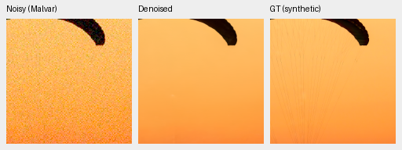
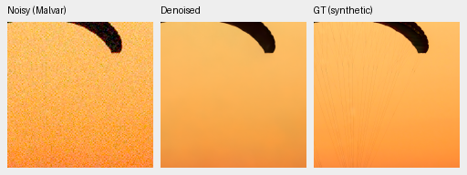
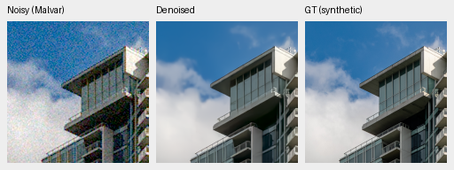
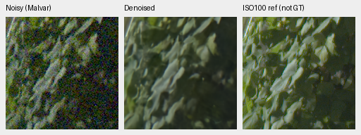
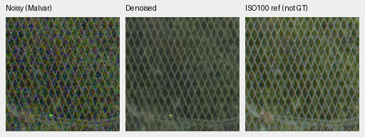
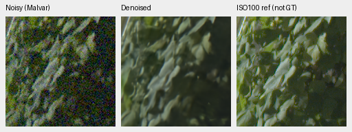
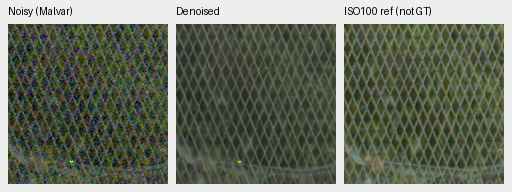

# Mature precision pilot: native screen passes, resident inference is about4× faster

Both mature models pass the fixed FP16 and hidden-branch FP16 screen. Hidden
FP16 reduces median resident B4/native512 time from690.54→162.49ms for V43
and704.41→173.51ms for V63: **4.250×/4.060×** observed ratios. All48 native
photo/GFX cells were actually inspected before quality/timing interpretation.

This is a finite existing-weight execution study on two photos,96 unique
analytic observations, ramp probes and four GFX contexts. Full-suite quality
and actual100MP16-bit validation remain required before integration. Working
model/config/defaults remain unchanged; the older FP32 full-frame results are
118.22/120.48s. No new whole-image timing or model-quality gain is claimed.

[Complete CUDA receipt, policy margins and selection](results/mature-mixed-precision-CUDA-v1.json),
[all per-observation results](results/mature-mixed-precision-CUDA-screen-v1.json),
[independent Torch replay](results/mature-mixed-precision-independent-Torch-audit-v1.json),
[actual pre-statistics viewing](results/mature-mixed-precision-native-viewing-v1.json),
[all36 triplets and crop metadata](results/mature-mixed-precision-published-native-v1.json),
and [original fixed protocol](mature-mixed-precision-pilot.md).

## Same learned tensors, explicit numerical policies

| Model | Original checkpoint SHA256 | Frozen DINO |
| --- | --- | --- |
| V43 step2000 | `0d74cf31fb1c7e3f97fc692c855a2ca0ee3ebf562b454e4f8b135c28fc0aa5c5` | ViT-S/16 |
| V63 original20000 | `ed70952dd33c5d7da39199bf1306b58b579862920fb0cccd6b222f19871bc9b5` | ConvNeXt-Tiny |

Each model retains its original learned tensors, config, parameter identities,
checkpoint/DINO hashes, inputs and Python/Torch/CUDA RNG. Scoped research
policies restore the existing hidden-stage flag on exit. The physical head,
final native skip, tail, output and inverse remain FP32. Ordinary FP16 retains
the first residual branch's original FP32 input; hidden FP16 casts that branch
to FP16 while keeping the native skip FP32. This changes arithmetic, without
retraining or creating a new checkpoint/export.

The serial worker starts only after every exact V92 training/review/closure/
reference/package owner exits successfully. It completes212 real forwards:
94 instrumented and12 unhooked timing forwards per model, saving174 captures
and24 timed repeats. Every instrumented forward invokes the actual DINO once
and records the intended physical/encoder dtypes. The16GiB CUDA cap, backend
settings and original state are restored; the worker and controller have exited.

## Resident timing and startup scope

Three excluded warmups per policy precede four synchronized samples each.
Policy order is balanced and reversed between models. All policies use bounded
cuDNN search limit10. Timed samples are unhooked, resident four-context forwards;
they exclude RAW decode, full-frame tiling/blending and export. Four samples on
a shared machine do not provide a broad timing confidence interval.

| Model | Policy | Median ms | Sample range ms | FP32/median |
| --- | --- | ---: | --- | ---: |
| V43 | FP32 |690.54|686.37–692.58|1.000×|
| V43 | FP16 |174.51|173.84–185.32|3.957×|
| V43 | FP16 hidden |162.49|161.76–162.95|4.250×|
| V63 | FP32 |704.41|700.58–708.50|1.000×|
| V63 | FP16 |184.43|184.15–186.44|3.819×|
| V63 | FP16 hidden |173.51|173.45–174.19|4.060×|

First-policy calls, including dtype hooks/checks, take:

| Model | FP32 seconds | FP16 seconds | FP16 hidden seconds |
| --- | ---: | ---: | ---: |
| V43 |17.785|1.440|.163|
| V63 |2.304|.187|1.205|

All calls share per-process library caches across policies and models. V43 runs
FP32 first; V63 runs hidden FP16 first. These are neither isolated cold starts
nor pure search costs. All24 timed output files are SHA256-identical to their
first policy capture, including signed-zero encodings.

## Accuracy, physical differences and native codes

Every fixed per-observation photo, ADC, noisy-carrier, flat and ramp criterion
passes for both half policies and both models. The two-photo worst PSNR loss
is below.000112dB, and worst SSIM loss below.00000323 across canonical FP32
and independent float64 arithmetic. Both implementations' gate decisions agree.
The original limits remain.05dB/.0001 per photo, signed-gain loss at most.05
per ADC/noisy-carrier observation and flat-luma RMS at most1.25×FP32.

| Model / policy | Worst ADC gain change | Worst noisy-carrier gain change | Largest flat-luma RMS ratio |
| --- | ---: | ---: | ---: |
| V43 FP16 |−.001288|−.000823|1.000898×|
| V43 FP16 hidden |−.001490|−.000692|1.000877×|
| V63 FP16 |−.002343|−.000787|1.000479×|
| V63 FP16 hidden |−.001812|−.000802|1.000541×|

All96 unique analytic observations per method remain, including48 actual ADC
carriers with192 original duplicate draw labels,32 noisy carriers and16 flat
observations. All12 ADC means and90 total method/signal groups are retained;
duplicate deterministic labels are not independent observations.

Unclipped camera-RGB differences cover all95,944,704 compared values. DN16
here means normalized camera-RGB difference multiplied by65535:

| Model / policy | Maximum absolute DN16 | Largest fixture RMS DN16 |
| --- | ---: | ---: |
| V43 FP16 |19.86493|1.71532|
| V43 FP16 hidden |28.81011|2.80906|
| V63 FP16 |19.70673|2.52832|
| V63 FP16 hidden |27.90192|3.66667|

FP16 outputs therefore change numerically. These values do not pass the earlier
FP32-autotuning1/.25DN16 equivalence limits; this separate intervention retains
its own original quality/response screen and records the physical differences.
No earlier tolerance is redefined. All24 native ramp checks retain more
than256 output codes, with a minimum21,692, and nonzero one-DN response;
the smallest RMS response is1.52280e−5 camera RGB.

Independent CPU Torch replay checks3,840 analytic fields,24 canonical photo
fields, all95.9million physical differences and48 ramp fields. Photo metrics
and code counts repeat exactly; maximum analytic discrepancy is3.66e−14,
physical RMS discrepancy2.78e−17 DN16 and maximum discrepancy zero. No model
inference or CUDA initialization is added by this audit. The prior11 numerical
tests and genuine historical preflight remain separate engineering evidence.

## Native photo and GFX views

Two exact-GT photo triplets per model/policy use the unchanged fixed CPU-generated
RGGB observations at native256, shot`.00256`, read variance`.0000262144`,
WB`[2,1,1.5]`, the common recorded matrix and exposure1/0EV. Every displayed
panel is native160×160, ROI`[48,48,160,160]` at the8×-binned evaluation resolution.
These CPU noise draws differ from V92's source-keyed GPU observations.

V43, hidden FP16:

V63, hidden FP16:

Sources: [Roy Egloff](https://commons.wikimedia.org/wiki/File:CH.VD.Villeneuve_2007-08-25_Vertigo-Swiss-Riviera_2392_3x2-R_4K.jpg)
and [Dietmar Rabich](https://commons.wikimedia.org/wiki/File:Vancouver_(BC,_Canada),_Coal_Harbour_Seaside_Park,_Blick_in_den_Himmel_--_2022_--_2158.jpg),
[CC BY-SA4.0](https://creativecommons.org/licenses/by-sa/4.0/); modified by
binning, cropping, simulated noise and restoration. The
[complete16-cell photo board](images/mature-precision-pilot-photo-all-policies-native.png)
and asset index retain both triplets for all six model/policy methods. Fine
canopy cords remain lost; no new precision-specific artifact is visible.

The cached GFX3879/3880 pair uses all four native512 contexts, native160 ROI
`[176,176,160,160]`, shared exposure4/+2EV, shot`.0014635775921166604` and
read variance`1.0715704128646712e-6`. The ISO100 f/5.6 exposure is a separate
qualitative reference, **not GT**, and is not scored. Foliage and fence for
the two hidden-FP16 methods:

All32 cells in the [complete GFX board](images/mature-precision-pilot-gfx-all-policies-native.png)
are actually viewed. Within-model policies look close; soft foliage and model
tone differences remain. The native RGB8 previews support visual inspection,
while numerical/16-bit checks use saved unquantized outputs.

Hidden FP16 is selected for a separately frozen full-quality and100MP16-bit
study because it passes the finite screen and is fastest on both models.
This selection does not alter the original pilot, learned weights, production
defaults or README crops. The full qualification study has not yet launched;
the SOTA, decisive real-photo advantage and100MP/10s goals remain open.
