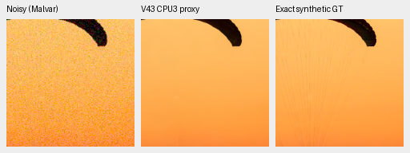
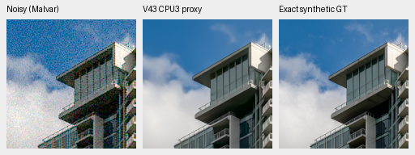
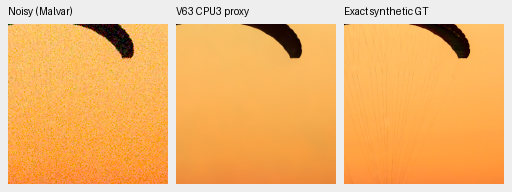
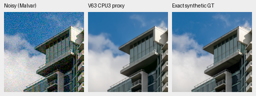

# Three-product convolution: CPU feasibility and offline compilation

The CPU operand proxy keeps the four tested mature-model outputs within
**0.063 maximum / 0.0077 RMS DN16** of their IEEE FP32 originals. All seven
hidden convolution shapes compile to SM121 Tensor Core instructions without
initializing CUDA or loading a kernel. **Actual GPU accuracy and speed remain
unverified.** Production inference/training, weights and defaults are unchanged.
[Plans, hashes, complete numerical checks and native crop records](results/mature-TF32x3-CPU-and-AOT-v1.json).

This targets the expensive hidden RGB convolutions while retaining the current
model's FP32 physical operations, first/final projections, native skips,
transposed convolutions and DINO path. It is an execution experiment, without
another learned branch or training change. The current original 20k V84/V85
data study keeps its fixed inputs and takes priority over GPU testing.

## Numerical feasibility

The installed Triton 3.8.0 API supports `tf32x3`. The
[official API](https://triton-lang.org/main/python-api/generated/triton.language.dot.html)
and [pinned compiler pass](https://raw.githubusercontent.com/triton-lang/triton/v3.8.0/lib/Dialect/TritonGPU/Transforms/F32DotTC.cpp)
describe a three-product decomposition. Our CPU proxy splits each FP32 operand
into a TF32 high part and a reduced residual, then evaluates high×high plus the
two cross terms. It omits residual×residual. High conversion rounds halfway
values away from zero; residual operands are truncated in this declared proxy.
Subnormal/overflow/nonfinite cases are rejected. The CPU reductions and term
rounding differ from GPU MMA, so this is **not a GPU arithmetic emulator**.

The actual pretrained V43 step2000 and V63 step20000 models each process both
fixed noisy native256 photo observations, unchanged RGGB/ISO12800 prior
shot=.00256/read variance=.0000262144. All 59 hidden dense convolutions use the
proxy; original projections, transpose/context/physical paths stay unchanged.
The high-only control is another CPU operand proxy, not a GPU TF32 benchmark.

| Model / photo | High-only max DN16 | Three-product max DN16 | Three-product RMS DN16 |
| --- | ---: | ---: | ---: |
| V43 / fabric | 7.624884 | .062499 | .007451 |
| V43 / building/sky | 7.019424 | .054687 | .004966 |
| V63 / fabric | 9.031112 | .054687 | .007614 |
| V63 / building/sky | 8.734242 | .046874 | .004651 |

Each proxy compares all 786,432 output values across the four cases, without
display clipping or quantization. Independent NumPy FP64 differences and
Python `math.fsum` reproduce every maximum exactly and RMS within 1e-12 DN.
Three-product repeats and original outputs after context removal are bitwise
exact. Parameter identities, full model/DINO state, checkpoint/input/source
hashes and Torch RNG remain unchanged. Both genuine foundation backbones stay
frozen; CUDA is never initialized.

## Native views

Noisy Malvar → CPU three-product proxy → exact saved synthetic GT. Each panel
contains native 160×160 pixels, with no resizing and identical exposure/WB/matrix
across methods. Evaluation ROI `[48,48,160,160]`; actual 8× source-cache ROIs
are `[237,51,160,160]` and `[243,137,160,160]`, independently replayed from the
original caches and matched to saved targets. Display exposure is 1 (0EV),
WB `[2,1,1.5]`, with the fixed protocol matrix recorded in the crop registry.
Checkpoint SHA256 and noise conditioning accompany every native crop.

V43:

V63:

Sources: [Roy Egloff](https://commons.wikimedia.org/wiki/File:CH.VD.Villeneuve_2007-08-25_Vertigo-Swiss-Riviera_2392_3x2-R_4K.jpg)
and [Dietmar Rabich](https://commons.wikimedia.org/wiki/File:Vancouver_(BC,_Canada),_Coal_Harbour_Seaside_Park,_Blick_in_den_Himmel_--_2022_--_2158.jpg),
[CC BY-SA 4.0](https://creativecommons.org/licenses/by-sa/4.0/), modified by
binning, crop, simulated noise, restoration and the numerical proxy.

The full native board includes all eight original/proxy triplets, 24 cells/12
unique cells, actually viewed at original resolution. The paired outputs look
unchanged. Both models still lose fine canopy cords/folds and retain their
existing tone/detail differences. Noisy and GT panels match byte-for-byte across
methods. These views are CPU outputs, not a trained improvement or GPU result.

## Kernel preparation and next check

`scripts/experimental_tf32x3_conv.py` implements a standalone inference-only
channels-last FP32 implicit-GEMM candidate for the mature 3×3/stride1/pad1 and
2×2/stride2/pad0 hidden operators. It has no production import or backward path.
Five actual Triton CPU-interpreter cases check indexing against independent
FP64 convolution, including odd sizes, padding, multiple batches, stride2 and
channel/reduction tails. Interpreter execution does not reproduce TF32 rounding.

Offline compilation covers all seven unique B4/native512 hidden shapes. Every
PTX contains TF32 MMA instructions and the high-part rounding conversion, and
declares 49,152 shared bytes. No kernel is loaded, and no GPU register query,
execution or timing occurs. Static instruction counts are not runtime costs.
The first direct-script attempt failed before main due to a namespace import;
its log remains preserved. The corrected attempt uses a fresh v2 output root.
All 20 targeted rounding/geometry/owner/dependency/restoration tests pass in 5.47s;
Ruff passes.

The CUDA plan is prepared at
`.cache/benchmarks/mature-TF32x3-CUDA-v1/plan.json`, with 47 frozen files / 57 bound
inputs. **No waiter or GPU job is launched.** Its actual worker refuses the
current exact live owners before CUDA initialization or output creation.
After successful original 20k training, numerical review, CPU closure and
retained-reference preparation have all finished and exited, the frozen worker
will check five CPU-FP64-known operators and both mature models on the two
photos and four standing GFX512 contexts. Each full RGB array must stay within
the unchanged 1 maximum / .25 RMS DN16 bounds; any failure stops before timing.

Only after all six model cases pass does the plan measure warmed resident
B4/native512 forwards, four samples/policy with reversed order and a16GiB CUDA
quota. That excludes JIT/search, transfers, tiling, blending, decode and export;
it cannot establish 100MP latency. Actual native viewing, broader ADC/color/photo
and full-frame checks remain required before production integration. No claimed
speedup, new default, SOTA result or completion of the 10-second goal follows.
