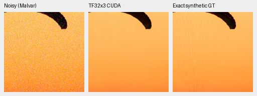
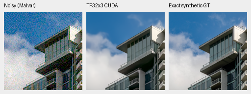
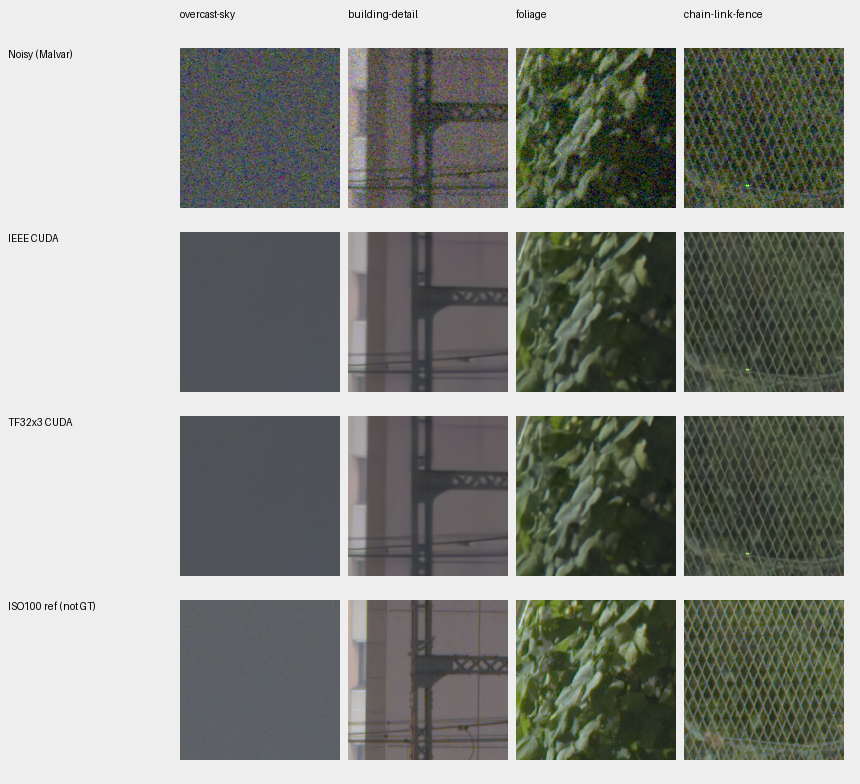
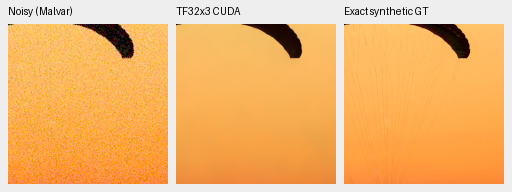
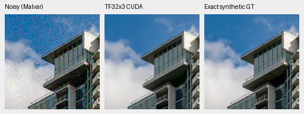
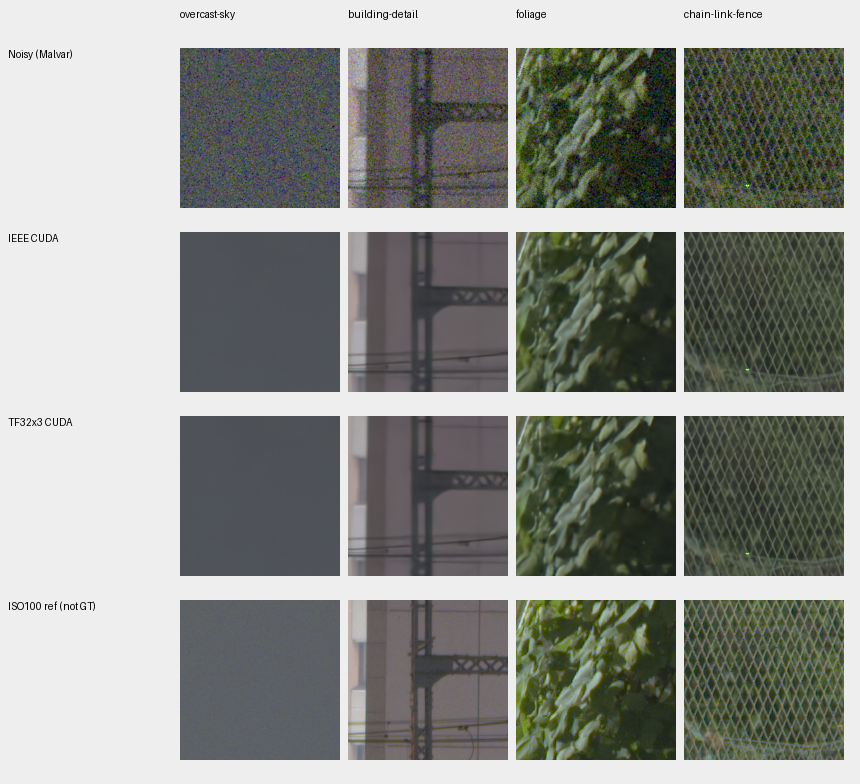

# TF32x3 CUDA review: accurate on the fixed cases, slower in the resident probe

All six actual GPU output-pair gates pass, with maximum error **0.06640524 DN16** and worst-case RMS below **0.0065 DN16**. The candidate is **10.1% slower for V43 and 8.9% slower for V63** by resident median. It stays experimental; there is no production integration, full-frame continuation, default change or speedup claim.

[Complete arrays, timings, source bindings and native-view record](results/mature-TF32x3-CUDA-complete-v1.json). [CPU/offline preparation](mature-tf32x3-convolution.md).

The exact original20k training, ten-stage quality review, CPU closure and retained-reference owners finished successfully before the queued worker started. Five actual CUDA operator cases passed independent CPU-FP64 convolution references, including odd shapes, padding, batches, stride2 and channel tails. The frozen worker temporarily replaced 59 hidden dense convolutions of the genuine mature V43/V63 networks. IEEE physical operations, head/tail, transposes, skips and DINO paths stayed unchanged. Model/DINO state and parameter identities remained unchanged; repeated candidate and restored-original outputs were exact, and RNG states matched.

## Numerical comparison

The fixed gate remains 1 maximum/.25 RMS DN16. All unquantized FP32 values are compared, without clipping or RGB16/RGB8 rounding. The separate CPU NumPy-FP64/`math.fsum` replay checks all 7,077,888 values, reproducing every maximum exactly and each RMS within 1e-12 DN16. All 57 frozen source/input bindings remain exact.

| Model | Saved observation | Maximum DN16 | RMS DN16 |
| --- | --- | --- | --- |
| V43 | photo0-native256 | 0.05078048 | 0.00649562 |
| V43 | photo1-native256 | 0.04687428 | 0.00455504 |
| V43 | GFX-four-native512 | 0.06249905 | 0.00061455 |
| V63 | photo0-native256 | 0.06640524 | 0.00649133 |
| V63 | photo1-native256 | 0.05468667 | 0.00424205 |
| V63 | GFX-four-native512 | 0.06249905 | 0.00056582 |

This is numerical agreement on two fixed native256 photos plus four fixed native512 GFX contexts per model. It is not a general error bound over all ADC/color/photo inputs or a new learned-quality result.

## Resident timing

Three warmups per policy precede four timings per policy, with reversed order on the same B4/native512 resident GFX tensors. Both policies use FP32 with cuDNN autotuning; the candidate changes only the declared hidden operators. CUDA synchronization brackets each forward.

| Model | IEEE median, seconds | TF32x3 median, seconds | Candidate change |
| --- | --- | --- | --- |
| V43 | 0.698810 | 0.769144 | 10.06% slower |
| V63 | 0.708752 | 0.771556 | 8.86% slower |

Every recorded candidate sample is slower than every IEEE sample for the same model. Four samples per policy are a small local probe, not a broad hardware benchmark. JIT/search, device startup, transfers, tiling, blending, decode and export are excluded. No 100MP latency is extrapolated from these measurements.

## Actual native crops

All four boards were actually viewed at original resolution: 56 native 160px cells representing 24 source triplets. Every source/ROI/WB/matrix/noise/display transform is fixed across policies; noisy and reference pixels match. Photo targets were replayed from the actual 8×-binned caches. No crop pixels are resized. IEEE and TF32x3 look unchanged in these views, retaining the models' existing loss of fine canopy cords, cloud detail and soft foliage. These previews do not establish full-frame equivalence.

### V43

Checkpoint SHA256: `0d74cf31fb1c7e3f97fc692c855a2ca0ee3ebf562b454e4f8b135c28fc0aa5c5`.

Source-cache ROI `[237, 51, 160, 160]`; native256 ROI `[48, 48, 160, 160]`; shot .00256/read variance .0000262144; RGGB; display exposure ×1 (0EV).

Source-cache ROI `[243, 137, 160, 160]`; native256 ROI `[48, 48, 160, 160]`; shot .00256/read variance .0000262144; RGGB; display exposure ×1 (0EV).

### V63

Checkpoint SHA256: `ed70952dd33c5d7da39199bf1306b58b579862920fb0cccd6b222f19871bc9b5`.

Source-cache ROI `[237, 51, 160, 160]`; native256 ROI `[48, 48, 160, 160]`; shot .00256/read variance .0000262144; RGGB; display exposure ×1 (0EV).

Source-cache ROI `[243, 137, 160, 160]`; native256 ROI `[48, 48, 160, 160]`; shot .00256/read variance .0000262144; RGGB; display exposure ×1 (0EV).

Sources: [Roy Egloff](https://commons.wikimedia.org/wiki/File:CH.VD.Villeneuve_2007-08-25_Vertigo-Swiss-Riviera_2392_3x2-R_4K.jpg) and [Dietmar Rabich](https://commons.wikimedia.org/wiki/File:Vancouver_(BC,_Canada),_Coal_Harbour_Seaside_Park,_Blick_in_den_Himmel_--_2022_--_2158.jpg), [CC BY-SA 4.0](https://creativecommons.org/licenses/by-sa/4.0/), modified by binning, crop, simulated noise and restoration. Complete source/conditioning/transform metadata accompanies every triplet in the registry.

Cached GFX3879 ISO6400/GFX3880 ISO100 use shot .0014635775921166604/read variance .0000010715704128646712 and shared display exposure ×4 (+2EV). Sky, building, foliage and fence use the standing fixed ROIs, without source HDD reads or image registration/resampling. ISO100 is separately demosaiced and differs in aperture, exposure duration and moving subjects; it is not exact GT. These captures and siblings stay outside training. No SOTA, broad real-photo superiority or 100MP/10s conclusion follows.
