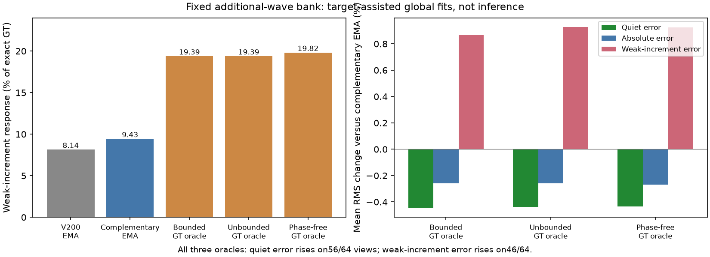
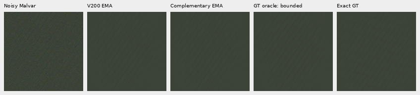
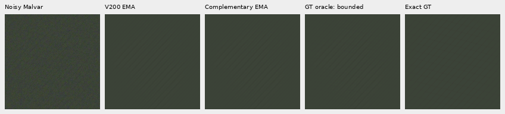

# Fixed measured waves have some response headroom, with persistent error costs

**A target-assisted fit to the complementary stage's fixed additional wave bank
raises weak response from 9.43% to 19.39% of exact GT.** It also raises quiet error
on 56/64 views and weak-increment error on 46/64. Native crops still lose most weak
structure. This is a **GT oracle diagnostic, not a trained model or inference
improvement**. V120 remains the general recommendation.

The [coverage/response join](complementary-coverage-quality.md) found weak
attenuation even near an available carrier. This follow-up holds the actual
additional-bank measurements fixed and asks how much a simple global gain fit
can deliver. It identifies some available synthesis capacity, while showing why
response alone is insufficient. The separate [V132 full-model run](raw-spatial-continuation.md)
continues; its [early matched review](v132-progress1000-quality.md) is unchanged.
[Exact receipts and executed sources](results/measured-wave-oracle-v1/publication.json).

## A stronger response is not a better reconstruction by itself

The panel retains **all 64 far-edge views at the 400 noise prior**: eight fixed
procedural geometries × four CFAs × two independent repeats, each with zero,
one and two wire directions. Means below give each view equal weight; these are
related views of eight sources, not 64 independent photographs. The same exact
targets and saved V200/complementary EMA predictions are reused.

| Method | Strong response | Weak response | Quiet RMS, DN16 | Full RMS, DN16 | Weak-increment RMS, DN16 |
| --- | ---: | ---: | ---: | ---: | ---: |
| V200 EMA |86.741% |8.140% |5.99346 |20.27253 |10.51200 |
| Complementary EMA |86.882% |9.434% |5.97884 |20.25961 |10.50479 |
| **GT oracle**, real gains in `[−1,1]` |88.255% |19.385% |5.95208 |20.20730 |10.59565 |
| **GT oracle**, unbounded real gains |88.255% |19.385% |5.95273 |20.20700 |10.60232 |
| **GT oracle**, unbounded phase rotation |88.295% |19.819% |5.95292 |20.20543 |10.60191 |

For the bounded oracle versus the learned complementary output, mean full error
falls 0.258% and mean quiet error falls 0.448%, while weak-increment error rises
0.865% and its orthogonal error rises 1.393%. Full error improves on every view;
weak response increases on 58/64, with stronger response falling on 20/64.

**The quiet mean hides a worse majority.** Quiet error rises on 56/64 views and
six of eight source means. Its median paired change is +0.02311 DN16; the range
is −0.90729 to +0.11982 DN16. Source 7 supplies the dominant reductions. All three
oracle variants have the same 56/64 quiet and 46/64 weak-increment error-increase
counts. These absolute-image fits do not solve the detail/false-texture tradeoff.

All eight source-level mean weak responses increase with the bounded oracle,
but stronger mean modulation does not ensure a faithful increment. This is
consistent with the [literature review's emphasis](weak-detail-literature-2026-11.md)
on discrimination, localized synthesis and nuisance modeling. It does not show
that larger gains alone should be deployed.

## What is held fixed and what is allowed to fit

Phase A reads only packed RAW, variance, CFA colors and saved V200 output. It
uses the already closed additional-bin choices and validity masks, with the
same frozen physical-wave source and CUDA backend as the trained evaluation.
Local window 65/stride 32, own-color amplitude fitting and native phase offsets
are unchanged. All 64 measured bases are sealed **before any target array is
loaded**. The existing V200 output has already seen all RAW samples; this is
not independent sensor validation.

Phase B uses GT explicitly. For each role and RGB channel separately, it fits
one constant real gain per carrier to the **full native 512 target residual**:

`oracle = saved_V200 + sum(gain[carrier,color,role] * measured_native_wave)`.

The first oracle bounds every gain to `[−1,1]`, matching the readout's scalar
gain range. The next removes that box; the last also adds each measured wave's
quadrature, permitting phase rotation. No crop, quiet mask, weak-increment
template or carrier-distance subset chooses the fitted coefficients. There
are 72 free scalar slots per view for real fits and 144 for phase-free fits;
invalid carriers remain zero. Numerical ranks range 1–8 and 2–16 respectively.

The bounded fit has 14 of 4,608 scalar gains at a bound. Removing the bound barely
changes response; allowing phase rotation adds only 0.433 percentage points.
Thus these two restrictions alone explain little of the remaining loss in
**this particular global fit**. Most weak structure is still absent.

The actual learned head uses spatially varying gains from a shared context
network. These oracle coefficients are freely selected using each target.
They therefore neither bound the spatial head's representation nor establish
what its 643 parameters can learn from noisy observations. Poor global-oracle
recovery is not a theorem that the full measured representation is inadequate.
The primary comparison concerns the **additional bank above saved V200**; it
does not refit inherited V200 carriers or recompute its outputs.

A descriptive subset at the original one-bin threshold has 31 views/seven
sources with an additional carrier near the weak fundamental. Their learned
response is 6.265%; the bounded oracle reaches 21.402%, phase-free 22.122%.
These are not the earlier combined-bank 48-view subset. Geometry is used only
after target-free closure, and different subsets differ in source difficulty.
[Full per-view scores](results/measured-wave-oracle-v1/scores.json.gz) ·
[Coefficient/rank/optimality receipts](results/measured-wave-oracle-v1/fits.json.gz) ·
[Proximity subsets](results/measured-wave-oracle-v1/proximity-summary.json.gz).

## Native crops retain the missing weak direction

Noisy Malvar → **learned complementary EMA** → exact constructed GT. Each cell
is 160×160 unchanged pixels from native 512 RGGB, role 2/two directions, far-edge
source 0/source 1, repeat 0, ROI `[176,176,160,160]`. Shot/read
`0.00008/2.56e−8`, 16-bit ADC/black 0.03, display exposure 2/contrast 1, identical
WB/matrix/clipped-sRGB transform. These two learned triplets are exact copies
of their previously reviewed pixels; no old model is rerun.

Complementary EMA checkpoint SHA256:
`0d87687b7224d40c7d0de998efc1aafc3f4a3016fe77b9d1dc91666007a3083b`.
[Full source/ROI/checkpoint/noise/display manifest](images/measured-wave-oracle-v1/manifest.json).
The direct comparisons add the saved V200 output and explicitly labeled
GT-assisted bounded oracle under exactly the same transform:

Oracle changes remain small at native display, with incomplete crossings and
weak modulation. The relaxed [source0](images/measured-wave-oracle-v1/source0-relaxations.png)
and [source1](images/measured-wave-oracle-v1/source1-relaxations.png) views look
close to the bounded fit. Target-assisted
[source0](images/measured-wave-oracle-v1/source0-GT-oracle-triplet.png) and
[source1](images/measured-wave-oracle-v1/source1-GT-oracle-triplet.png) triplets
are retained separately and must not be presented as learned inference.
All eight native figures and the final chart were actually viewed.

This diagnostic supplies no new real-camera output. Both protected GFX families,
main sky/building/foliage/chain-link crops and both cab ROIs/profiles/JPEGs remain
in the [complete complementary review](complementary-comparison.md) and
[conditional review](complementary-edge-response.md). Their color/mesh failures
persist. ISO100/AHD/JPEG references are qualitative, never exact GT for oracle
fitting. Originals and training exclusions remain intact.

## Verification and the next model question

Seventeen focused checks compare native synthesis with the actual readout at
FP32/FP64, actual CFA offsets/conjugate/Nyquist bins, bounded fits against a
separate full-design solver, rank-deficient/zero carriers and phase relaxation.
The tested synthesis/metric files match the frozen numerical source byte-for-byte.
SciPy is an optional `eval` dependency, locked to 1.18.1 for this run; NumPy is 2.5.4.
Use `uv sync --extra dev --extra eval` for these analysis tools.

The independent NumPy-only audit reconstructs all 192 oracle arrays from their
coefficients and direct native CFA offsets: **452,984,832 RGB channels**, maximum
discrepancy 5.56e−17. It recomputes all 4,160 primary metric fields using the shared
established metric implementation. Separate direct full-residual gradients
check all 1,728 fits and 576 bounded optimality conditions; maximum box duality
gap is 4.74e−23 in half-MSE units. No solver is rerun in this audit. Basis
measurement uses 375,446,016 peak CUDA bytes and takes 27.75s; fitting takes 56.02s
on two low-priority CPU cores. These are diagnostic timings, not demosaicing speed.

Actual measurement/fitting/auditing makes **zero neural constructions, selectors,
model/readout/parent/DINO forwards, new noise/source draws, RAW decodes or optimizer
updates**. The separate CPU unit tests exercise the readout; they are not part
of that zero-forward diagnostic claim. The original V132 worker is not signalled.
The first chart is preserved; the final chart additionally displays the 56/64
and 46/64 regression counts, with unchanged numerical results/native pixels.
[Publication checks](results/measured-wave-oracle-v1/publication-checks.json)
verify all 24 receipt/source archives, native copies, 382 local documentation
links, the locked optional dependency and the same live V132 worker at step 3,425.

The next useful comparison is whether **input-derived localized evidence can
retain more weak signal while rejecting quiet and increment errors**. A larger
scalar gain or the mere presence of a nearby carrier does not answer that
question. These results retain the demonstrated synthesis headroom without
mistaking target access, a lower aggregate loss or a global fit for the desired
faithful model improvement.
