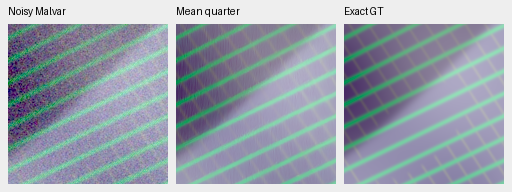
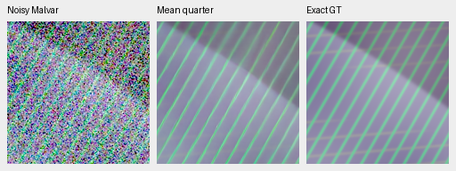

# Averaging weak-wire gap proposals before the Bayer audit

With carrier geometry fixed from a previous noisy observation,
averaging candidate footprints admits **27 of 32** new ISO6400
gaps, compared with **21 of 32** for the best single footprint.
Both preserve all 32 continuous controls in that comparison.
On fresh RGB crops, the average places the cut better at equal
strength, but its fixed-strength output leaves more high-noise
gap texture. A bounded strength estimate reduces that error with
more attenuation outside the gap. [Sources, scores and native viewing](results/mesh-averaged-gap-v1/publication.json).

## How the hypotheses are combined

The earlier [pooled gap check](mesh-pooled-gap-evidence.md) gives
one highest-scoring shape to an independent audit. In its largest
miss, the true footprint produces a much stronger signal than the
nominated shape. This trial asks whether neighboring hypotheses
can preserve that signal before the validation samples are seen.

The same bank supplies 336 tapered disk, band and ellipse candidates
to each policy. The best policy maximizes the error reduction on the
nomination sites. The mean policy combines the fitted attenuation
from all candidates. Its weights are proportional to
`exp((gain - best_gain) / 3) / family_size`, with each shape family
having equal total prior mass. We test both policies with a quarter
or half of the Bayer sites assigned to nomination. The entire
candidate cut, including its fitted attenuation, is fixed before
it is checked on the remaining sites. Both variants use the same
signed overlap threshold of 3.25 and require positive gain for the
half-strength displacement. A passing audit changes only the rear
correction. The median across 13 placements and the stronger wire
use the same inputs.

The checks reproduce the earlier single-shape nomination on three
archived crops and verify the weighted attenuation independently.
Perturbing held-out samples changes the overlap score and leaves
all nominations identical. [Arithmetic and split checks](results/mesh-averaged-gap-v1/verification.json).

## Fresh RGB comparisons

There are 24 fresh scenes, with six continuous and six gapped
observations per noise profile. The true gaps include disks,
ellipses, bands and two separated missing patches. The panel
includes four Bayer layouts, front-only and edge-only controls,
and eight rotated-donor interventions. Half the front-only and
two-wire pairs have independent sensor noise.

| Noise and policy | Added gap RMS | Total gap RMS | Wire increment RMS |
| --- | ---: | ---: | ---: |
| ISO400 wide | 116.33 | 146.34 | 101.94 |
| ISO400 best quarter | 84.10 | 123.38 | 102.28 |
| ISO400 mean quarter | 82.98 | 122.59 | 101.86 |
| ISO400 best half | 84.02 | 123.85 | 102.20 |
| ISO400 mean half | 82.81 | 122.85 | 101.99 |
| ISO6400 wide | 82.52 | 211.45 | 181.97 |
| ISO6400 best quarter | 71.74 | 204.08 | 182.74 |
| ISO6400 mean quarter | 74.65 | 206.32 | 182.31 |
| ISO6400 best half | 71.50 | 204.01 | 182.79 |
| ISO6400 mean half | 72.53 | 204.79 | 182.50 |

Errors are camera-linear DN16. Added gap RMS measures the difference
from the local trunk at missing-wire sites. Total gap RMS compares
with the exact target. Wire increment RMS uses the present-minus-absent
response. All four tests cut all six ISO400 gaps and three of six
ISO6400 gaps. The quarter-site mean attenuates one continuous
ISO400 wire versus two for the best quarter. Both half-site tests
attenuate two. Every continuous ISO6400 crop preserves wide support.
The compound g214 case retains substantial false continuation.

An equal-strength replay scales the best mask to match the mean
mask's delivered correction RMS wherever both policies pass. In
the quarter-site comparison the averaged footprint lowers mean
total gap error from **124.18 to 122.59 DN16** at ISO400 and from
**218.24 to 217.56 DN16** on the three eligible ISO6400 crops.
The half-site comparison gives 124.86 → 122.85 and 215.50 → 214.52
DN16. These results isolate the spatial placement of the cut at a
matched amount of change. The larger fixed cut from the single
shape still gives lower error overall at ISO6400. [Complete RGB and matched-strength scores](results/mesh-averaged-gap-v1/summary.json).

The native pairs use ROI `[80,80,160,160]` in 320-pixel fields,
identity WB and color matrix, ADC16 black fraction 0.03, exposure ×1
and shared reference-centered contrast ×8. The ISO400 g215 ellipse
uses GBRG and shot/read `8e-5/2.56e-8`. The ISO6400 g213 band
uses BGGR and `0.00128/6.5536e-6`. The spatial 2k EMA parent
has its scene input bypassed, SHA256
`97fd551bd0ae0b7aa97c67e1f6e8b513b722f70d5ad8b8814a96586b934eafac`.
Both comparisons show subtle reductions inside the true gap, with
some residual pattern near the step.
[Pixel and checkpoint manifest](results/mesh-averaged-gap-v1/viewing.json).

[g215 comparison](images/mesh-averaged-gap-v1/iso400-ellipse-g215-comparison.png) ·
[g213 comparison](images/mesh-averaged-gap-v1/iso6400-band-g213-comparison.png) ·
[Residual false continuation in g214](images/mesh-averaged-gap-v1/iso6400-compound-g214-comparison.png).

## Independent noise and strength re-estimation

The conditional panel uses eight new draws per class for four earlier
high-noise gaps. Measured carriers come from previously corrupted
observations. Clean support and waveform enter only to score the
mask's residual rear signal and attenuation outside the gap. This
test isolates decisions about support with the wire geometry supplied.

| Policy | Gapped draws admitted | Continuous draws cut | Rear-support error, DN16 |
| --- | ---: | ---: | ---: |
| Best quarter | 21/32 | 0/32 | 45.89 |
| Mean quarter | 27/32 | 0/32 | 49.00 |
| Best half | 20/32 | 1/32 | 44.80 |
| Mean half | 23/32 | 0/32 | 45.73 |

The quarter-site mean adds three admissions each on g204 and g205.
Its weaker attenuation leaves more ideal rear signal where the target
has a gap. [Independent conditional scores](results/mesh-averaged-gap-v1/summary.json).

A separate replay estimates strength from the same signed projection
after the fixed shape passes. The scalar is shrunk toward one half
with 16 units of noise-normalized prior information and bounded
to 0.25–0.85. This fit uses the actual audit measurements for
reconstruction and preserves the earlier admission decision. On the
fresh ISO6400 crops, the refitted quarter mean reduces total gap
error from 206.32 to 203.52 DN16 with increment RMS rising from
182.31 to 182.87. The refitted best quarter reaches 201.63 gap RMS
and 183.78 increment RMS. The lower-noise quarter mean moves from
122.59 to 113.70 gap RMS and from 101.86 to 102.91 increment RMS.

On 16 further independent ISO6400 pairs, the quarter mean admits
12 gaps versus 11 for the single shape. Both cut zero continuous
controls. Strength re-estimation lowers the quarter mean's ideal
rear-support error from 52.43 to 46.62 DN16. Outside-gap attenuation
rises from 5.03 to 8.28 DN16. The refitted best quarter gives
42.09 and 10.82 DN16 respectively. These tradeoffs depend on the
candidate shape and strength.
[Delivery replay](results/mesh-averaged-gap-v1/refit.json) ·
[Independent strength check](results/mesh-averaged-gap-v1/refit-repeats-summary.json) ·
[Native g215 refit](images/mesh-averaged-gap-v1/refit-iso400-ellipse-g215-comparison.png) ·
[Native g213 refit](images/mesh-averaged-gap-v1/refit-iso6400-band-g213-comparison.png).

A follow-up tapers the post-audit strength and fits a separate
fringe coefficient. The taper reduces attenuation outside the
known gap on independent high-noise draws. Fresh crop gains
are small and still depend on localizing the true footprint.
[Tapered strength refit](mesh-tapered-strength.md).

## Standing GFX100S review

Both passes use cached standing observations and local-only 2k EMA
with adjacent donors, SHA256
`ceb5ddaf23fce47806a01045bd86d34bb48d1f64031e382b0d5cfbabf0716880`.
The nominal right cab keeps its adjacent-donor pixels under both
averages and the quarter mean's refit. A single shape makes a
1.35 DN16 RMS cut with quarter-site nomination. The transferred
right crop still changes, by 0.21 DN16 with the mean versus 0.86
with the single shape. The left lattice softens a little, with
stronger edits in the refit. Both weak directions still look
softer and more regular than in the independent references.

On the main scene, the sky stays smooth, and the building and
foliage keep their earlier soft detail. The quarter mean changes
coarse fence contrast by 2.00 DN16 RMS and the refit by 3.40,
with the crossings still visible and no evident new color fringe.
[Actual viewing of both native comparison sets](results/mesh-averaged-gap-v1/viewing.json).

DSCF3879 uses exposure ×4 and shot/read `0.00128/6.5536e-6`.
DSCF3880 ISO100 AHD is the qualitative reference.
[Sky](images/mesh-averaged-gap-v1/main-overcast-sky-main-overcast-sky.png) ·
[Building](images/mesh-averaged-gap-v1/main-building-detail-main-building-detail.png) ·
[Foliage](images/mesh-averaged-gap-v1/main-foliage-main-foliage.png) ·
[Coarse fence and refit](images/mesh-averaged-gap-v1/refit-main-chain-link-fence-main-chain-link-fence.png).

DSCF3842 uses exposure ×16. Both camera JPEGs and independently
demosaiced DSCF3835 ISO100 are qualitative reference images.

| Cab shot/read | Native comparisons |
| --- | --- |
| `0.00128/6.5536e-6` | [Left](images/mesh-averaged-gap-v1/mesh-nominal-fine-green-mesh-left.png) · [Right](images/mesh-averaged-gap-v1/mesh-nominal-fine-green-mesh-right.png) |
| `0.0014635775921166604/1.0715704128646712e-6` | [Left](images/mesh-averaged-gap-v1/mesh-profile3879-fine-green-mesh-left.png) · [Right](images/mesh-averaged-gap-v1/mesh-profile3879-fine-green-mesh-right.png) |

The footprints and delivery fits remain crop-level experiments
on the same EMA checkpoints.
