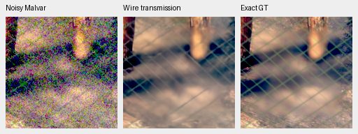
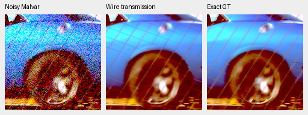
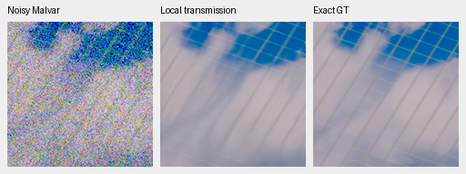
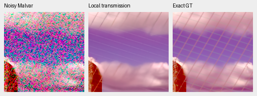

# Estimating weak mesh contrast over a changing background

When a wire covers parts of a textured surface, its apparent contrast
depends on that surface. In a 24-photo simulation with this image
formation law, fitting transmission reduces ISO6400 weak-wire error
on measured Bayer sites from **90.44 to 64.81 DN16** versus an affine
wire-amplitude fit. Above the neural parent, restricting delivery to
regions with local sensor support halves the added variation in known
gaps and retains most of the high-noise wire gain.
The standing GFX review still favors the existing two-direction
adjacent-donor correction over these one-direction lifts.
[Results and native evidence](results/mesh-background-transmission-v1/publication.json).

## Fitting the wire and its background together

The [natural RAW donor test](natural-raw-donor-evidence.md) transfers
detail when independently observed patches share the same structure.
That registration check fails on the standing fine GFX mesh. Here the
donor supplies repeating geometry, and a local radiometric model
accounts for a background that changes across the pattern.

The fitting background uses a smooth quadratic spline basis and a
strong foreground wire. Both hypotheses use the same rear-wire
footprint and reduce its visibility under the stronger wire.
The affine fit gives rear contrast its own signed slope in each
Bayer color. The transmission fit instead models the rear increment
as the difference between one material color and the fitted background,
multiplied by the rear footprint and a shared opacity. It selects the
opacity from six fixed candidates using only the fitting fold. The
footprint uses 16 equally weighted subpixel samples per photosite.

Both folds fit on disjoint checkerboard Bayer cells and forecast the
other fold. The check projects out the fitted nuisance components.
Delivery requires a positive held-out squared-error gain and signed
score above 2.5 in each direction. The adaptive fit requires a one-unit
held-out gain over the affine fit in both directions before using
transmission. A follow-up guard compares the selected fit with one
whose rear phase is shifted by 0.31 cycles. The guard was introduced
after several false no-rear accepts appeared in the first logs.
[Fit and simulation plan](results/mesh-background-transmission-v1/simulation-plan.json) · [Planted opacity and holdout verification](results/mesh-background-transmission-v1/verification.json).

## Known geometry on natural photo backgrounds

Twenty-four held-out photos, six per CFA, supply natural backgrounds.
The four roles contain a transmissive rear wire, an additive rear
wire, a transmissive rear wire with a smooth missing region, and no
rear wire. Each source and noise profile gives a distinct physically
independent observation of each role. The synthetic experiment supplies
the same exact foreground and rear geometry to both hypotheses. The
transmission fit estimates material color and opacity from the sensor.
The exact gap location is used only for scoring.

| ISO6400 raw fit | Transmissive RMS, DN16 | Additive RMS, DN16 | Broken RMS, DN16 | No-rear accepts |
| --- | ---: | ---: | ---: | ---: |
| Constant rear amplitude | 104.71 | 10.02 | 97.71 | 1/24 |
| Affine rear amplitude | 90.44 | 18.22 | 84.88 | 7/24 |
| Wire transmission | 64.81 | 27.70 | 69.72 | 4/24 |
| Adaptive | 66.71 | 21.50 | 70.66 | 8/24 |

Raw RMS measures the error of the inferred rear increment on measured
Bayer sites. With the wrong rear phase, the transmission fit accepts
one of 24 high-noise transmissive roles, compared with 15 for the
affine fit. Correctly phased no-rear accepts show that natural
background structure can still explain some of the proposed wire.
[Complete RAW measurements](results/mesh-background-transmission-v1/raw-summary.json).

## Delivery above Corpus 100k

The synthetic neural parent is Corpus 100k EMA under CUDA IEEE FP32.
Each arm adds the supported luminance above the parent's projection
onto the same high-pass template, using a 14-pixel taper. The
composition evaluates the actual delivered image at 160 native pixels.
Wire RMS scores the paired present-minus-absent luminance on rear-wire
sites. Gap RMS scores added variation relative to the same neural
parent inside the exact missing region.

| ISO6400 delivered fit | Transmissive wire RMS, DN16 | Additive wire RMS, DN16 | Gap addition, DN16 | No-rear addition, DN16 |
| --- | ---: | ---: | ---: | ---: |
| Corpus 100k | 297.17 | 269.55 | 0 | 0 |
| Constant rear amplitude | 292.15 | 257.71 | 13.26 | 0.83 |
| Affine rear amplitude | 286.31 | 258.11 | 17.35 | 4.36 |
| Wire transmission | 281.29 | 261.22 | 31.11 | 3.62 |
| Guarded adaptive | 281.01 | 258.40 | 30.43 | 5.29 |

Transmission improves high-noise transmissive wire RMS by 5.02 DN16
against affine, with a source-paired interval of 1.92–8.01 DN16.
It also lowers the transmissive junction error from 284.24 to
281.24 DN16. The more strongly recovered rear pattern extends
into missing areas. At ISO400, transmission raises transmissive
wire error from 136.26 to 140.83 DN16 and almost doubles the
added gap variation. [Paired delivery results](results/mesh-background-transmission-v1/summary.json).

### Local sensor support

The follow-up uses the same scenes and global fitted carriers. It checks
both Bayer folds in overlapping 64×64 regions spaced 32 pixels apart.
A region needs positive gain on both folds. Its coefficient increases
with the lower of the two signed scores from 1.5 to 3. The final lift
interpolates those coefficients. This check uses neither the true gap
map nor a semantic label.

| ISO6400 delivered fit | Transmissive wire RMS, DN16 | Additive wire RMS, DN16 | Gap addition, DN16 | No-rear addition, DN16 |
| --- | ---: | ---: | ---: | ---: |
| Affine rear amplitude | 286.31 | 258.11 | 17.35 | 4.36 |
| Global wire transmission | 281.29 | 261.22 | 31.11 | 3.62 |
| Local wire transmission | 282.55 | 263.46 | 16.14 | 0.79 |
| Global transmission scaled to the same gap RMS | 283.59 | 262.48 | 16.14 | — |

Local support improves the high-noise transmission fit at a comparable
level of unwanted gap texture. It also leaves some false variation
in empty controls. At ISO400, local transmission gives 141.15 DN16
wire error and 12.21 DN16 gap addition, compared with 136.26 and
8.42 for the affine fit. This follow-up reuses the same sources and
controls, so the measured high-noise gain is a development result.
[Local and matched-strength measurements](results/mesh-background-transmission-v1/local-summary.json).

## Native synthetic crops

The noisy Malvar, transmission lift and exact GT triplets retain
ROI `[16,16,160,160]` within a native 192-pixel query. Both use
ISO6400 shot/read `0.00128 / 6.5536e-6`, ADC16 with black fraction
0.03, identical camera transforms, display exposure ×4 and contrast ×2.
The parent checkpoint SHA256 is
`87b96f3c487b9edaf1c477742b6c38f2a82cc6b20a94716d51cc8cf46a17a760`.
These are the two largest transmissive wire RMS reductions against
the affine fit at ISO6400. Fine crossings and color remain weaker
than the exact constructed target.
[Seeds, source coordinates and viewed failures](results/mesh-background-transmission-v1/native-viewing.json).

The GBRG statue background is from the Two Donkeys photograph by
Rama, CC BY-SA 2.0 France. The higher-contrast rear direction
appears against both dark and tan regions, with residual softness.
[Source photograph](https://commons.wikimedia.org/wiki/File:Two_donkeys_carrying_packs-MBA_Lyon_1969-399-IMG_0153.jpg) · [License](https://creativecommons.org/licenses/by-sa/2.0/fr/).

The GRBG blue-car background is from Ermell's Dodge Challenger
photograph, CC BY-SA 4.0. The rear line changes contrast across
the paint and the wheel. The transmission lift retains more of
the dark diagonal on the blue surface than the affine arm.
[Source photograph](https://commons.wikimedia.org/wiki/File:Dodge_Challenger_SRT_Hellcat_2015-20180909-RM-171853.jpg) · [License](https://creativecommons.org/licenses/by-sa/4.0/).

The localized views retain the useful rear direction on both photos.
The broken-mesh control still shows some line extension into the gap.
The no-rear car retains the strong foreground by construction.
[Statue local comparison](images/mesh-background-transmission-v1/local/019-iso6400-role0-comparison.png) · [Blue car local comparison](images/mesh-background-transmission-v1/local/018-iso6400-role0-comparison.png) · [Known gap](images/mesh-background-transmission-v1/local/035-iso6400-role2-comparison.png) · [Absent rear wire](images/mesh-background-transmission-v1/local/016-iso6400-role3-comparison.png).

## Replication on 24 different photographs

The frozen fit, sensor check and display pipeline were replayed on
24 different held-out photographs, again six per CFA and with separate
noise draws. At ISO6400 the raw transmissive error is 61.93 DN16
against 92.42 for affine. On the no-rear raw inputs, transmission
accepts 6/24 and local delivery reduces the added variation.
[Source separation and frozen implementation](results/mesh-background-transmission-replication-v1/publication.json).

| ISO6400 delivered fit | Transmissive wire RMS, DN16 | Additive wire RMS, DN16 | Gap addition, DN16 | No-rear addition, DN16 |
| --- | ---: | ---: | ---: | ---: |
| Corpus 100k | 287.45 | 247.86 | 0 | 0 |
| Affine rear amplitude | 266.51 | 237.60 | 27.42 | 9.60 |
| Global wire transmission | 258.19 | 239.03 | 29.19 | 6.48 |
| Local wire transmission | 263.51 | 241.38 | 12.96 | 1.82 |
| Scalar fixed on development photos | 267.60 | 240.64 | 15.15 | 3.36 |

The local method cuts gap addition relative to affine by 14.46 DN16
with a paired interval of 8.12–20.80. The mean transmissive wire
error is 3.00 DN16 lower, with an interval spanning a 3.01 DN16
increase to an 8.64 DN16 reduction. Relative to the frozen scalar
control, local support lowers transmissive wire error by 4.09 DN16
(0.55–8.38) and lowers mean gap addition by 2.19 DN16, with an
interval spanning zero. At ISO400 the local method has higher wire
error than affine while adding less texture in gaps. Additive
wire error favors affine at both noise levels.
[Paired distributions and matched-strength comparison](results/mesh-background-transmission-replication-v1/fixed-strength.json).

The native triplets use the same ISO6400 conditioning, exposure ×4,
contrast ×2, ROI and Corpus 100k EMA as the development views. In
the chapel sky crop, the local lift preserves part of the transverse
direction, with much weaker crossings than the exact target. In the
Delos crop, it restores a faint diagonal across the violet band.
Local support also fades a spurious line through the dark gap of
the snow-covered pears control.
[Chapel photo by Jacek Halicki, CC BY-SA 4.0](https://commons.wikimedia.org/wiki/File:2025_Kaplica_%C5%9Bw._Floriana_w_Bystrzycy_K%C5%82odzkiej_(05).jpg) ·
[Delos photo by Bernard Gagnon, CC BY-SA 3.0](https://commons.wikimedia.org/wiki/File:House_of_the_Lake,_Delos_02.jpg) ·
[Native viewing, controls and licensing](results/mesh-background-transmission-replication-v1/viewing.json).

## Standing GFX100S checks

The review replays the [packaged adjacent-donor correction](donor-phase-transport.md)
and verifies the retained output before borrowing its central
candidate. All three new alternatives start from the same
local-only 2k EMA, SHA256
`ceb5ddaf23fce47806a01045bd86d34bb48d1f64031e382b0d5cfbabf0716880`.
The new corrections use the previously reserved query columns
for geometry and the remaining samples for the fit and check.
Sky, building and foliage retain that parent exactly. The coarse
fence keeps its larger crossings. In the cab, the stronger new
single-direction stripe is more apparent than a complete diamond
pattern. The existing adjacent-donor correction retains both
directions more convincingly. The guarded fit selects the affine
arm on all five eligible textured views.
[Native viewing and output deltas](results/mesh-background-transmission-v1/standing-viewing.json).

Local support softens the regular stripe on the nominal cab views.
Composed with the adjacent-donor result, the additional corrections
are at most 2.91 DN16 RMS across the four cab views. The visible
crossings resemble the adjacent output and remain incomplete under
both priors. The coarse fence keeps its existing crossings with a
modest change in contrast. Sky, foliage and building again reproduce
their respective parent exactly.
[Coarse fence](images/mesh-background-transmission-v1/local-standing/main-chain-link-fence-main-chain-link-fence.png) · [Nominal right cab](images/mesh-background-transmission-v1/local-standing/mesh-nominal-fine-green-mesh-right.png) · [Transferred right cab](images/mesh-background-transmission-v1/local-standing/mesh-profile3879-fine-green-mesh-right.png).

All eight boards use the fixed native 160×160 crops. DSCF3879
uses display exposure ×4 and shot/read `0.00128 / 6.5536e-6`.
DSCF3842 uses ×16 with the nominal and established transferred
priors. The DSCF3880 and DSCF3835 ISO100 AHD renders and both
cab JPEGs remain qualitative references.

This is a frozen analytic component study above existing neural
parents. It did not add a training run or produce full427 or camera
panel scores.
