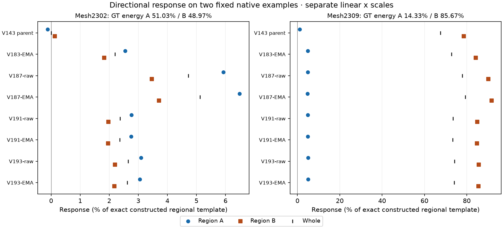
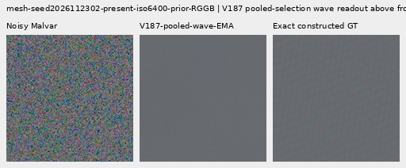
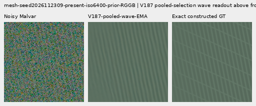

# Directional response hidden by a whole-pattern score

On the existing **mesh2309** native example, V187 EMA has **79.24% whole-template response**, but only **4.82% in region A**, versus **91.69% in region B**. Region B carries85.67% of exact GT template energy, so it dominates the aggregate. Against frozen V183 EMA, whole response rises72.85%→79.24% while the weaker A region falls4.92%→4.82%. A better aggregate here does not mean better recovery of both crossing directions.

The fixed **mesh2302** example is weak in both directions: V187 EMA reaches6.48%/3.71%, with whole5.12%. V193 EMA improves both regions over V191 on these two examples, but stays below V187 on both2302 regions. On2309, V193 has a small A-region strength,5.07% versus V187's4.82%, alongside lower dominant-region response85.58% versus91.69%. These are descriptive results on two previously selected native examples, not a population result or a new trained-model improvement. V187 remains the preferred experimental wave model; V120 Small remains the general recommendation.

[SVG](images/v194-orientation-response-v1/orientation-response-v2.svg) · [PDF](images/v194-orientation-response-v1/orientation-response-v2.pdf). The two panels use separate linear x scales; all48 plotted values are checked against the audited records.

## What the regions measure

The existing affine-detrended, full-context camera-RGB template projection is split into three disjoint native Fourier regions. A and B assign each non-Nyquist frequency to its nearer fixed recipe normal, modulo pi. DC and Nyquist axes form a residual region. All masks are conjugate closed. Their GT-energy-weighted gains recompose the original whole-template score exactly. Mask edges, visibility envelopes, harmonics and intersections leak between regions: **these are not isolated individual wire-family amplitudes** or a calibrated confidence measure.

The original recipes precede image augmentation. Before reading any saved prediction pixels, metadata inspection found seed2302 used rotation2 plus a horizontal flip, and2309 rotation3 without a flip; neither used homography. The two native normal pairs are transported through those exact maps. Deterministic geometry-draw replay closes against the original saved terminal RNG states, without rendering a new image or drawing new source/noise. The original preparation plan, math and eight tests remain byte-preserved; a prospective corrected plan records why native-angle transport was necessary. Sixteen math contracts now cover the decomposition and all eight D4 maps. The original data functions' ASTs match the frozen source used for preparation.

The independent audit uses centered-coordinate affine sums instead of production QR, angular distances instead of dot-power ranking, and real inverse-FFT subtemplates with spatial inner products instead of direct spectral numerators. All16 saved predictions bridge to their old whole-template scores;192 sector scalars,48 whole scalars and four transported normals pass. Maximum independent gain difference is8.23e−15. All103 neural source hashes remain unchanged. No Torch/CUDA/model/checkpoint load, optimizer update, real-reference read, RAW decode, original/dataz access or new source/noise draw occurs.

## Mesh2302

Full native512 RGGB context; common diagnostic/display ROI`[176,176,160,160]` is retained in the linked crop gallery. Supplied shot0.00128/read variance6.5536e−6, display exposure8/contrast1, stress contrast40. Native normals A/B are`[1.1762525290468266, 0.1464314737695438]` radians. GT energy A/B/residual is51.02595806% /48.97403494% /0.00000700%. The score uses the full512 context, not just the displayed160px ROI.

| Saved state | Whole response (%) | A response (%) | B response (%) |
| --- | ---: | ---: | ---: |
| V143 parent | 0.00013 | -0.12508 | 0.13059 |
| V183-coherent-pair-EMA | 2.19317 | 2.54483 | 1.82677 |
| V187-pooled-wave-raw | 4.71877 | 5.92679 | 3.46013 |
| V187-pooled-wave-EMA | 5.12225 | 6.47750 | 3.71022 |
| V191-dense-spectrum-raw | 2.37359 | 2.76515 | 1.96562 |
| V191-dense-spectrum-EMA | 2.36614 | 2.75569 | 1.96027 |
| V193-large-dense-raw | 2.65533 | 3.09357 | 2.19872 |
| V193-large-dense-EMA | 2.62220 | 3.05350 | 2.17282 |

## Mesh2309

Full native512 RGGB context; common diagnostic/display ROI`[176,176,160,160]` is retained in the linked crop gallery. Supplied shot0.00128/read variance6.5536e−6, display exposure8/contrast1, stress contrast40. Native normals A/B are`[1.9969001026452027, 2.948392806017094]` radians. GT energy A/B/residual is14.32753478% /85.67238893% /0.00007628%. The score uses the full512 context, not just the displayed160px ROI.

| Saved state | Whole response (%) | A response (%) | B response (%) |
| --- | ---: | ---: | ---: |
| V143 parent | 67.49105 | 1.03509 | 78.60496 |
| V183-coherent-pair-EMA | 72.84751 | 4.91911 | 84.20766 |
| V187-pooled-wave-raw | 77.90681 | 4.84382 | 90.12566 |
| V187-pooled-wave-EMA | 79.24432 | 4.82301 | 91.69033 |
| V191-dense-spectrum-raw | 73.43559 | 4.95586 | 84.88795 |
| V191-dense-spectrum-EMA | 73.41567 | 4.94758 | 84.86608 |
| V193-large-dense-raw | 74.12972 | 5.09329 | 85.67518 |
| V193-large-dense-EMA | 74.04474 | 5.07259 | 85.57944 |

## Consequence for the next experiment

Equal pressure on a whole-target projection can favor its dominant energy region. A controlled training-only test of orientation-balanced pair-response pressure is now motivated, while retaining the existing flat, absolute, difference/common and spatial losses. This diagnosis does not establish the objective as the cause, that a particular frequency band is sufficient, or that a new loss will improve real fence detail safely. Mesh2302's low response in both regions and the real GFX/flat failures remain separate requirements.

The completed [V193 quality comparison](large-dense-spectrum-comparison.md) remains authoritative for its822-case endpoints and quiet/blank/absent controls. Both protected GFX scenes/JPEGs/siblings remain excluded from training; ISO100/AHD/JPEG views remain qualitative, not exact GT. Existing V187 EMA native triplets below use the same source coordinates/noise/display transforms and no pixel resizing. They are already published model outputs, not new inference from this diagnostic. V187's checkpoint/export bindings are in its [full comparison](pooled-phase-wave-comparison.md).

[Exact evidence](results/v194-orientation-response-completed-v1.json) · [Latest native viewer](images/v193-large-dense-v1/native-viewer.html).

[Publication verification](results/v194-orientation-response-publication-verification-v1.json). The first figure/receipt and original report bytes remain archived; actual viewing found a legend covering a final-row marker, corrected by moving the legend outside the axes inV2. All48 plotted values are unchanged.
