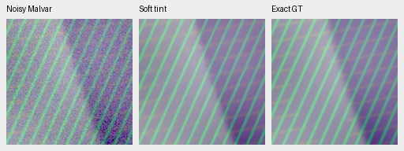
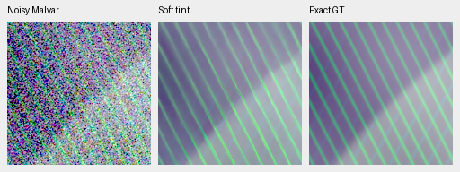

# Estimating weak-wire color from nearby RAW

Soft sharing of signed RAW color increases detection from **7 to 9
of 24** in independent ISO6400 repeats. That matches the straight-step
control and reduces rear-support error slightly. Soft sharing
reproduces the curved-affine local audit's pixels on all 24 fresh
scenes and all eight standing camera crops. Hard sharing avoids
one false ISO400 cut with matching donors and misses a real
ISO6400 gap when the donor color is wrong.
[Archived results and native views](results/mesh-donor-tint-v2/publication.json).

## How measured donor color enters the audit

The [previous diagnostic](mesh-gap-information.md) found that exact
waveform shape increased signed-cutoff passes from two to four of
five ISO6400 gaps with known support. This comparison tests the
signed RGB amplitude direction using measured nearby RAW and
retains the existing carrier phase, width and gap footprint.

Each eligible donor is separated from the query. Its two packed
checkerboard halves independently fit the fundamental sine and cosine
of both directions with a bilinear background. Green phase needs
split cosine at least 0.75 and signal at least 3.5 per half.
The rear-wave color vector projects each color onto the green
phase measured in the other half. The two signed color estimates
need cosine at least 0.80. Multiple accepted donors must also agree
in signed color. No query validation values enter those fits.

All four arms use the same footprint nominated under the straight
foreground model and the same original whole-wire gate. The
straight control audits the footprint as before. The curved-affine
local audit uses independent RGB coefficients from the reservation
quarter. The hard shared-tint arm fits one spatial amplitude vector
and uses the same signed RGB direction for all its coefficients.
The soft arm moves the independent fit toward the shared one by up
to 75%. It scales the movement by exterior agreement and reduces
it when the independent reserve fit disagrees with the shared tint.
Missing or rejected donors defer to the curved-affine local audit.
All methods retain the same held-site projection, signed cutoff
3.25, positive half-displacement gain requirement and half-strength
delivery for their applicable nuisance basis.

The signed exterior color is recovered with cosine above 0.999
for every Bayer layout on four fixed test tiles. Mutating validation
sites leaves the fitted coefficients and the footprint unchanged
and changes the audit scores. The overlapping donor fixture is
rejected. Both local controls reproduce the previous policies.
[Split and numerical verification](results/mesh-donor-tint-v2/verification.json).

## Fresh exact-target scenes

Twenty-four new cases include six continuous and six gapped
scenes at each noise prior. The six geometries vary signed red and
blue modulation. Half the present and absent roles use independent
noise. Eight rotated-donor trials test unrelated geometry. Eight
wrong-tint trials reverse the red and blue wire contributions in
the exterior with identical query and exterior green samples.
Every upstream geometry and local control output matches the
corresponding aligned-tint trial bit for bit.

The first wrong-tint fixture relied on common random seeds. The
Poisson sampler consumed different draws after red and blue
changed. The corrected fixture explicitly copies the measured
green planes from the matched observation and verifies equality.
The original aborted shards and fixture are preserved.
[Corrected plan and original receipts](results/mesh-donor-tint-v2/publication.json).

| Policy | ISO400 continuous cuts | ISO400 gap admissions | ISO6400 continuous cuts | ISO6400 gap admissions |
| --- | ---: | ---: | ---: | ---: |
| Straight step | 6/6 | 6/6 | 0/6 | 2/6 |
| Local audit | 2/6 | 6/6 | 0/6 | 3/6 |
| Shared tint | 1/6 | 6/6 | 0/6 | 3/6 |
| Soft tint | 2/6 | 6/6 | 0/6 | 3/6 |

All 21 aligned cases that reach the gap audit get an exterior tint.
The average tint cosine to the true signed vector exceeds 0.9998
in each group. The three curved-affine arms share the same true-gap
pixels, with total RMS of 102.37 at ISO400 and 204.98 at ISO6400.
The one hard-tint change on continuous g255 removes an unnecessary
cut and slightly increases mean intact-wire RMS across the six
continuous scenes from 103.87 to 104.42 DN16. The straight fit
sometimes reduces wider-reconstruction overshoot by cutting a
wire that is truly continuous.

Under wrong tint, hard sharing takes the valid ISO6400 g253
gap from a signed score of 7.40 to 0.11 and rejects it. Soft sharing
uses a weight below 0.001 in that crop and retains the cut. The
soft outputs match the local audit exactly on all eight wrong-color
trials. All eight rotated donors and all edge-only roles receive
zero correction. [All 264 recomputed metrics](results/mesh-donor-tint-v2/summary.json) ·
[Bitwise checks and continuous witness](results/mesh-donor-tint-v2/continuity-witness.json).

The two native gap triplets show noisy Malvar, soft tint and exact
GT. They use ROI `[80,80,160,160]` within 320-pixel fields, with
ADC16 black fraction 0.03, identity white balance and matrix,
exposure ×1 and fixed reference-centered contrast ×8. The EMA
parent is spatial 2k with scene input bypassed, SHA256
`97fd551bd0ae0b7aa97c67e1f6e8b513b722f70d5ad8b8814a96586b934eafac`.
The triplets show the largest remaining gap additions in each
profile. GBRG g255 at ISO400 uses shot/read `8e-5/2.56e-8`.
RGGB g252 at ISO6400 uses `0.00128/6.5536e-6`. Faint rear repeats
remain in both missing regions, especially in the high-noise disk.
[Complete native settings](results/mesh-donor-tint-v2/viewing.json).

[ISO400 ellipse comparison](images/mesh-donor-tint-v2/iso400-ellipse-g255-comparison.png) ·
[ISO6400 disk comparison](images/mesh-donor-tint-v2/iso6400-disk-g252-comparison.png) ·
[ISO400 continuous g255, where hard tint withheld a cut](images/mesh-donor-tint-v2/iso400-continuous-g255-comparison.png) ·
[ISO400 continuous g252](images/mesh-donor-tint-v2/iso400-step-g252-comparison.png).

## Independent ISO6400 noise repeats

Four measured carrier geometries receive six new gap/continuous
pairs each, with the earlier exterior as a fixed independent tint
source. Exact clean rear waveforms enter only the support scores.
The soft tint increases admissions from seven to nine versus the
curved-affine local fit and reduces rear-support error by
0.76 DN16. The straight control also admits nine, with 0.30 DN16
higher error than soft tint. None of the methods cuts any of
the 24 continuing wires. Mean exterior attenuation rises from
1.90 to 2.45 DN16 with soft sharing. The low-signal g232 disk remains
undetected on all six draws.

| Policy | Admitted gaps | Rear-support RMS, DN16 | Mean signed gap score |
| --- | ---: | ---: | ---: |
| Straight step | 9/24 | 35.25 | 2.631 |
| Local audit | 7/24 | 35.71 | 2.447 |
| Shared tint | 8/24 | 35.42 | 2.552 |
| Soft tint | 9/24 | 34.95 | 2.565 |

## Standing GFX100S review

The parent is local-only 2k EMA with the RAW crop helper and
exact adjacent donors, SHA256
`ceb5ddaf23fce47806a01045bd86d34bb48d1f64031e382b0d5cfbabf0716880`.
Both tint policies produce bit-identical crops to the curved-affine
local audit across both standing scenes. The sky stays smooth, and
the foliage and building retain their soft fine detail. The coarse
fence retains strong crossings under the local audit. No usable
color donor is found for that coarse ROI.

Both left cab priors give the full 0.75 blend weight. The right
cab gives weights of 0.014 and 0.017 under nominal and transferred
conditioning, respectively, because donor tint fits its reservation
pixels poorly. The cut decisions stay fixed and the right shows both
previous directions. The weakest fine crossings remain indistinct.
[Native viewing and donor scores](results/mesh-donor-tint-v2/viewing.json).

DSCF3879 uses exposure ×4, shot/read `0.00128/6.5536e-6`, and
DSCF3880 ISO100 AHD as the independently demosaiced qualitative
reference. All crop cells retain the native 160×160 pixels.
[Sky](images/mesh-donor-tint-v2/main-overcast-sky-main-overcast-sky.png) ·
[Building](images/mesh-donor-tint-v2/main-building-detail-main-building-detail.png) ·
[Foliage](images/mesh-donor-tint-v2/main-foliage-main-foliage.png) ·
[Coarse fence](images/mesh-donor-tint-v2/main-chain-link-fence-main-chain-link-fence.png).

DSCF3842 uses exposure ×16 and both fixed left/right crops. The
DSCF3835 ISO100 AHD image and both camera JPEGs are qualitative
references.

| Cab shot/read | Native boards |
| --- | --- |
| `0.00128/6.5536e-6` | [Left](images/mesh-donor-tint-v2/mesh-nominal-fine-green-mesh-left.png) · [Right](images/mesh-donor-tint-v2/mesh-nominal-fine-green-mesh-right.png) |
| `0.0014635775921166604/1.0715704128646712e-6` | [Left](images/mesh-donor-tint-v2/mesh-profile3879-fine-green-mesh-left.png) · [Right](images/mesh-donor-tint-v2/mesh-profile3879-fine-green-mesh-right.png) |

This is a scoped inference comparison above existing checkpoints.
Its measurements are separate from the fixed full-model photo and
camera benchmarks.
