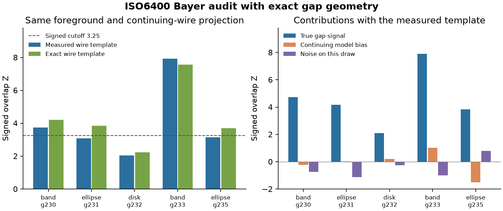
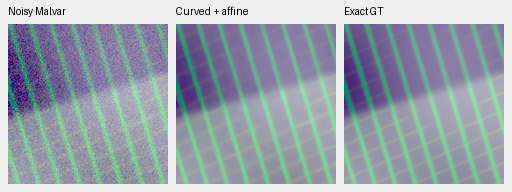
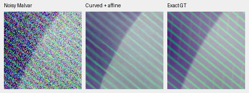

# Distinguishing smooth weak-wire contrast from a missing wire

In six fresh ISO400 scenes with a continuous weak wire, a curved
foreground and smoothly varying rear contrast prevent all six cuts
made by the straight-step control. Applying the new nuisance model
only during the audit preserves the control's exact output on all six
true gaps. At ISO6400 the joint comparison admits three of six gaps,
the same count as the control, and shows little change in total gap
error. The standing coarse fence retains stronger crossings. The
fine cab stays soft.
[Archived code, controls and crops](results/mesh-gap-information-v1/publication.json).

## Where the high-noise evidence goes

The [earlier exact-footprint test](mesh-refined-footprint.md)
supplies the true footprint and fits its strength on the reserved Bayer
quarter. It passes two of five ISO6400 cases with measured carriers.
The new diagnostic also substitutes the exact clean signed wire inside
that footprint. The foreground and continuing-wire nuisance basis,
Bayer sites and noise weights stay fixed. The exact template exceeds
the signed cutoff in four of five cases, compared with two using the
measured template. This comparison uses hidden clean data and reports
the signed cutoff separately from the displacement-gain condition.

Projecting away the fitted continuing wire retains **85–95%** of the
exact template's norm after background projection. The measured and
exact scored templates have cosine alignment **0.91–0.95**. The g232
disk still has a score of only 2.22 with both exact geometry and
exact waveform. The remaining high-noise deficit includes weak
signal, imperfect wire prediction and this draw's noise. The clean
continuing scene alone contributes signed overlap of −1.50 in g235
at ISO6400 and −5.76 in the ISO400 counterpart. A fixed straight
step and piecewise-constant wire amplitude leave structured residuals
that can also raise the score, as in ISO400 g233.
[Source-bound information decomposition](results/mesh-gap-information-v1/information.json).

## Curvature and smooth rear contrast

The control uses the earlier refined average footprint, the foreground
step and a constant rear amplitude on each side. The foreground
alternative adds a quadratic displacement along the step tangent. The
native offset of the step can move up to 14 pixels from the straight
estimate, its normal up to 12°, and its curvature up to 20 pixels at
a tangent distance of 128 pixels. Fitting this geometry uses the
reserved quarter and includes the stronger wire's change across the
step. The rear alternative adds a linear variation along each image
axis and allows the slope along the tangent to change across the step. Each camera
color still has separate coefficients.

The joint comparison changes both the foreground and rear nuisance
terms in nomination and audit. The audit-only arm changes both terms
and retains the control's exact proposed footprint. All four alternatives
retain the control's whole-wire gate, signed gap cutoff 3.25, positive
half-displacement gain requirement and half-strength delivery. The
three archived verification crops reproduce the control bit for bit.
Changing the validation samples changes the signed scores and preserves
the geometry and footprint nominations.
[Arithmetic and sample split verification](results/mesh-gap-information-v1/verification.json).

## Fresh exact-target panel

There are 24 fresh exact scenes, with six continuous and six gapped
cases at each noise profile. The scene generator changes edge angle,
curvature and shading across four Bayer layouts. All methods use
the same raw values and 13-placement adjacent-donor correction.
Half the present and absent roles use independent noise. Eight
trials replay the same local observations with rotated donors.

| Policy | ISO400 continuous cuts | ISO400 total gap RMS | ISO400 exterior attenuation | ISO6400 gap admissions | ISO6400 total gap RMS |
| --- | ---: | ---: | ---: | ---: | ---: |
| Wide delivery | 0/6 | 124.13 | 0.00 | — | 222.22 |
| Straight step | 6/6 | 98.10 | 1.86 | 3/6 | 220.63 |
| Affine rear contrast | 4/6 | 98.33 | 2.26 | 2/6 | 220.59 |
| Curved edge | 3/6 | 98.10 | 0.98 | 3/6 | 220.66 |
| Joint | 0/6 | 98.00 | 1.53 | 3/6 | 220.53 |
| Joint audit only | 0/6 | 98.10 | 1.86 | 2/6 | 220.65 |

RMS uses camera-linear DN16. Exterior attenuation is the change on
fully intact sites in the gapped crop relative to the central check.
With matched cut magnitude at ISO400, the curvature arm lowers
exterior attenuation from 1.76 to 0.98 DN16 with almost the same
total gap error. The joint fit lowers it from 1.78 to 1.53 DN16.
Preserving continuous ISO400 wires raises present-role intact-wire
RMS slightly from 105.82 to 106.05 DN16. In some controls the false
cut reduces overshoot from the wider reconstruction.

At ISO6400 the joint fit trades a cut on disk g242 for a cut on
band g240. The g240 change lowers exact gap error by 0.62 DN16
while considerable additional rear texture remains inside the gap.
All eight rotated-donor comparisons and all edge-only roles have
zero correction. [All 248 recomputed metrics and native settings](results/mesh-gap-information-v1/summary.json).

The triplets show noisy Malvar, the joint restoration and exact GT.
Both use the native ROI `[80,80,160,160]` inside 320-pixel fields,
ADC16 black fraction 0.03, identity white balance and matrix,
exposure ×1 and shared reference-centered contrast ×8. The parent
is the spatial 2k EMA with scene input bypassed, SHA256
`97fd551bd0ae0b7aa97c67e1f6e8b513b722f70d5ad8b8814a96586b934eafac`.
The two gap examples have the largest measured joint-arm reductions
under each prior. GRBG g242 at ISO400 uses shot/read `8e-5/2.56e-8`.
RGGB g240 at ISO6400 uses `0.00128/6.5536e-6` and shows a small
admitted change with weak intact rear crossings. The continuous
g241 board shows the strongest removal of an unwanted cut.
[Exact native panel coordinates and observations](results/mesh-gap-information-v1/viewing.json).

[ISO400 disk comparison](images/mesh-gap-information-v1/iso400-disk-g242-comparison.png) ·
[ISO6400 band comparison](images/mesh-gap-information-v1/iso6400-band-g240-comparison.png) ·
[ISO400 continuous wire](images/mesh-gap-information-v1/iso400-step-g241-comparison.png).

## Independent noise repeats

On 24 independently drawn ISO6400 gap and continuous pairs, the
carrier geometry comes from earlier observations. All five arms
leave all 24 continuous controls untouched. The joint fit admits
13 gaps versus 14 and raises ideal rear-support error. Using the
joint terms only at audit admits 14 and gives a small improvement
in rear-support error, with a small increase in exterior attenuation.

| Policy | Gap admissions | Rear-support RMS, DN16 | Exterior attenuation, DN16 |
| --- | ---: | ---: | ---: |
| Straight step | 14/24 | 39.68 | 5.00 |
| Affine rear contrast | 14/24 | 40.73 | 5.34 |
| Curved edge | 13/24 | 40.34 | 4.98 |
| Joint | 13/24 | 41.84 | 5.57 |
| Joint audit only | 14/24 | 39.50 | 5.06 |

## Standing GFX100S review

The crop helper with exact adjacent donor pixels uses local-only 2k
EMA SHA256
`ceb5ddaf23fce47806a01045bd86d34bb48d1f64031e382b0d5cfbabf0716880`.
Sky, foliage and building reproduce the same pixels. Sky remains
smooth and fine building hardware and leaf edges remain soft.
Affine rear contrast explains the strong coarse-fence deviation
from a constant-contrast model. The joint fit withholds the
earlier local cut and reproduces the adjacent-donor fence. The
difference from the straight-step cut is 2.95 DN16 RMS and both
directions remain visible.

On both left cab crops the joint changes are at most 0.04 DN16
versus the straight-step cut. At right the joint fit applies a
smaller cut at nominal conditioning, 0.20 DN16 from adjacent
donors versus 0.89, and makes a subtle change under the transferred
profile. Both directions remain visible. The faintest crossings
and uneven background still differ from the qualitative references.
[Eight viewed boards with exact crop provenance](results/mesh-gap-information-v1/viewing.json).

DSCF3879 uses exposure ×4 with shot/read `0.00128/6.5536e-6`.
DSCF3880 ISO100 AHD is the independently demosaiced qualitative
reference. All main crops use the fixed native 160-pixel boxes.
[Sky](images/mesh-gap-information-v1/main-overcast-sky-main-overcast-sky.png) ·
[Building](images/mesh-gap-information-v1/main-building-detail-main-building-detail.png) ·
[Foliage](images/mesh-gap-information-v1/main-foliage-main-foliage.png) ·
[Coarse fence](images/mesh-gap-information-v1/main-chain-link-fence-main-chain-link-fence.png).

DSCF3842 uses exposure ×16, the established left and right ROIs,
and both conditioning profiles. DSCF3835 ISO100 AHD and both camera
JPEGs are qualitative references.

| Cab shot/read | Native boards |
| --- | --- |
| `0.00128/6.5536e-6` | [Left](images/mesh-gap-information-v1/mesh-nominal-fine-green-mesh-left.png) · [Right](images/mesh-gap-information-v1/mesh-nominal-fine-green-mesh-right.png) |
| `0.0014635775921166604/1.0715704128646712e-6` | [Left](images/mesh-gap-information-v1/mesh-profile3879-fine-green-mesh-left.png) · [Right](images/mesh-gap-information-v1/mesh-profile3879-fine-green-mesh-right.png) |

This is a crop-level inference comparison above existing checkpoints.
No new training or full-model benchmark is attributed to it.
