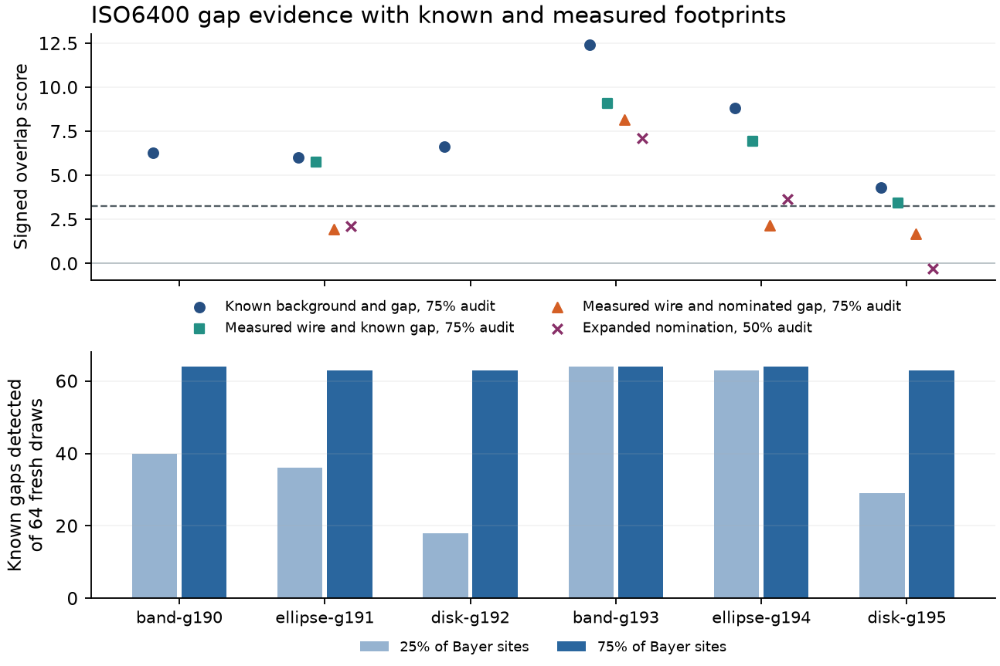
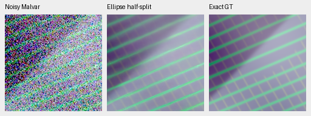
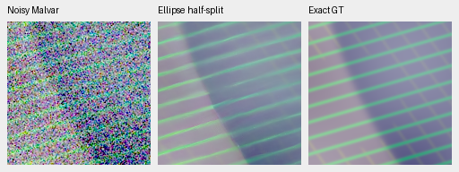

# Measuring what limits weak-wire gap recovery

The RAW data contains detectable evidence of the missing wire in the
earlier ISO6400 ellipse when the gap shape is supplied. Substituting the
true footprint into a pooled audit raises its signed score from **2.17
to 6.93** while retaining measured wire geometry. A larger search
finds a usable ellipse in that example. It makes a weaker tradeoff on
the fresh panel, where the smaller search delivers lower mean gap error.
[Measurements, source and native viewing](results/mesh-pooled-gap-evidence-v1/publication.json).

## How much evidence is in the samples?

The diagnostic constructs two exact predictions at each Bayer site.
Both share the foreground and background. One includes a continuing
rear wire, and the other cuts that wire inside the known footprint.
The signed matched-filter score compares the measured residual to
the known difference, using expected shot/read/ADC variance. The
models use the actual waveform and contrast for each CFA color.
The image generator reproduces the archived Bayer and reference
arrays exactly before the continuing counterfactual is constructed.

Across six previous ISO6400 gaps, independent sensor simulation
provides 64 new observations per class and geometry. At a signed
score cutoff of 3.25, a quarter of the sites detect **250/384** gaps.
Three quarters detect **381/384**, and all sites detect **383/384**.
All three allocations produce zero detections on the 384 continuing
controls. These tests supply both complete sensor predictions. The
figures measure how much evidence is available under those
assumptions, including exact amplitude and background.
[Independent physical draws and per-case results](results/mesh-pooled-gap-evidence-v1/oracle.json).

The measured pooled test first fits the continuing wave and estimates
signed color amplitudes on the reserved phase samples. It uses those
samples to nominate a footprint. On the remaining sites, it projects
the signed cut direction away from the continuing wave, step and
foreground nuisance columns. The projected direction then tests the
actual Bayer values with a cutoff of 3.25 and positive half-displacement
gain. The primary pooled arm retains the earlier reserve gain floor.
A second arm removes it. The stronger wire and upstream correction
use the same inputs as the [crossed finite-support check](mesh-shrunk-footprint.md).

Three arithmetic replays reproduce the pooled score with separate
rectangular least squares. Adding a signal in the fixed nuisance
space leaves the score equal within numerical tolerance. Perturbing
the audit samples leaves the reserve fit and footprint nomination
identical. [Projection checks](results/mesh-pooled-gap-evidence-v1/verify.json).

## Larger footprint search

The larger bank adds 225 tapered ellipses to the disks and bands. It
uses the reserve-fitted edge orientation to seed the candidate angles.
One arm keeps quarter-site nomination and the other uses half the
Bayer sites for nomination. The second half checks the selected
shape and is held apart during fitting and selection. A passing
score applies half the estimated cut to the existing rear correction.

On the earlier g194 ellipse, the quarter-site ellipse search raises
the score from 2.17 to 2.86. The half-site search reaches 3.65 on its
own held-out set. In the native crop, added gap RMS falls from
85.84 to 71.79 DN16. Total gap error falls from 201.48 to 193.79,
with weak recovery changing from 77.71% to 77.06%. The true
footprint produces much stronger evidence than the fitted ones.
The old panel is development evidence for the ellipse search.
[Development replay](results/mesh-pooled-gap-evidence-v1/nomination.json).

## Fresh exact-target results

The 24 scenes include six continuous wires and six true gaps per
noise profile, with four Bayer patterns and independent noise in
half of the pairs. The earlier and pooled policies use the exact same
candidate shape and wide correction. The ellipse follow-up tests
the same twelve new ISO6400 observations with its fixed shape bank.
[Per-case scores](results/mesh-pooled-gap-evidence-v1/report-summary.json) ·
[Fresh ellipse follow-up](results/mesh-pooled-gap-evidence-v1/fresh-nomination.json).

| Gap group and policy | Added gap RMS | Total gap RMS | Wire increment RMS |
| --- | ---: | ---: | ---: |
| ISO400 wide | 102.86 | 145.24 | 108.34 |
| ISO400 crossed or pooled | 66.56 | 121.13 | 107.29 |
| ISO6400 wide | 73.59 | 218.72 | 181.53 |
| ISO6400 crossed or pooled | 69.91 | 217.00 | 181.62 |
| ISO6400 ellipse with half-site nomination | 71.15 | 217.90 | 181.81 |

RMS uses camera-linear DN16. Added gap RMS measures change from the
local trunk. Total gap RMS uses the exact target. At ISO400, both audits
cut all six true gaps. The pooled test attenuates two continuous wires
versus one for the crossed check. On continuous g203, weak response
falls from 95.96% to 93.05%, while direct crop error falls from
102.14 to 99.93 DN16. The native board shows slightly weaker stripes.
All six continuous ISO6400 outputs keep wide support. Edge-only roles
and rotated donor controls keep the local trunk.

The quarter-site ellipse and circle searches agree on all six fresh
ISO6400 gaps. Half-site nomination catches two of six versus three
for the crossed and pooled checks. It improves disk g205, cutting
added error from 57.15 to 55.95 DN16 and total gap error from 227.54
to 226.82. It misses ellipse g204, where wide added gap RMS is 160.08
DN16 and the smaller search cuts it to 151.41. Large errors still
remain in both settings.

The two native triplets show the ellipse half-split on earlier g194
(GRBG) and fresh g205 (BGGR). They use ROI `[80,80,160,160]` in
a 320-pixel field, shot/read `0.00128/6.5536e-6`, ADC16 black
fraction 0.03, identity WB and color matrix, display exposure ×1
and reference-centered contrast ×8. The local parent is spatial
2k EMA with its whole-scene branch bypassed, SHA256
`97fd551bd0ae0b7aa97c67e1f6e8b513b722f70d5ad8b8814a96586b934eafac`.
Both crops retain some of the false rear pattern inside the gap.
[Source and pixel manifest](results/mesh-pooled-gap-evidence-v1/viewing.json).

[Earlier g194 comparisons](images/mesh-pooled-gap-evidence-v1/development-iso6400-ellipse-g194-comparison.png) ·
[Fresh g205 comparisons](images/mesh-pooled-gap-evidence-v1/iso6400-disk-g205-comparison.png) ·
[Continuous g203 attenuation](images/mesh-pooled-gap-evidence-v1/iso400-step-g203-comparison.png) ·
[Missed g204 ellipse](images/mesh-pooled-gap-evidence-v1/iso6400-ellipse-g204-comparison.png).

A follow-up averages candidate footprints before the audit. Independent high-noise
draws admit more true gaps, and the averaged shape gives lower gap error at
matched correction strength. [Average nomination and bounded refit](mesh-averaged-gap.md).

## Standing GFX100S review

The two sets of native comparisons use the cached standing observations
and local-only 2k EMA with adjacent donors, SHA256
`ceb5ddaf23fce47806a01045bd86d34bb48d1f64031e382b0d5cfbabf0716880`.
The elliptical half-split changes the coarse fence by 2.25 DN16 RMS
relative to adjacent donors, with coarse crossings still visible.
Sky, foliage and building reproduce the packaged crop pixels.
The sky stays smooth and the building rails and leaf edges stay soft.

The pooled test with the reserve floor preserves both right-cab
outputs. Removing the floor changes them by 1.12 and 0.73 DN16 RMS
under nominal and transferred noise. The elliptical half-split
changes them by 1.33 and 0.87 DN16. Both directions remain visible,
with local softening. It changes the left crops by 2.16 and 1.74
DN16. No clear improvement in crossing accuracy is visible against
the independent ISO100 and JPEG references.
[Native view records for both passes](results/mesh-pooled-gap-evidence-v1/viewing.json).

DSCF3879 uses exposure ×4 and shot/read `0.00128/6.5536e-6`.
DSCF3880 ISO100 AHD is the independent qualitative reference.
[Sky](images/mesh-pooled-gap-evidence-v1/ellipse-main-overcast-sky-main-overcast-sky.png) ·
[Building](images/mesh-pooled-gap-evidence-v1/ellipse-main-building-detail-main-building-detail.png) ·
[Foliage](images/mesh-pooled-gap-evidence-v1/ellipse-main-foliage-main-foliage.png) ·
[Coarse fence](images/mesh-pooled-gap-evidence-v1/ellipse-main-chain-link-fence-main-chain-link-fence.png).

DSCF3842 uses exposure ×16 and retains both camera JPEGs and the
independent DSCF3835 ISO100 AHD reference.

| Cab shot/read | Native crop comparisons |
| --- | --- |
| `0.00128/6.5536e-6` | [Left](images/mesh-pooled-gap-evidence-v1/ellipse-mesh-nominal-fine-green-mesh-left.png) · [Right](images/mesh-pooled-gap-evidence-v1/ellipse-mesh-nominal-fine-green-mesh-right.png) |
| `0.0014635775921166604/1.0715704128646712e-6` | [Left](images/mesh-pooled-gap-evidence-v1/ellipse-mesh-profile3879-fine-green-mesh-left.png) · [Right](images/mesh-pooled-gap-evidence-v1/ellipse-mesh-profile3879-fine-green-mesh-right.png) |

This crop-level experiment uses existing EMA checkpoints. The ellipse
and pooled checks remain experimental.
