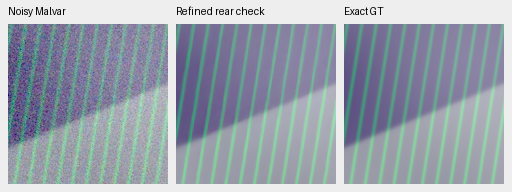
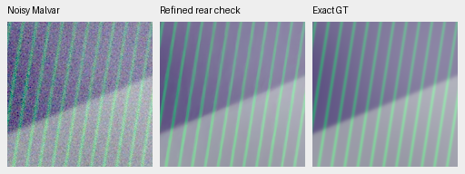

# Checking weak mesh against a better RAW edge fit

A refined foreground-edge fit distinguishes two false ISO400 second-wire
detections from real crossings on the same geometry. Removing the inferred
rear wire lowers the error in that wire's shape, with a small increase in
total RGB error. The eight standing GFX crops keep the adjacent-donor
pixels exactly, including the recovered crossings in the right cab crop.
The check is experimental. [Scores, sources and crop verification](results/mesh-refined-edge-v1/publication.json).

## What the edge fit changes

A strong step can leave a repeatable residual on separate Bayer subsets.
In the [previous study](mesh-step-continuity.md), replacing the estimated
background with the known synthetic background rejected two false
second directions that survived an exact foreground-wire geometry
check. The coarse step placed the transition near −45 pixels when
the actual offset was −15. On those two cases, the refined fit recovers
the offset within 0.11 pixels and rejects the weak direction. The new fit
also rejects the two other prior front-only detections, which the coarse
edge fit was already able to reject retrospectively.

The new search uses reserved Bayer sites to fit a smooth color-dependent
background, the stronger wire and a common step. It tests a coarse
bank, then refines angle, offset and width from three distinct starting
points. The candidate and the null share the fitted step and allow the
stronger wire to change contrast across it. The candidate can also vary
the weaker wire's amplitude across the step. Three disjoint forecasts
test that candidate, with two groups predicting each other and the
third auditing their pooled fit. With a measured step, the rear check
drops the rear correction if any forecast has nonpositive gain or
standardized overlap at or below 1.75. The no-step branch retains wide
delivery. The full veto also removes the front correction and serves
as a control. All policies use the same upstream 13 placements.
[Preregistered panel and checked source](results/mesh-refined-edge-v1/publication.json) ·
[Independent least-squares and partition checks](results/mesh-refined-edge-v1/verification.json).

## Fresh exact-target panel

The 24 new scenes vary the angle between the rear wire's frequency
and the foreground step normal from 3° to 85° and include curved
steps, steady illumination and three shapes of true gaps. Each scene
has a front-only target, a target with both wires, and an edge-only
target. Half of the front-only and two-wire pairs have independent
noise. The matching and rotated exterior controls hold the local
observation fixed. Matching donors make two front-only regions
eligible for wide delivery at ISO400. The edge-only roles and all
eight rotated controls retain their local parent.

| Group, six scenes each | Weak response, wide / coarse / refined | Wire increment error, wide / coarse / refined |
| --- | ---: | ---: |
| ISO400 continuous | 99.66% / 99.66% / 99.78% | 92.59 / 92.59 / 92.62 |
| ISO400 gaps | 83.39% / 83.39% / 83.39% | 90.06 / 90.06 / 90.04 |
| ISO6400 continuous | 84.71% / 82.55% / 82.55% | 179.00 / 181.23 / 181.23 |
| ISO6400 gaps | 41.34% / 41.34% / 41.34% | 182.35 / 182.35 / 182.35 |

Errors use camera-linear DN16. Response measures the present-minus-absent
increment and includes variation from independent noise. The same-observation
and independent-noise subsets are reported separately in the receipt.
Both ISO400 front-only detections are g180, with different noise draws
and different rear support in their present-wire counterparts. For both
negative crops, the coarse fit places the edge at +45 pixels and the
refined fit places it within 0.04 pixels of the correct +11. The refined
check keeps the real-wire output in both positive counterparts exactly.
The correction reduces the component of the error shaped like the false
wire, after projecting out the step and front wire from that measurement.
The known shape is used only for scoring. The targeted gains come with
slightly higher total front-only error.

| ISO400 front-only sample | False-wire RMS, wide → refined | Total RGB RMS, wide → refined |
| --- | ---: | ---: |
| g180 step | 1.98 → 1.89 | 78.96 → 79.11 |
| g180 band | 1.29 → 1.25 | 76.76 → 76.84 |

Both checked policies remove some real rear signal at ISO6400 in g183,
a continuous wire beside a curved step. Direct present-role RGB error
rises from 256.94 to 258.66 DN16. The ISO6400 gap results show
no change and still include false continuation. In g183, all three
overlaps support the true rear waveform, but the pooled forecast
overestimates its amplitude and raises held-out error. A retrospective
test scales the forecast displacement by one half. The pooled gain
moves from −2.97 to +6.58 and the two false g180 directions still fail
the overlap margin. That replay changes the comparison amplitude and
has no new delivery or independent trial behind it.
[Complete group and per-case results](results/mesh-refined-edge-v1/summary.json) ·
[Amplitude replay](results/mesh-refined-edge-v1/shrinkage.json).

The two triplets use front-only RGGB observations, 16-bit Bayer
simulation with black fraction 0.03, shot/read `8e-5/2.56e-8`, identity
white balance and color matrix, and identical native ROI
`[80,80,160,160]` in the 320-pixel field. Display exposure is ×1 with
shared reference-centered contrast ×8. The local parent is the spatial
2k EMA with whole-scene conditioning bypassed, SHA256
`97fd551bd0ae0b7aa97c67e1f6e8b513b722f70d5ad8b8814a96586b934eafac`.
The effects are subtle at native scale. [Pixel and source manifest](results/mesh-refined-edge-v1/viewing.json).

[g180 step, all policies](images/mesh-refined-edge-v1/iso400-step-g180-role0-comparison.png) ·
[g180 band, all policies](images/mesh-refined-edge-v1/iso400-band-g180-role0-comparison.png) ·
[g180 exact positive counterpart](images/mesh-refined-edge-v1/iso400-step-g180-role1-comparison.png) ·
[g183 ISO6400 real wire loss](images/mesh-refined-edge-v1/iso6400-step-g183-role1-comparison.png).

The fixed half forecast and the hard forecast also agree on the
24-scene follow-up and a separate set of independent high-noise draws
with exact guide geometry. A new reserve-nominated footprint reduces
false continuation mainly at ISO400.
[Finite support and amplitude follow-up](mesh-shrunk-footprint.md).

## Standing GFX100S review

The camera playback uses local-only 2k EMA
`ceb5ddaf23fce47806a01045bd86d34bb48d1f64031e382b0d5cfbabf0716880`
plus the packaged adjacent-donor path on the same cached RAW inputs.
All eight checked camera RGB crops exactly reproduce the packaged
result. The overcast sky stays smooth, the building and foliage remain
soft, and the main fence retains its coarse crossings. The cab
keeps both recovered directions at right under both noise profiles.
The dark cab background still shows mottling, and some intersections
look more regular and weaker than in the independent references.
The ISO100 AHD and the independently exposed camera JPEGs are
qualitative references. [Actual native viewing and exact inputs](results/mesh-refined-edge-v1/viewing.json).

The DSCF3879 main scene uses exposure ×4 and shot/read
`0.00128/6.5536e-6` with the DSCF3880 ISO100 AHD reference.
[Overcast sky](images/mesh-refined-edge-v1/main-overcast-sky-main-overcast-sky.png) ·
[Building](images/mesh-refined-edge-v1/main-building-detail-main-building-detail.png) ·
[Foliage](images/mesh-refined-edge-v1/main-foliage-main-foliage.png) ·
[Coarse fence](images/mesh-refined-edge-v1/main-chain-link-fence-main-chain-link-fence.png).

The DSCF3842 cab scene uses exposure ×16 and DSCF3835 ISO100 AHD, plus
both corresponding straight-out-of-camera JPEGs.

| Shot/read | Cab native crops |
| --- | --- |
| `0.00128/6.5536e-6` | [Left](images/mesh-refined-edge-v1/mesh-nominal-fine-green-mesh-left.png) · [Right](images/mesh-refined-edge-v1/mesh-nominal-fine-green-mesh-right.png) |
| `0.0014635775921166604/1.0715704128646712e-6` | [Left](images/mesh-refined-edge-v1/mesh-profile3879-fine-green-mesh-left.png) · [Right](images/mesh-refined-edge-v1/mesh-profile3879-fine-green-mesh-right.png) |

This is a crop-level inference experiment on existing checkpoints.
Training and fixed full427/camera PSNR history have no new endpoint
from this check. The packaged crop option and V120 general recommendation
retain their existing implementation. [Current choices](current-model.md).
