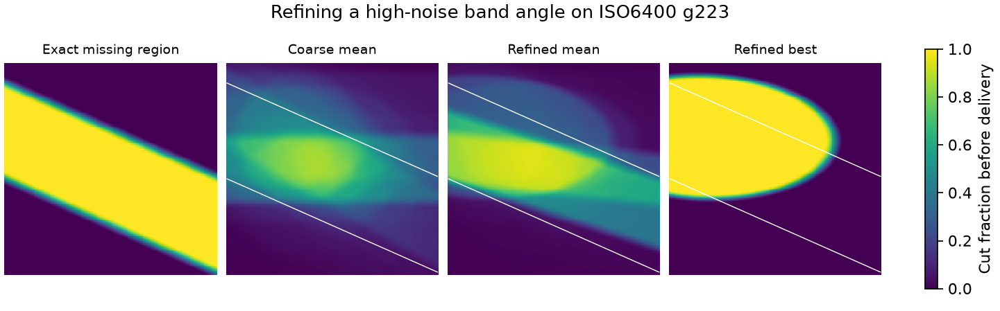
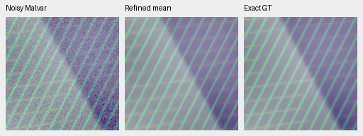
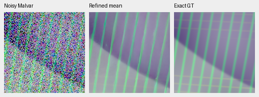

# Refining weak-wire gap geometry on reserved Bayer sites

Local shape refinement improves the placement of weak-wire gap cuts
at ISO400. In six fresh gaps, the averaged fit lowers exact-target
gap error from **105.90 to 103.15 DN16** and exterior attenuation
from **5.77 to 3.30 DN16**. At ISO6400 only one of six fresh gaps
gets an averaged cut and its gain is small. The standing photos
retain a smooth sky and coarse fence crossings. Fine cab crossings
are still soft and incomplete.
[Results and reviewed crops](results/mesh-refined-footprint-v1/publication.json).

## How the shape is selected

The [coarse bank](mesh-averaged-gap.md) has 336 bands, disks and
ellipses. A quarter of the Bayer sites ranks them against a null
that includes a fitted foreground edge and a continuing rear wire.
Two well-ranked seeds per family get a bounded search over position,
width and, where applicable, angle. Up to two coordinate sweeps
at each of three step sizes use the same quarter of sites. Band
centers can move at most 18 native pixels along the normal and
band normals can rotate by at most 21.6°. The search replaces those
six proposals in the original bank. The winning shape and a
family-weighted average are evaluated separately.

The other three quarters test the fixed footprint using the same
3.25 signed cutoff and positive half-displacement gain as the coarse
control. Passing cuts remove half of the proposed rear component.
This comparison holds delivery strength fixed to study geometry.
Arithmetic checks reproduce all 336 ranking scores on three crops
within 3e-14. Perturbing the audit group changes its scores and
preserves all nominated shapes.
[Frozen source and verification](results/mesh-refined-footprint-v1/verification.json).

Replaying the previously observed ISO6400 g223 angle miss reduces
the averaged footprint's normal error from 17.24° to 10.64° and
raises soft overlap with the true gap from 0.429 to 0.537. The
refined best proposal selects a compact shape and leaves the
right part of the gap mostly untouched. The g224 compound replay
shows that lower RGB error can coincide with lower true footprint
overlap for the best proposal.
[Two archived replays](results/mesh-refined-footprint-v1/development.json).

## Fresh exact-target crops

Twenty-four new scenes cover all four Bayer patterns, with six
continuous and six gapped cases at each noise level. The weaker
wire can change contrast across the foreground edge. Gaps include
off-grid bands, disks, ellipses and two separated patches. Half of the
present-versus-absent pairs use independent noise. All arms use
the same parent and 13-placement adjacent-donor correction.
Eight rotated donor controls and every edge-only crop receive
zero correction.

| Noise and delivered policy | Added gap RMS | Total gap RMS | Exterior attenuation RMS |
| --- | ---: | ---: | ---: |
| ISO400 wide | 102.31 | 129.29 | 0.00 |
| ISO400 coarse best | 68.06 | 106.40 | 5.95 |
| ISO400 refined best | 62.67 | 103.26 | 3.37 |
| ISO400 coarse mean | 67.47 | 105.90 | 5.77 |
| ISO400 refined mean | 62.91 | 103.15 | 3.30 |
| ISO6400 wide | 43.57 | 205.15 | 0.00 |
| ISO6400 coarse best | 41.13 | 204.59 | 0.37 |
| ISO6400 refined best | 41.07 | 204.59 | 1.51 |
| ISO6400 coarse mean | 42.84 | 205.04 | 0.04 |
| ISO6400 refined mean | 42.76 | 205.03 | 0.03 |

The table uses camera-linear DN16. Added gap RMS is the change from
the local parent inside the gap. Total gap RMS uses the exact target.
Exterior attenuation measures the difference from the central checked
output on fully intact sites. Matching each ISO400 cut's magnitude
to the refined mean still reduces gap error from 105.12 to 103.15
and exterior attenuation from 5.95 to 3.30. The refined mean cuts
three continuous ISO400 wires, the same count as the coarse mean,
with a larger average change of 2.03 versus 0.52 DN16. The refined
best cuts one continuous wire, down from two.

At ISO6400 the two best-proposal cuts and the one averaged cut
are in the same cases before and after refinement. The upstream
carrier path skips compound g234. The averaged audit rejects
four of the other five footprints. The refined signed score
for the g230 band is 3.09.
At equal delivered magnitude the refined best increases exterior
attenuation from 1.80 to 4.52 DN16 on its two admitted gaps.
[Recomputed scores and matched cuts](results/mesh-refined-footprint-v1/summary.json).

Putting the exact synthetic gap into the audited rear template
helps separate geometry and evidence. With measured carriers and
the same gate, the exact footprint passes in two of the five
ISO6400 crops that reach the audit. It recovers g230 with a
score of 3.73. The remaining three scores range from 2.04 to
3.14. The best fitted g235 proposal passes, while the exact
g235 footprint fails. These outcomes show why an admitted cut
and an accurate footprint need separate checks. The diagnostic
uses hidden gap geometry.
[Exact-footprint audit](results/mesh-refined-footprint-v1/packed-exact-footprint-probe.json).

The native triplets show noisy Malvar, the refined mean and
exact GT. They use ROI `[80,80,160,160]` in 320-pixel fields,
ADC16 black fraction 0.03, identity white balance and matrix,
exposure ×1 and fixed reference-centered contrast ×8. The parent
is the spatial 2k EMA with scene input bypassed, SHA256
`97fd551bd0ae0b7aa97c67e1f6e8b513b722f70d5ad8b8814a96586b934eafac`.
Selected to show the largest gap-RMS decrease under each prior,
GRBG g234 at ISO400 uses shot/read `8e-5/2.56e-8` and BGGR g233
at ISO6400 uses `0.00128/6.5536e-6`. At ISO400 the spurious rear
repeats fade in the gap. The difference at ISO6400 is subtle and
true rear repeats remain faint.
[Crop settings](results/mesh-refined-footprint-v1/viewing.json).

[ISO400 compound comparison](images/mesh-refined-footprint-v1/iso400-compound-g234-comparison.png) ·
[ISO6400 band comparison](images/mesh-refined-footprint-v1/iso6400-band-g233-comparison.png) ·
[Continuous wire with a false cut](images/mesh-refined-footprint-v1/iso400-step-g233-comparison.png) ·
[ISO6400 ellipse with no admitted cut](images/mesh-refined-footprint-v1/iso6400-ellipse-g231-comparison.png).

## Independent high-noise repeats

The conditional test uses 24 new ISO6400 gap and continuous
pairs across four already measured geometries, with carrier
geometry fixed from an earlier independent observation. The
exact rear waveform enters the scores only. All four policies
leave all 24 continuous controls untouched. The averaged fit
admits one fewer gap and reduces rear-support error from 50.30
to 48.58 DN16, with more exterior attenuation. The repeated
g223 band improves on both measures. All six ellipse g221 gaps
remain below the audit threshold.

| Policy | Admitted gaps | Exact rear-support RMS | Exterior attenuation RMS |
| --- | ---: | ---: | ---: |
| Coarse best | 13/24 | 46.65 | 6.62 |
| Refined best | 13/24 | 45.88 | 7.02 |
| Coarse mean | 16/24 | 50.30 | 5.44 |
| Refined mean | 15/24 | 48.58 | 6.32 |

## Standing GFX100S review

The eight boards use the local-only 2k EMA with the native
crop helper and exact adjacent donor pixels, SHA256
`ceb5ddaf23fce47806a01045bd86d34bb48d1f64031e382b0d5cfbabf0716880`.
Both coarse modes reproduce the earlier arrays bit for bit.
Refinement leaves the smooth sky, building rails and foliage
exactly as in adjacent-donor delivery. It changes the coarse
fence by 1.27 DN16 RMS relative to the coarse mean, with its
crossings still visible.

The refined mean changes the four cab boards by 0.52–2.13 DN16
RMS relative to the coarse mean. The largest change is in the
nominal left crop, where faint rear repeats soften next to the
post. Both right boards retain both directions under refinement.
The darkest crossings remain weak and some have coarser contrast
than in the independent ISO100 and JPEG references.
[Viewed boards and exact provenance](results/mesh-refined-footprint-v1/viewing.json).

DSCF3879 uses exposure ×4 with shot/read `0.00128/6.5536e-6`.
The native crops use the fixed main-scene boxes. DSCF3880 ISO100
AHD is an independent qualitative reference.
[Sky](images/mesh-refined-footprint-v1/main-overcast-sky-main-overcast-sky.png) ·
[Building](images/mesh-refined-footprint-v1/main-building-detail-main-building-detail.png) ·
[Foliage](images/mesh-refined-footprint-v1/main-foliage-main-foliage.png) ·
[Coarse fence](images/mesh-refined-footprint-v1/main-chain-link-fence-main-chain-link-fence.png).

DSCF3842 uses exposure ×16. DSCF3835 ISO100 AHD and the two
camera JPEGs are qualitative references. Each board uses the
fixed left or right native crop for every method and reference.

| Cab shot/read | Native boards |
| --- | --- |
| `0.00128/6.5536e-6` | [Left](images/mesh-refined-footprint-v1/mesh-nominal-fine-green-mesh-left.png) · [Right](images/mesh-refined-footprint-v1/mesh-nominal-fine-green-mesh-right.png) |
| `0.0014635775921166604/1.0715704128646712e-6` | [Left](images/mesh-refined-footprint-v1/mesh-profile3879-fine-green-mesh-left.png) · [Right](images/mesh-refined-footprint-v1/mesh-profile3879-fine-green-mesh-right.png) |

This is a scoped inference experiment using existing checkpoints.
The fresh high-noise misses and false cuts on continuous wires
keep geometry refinement experimental. The fixed full427 and
known/unseen camera benchmarks apply to full checkpoints.
