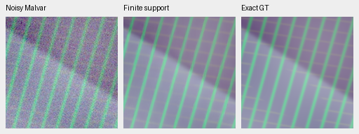
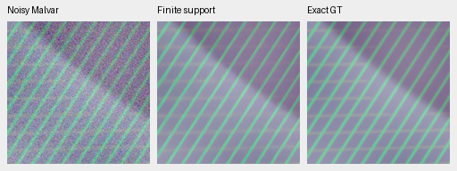

# Checking finite weak-wire support in Bayer data

A local footprint test reduces added weak-wire texture inside all six
fresh ISO400 gaps. Mean added gap error falls from **103.32 to 66.31 DN16**
relative to wide support. It changes one of six ISO6400 gaps and leaves
most of the false continuation there. The separate half-amplitude
forecast gives the same admission decisions as the hard forecast in
the fresh panel and in 16 exact-geometry high-noise repeats.
[Source, scores and native viewing](results/mesh-shrunk-footprint-v1/publication.json).

## Fit scope before reducing the rear correction

The [earlier edge study](mesh-refined-edge.md) rejected a real
ISO6400 rear direction when its predicted contrast was too strong.
This experiment tests a fixed half-amplitude displacement in that
held-out comparison. A positive gain still needs standardized
overlap above 1.75 in all three forecasts. Passing delivers the
existing wide correction. The half factor applies to the tested
displacement.

The finite-support arm also fits the continuing wire and a smooth
foreground with the reserve sites. It selects a possible gap from
111 tapered disks and bands using those sites. An independent
Bayer subset fits each model and predicts a different subset. The
pooled fit is checked on a third subset. The forecasts compare a
continuous rear wire with the same wire attenuated inside the
proposed gap. A successful audit applies half the proposed cut to
the existing rear correction, retaining the stronger direction.
The fit allows brightness and both wire amplitudes to vary across
a reserve-fitted step. The exact gap and image target enter scoring.
Perturbing the final audit samples leaves earlier fits and reserve
nomination identical in two independent cases.
[Fixed method and observations](results/mesh-shrunk-footprint-v1/publication.json) ·
[Independent-noise records](results/mesh-shrunk-footprint-v1/repeated.json).

## Fresh exact-target results

Each noise profile has six continuous scenes and six scenes with
true band, disk or ellipse gaps. Step and rear-wave orientations
vary, three geometries have curved steps, and all four Bayer
patterns are covered. Each scene includes front-only, two-wire and
edge-only observations. Twelve scenes use independent draws for
the absence and presence roles. The two delivered policies take
the same wider context and the same 13-placement median.

| Gap group and policy | Weak response | Added gap RMS | Total gap RMS | Intact-wire RMS |
| --- | ---: | ---: | ---: | ---: |
| ISO400 local trunk | 43.71% | 0.00 | 106.63 | 165.09 |
| ISO400 wide | 94.94% | 103.32 | 136.11 | 120.95 |
| ISO400 finite support | 93.21% | 66.31 | 111.70 | 121.76 |
| ISO6400 local trunk | 26.97% | 0.00 | 219.69 | 255.19 |
| ISO6400 wide | 47.14% | 36.37 | 219.22 | 224.37 |
| ISO6400 finite support | 47.11% | 36.01 | 219.15 | 224.42 |

Errors use camera-linear DN16. Added gap error is the change relative
to the local trunk at missing-wire pixels. Total gap and intact-wire
RMS compare the delivered image with the exact target at their
respective sites. Weak response uses both the present and absent
observations. At ISO400, direct RGB error averaged over the full
two-wire crops falls from 110.88 to 108.63 DN16. Gap error remains
above the local trunk, while intact-wire error remains substantially
lower. The finite fit keeps all twelve continuous two-wire outputs.
Both forecast checks reject the rear direction in two matching
ISO400 front-only controls, with both real-wire counterparts retained.
All edge-only roles and eight rotated-donor controls keep their
local parent.

The one admitted ISO6400 gap cut reduces added RMS from 26.97 to
24.79 DN16. The strongest ISO6400 false continuation remains visible
in g194. A separate check supplies exact geometry on eight new
draws per layout for two previously studied high-noise scenes.
Both central checks admit all sixteen true rear wires and reject
all sixteen front-only controls. In that diagnostic the finite
footprint check detects one of eight true ellipses and makes zero
cuts on the eight continuous wires. It uses no delivered image.
[Per-case measurements](results/mesh-shrunk-footprint-v1/summary.json).

A same-delivery replay verifies the original rear correction pixel
for pixel on the gap cases. Matching the attenuation RMS on the
ISO400 crops gives total gap errors of 119.51 DN16 for a uniform
rear cut, 111.45 for the earlier smooth mask and 111.70 for the
finite mask. Wire increment errors are 103.66, 102.40 and 102.32
DN16, respectively. The more aggressive unscaled smooth mask
reaches 105.77 DN16 in the gap, with higher wire increment error
of 103.61 DN16. The spatial masks are close at the same correction
strength. The ISO6400 smooth cut would require more than 100%
local attenuation to match the finite cut's RMS in g193, so that
equal-strength aggregate is left blank.
[Matched cut-strength replay](results/mesh-shrunk-footprint-v1/matched-summary.json).

Both triplets show the finite-support result with exact GT
on native `[80,80,160,160]` crops in 320-pixel fields.
ISO400 uses shot/read `8e-5/2.56e-8`, ADC16 with black fraction
0.03, identity WB and color matrix, exposure ×1 and a
shared reference-centered contrast of ×8. g191 uses GBRG and
g192 RGGB. The spatial 2k EMA has its scene branch bypassed,
SHA256 `97fd551bd0ae0b7aa97c67e1f6e8b513b722f70d5ad8b8814a96586b934eafac`.
The visible rear repeats weaken inside the gaps. Some residual
pattern remains, and the strong foreground strands stay visible.
[Pixel and source bindings](results/mesh-shrunk-footprint-v1/viewing.json).

[g191 comparison](images/mesh-shrunk-footprint-v1/iso400-ellipse-g191-role1-comparison.png) ·
[g192 comparison](images/mesh-shrunk-footprint-v1/iso400-disk-g192-role1-comparison.png) ·
[Remaining ISO6400 false continuation](images/mesh-shrunk-footprint-v1/iso6400-ellipse-g194-role1-comparison.png) ·
[Front-only g190](images/mesh-shrunk-footprint-v1/iso400-step-g190-role0-comparison.png) ·
[Real-wire g190 counterpart](images/mesh-shrunk-footprint-v1/iso400-step-g190-role1-comparison.png).

A follow-up supplies known continuing and gap predictions to measure
available sensor evidence. A pooled check and an expanded footprint
search then test actual RAW nominations. The expanded search helps
one earlier high-noise ellipse and trails the footprint check on fresh
high-noise gaps overall. [Pooled gap evidence](mesh-pooled-gap-evidence.md).

## Standing GFX100S review

The playback uses the existing local-only 2k EMA
`ceb5ddaf23fce47806a01045bd86d34bb48d1f64031e382b0d5cfbabf0716880`
with adjacent donors. The half-forecast policy reproduces all eight
packaged crops. The finite cut changes the coarse fence by 2.18 DN16
RMS and the left cab crop under nominal conditioning by 1.80 DN16.
The coarse crossings remain visible. The already faint left-cab
lattice softens locally under that prior. Both right-cab crops
preserve their recovered crossings, and irregularity remains in
the dark cab background. The sky remains smooth and no new color
fringes are apparent in the edited views.
[Native images and exact source bindings](results/mesh-shrunk-footprint-v1/viewing.json).

DSCF3879 uses shot/read `0.00128/6.5536e-6` and exposure ×4,
with DSCF3880 ISO100 demosaiced by AHD as the qualitative reference.
[Sky](images/mesh-shrunk-footprint-v1/main-overcast-sky-main-overcast-sky.png) ·
[Building](images/mesh-shrunk-footprint-v1/main-building-detail-main-building-detail.png) ·
[Foliage](images/mesh-shrunk-footprint-v1/main-foliage-main-foliage.png) ·
[Coarse fence](images/mesh-shrunk-footprint-v1/main-chain-link-fence-main-chain-link-fence.png).

DSCF3842 uses exposure ×16. DSCF3835 ISO100 AHD and both camera JPEGs
offer independent qualitative references at different capture settings.

| Cab shot/read | Native crop comparisons |
| --- | --- |
| `0.00128/6.5536e-6` | [Left](images/mesh-shrunk-footprint-v1/mesh-nominal-fine-green-mesh-left.png) · [Right](images/mesh-shrunk-footprint-v1/mesh-nominal-fine-green-mesh-right.png) |
| `0.0014635775921166604/1.0715704128646712e-6` | [Left](images/mesh-shrunk-footprint-v1/mesh-profile3879-fine-green-mesh-left.png) · [Right](images/mesh-shrunk-footprint-v1/mesh-profile3879-fine-green-mesh-right.png) |

The evidence covers crop-level inference using saved EMA checkpoints.
Finite support remains experimental.
