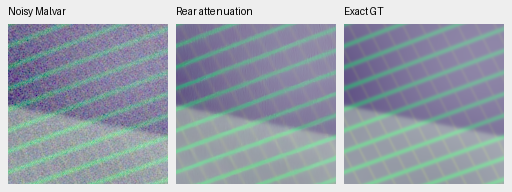
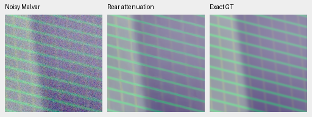

# Preserving weak wires across a contrast step

The side-dependent RAW fit keeps both recovered directions in the right
GFX100S cab crop. The simpler background-step mask fades parts of that
lattice. Fresh synthetic tests compare both masks against continuous
wires whose contrast changes across the edge, plus gaps that cross or
end beside the edge. [Scores, source and viewing record](results/mesh-step-continuity-v1/publication.json).

## Model wire contrast on both sides of the edge

The earlier smooth mask fits an intensity step from the reserved Bayer
columns. It then gives each Bayer color a constant baseline wire
amplitude. A real wire can retain its phase while changing contrast
across a shadow or background edge. The new fit uses that same step
geometry and gives both wire directions a separate amplitude on each
side. The stronger direction's step term is shared by the continuing
and masked forecasts.
The weak-direction terms are present in both the continuing and the
masked forecasts. The candidate mask scales both weak-direction terms
where it estimates a break.

Both fits use the same 13-placement correction, distributed Bayer
assignment, mask nomination and predictive margins. One sample group
fits a mask and predicts the other, then the roles reverse. A third
group audits the mask fitted from the first two together. Step geometry
uses only the reserved sites. The foreground and rear contrast terms
are the only changes to the nominated-mask model. Rectangular
least-squares reconstruction verifies nine held-out forecasts and the
fit's invariance to reversing the step label. [Source archive](results/mesh-step-continuity-v1/evidence.tar.xz) ·
[Arithmetic checks](results/mesh-step-continuity-v1/verification.json).

## Prospective exact-target panel

The panel has 24 new paired observations. Each noise prior contains
five continuous wires that change contrast across a soft intensity
step, one continuous wire under smooth lighting, and six true gaps.
The gap shapes include bands, disks and tilted ellipses. On the lower
contrast side, the green weak-wire amplitude is 36–63% of the brighter
side's value. The stronger wire has its own smaller contrast change.
All four Bayer layouts appear. The method and cases were fixed before
collection. Four additional continuous cases use independently drawn
noise in the present and absent images. The main table uses the 24
coupled pairs. [Input and score records](results/mesh-step-continuity-v1/summary.json).

| ISO400 policy | Continuous cases edited | Continuous wire recovery | Continuous wire RMS | Added gap RMS | Total gap RMS |
| --- | ---: | ---: | ---: | ---: | ---: |
| Wide support | 0/6 | 106.84% | 65.22 | 82.56 | 126.89 |
| Column gap audit | 0/6 | 106.87% | 65.28 | 58.66 | 117.05 |
| Distributed gap audit | 0/6 | 106.84% | 65.22 | 59.08 | 115.20 |
| Short support | 3/6 | 106.25% | 64.48 | 49.19 | 118.10 |
| Smooth support | 5/6 | 96.60% | 62.80 | 43.34 | 109.51 |
| Background step | 5/6 | 102.95% | 61.91 | 27.39 | 112.74 |
| Side-dependent step | 1/6 | 106.08% | 65.20 | 30.79 | 112.47 |

RMS uses camera-linear DN16. Wire recovery and wire RMS are computed
from the present-minus-absent increment. Gap error uses the restored
image directly. The side-dependent model reduces added texture across
the six gaps and gives slightly higher error on retained wire pixels
than the background-only step. Side-dependent added gap RMS is
30.79 DN16 versus 27.39 for the background step, with mean wire error
66.29 versus 63.70 DN16 on the six gap cases.

The background-step mask can correct excess contrast even where the
wire is continuous. On the dark side of g172, its attenuation lowers
weak increment error from 115.00 to 72.19 DN16. The side-dependent mask
withholds the cut and leaves the same overshoot as the wide fit.
This distinguishes detecting a break from estimating how strong a
continuing wire should be.

At ISO6400 the side-dependent mask matches all six continuous and all
six gap outputs from wide support. In the largest miss, g174, the
wide fit adds 85.38 DN16 RMS inside the disk. The background-step mask
reduces it to 81.78 and leaves the false crossing visible. Short support
reduces the average added gap RMS from 21.39 to 5.79 DN16 and lowers
the six continuous cases' weak response from 61.27% to 42.89%.

All edge-only or flat roles and rotated-donor observations keep the
local trunk. At ISO400, the upstream wide fit modifies four front-only
roles, all repetitions of the g174 and g175 step geometries. A later
RAW-only check with a stronger edge model rejects the two g175 rear
hypotheses and still admits both g174 hypotheses. The g174 approvals
survive exact strong-wire phase and disappear after subtracting the
known clean front-only scene. These two failures involve nuisance
model error even with accurate front geometry. These controls use the
synthetic targets and produce no correction. [Admission probe](results/mesh-step-continuity-v1/admission-probe.json) ·
[Known-background replay](results/mesh-step-continuity-v1/negative-oracle.json).

## Rescaling a wire without cutting it

In a further replay, a separate held-out comparison tests whether
the wire amplitude varies across the reserved-sample step. If both
crossed fits and the final audit improve the prediction, the two-side
fit estimates how much of the existing rear correction each color
needs. A noise-scaled denominator shrinks that change when its
amplitude is small. One variant attenuates the existing rear contribution
and another allows up to 125% of it. The stronger contribution stays
fixed. The delivery rules were specified after viewing early paired
results and before examining the independent repeats.

For three preselected ISO400 contrast-step cases, attenuation lowers
mean wire error from **58.02 to 52.17 DN16**. The bounded rescale gives
54.45 DN16. The two independent ISO400 repeats reduce mean wire
increment error from 111.40 to 109.18 DN16. In the same repeats, direct
RGB error against the exact present target on the dark side falls
from 89.27 to 85.10 DN16. The bright side stays identical. The three
high-noise counterparts and two independent high-noise repeats produce
no rescale at this margin. The broader crop helper still carries the
previous correction. [Coupled delivery replay](results/mesh-step-continuity-v1/edge-delivery.json) ·
[Independent delivery replay](results/mesh-step-continuity-v1/rescale-independent.json).

The two triplets show g173 (BGGR) and g175 (GBRG), the two largest wire
error improvements in the three ISO400 rescale cases. Both use the
same 160×160 native ROI `[80,80,160,160]` in 320-pixel fields, noisy
Malvar, ADC16 black fraction 0.03, identity WB and matrix,
shot/read `8e-5/2.56e-8`, exposure ×1 and shared reference-centered
display contrast ×8. The synthetic parent is spatial 2k EMA with its
scene input bypassed, SHA256
`97fd551bd0ae0b7aa97c67e1f6e8b513b722f70d5ad8b8814a96586b934eafac`.

[g173 comparison](images/mesh-step-continuity-v1/iso400-step-g173-comparison.png) ·
[g175 comparison](images/mesh-step-continuity-v1/iso400-step-g175-comparison.png) ·
[Remaining continuous false cut](images/mesh-step-continuity-v1/iso400-step-g174-comparison.png) ·
[ISO400 ellipse](images/mesh-step-continuity-v1/iso400-ellipse-g175-comparison.png) ·
[ISO6400 missed disk](images/mesh-step-continuity-v1/iso6400-disk-g174-comparison.png).

## Standing GFX100S review

The side-dependent mask keeps all four cab crops identical to the
packaged adjacent-donor result. The earlier background-step mask changes
both right crops by 3.68 and 3.00 DN16 RMS under nominal and transferred
conditioning. The recovered right-cab crossings remain visible under
both priors. Some repeat structure still looks more regular and lower
in contrast than the independent ISO100 image. The side-dependent fit
slightly fades sections of the coarse fence, with a change of 2.85 DN16
RMS. Limiting it to the weaker direction changes that crop by 1.86 DN16.
The sky, building and foliage retain their pixels. All eight native
boards were opened. [Pixel and provenance record](results/mesh-step-continuity-v1/viewing.json).

The direct rescale was also viewed on all eight crops. It changes only
the coarse fence, by 2.40 DN16 for attenuation and 3.01 for bounded
rescaling, and keeps the visible crossings. [Rescale comparison](images/mesh-step-continuity-v1/rescale-main-chain-link-fence-main-chain-link-fence.png).

The camera parent is local-only 2k EMA SHA256
`ceb5ddaf23fce47806a01045bd86d34bb48d1f64031e382b0d5cfbabf0716880`,
with the packaged adjacent-donor correction. DSCF3879 uses exposure ×4
and shot/read `0.00128/6.5536e-6`. Cab DSCF3842 uses ×16 with that
nominal prior and transferred `0.0014635775921166604/1.0715704128646712e-6`.
The DSCF3880 and DSCF3835 ISO100 AHD images and both cab JPEGs serve as
qualitative references. Every panel keeps the original 160×160 crop and
shares the same camera rendering within its board.

[Sky](images/mesh-step-continuity-v1/main-overcast-sky-main-overcast-sky.png) ·
[Building](images/mesh-step-continuity-v1/main-building-detail-main-building-detail.png) ·
[Foliage](images/mesh-step-continuity-v1/main-foliage-main-foliage.png) ·
[Coarse fence](images/mesh-step-continuity-v1/main-chain-link-fence-main-chain-link-fence.png).

| Cab profile | Native comparisons |
| --- | --- |
| Nominal | [Left](images/mesh-step-continuity-v1/mesh-nominal-fine-green-mesh-left.png) · [Right](images/mesh-step-continuity-v1/mesh-nominal-fine-green-mesh-right.png) |
| Transferred | [Left](images/mesh-step-continuity-v1/mesh-profile3879-fine-green-mesh-left.png) · [Right](images/mesh-step-continuity-v1/mesh-profile3879-fine-green-mesh-right.png) |

The masks and rear rescale are scoped experimental crop fits with frozen
checkpoints. [Full-checkpoint PSNR history](performance-history.md).
