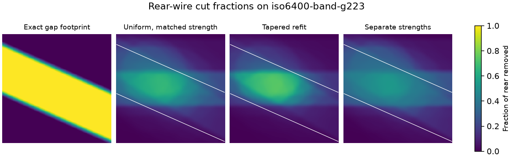
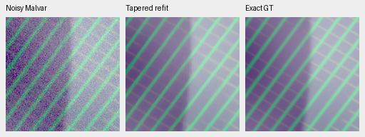
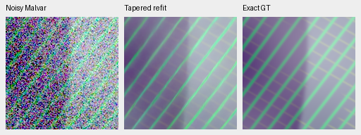

# Keeping gap attenuation inside the supported footprint

Tapering the strength refit reduces attenuation outside the true
gap from **9.57 to 7.02 DN16** on 24 independent high-noise draws.
The remaining rear-support error rises slightly from 42.49 to
43.75 DN16. In fresh RGB crops, fitting a separate strength in the
center and fringe gives a small ISO6400 improvement over a uniform
refit, with slightly less attenuation of intact wire.
[Results, sources and native viewing](results/mesh-tapered-strength-v1/publication.json).

## What changes after the audit

A quarter of the Bayer sites nominates the same weighted average
of disk, band and ellipse candidates as the
[previous study](mesh-averaged-gap.md). The other sites check the
fixed shape using a signed score cutoff of 3.25 and positive
half-displacement gain. If it passes, the unchanged rear correction
receives one of four attenuation strengths. The bank's best
single shape with a uniform refit supplies a control.

The fixed mean uses a strength of 0.5 across the footprint.
The uniform refit estimates one strength on the whole cut and
bounds it to 0.25–0.85. The tapered refit applies that strength
where the estimated footprint has strong agreement and smoothly
limits the fringe to at most 0.5. The central weight rises from
zero at 30% of the footprint peak to one at 90%, using smoothstep.
A fourth arm fits independent center and fringe strengths with
the same bounds and 16 units of prior information toward 0.5 per
term. Both components use the
same projected Bayer residuals and account for their overlap.
The strength estimate affects reconstruction after the gate.
The shape and its nomination samples are identical across the
four comparisons.

Independent least squares reproduces both projected terms on
three native crops. Perturbing the audit values changes the score
and preserves the nomination. The bounded quadratic solver passes
512 numerical cases covering interior, edge and corner solutions.
[Arithmetic and sample checks](results/mesh-tapered-strength-v1/verification.json).

## Matched exact-target crops

The 24 new scenes include six continuous and six gapped views at
each noise profile, with four Bayer patterns and independent noise
in half of the present-versus-absent pairs. Gaps use disks, bands,
ellipses and multiple separated patches. The weaker wire can
change contrast at a strong step and vary smoothly along it. All
methods receive the same 13-placement correction and the same
upstream check for a second direction.

| Noise and policy | Added gap RMS | Total gap RMS | Exterior attenuation RMS |
| --- | ---: | ---: | ---: |
| ISO400 wide | 119.61 | 157.04 | 0.00 |
| ISO400 fixed mean | 80.39 | 129.74 | 6.82 |
| ISO400 uniform | 57.20 | 118.07 | 11.44 |
| ISO400 tapered | 57.92 | 118.44 | 10.54 |
| ISO400 separate strengths | 57.89 | 118.48 | 10.85 |
| ISO6400 wide | 70.53 | 229.57 | 0.00 |
| ISO6400 fixed mean | 59.19 | 221.86 | 3.99 |
| ISO6400 uniform | 57.20 | 221.24 | 5.03 |
| ISO6400 tapered | 57.78 | 221.38 | 4.43 |
| ISO6400 separate strengths | 57.05 | 220.79 | 4.60 |

Values are camera-linear DN16. Added gap RMS measures the output
difference from the local trunk on missing-wire sites. Total gap
RMS uses the exact target. Exterior attenuation is the change
from the central checked output on fully intact sites. All six
ISO400 gaps and five of six ISO6400 gaps pass the shape audit
for the mean. The single shape passes two ISO6400 gaps and
reaches 221.71 DN16 total gap error. Four continuous ISO400 wires
receive a cut under the shared mean gate. All six ISO6400
continuous crops preserve wide support.

The equal-strength replay matches each tested cut's RMS to a
rescaled uniform cut. Across all six ISO400 gaps, tapering reduces
exterior attenuation from 11.23 to 10.54 DN16 at effectively the
same gap error, 118.44 DN16. On the five admitted ISO6400 gaps,
tapering moves exterior attenuation from 5.57 to 5.31 and total
gap error from 213.56 to 213.54. Separate strengths reduce it
from 213.09 to 212.83 with exterior attenuation falling from
5.82 to 5.52. These gains are small. The estimated band in g223
still misses the direction of the true gap. The strength
changes reduce its spill while leaving part of the gap uncut.
[Case scores and matched-strength replay](results/mesh-tapered-strength-v1/summary.json).

The two triplets use the same exact RGGB layout and native ROI
`[80,80,160,160]` in 320-pixel fields. They show g224 under
ISO400 shot/read `8e-5/2.56e-8` and ISO6400
`0.00128/6.5536e-6`, ADC16 with black fraction 0.03, identity
WB and matrix, exposure ×1 and shared reference-centered contrast
×8. The local parent is spatial 2k EMA with the scene input
bypassed, SHA256
`97fd551bd0ae0b7aa97c67e1f6e8b513b722f70d5ad8b8814a96586b934eafac`.
The lower-noise crop loses some false rear lines inside the two
missing patches. The high-noise crop retains some repeat structure.
[Native provenance](results/mesh-tapered-strength-v1/viewing.json).

[ISO400 compound gap](images/mesh-tapered-strength-v1/iso400-compound-g224-comparison.png) ·
[ISO6400 compound gap](images/mesh-tapered-strength-v1/iso6400-compound-g224-comparison.png) ·
[Continuous step with a false cut](images/mesh-tapered-strength-v1/iso400-step-g224-comparison.png).

## Independent noise and standing photos

A conditional test fixes measured carriers from earlier independent
observations and simulates six new pairs in each of four ISO6400
geometries. The mean admits 19 of 24 true gaps and cuts zero of the 24 continuous controls. The single shape admits
16 true gaps and cuts one continuous wire. The exact clean rear
waveform enters only the support scores below.

| Policy | Ideal rear-support error, DN16 | Exterior attenuation, DN16 |
| --- | ---: | ---: |
| Fixed mean | 49.70 | 5.88 |
| Uniform refit | 42.49 | 9.57 |
| Tapered refit | 43.75 | 7.02 |
| Separate strengths | 43.41 | 7.41 |
| Single shape refit | 38.64 | 10.55 |

The eight native standing crops use local-only 2k EMA plus adjacent
donors, SHA256
`ceb5ddaf23fce47806a01045bd86d34bb48d1f64031e382b0d5cfbabf0716880`.
The fixed mean reproduces the earlier output bit for bit and the
new uniform refit matches within `3e-8` camera RGB.
The sky stays smooth. Building rails and foliage retain their soft
detail. Tapering changes the coarse fence by 3.29 DN16 RMS relative
to adjacent donors, compared with 3.40 for the uniform refit.
The coarse crossings remain visible.

The mean-based refits preserve the nominal right cab pixels.
The transferred right changes by 0.30 DN16 with tapering versus
0.33 for uniform. The nominal and transferred left views change
by 0.91 and 1.53 DN16 with tapering, versus 1.04 and 1.67 for
uniform. The contrast differences are subtle. Fine crossings
remain softer and more regular than in the independent references.
[All viewed boards and observations](results/mesh-tapered-strength-v1/viewing.json).

DSCF3879 uses exposure ×4 with shot/read `0.00128/6.5536e-6`.
DSCF3880 ISO100 AHD is the qualitative reference.
[Sky](images/mesh-tapered-strength-v1/main-overcast-sky-main-overcast-sky.png) ·
[Building](images/mesh-tapered-strength-v1/main-building-detail-main-building-detail.png) ·
[Foliage](images/mesh-tapered-strength-v1/main-foliage-main-foliage.png) ·
[Coarse fence](images/mesh-tapered-strength-v1/main-chain-link-fence-main-chain-link-fence.png).

DSCF3842 uses exposure ×16 with both camera JPEGs and the
independent DSCF3835 ISO100 AHD as qualitative references.

| Cab shot/read | Native boards |
| --- | --- |
| `0.00128/6.5536e-6` | [Left](images/mesh-tapered-strength-v1/mesh-nominal-fine-green-mesh-left.png) · [Right](images/mesh-tapered-strength-v1/mesh-nominal-fine-green-mesh-right.png) |
| `0.0014635775921166604/1.0715704128646712e-6` | [Left](images/mesh-tapered-strength-v1/mesh-profile3879-fine-green-mesh-left.png) · [Right](images/mesh-tapered-strength-v1/mesh-profile3879-fine-green-mesh-right.png) |

These crop-level strength fits remain experimental.

The next comparison refines the nominated angle and location at
fixed delivery strength. It improves fresh ISO400 gap placement
and partly corrects the g223 angle miss.
[Refined footprints](mesh-refined-footprint.md).
