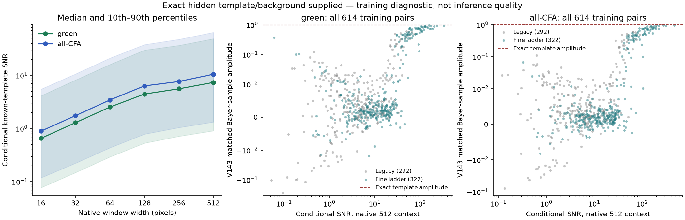

# Conditional evidence for weak mesh detail

On all **614 noisy training mesh pairs**, the median conditional green-sample
template SNR rises from **0.653 in the best native 16 window to 7.360 over
native 512**. All-CFA medians rise from 0.893 to 10.502. Many small windows remain
weak even when the exact pattern is supplied. Larger areas contain substantially
more evidence for this known pattern.

This **V176 diagnostic supplies the hidden clean template, background and physical
variances**. These inputs are unavailable at inference. It produces no restored
RGB, trains no model and establishes neither input-only recoverability nor sky
safety. V175's fixed fresh-noise continuation and its future quality evaluation
remain separate. V172 remains the balanced matching baseline, with V161's
stronger learned detail and V171's stronger flats still useful.

The left panel shows medians and descriptive 10th–90th percentiles across the same
614 pairs. The two scatter panels show every pair, with logarithmic SNR and a
symmetric-log amplitude axis (linear threshold 0.01); negative amplitudes remain
visible. Colors identify fine-ladder and legacy training recipes. Those recipes
change contrast and frequency jointly. The two phase groups reuse related
observations and are not independent replications.

[SVG](images/v176-template-information-v1/context-evidence-v1.svg) ·
[PDF](images/v176-template-information-v1/context-evidence-v1.pdf) ·
[Machine summary, all plot points, source and independent checks](results/v176-template-information-v1.json).

## Measurement

The immutable V168 bank contains 307 retained noisy mesh batches, two
present/absent pairs per batch. Each pair shares camera/CFA and coupled physical
noise construction. We analyze **each member's marginal RAW separately**;
subtracting their noisy observations would artificially cancel the shared noise.
The exact signal template is the difference of their **clean Bayer samples**.

For each green-only or all-CFA group and native window width 16, 32, 64, 128, 256, 512:

1. Use weights `W = 1 / (shot × clean_background + read)`.
2. Remove a separate weighted affine DC/x/y nuisance plane from the template
   within each observed CFA phase. Fit one shared template amplitude.
3. Compute the linear estimator's variance with the actual marginal clean
   variance `shot × clean_member + read`, including its spatial variation.
4. Choose the aligned, nonoverlapping window with the largest known-template
   SNR, defined as `1 / present_amplitude_standard_error` for unit amplitude.
   This selection uses GT, never noisy values or model outputs. It is an
   **oracle best-window** statistic; native 512 has only one window.

If `q` is the template after removing its nuisance projection and
`E = sum(W × q²)`, the amplitude is `sum(W × q × (observation-background))/E`.
Its variance is `sum((W × q)² × actual_variance)/E²`. These are conditional
linear-estimator second moments, not Gaussian detection probabilities or an
unknown-template information bound. The implementation rejects numerically
uninformative affine/zero templates; that tolerance is not a detection gate.

Quantization and clipping are outside this pre-ADC variance formula. Actual
cached observations contain **zero clipped samples out of 321,912,832**. The
largest nominal `ADC_step²/12` relative to mean physical variance is 0.010629%;
this is a scale comparison, not a claim of exact uniform quantization error.

## Context distribution

| Native width | Green median SNR | All-CFA median SNR | Green count SNR<1 | All-CFA count SNR<1 |
|---:|---:|---:|---:|---:|
|16|0.653|0.893|371/614|327/614|
|32|1.289|1.743|272/614|214/614|
|64|2.532|3.446|174/614|127/614|
|128|4.447|6.327|108/614|81/614|
|256|5.581|7.660|89/614|58/614|
|512|7.360|10.502|67/614|43/614|

At native 512, 374 green cases and 427 all-CFA cases have conditional SNR≥5;
444/488 have SNR≥3. The bins 1, 3, 5 were recorded before execution and are
descriptive, with no significance or model-promotion interpretation. These
training cases do not represent a uniform sample of real fences or unseen noise.

Full-context raw amplitudes average 0.9971 green/1.0043 all-CFA for the present
members and −0.00454/+0.00261 for the absent members. Standardized present
residual RMS is 0.9792/0.9901 and absent RMS 0.9879/0.9957. These are empirical
marginal checks, not tests of independence, normality or calibrated false alarms.

## What the frozen parent retains

Projecting existing V143 outputs onto the same full-context Bayer-sample
templates gives mean present amplitude 0.08490 green/0.08290 all-CFA, with
medians 0.003586/0.003161. Among cases with conditional SNR≥5, median parent
amplitudes remain 0.003718/0.003266. This is descriptive
under-response to a supplied training template, not a causal explanation.

These values **must not be compared numerically to held-out RGB mesh-response
percentages** in model reports. Cohort, sampling, projection and weighting differ.
Parent absent means 0.000445/0.000757 also do not establish flat safety; covariance
of the nonlinear parent's output is not estimated. No V175 output enters this
analysis.

The result motivates investigating aggregation of many noisy samples across a
larger area while preserving phase and spatial support. It does not show that
widening matching offsets alone is sufficient: [V174](spread-sample-matching.md)
already tests that initialization, without improving detail. Existing CNN and
DINO features also use context; these statistics do not measure their receptive
field or show which pathway loses the evidence. Unknown-pattern selection,
localization and matched empty/flat controls remain necessary for any future
inference rule. No architecture or loss change is promoted from this diagnostic.

## Verification and retained evidence

All 2,456 cached input fingerprints and 307 original parent arrays were checked.
The 16 CPU tests compare the core fit against an augmented weighted design and
covariance, including nuisance invariance and degenerate inputs. An independent
weighted-QR implementation checks 48 predeclared full-context fits/336 scalar
values; its largest scaled difference is 3.90e−14. All 7,368 window summaries pass
the recorded energy/variance identities. Scientific peak RSS is 201.1 MiB.

There are zero new neural, parent/DINO, source-render, noise-draw, checkpoint-load
or RAW-decoder calls. The scientific process imports neither Torch nor rawpy.
Full rows/results remain in
`/mnt/external/demosaic/quality-20261107/V176-template-information-v1/` with
hashes in the published summary. Local source/plan and the first preparation's
disk-reservation rejection are preserved. No successful scientific prefix was
repeated. The first plot's crowded minor labels were corrected in publication
v2; publication v1 and its exact source remain on external storage. Scientific
rows, metrics and frozen sources did not change.

For actual model-quality crops, use the [V172 comparison](local-noise-matching.md)
and [V174 native viewer](images/v174-spread-matching-v1/native-viewer.html), including
the standing GFX scenes. Their separate ISO100 captures and independent demosaics
are qualitative references, not exact GT. No original media or unavailable
`/mnt/dataz` source was accessed for this diagnostic.
