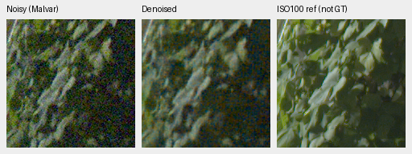
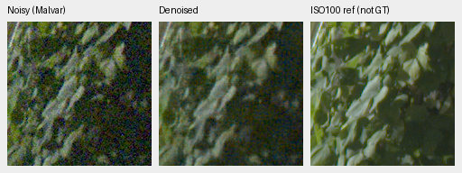
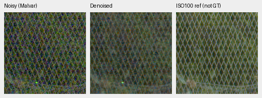

# Full-frame IEEE FP32 autotuning validation

Autotuning reduces the observed101.996MP restore from159.53→62.65s for
V72 and171.64→65.56s for V73. Every unquantized output pixel passes the
unchanged1DN16 maximum/.25DN16 RMS limits. The existing models' visible
quality is unchanged; both remain unpromoted and the100MP/10s target is unmet.

[Complete case metadata, checkpoint/source/output hashes, numerical/export audits and native-view record](results/mixed16-cudnn-fullframe-v1.json).
[Four-context pilot](mixed16-cudnn-autotune.md) and
[unchanged model-quality review, including two exact-GT triplets per model](packed-isotropic-mixed16-quarter-review.md).

## Complete-output comparison

Four fresh processes run serially on the same cached DSCF3879 normalized RAW,
same actual10k EMA weights, shot/read conditioning and color metadata. Each
uses512px tiles,64px overlap, B4, channels-last and IEEE FP32 without AMP/TF32,
with a16GiB CUDA allocator cap. The two arms use opposite policy order; there
is one full observation per case, without repeated-throughput confidence intervals.

| Arm | Original seconds | Autotuned seconds | Observed ratio | Maximum DN16 | RMS DN16 |
| --- | ---: | ---: | ---: | ---: | ---: |
| V72 no-DINO | 159.525 | 62.648 | 2.546× | .031250 | .000379 |
| V73 DINO | 171.639 | 65.557 | 2.618× | .031250 | .000560 |

The comparison covers **611,975,112 camera-linear RGB values**, before clipping,
display exposure or TIFF quantization. The original comparison helper and an
independent64-row/channel dot-reduction plus`math.fsum` replay agree exactly
on maximum error and within1e−12 DN on RMS arithmetic. Both apply the same
strict1/.25DN limits. No threshold was relaxed after seeing results.

Full model hashes, including the genuine DINO backbone, also match the prior
four-context profiles. Checkpoint bytes, source/parameter identities and
CPU/Python/CUDA RNG remain unchanged. No training or output correction is involved.

## Startup and timing scope

Three forwards on the first four actual full-frame sensor tiles precede each
restore. The first includes library initialization and algorithm search;
the following two reuse that process's plans. It is not a pure search measurement.

| Arm / policy | Initial forward seconds | Next warmup seconds | Third warmup seconds |
| --- | ---: | ---: | ---: |
| V72 original | 1.512 | 1.226 | 1.232 |
| V72 autotuned | 3.417 | .414 | .420 |
| V73 original | 1.724 | 1.303 | 1.280 |
| V73 autotuned | 4.748 | .464 | .455 |

The full restore includes RAW validation, allocations, packing/transfers,
neural execution and blending. It excludes CUDA/model initialization, these
warmups, source decoding, float-array saving and TIFF export. All520 tiles are
processed; edge phase/grid behavior is unchanged. Measurements come from a
shared GB10 and do not establish an idle hardware optimum or a training-speed
gain. Training already enables cuDNN benchmarking.

## Native views and RGB16 files

The [complete native board](images/mixed16-cudnn-fullframe-native.png) contains
all16 triplets/24 unresized160px cells: original/autotuned outputs of both
models at the standing sky, building, foliage and chain-link-fence coordinates.
All were actually viewed at original resolution. The common noisy/ISO100
panels are byte copies from the fixed completed report; the denoised panels
come from the new complete float32 restores with the same display transform.

Original/autotuned rows show no visible difference in these regions. Both
models retain substantial colored grain and weak fine foliage/fence structure.
Fourteen8-bit preview channel values change by one code across the eight
policy pairs; those display-rounding differences are separate from the full
16-bit numerical gate.

DSCF3880 is an independently demosaiced ISO100/f5.6 exposure taken3m38s later,
**not GT**. Aperture, shutter time and moving content differ. The locally cached
source RAFs remain read-only and the scene/siblings stay out of training.
Display exposure4(+2EV), WB`[1.5132450331,1,2.2152317881]`, the recorded
matrix and ROI coordinates remain those of the standing GFX test.

Each candidate's101.996MP linear-camera-RGB TIFF passes uint16 RGB/type/shape
and metadata checks. **Every encoded channel value** matches the declared
clip/F32-scale/round-to-even quantizer of its saved float32 output; sampled
unique codes are9,554/9,557. The private files and SHA256 references are recorded
in the result registry. All four full float32 outputs remain preserved.

Both full-frame workers/controller and the CPU auditor exited successfully.
Production defaults remain unchanged. The subsequent [V43/V63 context probes](mature-cudnn-autotune.md)
also pass the original error limits, with complete-frame validation still
required before selecting an inference policy. Passing this execution
gate does not promote the grainier10k weights or satisfy SOTA/real-photo superiority.
