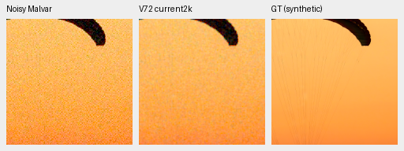
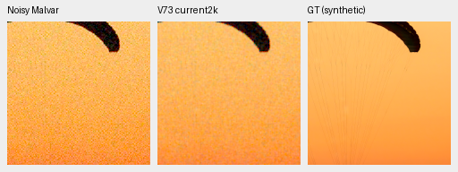
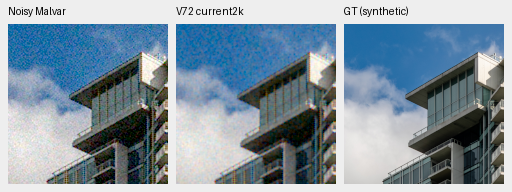
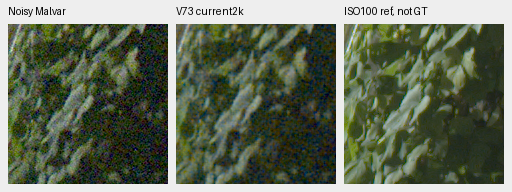
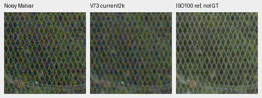

# Current weights versus EMA at the mixed16 first gate

Current weights improve the two fixed-photo sRGB PSNRs over EMA by only
0.03–0.17dB. Both versions retain heavy grain and show no clear new GFX
foliage/fence advantage. On these selected examples, averaging does not explain
the large gap to mature controls. Keep the existing EMA policy for the ongoing
full review; this diagnostic selects no new weights or training settings.

[Protocol, state/source/ROI/noise/display metadata, numbers and artifact hashes](results/mixed16-current-EMA-CPU-v1.json).
The [matched camera interim review](packed-isotropic-mixed16-matched-camera-interim.md)
and [trial recipe](packed-isotropic-mixed16-trial.md) provide the broader context.

Both states come from the same immutable2k-optimizer/32k-example checkpoint.
`ema` is the existing inference policy; `model` means the current restoration
parameters saved by the trainer, without averaging. Both arms use the same
fixed observations in IEEE FP32 CPU/NCHW inference. All12 EMA F32 outputs
replay their previous previews **bitwise exactly** before current-weight loading.
All852 V72 and865 V73 restoration tensors load exactly;852/863 differ from
their respective EMAs. The current-weight check never initializes CUDA.

| Checkpoint | SHA256 |
| --- | --- |
| V72 no-DINO | `8d67375e2169adb88f7dcdafd253e23642eb0d87b1dc2d79416cb0f22320416a` |
| V73 DINO | `43c10f2a0af38761f9418f19c725edc4129284e76b5b2da89f66c184d1f643e1` |

## Fixed exact-GT photos

| Model/state | Parachute sRGB PSNR | Building sRGB PSNR |
| --- | ---: | ---: |
| V72 EMA | 28.79973 | 26.00101 |
| V72 current | 28.95456 | 26.03290 |
| V73 EMA | 28.79319 | 26.01202 |
| V73 current | 28.96408 | 26.04780 |

Errors use the240×240 interior after border8 in each256 context, with
float64 accumulation. These are two preselected single-condition observations,
not full427 means, uncertainty estimates or evidence of convergence.
The [direct native photo board](images/mixed16-current-EMA-photos-native.png)
shows EMA/current for each arm at identical coordinates and display transforms.

All triplets below are noisy Malvar → current weights → exact synthetic GT.
Native ROI`[48,48,160,160]`, RGGB ISO12800 prior, shot`.00256`, read variance
`2.62144e−5`, exposure1, WB`[2,1,1.5]` and the recorded matrix are fixed.
Open the original PNG at100%; crop pixels are never resized.

Swiss Riviera parachute, Roy Egloff,
[source](https://commons.wikimedia.org/wiki/File:CH.VD.Villeneuve_2007-08-25_Vertigo-Swiss-Riviera_2392_3x2-R_4K.jpg),
[CC BY-SA4.0](https://creativecommons.org/licenses/by-sa/4.0/).
The8× cache context is`[189,3,256,256]`, displayed ROI`[237,51,160,160]`.

Vancouver building/sky, Dietmar Rabich,
[source](https://commons.wikimedia.org/wiki/File:Vancouver_(BC,_Canada),_Coal_Harbour_Seaside_Park,_Blick_in_den_Himmel_--_2022_--_2158.jpg),
[CC BY-SA4.0](https://creativecommons.org/licenses/by-sa/4.0/).
Cache context`[195,89,256,256]`, displayed ROI`[243,137,160,160]`.
Both sources are modified by linear-light binning, crop, synthetic camera/noise,
restoration and shared rendering. The companion report retains the EMA triplets.

## Standing GFX contexts

The [direct native GFX board](images/mixed16-current-EMA-GFX-native.png)
contains sky, building, foliage and fence for both policies and arms.
These are common32-grid512 CPU contexts, not full-frame CUDA predictions.
The [standing coordinates and cached-source hashes](packed-isotropic-mixed16-matched-camera-interim.md#standing-gfx-foliage-and-fence)
remain fixed. Each panel is160×160. Foliage noisy/reference xy is
`[8890,5570]`/`[8890,5570]`; fence is`[2240,6000]`/`[2241,6000]`.
Conditioning is shot`.0014635775921166604`, read variance
`1.0715704128646712e−6`, exposure4 (+2EV), WB`[1.5132450331,1,2.2152317881]`
and the recorded common matrix.

Noisy DSCF3879 is ISO6400/f1.7/1/240s; DSCF3880 is ISO100/f5.6/3s,3m38s
later. The separately demosaiced reference is **not GT**: optics, lighting
and moving subjects differ. No real-reference scores are computed. Cached
sources remain read-only and this scene/siblings stay outside training.

Saved-array readback verifies all24 F32/PNG pairs,24 exact denoised display
replays,12 shared outer panels,36 unresized board cells and32 photo metric
fields. All37 inputs/263 guards remain unchanged and the actual CPU owner
exited. Rendering operators are reused in readback; this does not independently
validate their definitions. Both boards were viewed at original resolution.
The selected result does not determine an optimal EMA decay or establish a
population-quality improvement. No new checkpoint, training, source admission,
protected-final scoring or promotion follows.
