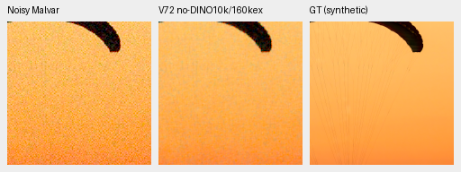
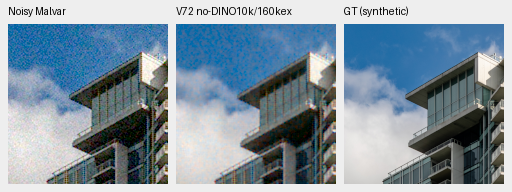
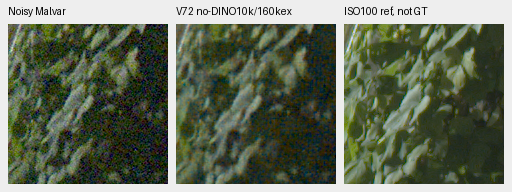
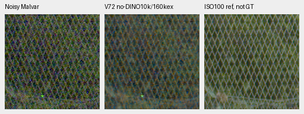

# No-DINO160k-example CPU preview

Current architecture and recommendations: [current model guide](current-model.md).
The versioned study below retains its measured results and original protocol.

The completed10k checkpoint improves over its2k parent on both fixed photos,
but trails the older RAW model at the same160,000-example budget and remains
visibly grainy. V43 was the reference for this study. This selected CPU check
does not promote a model; the full matched GPU review remains queued while
DINO finishes its unchanged schedule.

[Checkpoint/source hashes, exact crop metadata, saved F32 outputs and audits](results/mixed16-no-dino10k-CPU-preview-v1.json).
The [first endpoint/state and DINO-resume checks](packed-isotropic-mixed16-quarter-training.md)
passed before this preview. New checkpoint SHA256:
`d6e3bc6d98b1ffc294ac651c731636ef4072bef284925f357b690b78cc7fa9c1`.

Only six new EMA predictions are computed in CPU IEEE FP32, batch1/NCHW.
Thirty unchanged control triplets and saved F32 arrays are reused from the
earlier CPU preview after hash checks; their networks are not rerun. All methods
share the exact observations, crop coordinates and display transforms. The
older RAW40k control has the same example budget, but units, training precision,
optimizer grouping and EMA differ together. V43/V63 have other backbones and
training histories. These comparisons cannot isolate a batch-size effect.

## Two exact-synthetic-GT photos

Numbers are sRGB PSNR on the240×240 interior of each256 context, border8,
using CPU FP32 rendering and float64 squared-error accumulation. They describe
two selected single-condition observations, not427-source means or intervals.

| Method | Parachute dB | Building dB |
| --- | ---: | ---: |
| V72 no-DINO10k /160k examples | 29.97383 | 26.48805 |
| Own2k parent /32k examples | 28.79973 | 26.00101 |
| Original RAW40k /160k examples | 31.48196 | 28.34273 |
| V43 working | 40.69080 | 35.20764 |
| V63 mature | 33.69030 | 35.76606 |
| RawNIND observed-CFA channel gain | 29.83785 | 26.17905 |

The new checkpoint gains1.17410/.48705dB over its parent, but trails the older
equal-example RAW control by1.50814/1.85468dB. That negative comparison needs
the scheduled full review before choosing any further training budget.

Both displayed crops are160×160 at context ROI`[48,48,160,160]`. Shared RGGB
ISO12800-prior conditioning is shot`.00256`, read variance`2.62144e−5`,
WB`[2,1,1.5]`, recorded shared matrix and display exposure1. Each triplet is
noisy Malvar → new EMA restoration → exact synthetic GT. Crop pixels are never
resized; open the original PNGs at100%.

Swiss Riviera parachute, Roy Egloff,
[source](https://commons.wikimedia.org/wiki/File:CH.VD.Villeneuve_2007-08-25_Vertigo-Swiss-Riviera_2392_3x2-R_4K.jpg),
[CC BY-SA4.0](https://creativecommons.org/licenses/by-sa/4.0/).
The8× cache context is`[189,3,256,256]`, displayed cache ROI`[237,51,160,160]`.

Vancouver building/sky, Dietmar Rabich,
[source](https://commons.wikimedia.org/wiki/File:Vancouver_(BC,_Canada),_Coal_Harbour_Seaside_Park,_Blick_in_den_Himmel_--_2022_--_2158.jpg),
[CC BY-SA4.0](https://creativecommons.org/licenses/by-sa/4.0/).
Cache context`[195,89,256,256]`, displayed cache ROI`[243,137,160,160]`.
Both sources are modified by linear-light binning, crop, simulated camera/noise,
restoration and shared rendering.

The [complete native photo board](images/mixed16-no-dino10k-CPU-photos-native-board.png)
shows all six methods. The new model reduces some grain over2k but retains
substantial noise in the canopy and sky. The older RAW40k model is stronger
here; mature controls are much cleaner while still losing fine canopy cords.
V63 retains a canopy-tone difference. Small synthetic-score gains over RawNIND
do not establish a real-photo advantage.

## Standing GFX contexts

These are512-pixel CPU contexts on the same32-pixel input grid as the preserved
controls, rather than blended full-frame predictions. All displayed crops are
160×160. Conditioning stays shot`.0014635775921166604`, read variance
`1.0715704128646712e−6`, display exposure4 (+2EV),
WB`[1.5132450331,1,2.2152317881]` and the recorded shared matrix.

| Region | Noisy sensor xy | Separate-reference xy |512 context xy |
| --- | --- | --- | --- |
| Sky | `[5800,1400]` | `[5800,1400]` | `[5600,1216]` |
| Building | `[5790,2690]` | `[5791,2690]` | `[5600,2496]` |
| Foliage | `[8890,5570]` | `[8890,5570]` | `[8704,5376]` |
| Fence | `[2240,6000]` | `[2241,6000]` | `[2048,5824]` |

DSCF3879 is ISO6400/f1.7/1/240s; DSCF3880 is ISO100/f5.6/3s,3m38s later.
The latter is a separately demosaiced qualitative reference, **not GT**:
aperture, optics, lighting and moving content differ. Neither it nor these
real crops receive a pixelwise score. Both RAFs stay locally cached, originals
read-only, and this scene/siblings excluded from training.

The [sky](images/mixed16-no-dino10k-CPU-overcast-sky.png),
[building](images/mixed16-no-dino10k-CPU-building-detail.png) and
[complete GFX native board](images/mixed16-no-dino10k-CPU-GFX-contexts-native-board.png)
are retained. New10k output still has strong colored grain, soft foliage and
weak noisy fence structure. V43/V63 are markedly cleaner, while RawNIND retains
soft/wavy structure. No decisive real-photo advantage is established.

Both native boards were actually viewed at original resolution:48 unresized
cells represent all36 triplets. Saved-array readback replays all108 panel pixel
blocks exactly and verifies12 common noisy/reference panels. All12 photo scores
match independent float64 `fsum` reduction with zero difference; cached control
scores are unchanged. The production rendering operator is reused, so that
readback does not independently define the color transform. The first photo
repeats byte-identically, model/input hashes and RNG remain unchanged, and CUDA
stays uninitialized. Full camera/photo/analytic/color panels, the DINO endpoint,
full-frame quality/timing and the next performance decision remain pending.
