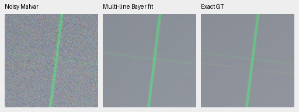
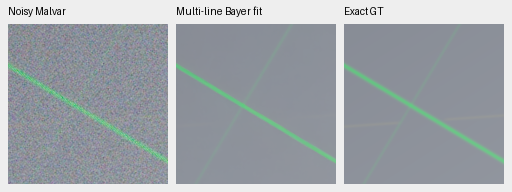

# Multiple straight-line proposals from the RAW surround

Two separated sides of a noisy Bayer surround can locate several straight
lines at once. On the ISO400 synthetic crossing panel, the multi-line fit
restores the stronger continuous wire from **13.14% to 100.53%** of its exact
signed increment. The weaker interrupted wire improves from **12.11% to
35.24%**. At ISO6400, the search still finds the exterior geometry, while the
local sampler delivers little of the missing detail. Neither standing GFX
photo gains convincing new fine crossings.
[Case receipts and native comparisons](results/multiple-raw-lines-v1/publication.json).

## Search and controls

The search sees a 768×768 native synthetic frame with the 256×256 query and
32-pixel margin masked out. It accumulates band-pass Bayer responses in
0.75°-spaced directions and 1.5-pixel offset bins. A peak needs consistent
polarity on both sides of the query. Sub-bin refinement and signed RGB fitting
use the exterior alone. The final amplitude replaces the matching component of
the parent using the [existing two-subset 64-pixel fit and 24-pixel support
check](isolated-raw-line.md). The proposed directions share the same local parent
and sensor samples. Their tested corrections add on intersecting support
without a joint local fit. The per-proposal scores are empirical and selection
from the full bank can admit false candidates.

Each of the 96 initial exact-reference Bayer pairs shares the same coupled
query noise on the role with both weak wires and the role with both absent.
Both include a much stronger crossing line. The second weak wire has an exact
gap. The third exterior guide has no true wire in the query. In the edge-aligned
test this guide instead falls beside a strong step. The matched, shifted and
flat exteriors change only the guide input. Each case renders the same parent
trunk, the spatial 2k EMA with context disabled, checkpoint SHA256
`97fd551bd0ae0b7aa97c67e1f6e8b513b722f70d5ad8b8814a96586b934eafac`.

## Initial exact-reference panel

Each cell covers 16 pairs. Response is the signed RGB increment projected
onto the true wire, away from the other structures. Values over 100% reflect
overshoot. Increment error includes color, profile and position errors, as
well as amplitude. The isolated-line detector declines all initial surrounds
with competing lines.

| Noise and layout | Continuous response, parent → fit | Interrupted response, parent → fit | Continuous / interrupted increment RMS DN16, parent → fit |
| --- | ---: | ---: | ---: |
| ISO400 parallel | 14.42% → 107.28% | 12.99% → 42.29% | 99.18 / 73.65 → 30.30 / 57.70 |
| ISO400 crossing | 13.14% → 100.53% | 12.11% → 35.24% | 99.94 / 75.52 → 29.24 / 61.14 |
| ISO400 edge-aligned | 15.29% → 102.82% | 12.60% → 35.20% | 98.46 / 74.91 → 31.56 / 61.06 |
| ISO6400 parallel | 6.26% → 6.57% | 8.09% → 8.09% | 106.59 / 76.93 → 106.26 / 76.93 |
| ISO6400 crossing | 5.56% → 6.62% | 7.57% → 8.23% | 107.18 / 78.80 → 106.24 / 78.29 |
| ISO6400 edge-aligned | 6.46% → 6.81% | 7.88% → 7.88% | 106.34 / 78.33 → 105.97 / 78.33 |

The bank locates both true lines within 1° and 2 native pixels in all 96
matching surrounds. It admits eight candidates in every matched case, often
including offset responses on the flanks of strong ridges. The flat surrounds
return the parent exactly. Shifted surrounds leave the measured wire responses
essentially unchanged and can add detail away from the true wire, including
one 24.78 DN16 RMS correction inside a true crossing gap. The matching
edge-aligned surround also adds up to 19.94 DN16 RMS at ISO400 and
21.55 DN16 at ISO6400 near the step where the third wire is absent. The
checkerboard support requirement alone does not distinguish a weak line
from a strong edge at nearby geometry.

## Exterior shoulder check on fresh cases

Band-pass peaks beside a strong ridge can masquerade as separate lines.
The shoulder check fits the line against each side of its cross-section,
separately at both ends, and requires a consistent signed RGB contrast in
all four fits. The first search and the revised search use the same local fit.
Replacing all 99,856 excluded RAW and variance samples in a synthetic replay
left both sets of guide records identical.

The 48 fresh pairs use eight new geometries, independent seeds, the same
three layouts and two priors. The shoulder check reduces eight matched
candidates per case to a mean of 3.00–3.88, while locating all three exterior
lines within the same tolerance in all 48 cases. At ISO400 both wire errors
improve over the parent on all 24 pairs. The continuous response spans
97.66–103.17% across layouts. The interrupted response spans 35.37–49.54%,
within 1.13 percentage points of the original multi-line arm.

The shoulder check preserves all 48 matching no-wire regions exactly.
In the edge-aligned cases the worst added RMS around the absent third line
drops from **6.74 to 0 DN16** at ISO400 and **64.13 to 0 DN16** at ISO6400.
The third exterior guide still passes. Other candidate offsets are removed,
and the remaining guide makes no correction in that region on these cases.
The shifted arm still makes a tiny correction in one ISO400 case. A true
interruption is imperfect too, with up to 13.15 DN16 RMS of added correction
inside a fresh ISO400 gap. At ISO6400 the revised fit changes only two
present roles inside the displayed regions, both from the parallel panel.

[Fresh ISO400 parallel](images/multiple-raw-lines-v1/fresh/iso400-parallel-g51-r0-comparison.png) ·
[ISO400 crossing](images/multiple-raw-lines-v1/fresh/iso400-crossing-g55-r0-comparison.png) ·
[ISO400 edge-aligned](images/multiple-raw-lines-v1/fresh/iso400-edge-aligned-g55-r0-comparison.png) ·
[ISO6400 crossing](images/multiple-raw-lines-v1/fresh/iso6400-crossing-g55-r0-comparison.png).

## Native synthetic comparisons

Case 37 (parallel) and case 43 (crossing), draw 0, show the noisy Malvar
image, the multi-line correction, and exact GT. Both use the ISO400 shot/read
prior `8e-5/2.56e-8`, ADC16 black fraction 0.03, and identity WB and matrix.
The 160×160 native region starts at `[48,48]` inside the 256×256 query
starting at `[256,256]` in the synthetic frame. All columns use exposure ×1
and the same reference-centered contrast ×8. The fit recovers the more
visible thin wire. Part of the weaker interrupted wire remains missing.
[Panel coordinates, seeds, CFA indices and checkpoint](results/multiple-raw-lines-v1/publication.json).

[Edge-aligned ISO400 comparison](images/multiple-raw-lines-v1/initial/iso400-edge-aligned-g37-r0-comparison.png) ·
[ISO6400 crossing comparison](images/multiple-raw-lines-v1/initial/iso6400-crossing-g43-r0-comparison.png).

## Standing GFX100S scenes

Both searches used the archived 512- or 768-pixel native RAW surroundings
and the fixed 160×160 display regions. All 16 camera boards retain V120,
the local-only 2k EMA
`ceb5ddaf23fce47806a01045bd86d34bb48d1f64031e382b0d5cfbabf0716880`,
the corresponding composed output and the independent AHD ISO100 reference.
The cab boards also retain both camera JPEGs. The captures differ in aperture
and moving subjects. The AHD and JPEG columns are qualitative references.

| Main DSCF3879 region | Proposals, initial / shoulder check | Added RMS DN16, initial / shoulder check | Native boards |
| --- | ---: | ---: | --- |
| Sky | 0 / 0 | 0 / 0 | [Initial](images/multiple-raw-lines-v1/initial/standing/main-overcast-sky-main-overcast-sky.png) · [Shoulders](images/multiple-raw-lines-v1/fresh/standing/main-overcast-sky-main-overcast-sky.png) |
| Building | 8 / 1 | 1.616 / 0.199 | [Initial](images/multiple-raw-lines-v1/initial/standing/main-building-detail-main-building-detail.png) · [Shoulders](images/multiple-raw-lines-v1/fresh/standing/main-building-detail-main-building-detail.png) |
| Foliage | 8 / 0 | 1.462 / 0 | [Initial](images/multiple-raw-lines-v1/initial/standing/main-foliage-main-foliage.png) · [Shoulders](images/multiple-raw-lines-v1/fresh/standing/main-foliage-main-foliage.png) |
| Coarse fence | 8 / 0 | 0.063 / 0 | [Initial](images/multiple-raw-lines-v1/initial/standing/main-chain-link-fence-main-chain-link-fence.png) · [Shoulders](images/multiple-raw-lines-v1/fresh/standing/main-chain-link-fence-main-chain-link-fence.png) |

The sky retained the parent pixels exactly. The initial search makes small
changes in the building and foliage without visibly restoring new hardware or
leaves. The shoulder check leaves a small building change and restores the
other three crops exactly to the parent. Neither search visibly changes the
coarse fence crossings. Main crop exposure is ×4 with shot/read
`0.00128/6.5536e-6`.

Both searches leave all four displayed DSCF3842 regions identical to
the matched local parent. The first search offers 0–8 candidates per
surround, including some outside the displayed region. The shoulder
check rejects all cab proposals. Transferred conditioning retains faint
diagonal modulation already in the parent. The crossings remain incomplete
and the two JPEGs and ISO100 AHD still show the qualitative separation.
Cab crop exposure is ×16.

| DSCF3842 prior, shot/read | Initial search | Shoulder check |
| --- | --- | --- |
| Nominal, `0.00128/6.5536e-6` | [Left](images/multiple-raw-lines-v1/initial/standing/mesh-nominal-fine-green-mesh-left.png) · [Right](images/multiple-raw-lines-v1/initial/standing/mesh-nominal-fine-green-mesh-right.png) | [Left](images/multiple-raw-lines-v1/fresh/standing/mesh-nominal-fine-green-mesh-left.png) · [Right](images/multiple-raw-lines-v1/fresh/standing/mesh-nominal-fine-green-mesh-right.png) |
| Transferred, `0.0014635775921166604/1.0715704128646712e-6` | [Left](images/multiple-raw-lines-v1/initial/standing/mesh-profile3879-fine-green-mesh-left.png) · [Right](images/multiple-raw-lines-v1/initial/standing/mesh-profile3879-fine-green-mesh-right.png) | [Left](images/multiple-raw-lines-v1/fresh/standing/mesh-profile3879-fine-green-mesh-left.png) · [Right](images/multiple-raw-lines-v1/fresh/standing/mesh-profile3879-fine-green-mesh-right.png) |

These are scoped component tests without endpoint training or a comparable
[full427 or camera-history measurement](performance-history.md). The
[model guide](current-model.md) continues to recommend V120.
