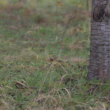
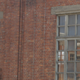
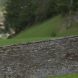
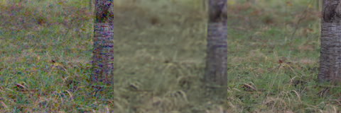
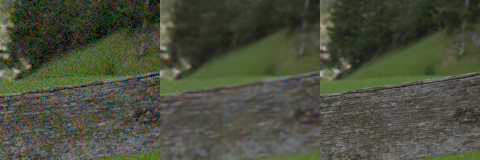

# Native camera development comparison

A supplementary development set has **20 fixed 256px regions from 11 CC0
captures**, with 240 shared synthetic-noise observations. It starts from
phase-aligned, low-ISO camera RGB rather than processed Commons RGB. Source WB
and color matrices remain attached to each region. **All five methods, CPU
metrics and actual native review are complete.** Our joint models preserve
much finer texture than released RawNIND on these binned inputs with added
noise. V119 improves slightly over V115; V117 retains higher condition means.
[Selection and protocol](../configs/native-camera-development-v1.json) ·
[Preparation and actual readback evidence](results/native-camera-development-inputs-v1.json) ·
[Original queue and preflight](results/native-camera-development-queue-v1.json) ·
[Completed metrics, recovery and native review](results/native-camera-development-comparison-complete-v1.json).
[Independent publication checks](results/v119-quality-publication-verification-v1.json)
verify all420 board cells against retained inputs/predictions and all ten
triplets against those cells:32,256,000 channel values, exactly.

The source references are **low-noise estimates, not exact noiseless GT**.
They retain reduced source noise and optical blur. Scores describe
recovery of these fixed binned references under added noise. The full photo,
measured-camera and standing GFX comparisons continue to provide their own
quality evidence; this supplementary test does not replace them.

## Source and region selection

The existing128 native captures are all training data. We inspected29 other
cached public RAW previews that were withheld from training because of clipped
source regions. Twelve photographic candidates received native inspection:
39 unchanged160px reference crops across four pages. Eleven had suitable
256px contexts; the Nikon park capture had none under the declared rule and
was dropped. Twenty regions were selected before any model output on these
inputs was examined.

| Source file ID | Camera label | Selected regions |
| --- | --- | --- |
| 5002 | GFX50S II | Grass/root detail and a lower tree trunk |
| 1603 | LEICA M10 | Window/brickwork and lower-contrast mortar |
| 1797 | LEICA Q (Typ116) | Lily foliage and dark reeds |
| 1951 | LEICA SL (Typ601) | Two weathered wood-rail regions |
| 4160 | NIKON Z6_2 | Two leafless-woodland regions |
| 3235 | DC-G91 | Roof/window/balcony detail |
| 1504 | DMC-CM1 | Two masonry/grout regions |
| 3103 | DMC-TX1 | Trunk/roots and darker pond-bank detail |
| 2247 | DSC-RX10M4 | Fine tea-bush rows |
| 1535 | ILCA-99M2 | Tree foliage and a sky/field control |
| 5075 | ILCE-7RM3A | Stone-wall texture and sign lettering |

The source256 context and a mapped four-pixel guard at4× resolution contain
no cache channel value≥60000. This bounds clipping in the retained caches;
individual sensor pixels may have clipped before averaging. Both4×/8× caches
trim a border, so the coordinate map includes a one-cell4× offset. A linear-ramp
fixture checks the actual binning operators at12 ROIs/four Bayer layouts:
correct mapping is exact, while omitting the offset produces the predicted
.0029296875 displacement error.

Reference pixels are copied directly from the8× cache, with no geometry,
resize or camera/sRGB/inverse-camera round trip. The inference context is256px;
the fixed score/display interior is `[48,48,160,160]`. Some same-source regions
overlap. Aggregate repeats/CFAs/ROIs within source before equal-source means;
the20 regions and240 cases are not240 independent photographs.

## Source identity and protected data

The finite content screen covers all103,604 current Commons records, including
legacy exclusions/reserves. It reuses a private copy of the matching-algorithm
fingerprint cache and adds9,212 missing entries from verified cached bytes.
No threshold match is found; all36 nearest-correlation suggestions were actually
viewed and show different subjects/compositions.

The source audit reconciles all128 current native captures and154 unique clean
references in the83-ID paired set. Cached full-reference identity views cover
all but one small Nikon reference; that one cached NEF receives an identity-only
LibRaw render. All42 protected reference screens and the exact current cached
DSCF3879/3880 hashes verify. Original sources, admissions, training manifests
and V119's frozen execution remain unchanged.

These are held-out captures under source hashes and finite full/crop/orientation
screens. Camera models or unrecognized geographic places may overlap training;
the screen is not complete scene recognition. The GFX5002 grove, for example,
does not visibly match training4493's woodland-edge composition, but geographic
place identity is unknown. No protected-final model performance is consulted.

## Prepared observations and checks

| Setting | Value |
| --- | --- |
| Conditions | ADC-only, ISO100 prior, ISO12800 prior |
| Shot/read coefficients |0/0,2e-5/1.6e-9,.00256/.0000262144 |
| Meaning | Declared sensor priors, not measured profiles for these cameras |
| ADC / black level |16 bits /.03 |
| Sampling | Direct camera-RGB Bayer sampling; RGGB/BGGR/GRBG/GBRG |
| Randomness | CPU generator keyed by seed20261025, case, condition and CFA |
| Sharing |240 observations generated once and saved for every future method |

The [builder](../scripts/prepare_native_development.py) forbids neural Module
calls, leaves CUDA uninitialized and preserves global Python/NumPy/Torch RNG.
Actual readback verifies3,932,160 uint16 reference values exactly against source
slices, the same number of canonical FP32 values, and15,728,640 noisy plus
15,728,640 variance values. Independent variance arithmetic agrees exactly.
The actual native training loader rejects the development manifest.

Completed local inputs:
`.cache/current-quality-20261023-v1/native-camera-development-inputs-v1/manifest.json`.
Reuse these arrays for predictions and reports. To reproduce data preparation,
use a new output directory:

```bash
source scripts/env.sh
CUDA_VISIBLE_DEVICES='' HF_HUB_OFFLINE=1 .venv/bin/python \
  scripts/prepare_native_development.py configs/native-camera-development-v1.json \
  .cache/native-camera-development-copy-v1
```

## Native source-reference inspection

These unchanged160×160 cells are at8×-binned target resolution, with metadata
WB/matrix, exposure×1 and no resized pixels. They are source-reference
inspections, with no added noise or learned output in the PNGs.
[Source/ROI/display/license metadata](images/native-camera-development-v1/manifest.json).







Sources: per-file CC0 grants from the [RAW source catalogue](https://raw.pixls.us/),
with original URLs and metadata checksums in the selection. Modified by
phase-aligned binning, cropping and the shared display transform.

## Completed comparison

| Method | ADC camera RGB / sRGB | ISO100 camera RGB / sRGB | ISO12800 camera RGB / sRGB |
| --- | ---: | ---: | ---: |
| V114 | 49.929 / 38.634 | 49.731 / 38.769 | 41.828 / 33.088 |
| V115 | 49.912 / 38.614 | 49.726 / 38.761 | 41.827 / 33.084 |
| **V117** | **50.027 / 38.716** | **49.783 / 38.816** | **41.841 / 33.102** |
| V119 | 50.001 / 38.695 | 49.773 / 38.804 | 41.836 / 33.093 |
| RawNIND preupsample | 39.107 / 30.447 | 39.091 / 30.434 | 38.139 / 29.749 |

PSNR is in dB. The80 observations per method/condition average within capture,
then give each of11 captures equal weight. All1200 predictions share the same
stored noisy inputs and low-noise reference estimates. These are neither exact
noiseless GT nor real high-ISO captures. Small differences between joint models
should be considered alongside the larger full-photo/measured-camera panels.
[Complete per-case/source metrics and bootstrap intervals](results/native-camera-development-comparison-complete-v1.json).

V119's camera-RGB gains over V115 are+.08889/.04624/.00958dB at ADC/ISO100/
ISO12800. It stays below V117 on each condition mean. Its high-noise gain over
RawNIND is+3.69779dB; that substantial result applies to these11 binned sources
and declared added-noise priors, without establishing broad real-camera
superiority. RawNIND uses its genuine released preupsample32 checkpoint and the
existing CFA-channel adapter, with no target fitting, input clipping or extra
input scaling. Checkpoint SHA256 is
`3d8d5fab966f790f4adbaf1786ca1ee81cb027d9cd45220787247b0af99fd814`.

## Native comparisons

All12 boards were actually viewed:20 contexts at each of three conditions,
with420 unchanged160px cells across noisy/five methods/reference. Grass,
weathered-rail grain, mortar joints, fine branches and lettering are substantially
clearer in the joint models than RawNIND. High-noise grass/foliage remain soft,
and differences between our versions are subtle. The reference can contain
residual source noise/optical blur. A higher reference-band response alone does
not establish better scene detail.

Native noisy → V119 → low-noise reference estimate, ISO12800 prior:


Same inputs and display, released RawNIND:





All cells are native160 at8×-binned reference resolution, RGGB, context256,
ROI[48,48,160,160], shot.00256/read2.62144e−5. Each source uses its recorded
WB/matrix/exposure identically across methods; no pixels are resized.
[Full source/ROI/checkpoint/display metadata and all12 boards](images/native-camera-development-comparison-v1/manifest.json) ·
[Grass/mortar/foliage high-noise board](images/native-camera-development-comparison-v1/all-native-iso12800-prior-1.png) ·
[Wood/woodland](images/native-camera-development-comparison-v1/all-native-iso12800-prior-2.png) ·
[Masonry/pond](images/native-camera-development-comparison-v1/all-native-iso12800-prior-3.png) ·
[Tea/trees/lettering](images/native-camera-development-comparison-v1/all-native-iso12800-prior-4.png).
Sources are the per-file CC0 captures listed above, modified by phase-aligned
binning, cropping, simulated noise and restoration.

## Preserved failure and recovery

The original collector saved all960 V114/V115/V117/V119 predictions, then
stopped before any RawNIND forward: its expected wrapper hash was compared with
the bare UtNet2 network hash. A CPU identity check verifies all46 network tensors
exactly against the genuine checkpoint. The wrapper prefixes state keys with
`network.`, giving a different hash despite identical network tensor values.
The fix checks the intended wrapper state; integrity checks remain enforced.

Recovery uses a separate frozen workspace and archive. It verifies original
input, target, checkpoint and saved-prediction bindings, reuses all960 completed
joint outputs, and runs only the240 missing RawNIND cases. Original failed
sources, logs, receipts and arrays remain unchanged. New per-method receipts
are written before final collection assembly. Nineteen focused recovery/archive
tests pass, including refusal of changed observations or prior reference calls.
No new training, noise draw or RAW decode occurs. NumPy analysis and publication
add zero neural calls. The original job-chain and
[archive-layout evidence](results/native-camera-development-output-layout-v1.json)
remain historical receipts rather than live queue status.
