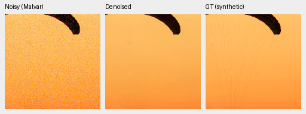
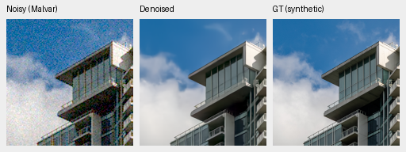
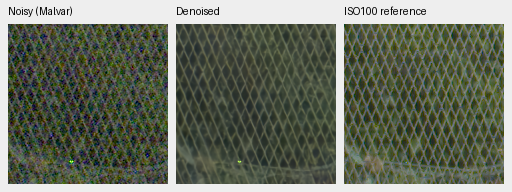
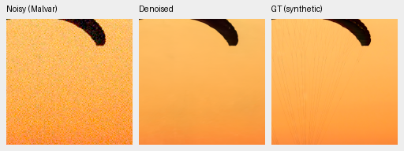
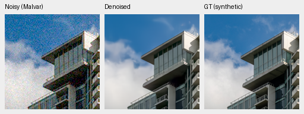
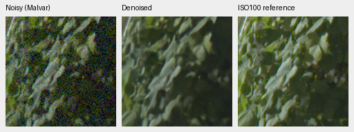
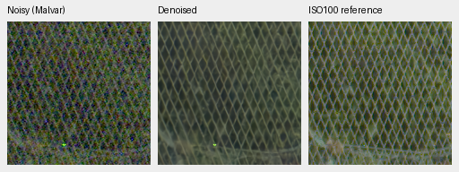
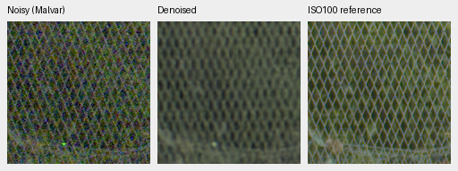

# Native corpus comparison at 2,000 updates

V43 step 2000 improves full-photo PSNR by **0.19536 dB** over its first gate
and **0.08870 dB** over the matched 53-capture V37 control at the same update.
Unseen measured-CFA PSNR also improves over its first gate. It becomes the
**photographic experimental reference**, with significant procedural regression
and limited visible improvement. This is not broad superiority over RawNIND.
[Complete measurements and native-crop receipt](results/native-corpus-2k-review.json).

All three arms continued their own complete step 1000 checkpoints to step 2000
of the planned 3000 schedule, preserving optimizer, EMA, RNG and original per-arm
source. Native selection remains the only recipe difference: 53, 59 or 128
captures. All three stop here. Further continuation waits for investigation of
the low-noise pattern failures below. The first-gate weights remain immutable.

| Panel | Model | Measured-CFA PSNR | AHD RGB PSNR | AHD SSIM |
| --- | --- | ---: | ---: | ---: |
| Known4 | V37 native53 first1000 | 54.27943 | 40.01531 | 0.930415 |
| Known4 | V39 native59 first1000 | 54.28847 | 40.03380 | 0.930749 |
| Known4 | V43 native128 first1000 | 54.26354 | 40.02047 | 0.930380 |
| Known4 | V37 native53 step2000 | 54.22979 | 40.05682 | 0.931272 |
| Known4 | V39 native59 step2000 | 54.27380 | 40.04966 | 0.930978 |
| Known4 | V43 native128 step2000 | 54.23332 | 40.05105 | 0.930848 |
| Known4 | RawNIND global CFA-LS | 54.06860 | 39.67805 | 0.928811 |
| Known4 | RawNIND channel CFA-LS | 54.08474 | 39.71710 | 0.928831 |
| Unseen5 | V37 native53 first1000 | 53.67990 | 38.43590 | 0.920981 |
| Unseen5 | V39 native59 first1000 | 53.70922 | 38.48650 | 0.921306 |
| Unseen5 | V43 native128 first1000 | 53.72974 | 38.56632 | 0.922620 |
| Unseen5 | V37 native53 step2000 | 53.77653 | 38.63734 | 0.921995 |
| Unseen5 | V39 native59 step2000 | 53.65415 | 38.51641 | 0.920843 |
| Unseen5 | V43 native128 step2000 | 53.80606 | 38.59078 | 0.921579 |
| Unseen5 | RawNIND global CFA-LS | 53.56220 | 38.14484 | 0.918380 |
| Unseen5 | RawNIND channel CFA-LS | 53.76822 | 38.56191 | 0.922127 |

Known4 contains eight pairs/72 crops; unseen5 ten pairs/90 crops. Means balance
captures within scenes, then scenes. Registered low-noise measured CFA is the
primary reference. Independently demosaiced AHD is an auxiliary RGB reference,
**not exact RGB GT**. Both RawNIND calibrations remain in the complete receipt.
Protected-final model scoring remains untouched. V43's own unseen primary gain
has a positive source interval, while its known change is uncertain. Its unseen
advantage over matched V37 is only 0.02953 dB and its interval crosses zero.
V39 has higher known primary PSNR but lower unseen and photographic means.
V43's unseen AHD SSIM falls from .922620 to .921579 and trails RawNIND channel's
.922127. These are material differences between accuracy measures.

| Model | 427-photo PSNR | SSIM | 16-procedural PSNR | SSIM |
| --- | ---: | ---: | ---: | ---: |
| V37 native53 first1000 | 34.65497 | 0.955273 | 33.80809 | 0.967787 |
| V39 native59 first1000 | 34.66049 | 0.955174 | 33.71264 | 0.967447 |
| V43 native128 first1000 | 34.70399 | 0.955576 | 33.85008 | 0.967898 |
| V37 native53 step2000 | 34.81064 | 0.956680 | 33.62404 | 0.967419 |
| V39 native59 step2000 | 34.78920 | 0.956733 | 33.50875 | 0.966898 |
| V43 native128 step2000 | 34.89934 | 0.957126 | 33.28537 | 0.966604 |

| Difference | Known primary | Unseen primary | Photo PSNR |
| --- | --- | --- | --- |
| V43−V37 at2000 | +0.00353 dB [-0.03241, +0.03947] | +0.02953 dB [-0.00197, +0.04981] | +0.08870 dB [+0.06747, +0.11833] |
| V43−V39 at2000 | -0.04047 dB [-0.09269, -0.00642] | +0.15190 dB [+0.12592, +0.17741] | +0.11014 dB [+0.08523, +0.13990] |
| V37 step2000−1000 | -0.04964 dB [-0.20342, +0.05786] | +0.09663 dB [+0.04215, +0.15695] | +0.15567 dB [+0.11894, +0.18440] |
| V39 step2000−1000 | -0.01467 dB [-0.05606, +0.02671] | -0.05507 dB [-0.12939, +0.01926] | +0.12871 dB [+0.08059, +0.16493] |
| V43 step2000−1000 | -0.03021 dB [-0.12930, +0.03126] | +0.07632 dB [+0.01494, +0.14043] | +0.19536 dB [+0.15173, +0.23035] |
| V43 step2000−RawNIND channel | +0.14858 dB [-0.24919, +0.51473] | +0.03784 dB [-0.23105, +0.34195] | +8.21577 dB [+8.06291, +8.36901] |

Brackets are 95% source-bootstrap intervals, not training-seed uncertainty.
The full 443-source suite uses seven conditions and four CFAs. New evaluation
contains 74,424 cases; combined comparison 148,848, including seven neural
checkpoints, both RawNIND calibrations and three classical methods. Cached
comparators retain original model source/weights. Reuse checks frozen protocol,
data/render/metric/evaluator bytes and exact equality of 24 known / 30 unseen
classical pair summaries and 37,212 individual classical synthetic records.

V43 loses **0.56471 dB** on procedural sources versus its first gate, with
95% source interval **[−1.29892, −0.09554]**. The loss is concentrated in a few
sources: synthetic-13 drops 4.8033 dB, synthetic-0 1.8193 dB, synthetic-10
1.2866 dB and synthetic-1 .9386 dB. Synthetic-13 falls from 35.175 to 26.063 dB
in ADC-only conditions, and from 35.807 to 26.965 dB at the ISO100 prior.
Those large low-noise failures require investigation before extending training;
the photographic gain does not establish generally better detail recovery.
All sources, conditions and metrics remain in the receipt and case files.

Same V34 EMA initializer, seed 47, batch 16, LR 3e-5 / planned 3000, complete
frozen Commons4/paired and original 8× validation. Mix 25% paired / 25% native /
50% Commons.
Full-resolution CNN, genuine pinned DINOv3 and original arithmetic remain fixed;
V42 hidden autocast is separate. All 65 shared logged Commons/paired
observations through 2000 match across arms. Native draws
change intentionally; unlogged observations are not separately hashed. Native
targets are phase-aligned low-noise RAW estimates, not exact noiseless GT.
Training stays 4× cache → geometry/PSF at 2× target resolution → final area2.
See [source admission](public-raw-expansion-v2.md) and [first gate](native-v43-1k-review.md).

Step 2000 checkpoint SHA256:

- V37: `19ec42dfa1b1f92f955b1a4263571dd0e0a6d4a8bd5f8e7ee41c005002af373f`
- V39: `82b325db86ca5e07032a2b2994b9e4227bab4e7143ae9cb79270c9f5b1ff9273`
- V43: `0d74cf31fb1c7e3f97fc692c855a2ca0ee3ebf562b454e4f8b135c28fc0aa5c5`

## Native crops

Each panel is 160×160, one source pixel per PNG pixel; no resizing. Synthetic
triplets are noisy Malvar → restored → **exact synthetic GT**, same two protocol
sources, RGGB/ISO12800 prior (`shot=.00256`, `read=.0000262144`), tile ROI
[48,48,160,160], display×1, WB[2,1,1.5] and fixed protocol matrix. The receipt
records source/cache/checkpoint hashes, ROI, conditioning and display metadata.
PNGs are 8-bit sRGB previews; scoring uses unquantized predictions.

GFX triplets come from blended full 102 MP outputs: DSCF3879 ISO6400 → restored →
separate DSCF3880 ISO100 f/5.6. Native foliage[8890,5570], fence[2240,6000],
reference fence x2241. Shared+2EV/WB/matrix, input-only prior
`shot=.0014635775921166604`, `read=.0000010715704128646712`.
The exposures differ in time, aperture and moving subjects; final panel is a
qualitative reference, **not GT**. No pixelwise GFX reference scores.

### V37 step 2000

### V39 step 2000

### V43 step 2000

The first and second V43 gates look close in these selected regions. Fine
fabric threads remain missing, cloud texture smoothed and leaves soft. The
wire mesh is more legible than RawNIND's repeating blur, but irregular fine
structure and an isolated colored point remain. These examples do not show a
decisive visual improvement. The sharper f/5.6 reference also differs optically
from the noisy f/1.7 exposure; it is not a pixelwise recovery target.

Cached RawNIND with input-only channel CFA-LS calibration, using the same crops
and display settings ([original comparison receipt](packed-v37-v38-first-review.md)):

Synthetic source authors: [Roy Egloff](https://commons.wikimedia.org/wiki/File:CH.VD.Villeneuve_2007-08-25_Vertigo-Swiss-Riviera_2392_3x2-R_4K.jpg)
and [Dietmar Rabich](https://commons.wikimedia.org/wiki/File:Vancouver_(BC,_Canada),_Coal_Harbour_Seaside_Park,_Blick_in_den_Himmel_--_2022_--_2158.jpg),
[CC BY-SA 4.0](https://creativecommons.org/licenses/by-sa/4.0/). Modified by binning,
crop, synthetic noise, restoration and rendering; previews retain that license.
Real paired source attribution: Benoit Brummer and Christophe De Vleeschouwer,
[Raw Natural Image Noise Dataset](https://doi.org/10.14428/DVN/DEQCIM), with
publisher per-scene CC BY-SA 4.0/CC0 credits in the receipt. GFX by project owner.

Thirty new native triplets include known/unseen examples and all four standing
GFX regions. PNG SHA/dimensions/coordinates/display metadata and noisy/reference
panel bytes match the controls. All six complete 8746×11662×3 uint16 TIFFs pass
SHA/size, shape/dtype/16-bit tags and >256 sampled-code checks. All three sRGB
TIFFs carry ICC profiles.
Full outputs remain under
`/mnt/external/demosaic/evaluation/gfx-3879-3880-native-corpus-v37-v39-v43-2k-full/`.
Restoration took 34.08 / 33.80 / 33.51 s for V37 / V39 / V43, with 512px tiles,
64px overlap and batch 4, excluding decode/load/render/encoding. These successive
shared-machine observations do not establish a speed gain. The 10-second target,
decisive SOTA/RawNIND qualitative
superiority and current-architecture trained DINO ablation remain unproven.
