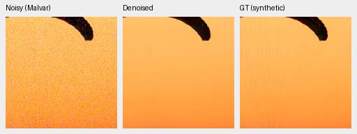
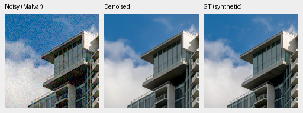
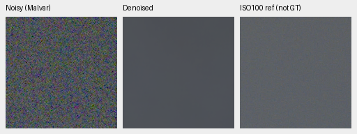
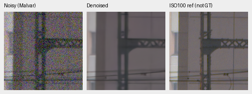
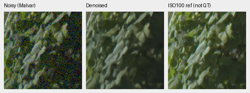
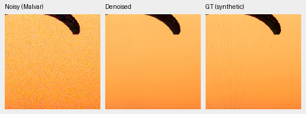
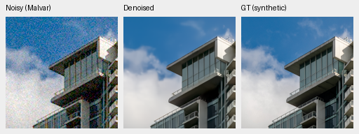
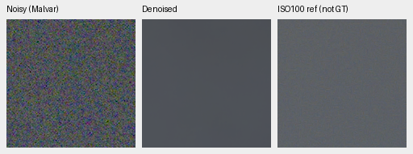
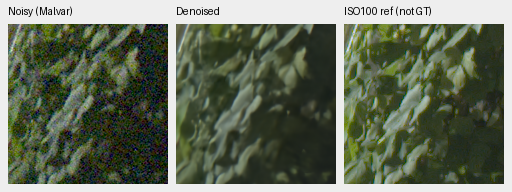
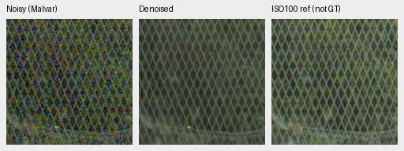

# Completed V84/V85 original20k native-data comparison

**V84 is the current quality and training baseline; V85 is a closely matched alternative.**
Both reach about36.44dB on the fixed photographic panel, roughly1.54dB above
V43, with improved unseen-camera means and reduced bright-magenta mottling
versus their V63 parent. [Current choices and native comparisons](current-model.md).

The specific addition of22 native captures has little matched effect:
expanded−control photo PSNR is **−.00422 [−.00995,+.00310]dB**. The original
study's strict known-camera/weak-carrier eligibility gates were not all met.
Those study-specific decisions do not invalidate the useful V84/V85 checkpoints
or require keeping V43 as the global baseline. The detailed results below
retain the measured gains and remaining weaknesses.

[Complete results and source bindings](results/native-data-original20k-complete-v1.json). [Publication checks](results/native-data-original20k-publication-v1.json). [Fixed criteria](native-data-v84-v85.md). [Training completion](results/native-data-original20000-completion-v1.json).

Both arms started freshly from the genuine V63 original20k EMA and completed their original 20,000-update schedules: seed 53, B16/native256/BF16/channels-last, LR 1e-5 with warmup 200 and a 10% final floor, deterministic execution, sensor-valid targets and 4×→geometry/PSF→area2. The mature pretrained DRUNet RGB backbone and official frozen DINOv3 ConvNeXt pyramid are unchanged. Only the native manifest and output paths differ: 128 captures/106 groups versus 150/120. Commons 84,867 and paired 32 stay fixed. The future Commons890/public-RAW18 additions are outside both arms. GFX3879/3880 and siblings remain excluded from training.

Both owners exited. The 595 recorded shared batches match, all 221 recorded native batches change, and final Python/CPU/CUDA RNG states match. The 91 model tensors, 91 EMA tensors and 89 AdamW parameter states are finite, with optimizer counters at 20000. Unrecorded inputs were not independently replayed. This one-seed continuation does not establish convergence or seed-repeat reliability.

All ten review stages finished. Both final EMAs and V63 were freshly evaluated in FP32: 432 known, 540 unseen and 74,424 photo/procedural records. Retained V43/RawNIND comparisons require the matching source/protocol/classical witnesses. Independent CPU arithmetic/array/rendering checks completed, and all eight final boards were actually viewed at original resolution: 125 unchanged 160px cells representing 81 source triplets.

## Photographic and camera results

Photo means balance 427 sources, seven conditions and four CFAs. Paired source/scene bootstrap 95% intervals use 1000 resamples, seed 42; they describe source variation, not training-seed uncertainty. The 16 procedural sources are retained separately.

| Model | Photo sRGB PSNR | Change from fresh V63 [95% source interval], dB | Photo SSIM |
| --- | --- | --- | --- |
| V84-original20000 | 36.43996 | +0.50698 [+0.42363, +0.61954] | 0.965208939 |
| V85-original20000 | 36.43574 | +0.50276 [+0.41780, +0.61410] | 0.965208280 |
| V63-parent | 35.93298 | reference | 0.963289824 |

The matched native-data effect is tiny: known-camera +0.00819 [-0.00438, +0.03064] dB; unseen-camera +0.00246 [-0.00414, +0.00962] dB; SSIM -0.000000659. None establishes a positive matched photographic benefit. Parent gains also include the additional 20k updates and fresh optimizer; they do not isolate augmentation or the native extension.

| Model | Known4 change from V63 [95% scene interval], dB | Unseen5 change from V63 [95% scene interval], dB |
| --- | --- | --- |
| V84-original20000 | -0.03245 [-0.06938, -0.00436] | +0.08504 [+0.06305, +0.10586] |
| V85-original20000 | -0.02426 [-0.06639, +0.01539] | +0.08751 [+0.05850, +0.11171] |

Each camera panel requires at least +.05 dB with a positive interval lower bound. Both arms pass the five-source unseen panel and fail the four-source known panel. Camera scores use measured CFA sites; the auxiliary independently demosaiced AHD RGB reference is not exact RGB GT. The matched .03dB camera-loss ceilings pass, but the required positive matched photo interval does not.

| Photo condition | Control−V63, dB | Expanded−V63, dB | Expanded−control, dB |
| --- | --- | --- | --- |
| adc-only | +0.62605 | +0.61632 | -0.00973 |
| iso100-prior | +0.70475 | +0.70132 | -0.00344 |
| iso1600-prior | +0.52228 | +0.51266 | -0.00963 |
| iso12800-prior | +0.25832 | +0.25307 | -0.00525 |
| shadows | +0.06379 | +0.06477 | +0.00098 |
| highlights | +0.91788 | +0.92429 | +0.00640 |
| legacy-noise | +0.45579 | +0.44692 | -0.00887 |

These condition means are descriptive, without new per-condition intervals. Canonical camera-linear photo PSNR remains materially adverse: control−parent -1.90231 [-2.01682, -1.77226] dB and expanded−parent -1.91021 [-2.02125, -1.78012] dB. Evaluation retains reference-white clipping before inverse camera transport while these arms train on sensor-valid targets. This convention limits interpretation and does not justify hiding or replacing these unfavorable scores. The highlight condition has canonical camera-linear changes of -17.22107/-17.22486 dB for control/expanded. All procedural and condition means are in the registry.

| Photo sources | Control−V63, dB | Expanded−V63, dB | Expanded−control [95% source interval], dB |
| --- | --- | --- | --- |
| 427 | +0.50698 | +0.50276 | -0.00422 [-0.00995, +0.00310] |
| 418 | +0.50868 | +0.50459 | -0.00409 [-0.00997, +0.00316] |
| 416 | +0.50892 | +0.50482 | -0.00410 [-0.00993, +0.00405] |

The 418/416 source sensitivities also do not establish a positive native-data effect. These fixed exclusions do not prove complete scene independence. Real measured-CFA comparisons with RawNIND-channel have intervals crossing zero on both camera panels; the large synthetic gap does not establish broad real-photo superiority.

## Weak detail, color and actual native views

The two predeclared high-noise carrier means each require at least +.05 signed coherent gain, with matched flat spatial-luma RMS at most 1.25× control. Each mean includes four CFAs and four draws.

| Level/contrast/period | Control gain | Expanded gain | Change | Flat RMS ratio |
| --- | --- | --- | --- | --- |
| 0.01/0.1/8 | 0.00460499 | 0.00283005 | -0.00177494 | 0.994258 |
| 0.18/0.02/16 | 0.24678816 | 0.24307765 | -0.00371051 | 0.983381 |

Both gain gates fail; both flat ceilings pass. All 1344 analytic cases/84 groups remain in the registry. Four of 192 ADC layout/draw cases fail the no-loss-over.05 rule; the worst is [0.01, 0.02, 4, 'BGGR', 0] with gain change -0.15053979. All four failures are the dark BGGR/period4 configuration across its four ADC-only draw labels. All 192 individual contrasts and 12 group means are retained.

All 1176 hue observations/3528 fresh predictions and 54 groups passed saved-array/metric/rendering checks. High-noise mean maximum absolute channel-mean error / mean centered camera-RGB RMS:

| Saturation/peak | Control | Expanded | V63 |
| --- | --- | --- | --- |
| 0.0/0.18 | 0.00078509 / 0.00040113 | 0.00072185 / 0.00039739 | 0.00073790 / 0.00045348 |
| 0.98/0.02 | 0.00009989 / 0.00014236 | 0.00010014 / 0.00014216 | 0.00011977 / 0.00016074 |
| 0.98/0.18 | 0.00023631 / 0.00040854 | 0.00023926 / 0.00040612 | 0.00039867 / 0.00049250 |
| 0.98/0.9 | 0.00082541 / 0.00125897 | 0.00090074 / 0.00126398 | 0.00573934 / 0.00183866 |

The full 54 groups retain adverse as well as favorable color changes. Fixed palettes, one WB/camera and one observation per cell limit generalization; descriptive quantiles are not confidence intervals.

[full427 native board](images/native-data-full427-all-methods-native.png): All methods remain close in the fixed exact-GT examples. Fine paraglider cords/wing lines are largely suppressed and cloud/facade detail is softened; no clear added-native-data detail gain is visible.

[known native board](images/native-data-known-all-methods-native.png): Plate variation stays softened; the thin light fiber and isolated chart points remain. Current models look close. RawNIND boundaries look softer/fringed in these few patches; no whole-image superiority follows.

[unseen native board](images/native-data-unseen-all-methods-native.png): Brown object/illustration structure is restored with similar smoothness across current checkpoints. The independent AHD reference retains more variation. These fixed regions do not establish broad real-camera superiority.

[gfx native board](images/native-data-gfx-all-methods-native.png): Sky noise is suppressed. V63, V84, V85 and V43 look close in building, foliage and fence detail. Fine building wires and leaves remain soft. Fence diamonds are more continuous than RawNIND broken/checkered detail, while foliage still lacks a clear improvement. ISO100 differs in aperture/time/motion and is not exact GT.

[analytic native board](images/native-data-analytic-all-methods-native.png): The dark high-noise carrier is almost entirely suppressed; the brighter period16 carrier is only weakly retained. Displayed flat fields show no obvious new pattern. The numerical ADC regression remains an adverse result.

[hue native board](images/native-data-hue-all-methods-native.png): Both new arms reduce the parent bright-magenta mottling in this fixed palette. No conspicuous new color failure appears in these displayed patches; fixed-grid descriptive bias/RMS remain required and do not establish real-photo color accuracy.

[hue-extra native board](images/native-data-hue-extra-all-methods-native.png): The four additional fixed hue/saturation/brightness patches look close across the new arms. Small smooth residual variation remains; this finite RGB8 view cannot rule out numerical bias.

[highlights native board](images/native-data-highlights-all-methods-native.png): Fine cyan/blue neon-wave detail remains unresolved in all three predictions. Broad sign/platform geometry looks similar. ISO100 AHD differs in exposure, aperture, motion and sign content; no pixelwise highlight score is assigned.

The primary GFX sky/building/foliage/fence crops and supplementary neon-sign/platform regions use cached DSCF3879 ISO6400 versus separately demosaiced DSCF3880 ISO100. Aperture, exposure duration, framing and moving subjects differ; the ISO100 images are qualitative references, not pixelwise scoring targets. No source HDD read was needed. The fixed RGB8 preview set cannot rule out failures elsewhere or override the adverse ADC tests.

## Native crop triplets

The following source triplets are copied byte-for-byte. Each cell is native 160×160 with no resized pixels. Identical source/ROI/noise/display transforms and unchanged noisy/reference pixels across methods were validated. Each checkpoint has two exact synthetic-GT examples and four GFX reference triplets. Complete CFA/WB/matrix, source/attribution, checkpoint hash and context metadata are in the registry. Scores use unquantized FP32 predictions; RGB8 is a viewing copy. Shot is a coefficient and read is a variance. The synthetic target is at the original 8× evaluation resolution; the ROI within the256 context is [48,48,160,160].

### V84-original20000

Checkpoint SHA256: `134887e12357aabf420cceee3ee53fc8832cf02a8f81ff883b829a9e51e16f10`.

Source/ROI: `[237, 51, 160, 160]`; noise/conditioning: `{"exposure": 1.0, "name": "iso12800-prior", "read": 2.62144e-05, "shot": 0.00256}`; display exposure ×1.0.

Source [File:CH.VD.Villeneuve 2007-08-25 Vertigo-Swiss-Riviera 2392 3x2-R 4K.jpg](https://commons.wikimedia.org/wiki/File:CH.VD.Villeneuve_2007-08-25_Vertigo-Swiss-Riviera_2392_3x2-R_4K.jpg), Roy Egloff; [CC BY-SA 4.0](https://creativecommons.org/licenses/by-sa/4.0). Binned, cropped, simulated noise and restoration.

Source/ROI: `[243, 137, 160, 160]`; noise/conditioning: `{"exposure": 1.0, "name": "iso12800-prior", "read": 2.62144e-05, "shot": 0.00256}`; display exposure ×1.0.

Source [File:Vancouver (BC, Canada), Coal Harbour Seaside Park, Blick in den Himmel -- 2022 -- 2158.jpg](https://commons.wikimedia.org/wiki/File:Vancouver_(BC,_Canada),_Coal_Harbour_Seaside_Park,_Blick_in_den_Himmel_--_2022_--_2158.jpg), Dietmar Rabich; [CC BY-SA 4.0](https://creativecommons.org/licenses/by-sa/4.0). Binned, cropped, simulated noise and restoration.

Source/ROI: `{"context_green_correlation": null, "name": "overcast-sky", "noisy_xy": [5800, 1400], "reference_xy": [5800, 1400], "selection_method": "Same sensor coordinates; sky has no fixed registration landmarks", "size": 160}`; noise/conditioning: `{"read": 1.0715704128646712e-06, "shot": 0.0014635775921166604}`; display exposure ×4.

DSCF3879 ISO6400 and independently demosaiced DSCF3880 ISO100 differ in aperture, exposure time and moving subjects. The ISO100 image is a qualitative reference, not a pixelwise scoring target.

Source/ROI: `{"context_green_correlation": 0.6824449896812439, "name": "building-detail", "noisy_xy": [5790, 2690], "reference_xy": [5791, 2690], "selection_method": "Maximum normalized green correlation in input/reference 512px contexts; integer offsets only, no output-dependent selection", "size": 160}`; noise/conditioning: `{"read": 1.0715704128646712e-06, "shot": 0.0014635775921166604}`; display exposure ×4.

DSCF3879 ISO6400 and independently demosaiced DSCF3880 ISO100 differ in aperture, exposure time and moving subjects. The ISO100 image is a qualitative reference, not a pixelwise scoring target.

Source/ROI: `{"context_green_correlation": 0.9597686529159546, "name": "foliage", "noisy_xy": [8890, 5570], "reference_xy": [8890, 5570], "selection_method": "Maximum normalized green correlation in input/reference 512px contexts; integer offsets only, no output-dependent selection", "size": 160}`; noise/conditioning: `{"read": 1.0715704128646712e-06, "shot": 0.0014635775921166604}`; display exposure ×4.

DSCF3879 ISO6400 and independently demosaiced DSCF3880 ISO100 differ in aperture, exposure time and moving subjects. The ISO100 image is a qualitative reference, not a pixelwise scoring target.

Source/ROI: `{"context_green_correlation": 0.9550720453262329, "name": "chain-link-fence", "noisy_xy": [2240, 6000], "reference_xy": [2241, 6000], "selection_method": "Maximum normalized green correlation in input/reference 512px contexts; integer offsets only, no output-dependent selection", "size": 160}`; noise/conditioning: `{"read": 1.0715704128646712e-06, "shot": 0.0014635775921166604}`; display exposure ×4.

DSCF3879 ISO6400 and independently demosaiced DSCF3880 ISO100 differ in aperture, exposure time and moving subjects. The ISO100 image is a qualitative reference, not a pixelwise scoring target.

### V85-original20000

Checkpoint SHA256: `44d46580d1026f8581e4a9404dbd7c3eed9721459cf19edd1efecdc266594c57`.

Source/ROI: `[237, 51, 160, 160]`; noise/conditioning: `{"exposure": 1.0, "name": "iso12800-prior", "read": 2.62144e-05, "shot": 0.00256}`; display exposure ×1.0.

Source [File:CH.VD.Villeneuve 2007-08-25 Vertigo-Swiss-Riviera 2392 3x2-R 4K.jpg](https://commons.wikimedia.org/wiki/File:CH.VD.Villeneuve_2007-08-25_Vertigo-Swiss-Riviera_2392_3x2-R_4K.jpg), Roy Egloff; [CC BY-SA 4.0](https://creativecommons.org/licenses/by-sa/4.0). Binned, cropped, simulated noise and restoration.

Source/ROI: `[243, 137, 160, 160]`; noise/conditioning: `{"exposure": 1.0, "name": "iso12800-prior", "read": 2.62144e-05, "shot": 0.00256}`; display exposure ×1.0.

Source [File:Vancouver (BC, Canada), Coal Harbour Seaside Park, Blick in den Himmel -- 2022 -- 2158.jpg](https://commons.wikimedia.org/wiki/File:Vancouver_(BC,_Canada),_Coal_Harbour_Seaside_Park,_Blick_in_den_Himmel_--_2022_--_2158.jpg), Dietmar Rabich; [CC BY-SA 4.0](https://creativecommons.org/licenses/by-sa/4.0). Binned, cropped, simulated noise and restoration.

Source/ROI: `{"context_green_correlation": null, "name": "overcast-sky", "noisy_xy": [5800, 1400], "reference_xy": [5800, 1400], "selection_method": "Same sensor coordinates; sky has no fixed registration landmarks", "size": 160}`; noise/conditioning: `{"read": 1.0715704128646712e-06, "shot": 0.0014635775921166604}`; display exposure ×4.

DSCF3879 ISO6400 and independently demosaiced DSCF3880 ISO100 differ in aperture, exposure time and moving subjects. The ISO100 image is a qualitative reference, not a pixelwise scoring target.

Source/ROI: `{"context_green_correlation": 0.6824449896812439, "name": "building-detail", "noisy_xy": [5790, 2690], "reference_xy": [5791, 2690], "selection_method": "Maximum normalized green correlation in input/reference 512px contexts; integer offsets only, no output-dependent selection", "size": 160}`; noise/conditioning: `{"read": 1.0715704128646712e-06, "shot": 0.0014635775921166604}`; display exposure ×4.

DSCF3879 ISO6400 and independently demosaiced DSCF3880 ISO100 differ in aperture, exposure time and moving subjects. The ISO100 image is a qualitative reference, not a pixelwise scoring target.

Source/ROI: `{"context_green_correlation": 0.9597686529159546, "name": "foliage", "noisy_xy": [8890, 5570], "reference_xy": [8890, 5570], "selection_method": "Maximum normalized green correlation in input/reference 512px contexts; integer offsets only, no output-dependent selection", "size": 160}`; noise/conditioning: `{"read": 1.0715704128646712e-06, "shot": 0.0014635775921166604}`; display exposure ×4.

DSCF3879 ISO6400 and independently demosaiced DSCF3880 ISO100 differ in aperture, exposure time and moving subjects. The ISO100 image is a qualitative reference, not a pixelwise scoring target.

Source/ROI: `{"context_green_correlation": 0.9550720453262329, "name": "chain-link-fence", "noisy_xy": [2240, 6000], "reference_xy": [2241, 6000], "selection_method": "Maximum normalized green correlation in input/reference 512px contexts; integer offsets only, no output-dependent selection", "size": 160}`; noise/conditioning: `{"read": 1.0715704128646712e-06, "shot": 0.0014635775921166604}`; display exposure ×4.

DSCF3879 ISO6400 and independently demosaiced DSCF3880 ISO100 differ in aperture, exposure time and moving subjects. The ISO100 image is a qualitative reference, not a pixelwise scoring target.

No new full-frame output, protected-final scoring, integration/default change or speed claim follows from this trial. SOTA quality, broad real-photo superiority and 100MP/10s remain unmet or unproven.
