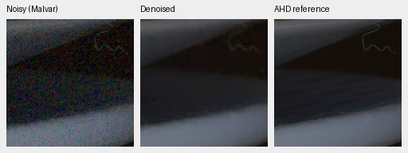
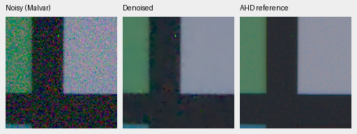

# Native targets with restoration-body adaptation

V22/V23 completed their predeclared first 1000-step review. Native targets with
body adaptation have mixed effects: they improve known-camera measured-CFA
PSNR over the matched control, reduce unseen-camera measured-CFA PSNR, and
improve auxiliary AHD-rendered PSNR on both panels. These short trials did not
replace their V16 parent or establish a general quality gain. Later native-data
training is part of the [current models](current-model.md); this result applies
to the V22/V23 recipe below.

Both start from the same frozen V16 step5000 EMA, seed 44, LR 3e-5, planned
5000-step schedule and architecture as the first [V20/V21 pilot](native-target-review.md).
V22/V23 update 4,819,236 restoration/fine-correction parameters while DINO's
21,596,544 parameters remain frozen. V20/V21 update only 144,072 fine-correction
parameters. The coarse branch is disabled in all four. Training uses BF16 neural
features and IEEE FP32 physical/refinement operations; reviewed inference uses
FP16 base features and the default IEEE FP32 correction.

V22 actually drew 522 paired, 198 native-target and 280 Commons/procedural batches;
V23 drew 522 paired and 478 Commons/procedural batches, matching their fine-only
counterparts. All 41 sampled observation/target hashes match V20↔V22 and
V21↔V23. Within V22/V23, all 34 sampled shared draws match and 7 native
substitutions differ as intended. CPU/Python/CUDA RNG states and initialization
identities match across the compared arms. Training/model/data/noise code is
identical; the earlier native preparation/report source differs, with AST-equal
runtime native dataset and degradation functions. This checks sampled draws,
not every batch, and CUDA optimization need not be bit-identical.
[Observation/source audit](results/native-joint-observations-1k.json).

Measured-CFA PSNR is primary. Registered/calibrated AHD RGB is an auxiliary
reference, not exact RGB GT. Results are scene means over four known-camera
and five unseen-camera development scenes; the protected final test is unused.

| Training arm, step1000 | Known CFA PSNR | Unseen CFA PSNR | Known AHD sRGB PSNR | Unseen AHD sRGB PSNR |
| --- | ---: | ---: | ---: | ---: |
| V20 native, fine only | 53.25157 | 53.07420 | 39.13712 | 37.63820 |
| V21 control, fine only | 53.27959 | 53.07429 | 39.15605 | 37.66129 |
| V22 native, body + fine | 53.28997 | 53.07098 | 39.14413 | 37.71480 |
| V23 control, body + fine | 53.26375 | 53.08593 | 39.07983 | 37.61295 |

Native-minus-control primary effects under body adaptation are +0.02622 dB
known and −0.01494 dB unseen. Scene-bootstrap 95% intervals are
[+0.01381,+0.03529] and [−0.02869,−0.00102]. These intervals use only 4/5 scenes;
there is no broad generalization claim. Auxiliary rendered PSNR improves by
+0.06430/+0.10185 dB, while SSIM is 0.922003/0.907244 versus 0.921299/0.906940.
The primary/auxiliary disagreement is a reason to retain both measurements.

On the matched 64-photo synthetic screen, V22 gives 31.96588 dB/0.925032 and V23
32.01470 dB/0.925428 sRGB PSNR/SSIM. Native targets lose 0.04881 dB on this panel
(bootstrap 95% [−0.07173,−0.03197]). Eight procedural sources give
29.24892 dB/0.912062 versus 29.26336 dB/0.912125. This is a screening panel, not
the full 427-photo evaluation, and no full-panel improvement is claimed.

Two native 160×160 triplets per candidate, at identical coordinates and display
settings. Left: noisy Malvar; middle: candidate; right: registered/calibrated
low-noise AHD reference, **not exact RGB GT**. Open originals at 100%. V22:

V23 matched control:

Both retain some color speckling and lose fine plate detail. The differences are
small in these examples; numerical auxiliary improvements alone do not establish
superior real-photo texture. [Complete metrics, bootstrap comparisons, checkpoint hashes,
ROI/noise/display settings and source reports](results/native-joint-control-1k-review.json).
Synthetic source reports also contain exact synthetic-GT triplets. Native
training targets remain low-noise binned estimates, with residual capture noise,
clipping and optical filtering; see [their preparation](native-raw-targets.md).

The standing personal-photo evaluation now uses [DSCF3879/DSCF3880, including
foliage and fence](gfx-qualitative.md). That scene and siblings remain excluded
from training. No new GFX outputs are claimed for these unpromoted trials.
The quality and speed goals remain open.

Sources for paired crops: Benoit Brummer and Christophe De Vleeschouwer,
*Raw Natural Image Noise Dataset (2025)*, [dataset](https://doi.org/10.14428/DVN/DEQCIM),
[CC BY-SA 4.0](https://creativecommons.org/licenses/by-sa/4.0/), with additional
scene permissions (`7D-1`: Peter Wemmert, CC0). Modified by registration,
calibration, demosaicing/restoration, crop and shared display.
