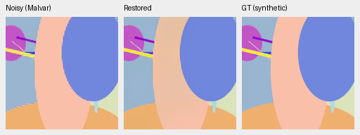
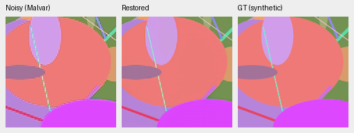
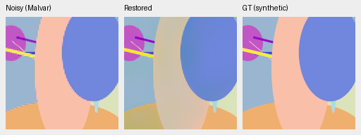
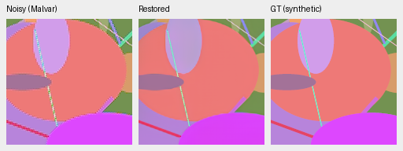
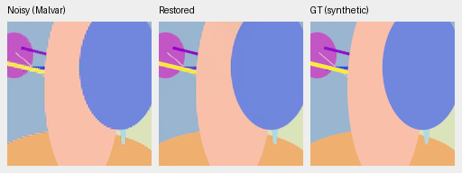
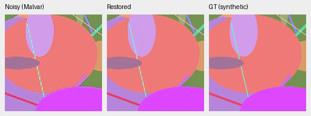

# Low-noise failure diagnosis: learned camera projection

Zeroing only the learned WB/matrix input weights raises the selected worst
ADC-only case from **26.063 to40.015dB**, while retaining physical photometry
anchors and DINO. The visible error is largely a color bias over broad uniform
regions. Source0 also improves. These are deliberately selected failure cases,
**not a representative quality estimate or a trained ablation**.
[Complete cases, effective-weight identities and native crops](results/native-low-noise-camera-diagnosis-v1.json).

Each score below averages the four CFAs. The input, original checkpoint, all
other weights, camera transform, noise and display remain fixed for each
step2000 intervention. Only the named learned tensors/columns are zeroed in
memory; the checkpoint file remains unchanged.

| Method | Source13 ADC-only | Source13 ISO100 | Source0 ADC-only | Source0 ISO100 |
| --- | ---: | ---: | ---: | ---: |
| V43 first1000 | 35.175 | 35.807 | 34.591 | 35.798 |
| V43 step2000 | 26.063 | 26.965 | 30.500 | 31.367 |
| DINO gate zero | 29.595 | 27.574 | 28.663 | 28.695 |
| Whole projection zero | 34.753 | 30.297 | 35.093 | 34.727 |
| CFA value columns zero | 26.063 | 27.074 | 30.529 | 31.404 |
| CFA mask columns zero | 24.480 | 24.806 | 28.896 | 29.396 |
| Photometry anchor columns zero | 24.902 | 20.969 | 28.441 | 26.523 |
| WB/matrix columns zero | 40.015 | 41.550 | 35.351 | 36.638 |
| Malvar2004:WB | 33.961 | 33.880 | 29.430 | 29.398 |

The measurement projection is21→64 at the first RGB stage. Its inputs are
CFA values[0:3], CFA masks[3:6], physical black/white/noise-family anchors[6:9],
log2 WB[9:12] and flattened camera matrix[12:21]. Removing the last12 columns
preserves all CFA/anchor information. WB/matrix still participate in physical
rendering and DINO preview creation. Whole-projection removal is less effective;
removing anchors or masks harms these cases. DINO-off is mixed and loses about
5dB at the high-noise prior on both selected sources. This does not support
removing the foundation branch.

The experiment points to a learned camera-dependent color bias. Zeroing a path
of a trained network changes its feature distribution; these results cannot
attribute the benefit of training with that path or establish a globally better
model. A narrowly changed inference export, V46, has completed measurement on
known/unseen development,427-photo/16-procedural and full102MP GFX; its combined
comparison and qualitative review are pending.
It zeros only those camera columns, preserves every other tensor and has no new
training updates. Current V43 reference weights/aliases remain unchanged until
that broader review finishes.

## Replay precision and scope

The final run reconstructs the full suite's exact original batch companions
and positions: photo426/source0 and source13/source14. All56 Malvar cases
replay **exactly** against each archived suite. All source/operator/checkpoint/
protocol identities are recorded. The stricter neural1e-4 metric tolerance
still fails: maximum absolute metric differences are0.001793 for first1000 and
0.001431 for step2000. Every difference remains in the receipt, with failed
strict-replay flags. The first two attempts/logs are retained separately.

The remaining small neural discrepancy has not been fully isolated; do not
interpret effects at that scale. It is far below the multi-dB effects discussed
here. Original full-suite measurements remain authoritative. This diagnosis
neither replaces those scores nor claims bitwise neural replay.

## Native exact-GT examples

Noisy Malvar → restored → exact synthetic GT, each panel native160×160 with no
resizing. Own procedural seeds1000013 and1000000, full tile256px, ROI
[48,48,160,160], ADC-only conditioning shot0/read0, RGGB, display×1, WB[2,1,1.5]
and the frozen protocol matrix. Noisy/reference panel bytes match exactly across
all eight methods. Every crop records original checkpoint SHA, zeroed tensor
columns, effective tensor SHA, source/ROI/noise/display and PNG SHA.
PNGs are8-bit sRGB previews; metrics use unquantized physical predictions.

First1000:

Step2000:

Only WB/matrix columns zero:

All16 native triplets, including the other group overrides, remain in the receipt. No personal/GFX gradients, protected-final scoring, reference fitting or main training-data changes.
