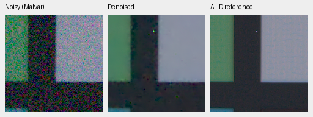
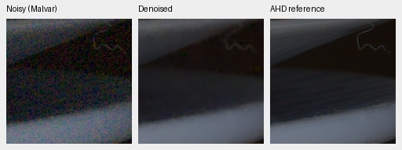

# First native-target training review

The 1000-step native-target pilot does not establish an improvement. V20 and
V21 start from the same frozen V16 step5000 EMA and update only the fine RGB
correction, with seed 44, LR 3e-5 and the same planned 5000-step schedule. Both
stopped at the predeclared first 1000-step review. DINO and the restoration body
remain frozen. The coarse branch is disabled.

V20 substitutes binned low-ISO camera-linear targets for half of the expected
non-paired batches; V21 retains the existing paired/synthetic mix. The native
targets are low-noise estimates, not exact noiseless RGB GT. See
[preparation and limitations](native-raw-targets.md).

The probabilistic schedule actually drew **522 paired, 198 native-target and
280 existing-synthetic batches**, versus control **522 paired and 478 synthetic**.
All 34 logged shared batches match; seven logged substitutions differ as
intended. CPU/Python/CUDA RNG states, Python training code, initialization and
all frozen restoration/EMA weights match. Individual physical noise draws on
substituted steps differ, while their prior distribution is unchanged. CUDA
optimization need not be bit-identical.
[Observation and schedule evidence](results/native-control-observations-1k.json).

| Method | Known CFA PSNR | Unseen CFA PSNR | Known AHD sRGB PSNR | Unseen AHD sRGB PSNR |
| --- | ---: | ---: | ---: | ---: |
| V20 native-target step1000 | 53.25157 | 53.07420 | 39.13712 | 37.63820 |
| V21 control step1000 | 53.27959 | 53.07429 | 39.15605 | 37.66129 |

Primary native-minus-control PSNR is −0.02802/−0.00009 dB on four/five development
scenes, with scene-bootstrap 95% intervals [−0.06059,+0.00019] and
[−0.02972,+0.02872]. Auxiliary SSIM is 0.921461/0.906839 versus
0.921379/0.907351. Neither candidate is promoted; V16 remains the reviewed model.
Scope is limited to short correction-branch adaptation. Effects of longer or
restoration-body training remain unmeasured.

On the matched **64-photo** synthetic screen, PSNR/SSIM is
31.97303/0.924220 for native targets and 31.97150/0.924175 for control.
Eight procedural sources give 29.22457/0.910896 versus 29.22619/0.911048.
These are screening results, distinct from the full 427-photo panel.

Native 160×160 triplets at identical coordinates and display transforms.
Left: noisy Malvar; middle: candidate; right: registered, calibrated low-noise
AHD reference, **not exact RGB GT**. Open original PNGs at 100%. V20:

V21 on the same inputs:

[Full metrics, crop coordinates, checkpoint hashes, noise conditioning and display settings](results/native-control-1k-review.json).
Synthetic source reports also include exact synthetic-GT triplets. All protected
final and personal GFX qualitative scenes remain excluded from training. The
quality and speed goals remain open.

Sources: Benoit Brummer and Christophe De Vleeschouwer, *Raw Natural Image Noise
Dataset (2025)*, [dataset](https://doi.org/10.14428/DVN/DEQCIM),
[CC BY-SA 4.0](https://creativecommons.org/licenses/by-sa/4.0/), with additional
scene permissions (`7D-1`: Peter Wemmert, CC0). Modified by registration,
calibration, demosaicing/restoration, crop and shared display.
