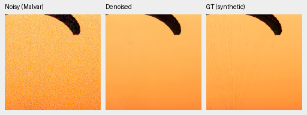
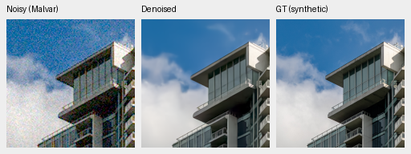
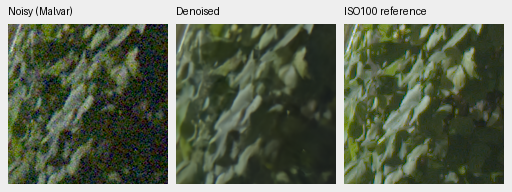
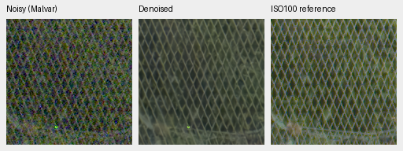

# Six-source native extension: first review

V39's six additional outdoor RAWs give **small, uncertain real-camera gains**
against V37 after 1,000 updates. Photo PSNR is nearly unchanged, photo SSIM and
procedural means are slightly lower. This one-seed trial does not establish a
broad quality improvement. [Complete metrics, cache checks and native-crop receipt](results/native-v39-1k-review.json).

| Panel | Model | Measured-CFA PSNR | AHD RGB PSNR | AHD SSIM |
| --- | --- | ---: | ---: | ---: |
| Known4 | V37 control | 54.27943 | 40.01531 | .930415 |
| Known4 | V39 expanded native | 54.28847 | 40.03380 | .930749 |
| Unseen5 | V37 control | 53.67990 | 38.43590 | .920981 |
| Unseen5 | V39 expanded native | 53.70922 | 38.48650 | .921306 |

V39−V37 primary differences are+.00903dB known,95% scene interval
[−.03231,+.05038], and+.02932dB unseen[−.02190,+.07586]. Known4 has8 pairs/72
crops; unseen5 has10 pairs/90 crops. Means balance captures within scenes, then
scenes. Registered measured low-noise CFA is the primary reference; independently
demosaiced AHD RGB is auxiliary, **not exact RGB GT**. Both RawNIND calibrations
remain available from frozen comparator reports. Protected-final performance
remains unscored.

| Model | 427-photo PSNR | SSIM | 16-procedural PSNR | SSIM |
| --- | ---: | ---: | ---: | ---: |
| V37 control | 34.65497 | .955273 | 33.80809 | .967787 |
| V39 expanded native | 34.66049 | .955174 | 33.71264 | .967447 |

Photo gain+.00552dB has source interval[−.00996,+.01991]; procedural change
−.09545dB has interval[−.25382,+.02726]. Both cross zero. All443 sources share
the same seven cases/four CFAs. These intervals cover evaluation-source
variability, not training-seed variability.

Only native membership changes:53 captures/31 scenes →59/37, adding six reviewed
CC0 outdoor sources from six camera models. V39 uses the same V34 EMA bytes,
fresh AdamW/EMA, seed47, batch16, LR3e-5/planned3000, original Commons4/paired
data, domain proportions and8× validation as V37. Numerical augmentation,
degradation, model and trainer code match V37 byte-for-byte. Admission validation
and its helper are the only code changes. Old/new loaders reproduce one sample
from every one of the53 original captures exactly; all33 logged Commons/paired
observations match. Native draws change with the added scenes. CanonM100 and
DMC-GH1 camera holdouts remain outside training.

The [admission and preparation review](public-raw-pilot.md) pins licenses,
source/cache/camera identities, clipped-source exclusions and data-only overlap
checks. No original, quarantine or active comparator dataset was edited.
The complete checkpoint SHA and source bundle are in the receipt.

V39 checkpoint SHA256:
`2270562379ea5e683e7036e75b8e158bfb097709fb709f9fc7992d138f36e8c0`.

Only V39/classical predictions were recomputed. Reused V34/V37/RawNIND results
retain their original source reports and hashes. Matching model/evaluation code
and protocol/data identities are checked. All24 known and30 unseen classical
pair summaries, plus all37,212 individual synthetic classical records, match
exactly. This validates the cache comparison without repeating unchanged
neural inference. Source reports keep original labels; composite statistics
use0=V34,1=V37,2=V39. RawNIND's normalization scales belong to its cached reports;
they are not settings for V39.

Noisy Malvar → V39 → **exact synthetic GT**, native160×160 panels, no resizing.
Same RGGB/ISO12800 prior (`shot=.00256`, `read=.0000262144`), tile ROI
[48,48,160,160], display×1, WB[2,1,1.5] and fixed protocol matrix as the
[V37 control triplets](packed-v37-v38-first-review.md). Source/cache/checkpoint
hashes and full conditioning/display metadata are retained per crop. PNGs are
8-bit sRGB previews; metrics use unquantized physical FP32 predictions.

Sources: [Roy Egloff](https://commons.wikimedia.org/wiki/File:CH.VD.Villeneuve_2007-08-25_Vertigo-Swiss-Riviera_2392_3x2-R_4K.jpg)
and [Dietmar Rabich](https://commons.wikimedia.org/wiki/File:Vancouver_(BC,_Canada),_Coal_Harbour_Seaside_Park,_Blick_in_den_Himmel_--_2022_--_2158.jpg),
[CC BY-SA4.0](https://creativecommons.org/licenses/by-sa/4.0/). Modified by linear
binning, crop, simulated noise, restoration and rendering; derivative previews
retain that license.

Full102MP GFX DSCF3879 ISO6400 → V39 → separate DSCF3880 ISO100 f/5.6,
native foliage[8890,5570] and fence[2240,6000], reference fence x2241.
Shared+2EV/WB/matrix and input-only prior (`shot=.001463577592`,
`read=.000001071570413`). Aperture, time and motion differ; the final panel
is a qualitative reference, **not GT**.

All four fixed regions are retained. New/cached V37 crops have identical noisy/
reference panel bytes and matched metadata. Fine texture remains soft; no
decisive visual gain is established. V39's two complete8746×11662×3 uint16 TIFFs
passed full SHA/size, actual shape/dtype/16-bit sample tags, sampled-code and
sRGB ICC checks. Existing comparator frames retain their previous verification.
New outputs: `/mnt/external/demosaic/evaluation/gfx-3879-3880-native-expanded-v39-1k-full-newonly/`.
Restoration took35.28s, tile512/overlap64/batch4, shared machine, excluding
decode/load/render/encoding. The10-second target remains unmet. Both trials
stop at this review point; the README keeps the V34 representative set.
