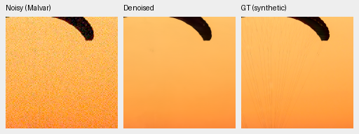
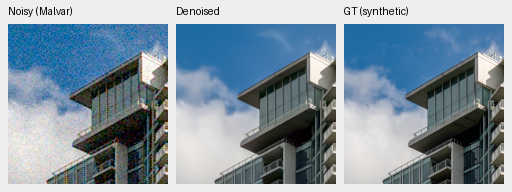
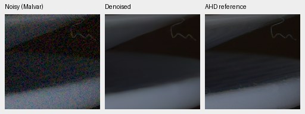
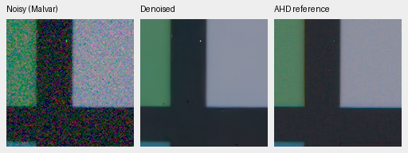
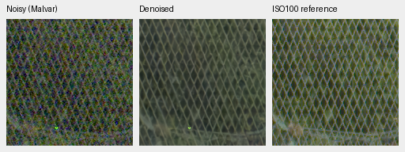
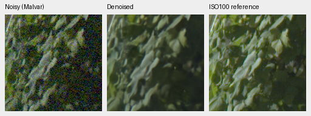
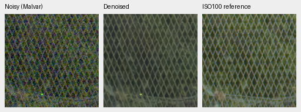

# Broader native RAW corpus: V43 first quality gate

**The larger native corpus provides a modest first-gate gain.** Versus matched
V37, V43 gains 0.04984 dB on unseen measured-CFA samples and 0.04902 dB across
427 synthetic-noise photos, with positive source intervals. Known primary
changes by −0.01590 dB with an interval crossing zero. The larger corpus becomes
the next full-resolution training recipe, and V43 the current experimental
reference. This single-seed result does not establish broad superiority.

V43 tests the [reviewed native corpus](public-raw-expansion-v2.md), expanded from
53 captures/31 scenes to **128 captures/106 declared scene groups**, against
matched V37 and the six-source V39 extension. It stops at the first 1,000-update
gate. Data admission alone does not establish model quality.
[Complete measurements, source/checkpoint identities and native-crop receipt](results/native-v43-1k-review.json).

| Panel | Model | Measured-CFA PSNR | AHD RGB PSNR | AHD SSIM |
| --- | --- | ---: | ---: | ---: |
| Known4 | V34 parent | 54.24658 | 39.94860 | 0.930049 |
| Known4 | V37 original native53 | 54.27943 | 40.01531 | 0.930415 |
| Known4 | V39 small native59 | 54.28847 | 40.03380 | 0.930749 |
| Known4 | V43 diverse native128 | 54.26354 | 40.02047 | 0.930380 |
| Unseen5 | V34 parent | 53.78664 | 38.51133 | 0.921075 |
| Unseen5 | V37 original native53 | 53.67990 | 38.43590 | 0.920981 |
| Unseen5 | V39 small native59 | 53.70922 | 38.48650 | 0.921306 |
| Unseen5 | V43 diverse native128 | 53.72974 | 38.56632 | 0.922620 |

Known: four scenes/eight pairs/72 crops. Unseen: five scenes/ten pairs/90 crops.
Means balance captures within scenes and then scenes. Registered low-noise CFA
measurements are the primary reference. Independently demosaiced AHD RGB is an
auxiliary reference, **not exact RGB GT**. Protected-final performance is unscored.

V43 minus V37 primary PSNR: known -0.01590 dB, 95% source interval [-0.04011,+0.00831];
unseen +0.04984 dB, 95% source interval [+0.00316,+0.09566].
V43 minus V39: known -0.02493 dB, 95% source interval [-0.06206,+0.01288];
unseen +0.02052 dB, 95% source interval [+0.00433,+0.03742].

| Model | 427-photo PSNR | SSIM | 16-procedural PSNR | SSIM |
| --- | ---: | ---: | ---: | ---: |
| V34 parent | 34.46662 | 0.954201 | 33.18400 | 0.962951 |
| V37 original native53 | 34.65497 | 0.955273 | 33.80809 | 0.967787 |
| V39 small native59 | 34.66049 | 0.955174 | 33.71264 | 0.967447 |
| V43 diverse native128 | 34.70399 | 0.955576 | 33.85008 | 0.967898 |

V43 minus V37 photo PSNR: +0.04902 dB, 95% source interval [+0.03872,+0.05855].
V43 minus V39: +0.04349 dB, 95% source interval [+0.03110,+0.05718].
These intervals sample scenes/sources, not training seeds or convergence.
V34 still has a slightly higher unseen primary mean than V43: the V43−V34
difference is −0.05690 dB, interval [−0.17569,+0.04877]. V43 has stronger photo
and rendered means; its primary tradeoff remains explicit.
All 443 sources share seven conditions and four CFAs. The new-only evaluation
contains 49,616 cases; the explicitly combined comparison contains 111,636,
including four neural models, both RawNIND calibrations and three classical
methods. Cached V34/V37/V39/RawNIND retain their original weights and method
source. Reuse requires matching data/render/metric/evaluator bytes and protocol,
plus exact equality of 24 known and 30 unseen classical pair summaries and all
37,212 individual classical synthetic records. Old/new report hashes remain
in the receipt.

## Matched recipe and source integrity

Same immutable V34 step 1000 EMA, fresh AdamW/EMA, seed 47, batch 16, base LR 3e-5 /
planned 3000 schedule, complete 40,170-source Commons4, paired data, original 8×
validation and 25% paired /25% native /50% Commons mix as V37/V39. Only native
source selection changes. Full-resolution CNN and its original precision policy
remain fixed; V42's hidden-autocast export is separate. Genuine pinned DINOv3
features are retained. **All 33 shared logged Commons/paired observations match**
across V37/V39/V43. Native observations intentionally change. Unlogged batches
are not separately hashed.

The new corpus preserves all 53 original captures and the six previously approved
public sources, adding 69 photographic CC0 captures. All 138 downloads verify;
131 decode, 102 pass source clipping and 69 pass content/duplicate review. Charts,
staged props, clipping and duplicate/ambiguous variants are excluded. All 42
protected references, 53 native references, previous public sources, intra-source
views and 46,738 Commons records are screened. Standing GFX and siblings remain
out of training. Finite fingerprints and visual inspection are not complete
scene recognition; declared groups are not a guarantee of unique physical places.

Training targets are phase-aligned camera-linear low-noise RAW estimates,
**not exact noiseless GT**. Their original bytes/metadata and admission are
SHA-pinned. No demosaicer, WB/matrix, gamma or 8-bit stage enters target caches.
4× cache → geometry/PSF at 2× target scale → final area2 remains unchanged.
See the [admission and dataset receipts](public-raw-expansion-v2.md).

V43 checkpoint SHA256: `8ee3e960acdf95d88ba06eab30ac9abbab8bab28b0dc63d79b304a960eb535c5`.
Frozen source bundle: `c758d2b56213869607fd3097936fae6cacf0e6a1f2a79ff9dea5b40c5d971bac`,
private code at `807d929`. All 343 tests pass, including exact legacy-source
preservation, admission tamper guards, all-CFA ADC precision and restart checks.
The stable local inference alias `/mnt/external/demosaic/models/v43-first1000.pt`
points to this immutable first-gate checkpoint, preserving it during future
training continuations. The README inference example uses this artifact with
the evaluated tile/precision settings.

## Native exact synthetic GT and real-reference crops

Noisy Malvar → restored → **exact synthetic GT** below. Each panel is native
160×160, never resized, from the same first two prescribed full-suite sources.
RGGB/ISO12800 prior `shot=.00256`, `read=.0000262144`, ROI[48,48,160,160] in
the validation tile, display×1, WB[2,1,1.5], fixed protocol matrix. Each triplet
records source/cache, ROI, checkpoint, conditioning and display metadata.
PNG previews are 8-bit sRGB; evaluation and physical predictions retain FP32.

Original V37:

V43:

Sources: [Roy Egloff](https://commons.wikimedia.org/wiki/File:CH.VD.Villeneuve_2007-08-25_Vertigo-Swiss-Riviera_2392_3x2-R_4K.jpg)
and [Dietmar Rabich](https://commons.wikimedia.org/wiki/File:Vancouver_(BC,_Canada),_Coal_Harbour_Seaside_Park,_Blick_in_den_Himmel_--_2022_--_2158.jpg),
[CC BY-SA 4.0](https://creativecommons.org/licenses/by-sa/4.0/). Modified by linear
binning, crop, noise simulation, restoration and rendering; derivative previews
retain that license. Noisy/GT panel bytes match the cached controls exactly.

Known real examples, noisy → V43 → independent AHD reference:

Real sources: Benoit Brummer and Christophe De Vleeschouwer,
[Raw Natural Image Noise Dataset](https://doi.org/10.14428/DVN/DEQCIM),
[CC BY-SA 4.0](https://creativecommons.org/licenses/by-sa/4.0/), with individual
scene credits/CC0 grants in publisher `permissions.txt`. Modified by crop,
restoration and rendering; derivative previews retain the applicable license.

Full 102 MP GFX DSCF3879 ISO6400 → restored → separate DSCF3880 ISO100 f/5.6,
native 160px foliage[8890,5570] and fence[2240,6000], reference fence x2241.
Shared +2EV/WB/matrix, input-only prior `shot=.001463577592`,
`read=.000001071570413`. Time/aperture/motion differ; the final panel is a
qualitative reference, **not GT**. No pixelwise GFX reference scores are computed.

Original V37:

The selected GFX regions look close to V37; a decisive visual gain is not
established. Fine foliage/fabric remains too soft. The best channel-calibrated
RawNIND unseen auxiliary means are 38.56191 dB/.922127, versus V43's
38.56632 dB/.922620; primary means are 53.76822 versus 53.72974 dB. The requested
broad qualitative margin remains unproven. Both RawNIND gain variants retain
their original source/checkpoint/normalization identities in the cached reports.

All four GFX regions and ten new native triplets remain in the receipt. Source/
ROI/noise/display metadata, PNG SHA and exact noisy/reference panel bytes match
the controls. Both new 8746×11662×3 uint16 TIFFs pass full SHA/size, actual
dtype/shape/16-bit tags, >256 sampled-code and sRGB ICC checks. Full outputs
reside in `/mnt/external/demosaic/evaluation/gfx-3879-3880-native-diverse-v43-1k-full-newonly/`.
Restoration took 34.97 s, tile 512/overlap 64/batch 4, excluding decode/load/
render/encoding. This is a successive shared-machine measurement, not a repeated
idle speed comparison or a 10-second result. Broad superiority over RawNIND/SOTA
and the current architecture's trained DINO ablation remain unproven.
