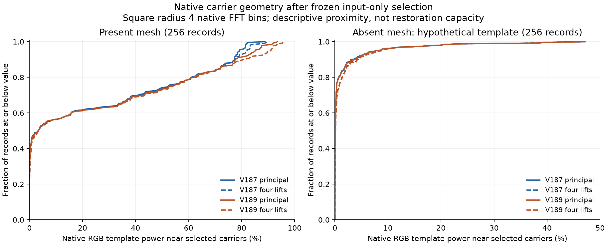

# Native wave alias geometry

The native-spectrum diagnostic gives **little support to an alias-only fix as the next priority**. About **90.78%** of exact mesh-template RGB power lies in the strict principal native square; **0.149%** lies on its quarter-cycle boundary and **9.07%** outside the closed square. At the existing selected bins, adding every half-cycle alias increases mean ±4-bin proximity by only **0.445 percentage points for V187 / 0.674 for V189**. This is a description of fixed carrier locations, not a limit on a spatially modulated neural readout or a new quality result.

The largest remaining gap in this description is sparse selection. Mean present principal-carrier proximity is **24.400% for V187 / 25.255% for V189**, but its median is only **3.348% for both**. Including all four lifts reaches means **24.845% / 25.929%**, with the same **3.455% median**. Median added-alias proximity is just **0.00876 / 0.01526 percentage points**. The small V189 mean geometric advantage coexists with its completed 4.63% raw / 5.68% EMA mesh-response regression. Neither folded nor native footprint proximity predicts the learned outcome by itself.

Tighter ±1-bin principal proximity falls from **20.671% to 18.974%** with wider suppression; four-lift proximity falls from **20.942% to 19.423%**. This strengthens the case for checking local frequency resolution, spatially dense/multiscale measurements and the actual objective/readout before adding aliases to the same eight global centers. It does not establish which of those changes will improve detail without false structure. No next architecture is promoted on this diagnostic.

Absent cases use a hypothetical present-minus-empty template, not a signal actually in the input. Their ±4-bin four-lift mean proximity is **1.759% / 1.778%** for V187 / V189, but a rare alignment reaches **47.24%**. The plotted axis includes that tail. Chance spectral alignment is neither evidence of hidden detail nor a calibrated false-positive rate. Case records share templates, seeds and noise settings; 512 template records contain 64 distinct native values and do not constitute 512 independent replications.

Four mathematical native lifts share an individual packed frequency. The green phases' relative signs distinguish only two classes among the four lifts, as checked with exact complex carriers for all four Bayer layouts. That ambiguity is real, but it does not show that missing aliases explain the present real-fence failure. This diagnostic has exact constructed templates only; real GFX ISO100/AHD/JPEG images remain qualitative references in the completed native comparison, and were not read here.

The independent QR audit verifies all 512 template records, 18,432 fractions/footprint counts, 1,650 input fingerprints, 1,100 saved-selection bridges and 72 Decimal summary means. Maximum independent fraction error is 3.33e-16. All 550 saved input-only bin records close before target reads. Actual V189 bins match V188's earlier spaced counterfactual. Twenty CPU contracts pass. No model, checkpoint, source/noise draw or restored RGB is produced; all 102 neural source files are unchanged. V187 remains preferred for wave experiments, and V120 Small remains the general recommendation.

| Input | Selector | Neighborhood | Principal carrier | Four lifts | Added aliases |
|---|---|---|---:|---:|---:|
| Present | V187 | ±1 bin | 20.670806% | 20.942498% | 0.271692 pp |
| Present | V187 | ±4 bins | 24.399992% | 24.845227% | 0.445235 pp |
| Present | V189 | ±1 bin | 18.973744% | 19.423306% | 0.449562 pp |
| Present | V189 | ±4 bins | 25.254566% | 25.928542% | 0.673976 pp |
| Absent (hypothetical) | V187 | ±1 bin | 0.176505% | 0.208685% | 0.032180 pp |
| Absent (hypothetical) | V187 | ±4 bins | 1.572217% | 1.758619% | 0.186402 pp |
| Absent (hypothetical) | V189 | ±1 bin | 0.160487% | 0.192636% | 0.032150 pp |
| Absent (hypothetical) | V189 | ±4 bins | 1.591041% | 1.777503% | 0.186461 pp |

Each entry is the mean over 256 case records. Present/absent records share targets; there are 64 distinct native template values across 512 records, not 512 independent examples. All frequency distances refer to native FFT bins in 512×512 contexts. Both neighborhoods are descriptive conventions, not measured synthesis support or recovery bounds.

[SVG](images/v190-native-alias-geometry-v1/native-carrier-proximity.svg) · [PDF](images/v190-native-alias-geometry-v1/native-carrier-proximity.pdf). All 2,048 CDF points are checked against the audited rows.

The native template is clipped camera-RGB present minus clipped empty GT, in FP64 after the original FP32 clipping. Each color removes its own Hann-weighted affine plane before an orthonormal native FFT; powers are summed across RGB. Principal centers use signed packed-bin coordinates lifted to the native FFT. Their conjugates and ±1/±4 neighborhoods are formed on the native torus before unioning the four possible half-cycle aliases. This avoids wrapping a neighborhood at the packed Nyquist boundary. Strict principal support excludes ±1/4-cycle boundaries; those boundaries are reported separately. No real ISO100/AHD/JPEG reference enters this diagnostic.

All 550 saved input selections and 1,650 RAW/variance/CFA fingerprints close before target reads. Actual V189 selections match the previously closed V188 spaced counterfactual; actual V187 selections match its V187 records. No new bins, fitted coefficients, network, checkpoint or restored image is produced. The independent audit uses QR rather than normal-equation detrending, sparse native coordinate sets rather than the production masks, and Decimal summary means. Twenty CPU tests include four-CFA alias ambiguity, exact synthetic carriers, Nyquist boundaries and malformed inputs. An initial import-only failure omitted a frozen helper; its terminal attempt is preserved. The corrected package passes isolated imports and completes scientific work once.

This is a geometry diagnostic, not an improved-model performance report. The [completed V189 comparison](spaced-pooled-wave-comparison.md) retains all 60 native figures / 12 triplets, both protected GFX scenes and the [eighteen-state viewer](images/v189-spaced-pooled-v1/native-viewer.html). V187 remains the preferred wave model; V120 Small remains the general recommendation. Originals/captures/JPEGs/siblings and unavailable dataz were untouched. All 102 neural sources and previous evidence remain preserved.

[Exact evidence](results/v190-native-alias-geometry-v1.json) · [Publication verification](results/v190-native-alias-geometry-publication-verification-v1.json).
