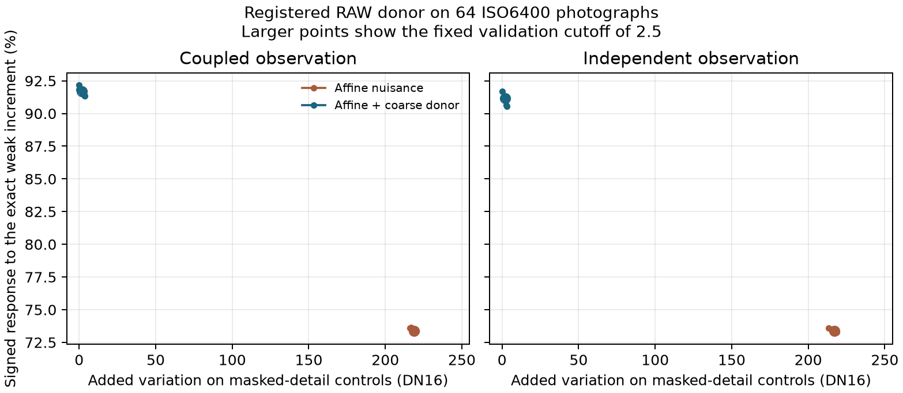
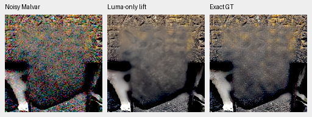
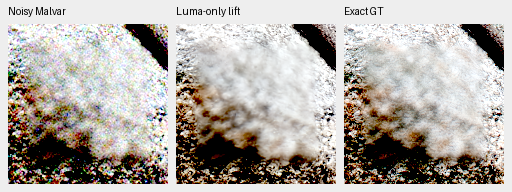

# Recovering weak natural texture from a measured RAW donor

A separately observed, registered copy of a texture helps recover
weak detail on seven of 64 coupled ISO6400 photo crops above
Corpus 100k. Modeling the donor's coarse structure reduces false
accepts on masked-detail controls from 53 to 2 of 64 in the Bayer
fit. A luminance-only correction retains the measured fine-detail
improvement and removes the added color speckle. The same search
finds no usable donor on either standing GFX scene.
[Evidence and provenance](results/natural-raw-donor-evidence-v1/publication.json).

## Source and measurement

The [frozen whole-scene panel](scene-local-contrast-2400.md#held-out-test-for-true-detail-and-flat-regions)
contains 64 held-out photos, 16 of each Bayer order. It provides a
present weak-residual query, a matched query with that residual
removed, and an exact flat core. The benchmark uses the native
256-pixel observations without changing their shot/read noise,
camera transforms or exposure. There are 256 matched groups
across ISO400, ISO6400, and the independent and coupled draws.

The registered donor comes from an independent noisy observation
of the unattenuated scene at that location. This is a simulator
control for a truly corresponding measurement. The shifted control
uses the same donor displaced 4 pixels down and 6 right. The
disjoint donor uses the farthest available corner patch from
the same noisy photo with zero query overlap. One source has
no qualifying disjoint patch.
[Source observations and exact coordinates](results/natural-raw-donor-evidence-v1/plan.json).

The fit estimates how much of the donor's fine residual the query
supports on alternating 2×2 Bayer cells. Both folds use half the
samples of each CFA phase in every 16×16 block. The affine control
projects out per-color planes. The alternative includes two coarse
versions of the donor in that projection, removing the part of the
fine template that can explain the coarse scene even when the weak
residual is absent. Each fit uses one fold and tests its prediction
on the other. Both directional checks require positive weighted
error reduction and a signed score above 2.5. The output coefficient
is bounded between 0 and 0.5. The variance estimate uses only the
fitting fold and the known simulation prior.
[Split, orthogonality and planted-amplitude checks](results/natural-raw-donor-evidence-v1/verification.json).

## Query evidence before RGB delivery

The coupled ISO6400 results below use the same 96×96 center for
fitting and scoring. Response is the signed projection of the
paired donor prediction onto the exact *present minus masked*
increment on measured Bayer samples. Masked RMS measures the
unwanted reintroduction of that residual.

| Donor and nuisance model | Present accepts | Masked accepts | Exact-flat accepts | Paired weak response | Masked RMS, DN16 |
| --- | ---: | ---: | ---: | ---: | ---: |
| Registered, affine | 55/64 | 53/64 | 0/64 | 73.38% | 218.83 |
| Registered, coarse-aware | 51/64 | 2/64 | 0/64 | 91.67% | 1.79 |
| Shifted, coarse-aware | 1/64 | 0/64 | 0/64 | 0.31% | 0.00 |
| Disjoint, coarse-aware | 2/63 | 2/63 | 0/63 | 0.02% | 1.67 |

The same registered, coarse-aware fit gives 91.18% response
with 50 present and two masked accepts on the independent draws.
Across the predeclared 32 fainter photos it gives 64.14% response
and 19 present, one masked and zero flat accepts on the coupled
draws. Mean projected-increment error falls by 34.19 DN16 versus
suppressing the increment, with a paired source interval of
21.58–47.77 DN16. These measurements score the fitted texture
component on native Bayer sites. [Full thresholds](results/natural-raw-donor-evidence-v1/summary.json) · [Fainter-source results](results/natural-raw-donor-evidence-v1/raw-strata.json).

A short translation search tests 35 even-pixel shifts. For each
fold it ranks low-frequency agreement separately and requires
the same winner with both scores above four. It then applies the
coarse-aware fine check. At ISO6400 this recovers the exact
registration in 55 of 64 coupled present queries, with 50 fine
accepts. It gives zero coupled and one independent fine accept
from the disjoint donor across 63 present queries. Because the
search uses both folds' coarse rankings and the coarse/fine bands
overlap, the combined decision is assessed on the measured
controls.
[Search plan](results/natural-raw-donor-evidence-v1/registration-plan.json).

## Effect above the Corpus 100k EMA

The full RGB comparison uses the bound Corpus 100k EMA on the
same 256 groups. It reuses 32 previous predictions and collects
224 new groups at the same CUDA IEEE FP32 policy. The delivery
adds only the measured coefficient exceeding the parent's
projection onto the donor band. The correction is mean-zero
per camera channel, with a 12-pixel taper inside the center.
Zero delivery preserves the parent's bytes.

| ISO6400 coupled, 64 sources | Paired fine response | Paired fine RMS, DN16 | Exact-flat fine RMS, DN16 | Present / masked / flat crops changed |
| --- | ---: | ---: | ---: | --- |
| Corpus 100k | 66.18% | 102.99 | 4.37 | — |
| Registered affine lift | 76.38% | 96.06 | 4.37 | 45 / 11 / 0 |
| Registered coarse-aware lift | 67.04% | 101.81 | 4.37 | 7 / 0 / 0 |
| Shift corrected by search, coarse-aware | 67.04% | 101.81 | 4.37 | 7 / 0 / 0 |
| Disjoint donor after search | 66.18% | 102.99 | 4.37 | 0 / 0 / 0 |

The exact registered and shift-recovery policies produce identical
RGB arrays in all 256 groups, including the groups where the
parent already carries the detectable detail.

The coarse-aware correction improves all seven crops it changes
in the coupled test. The mean reduction is 1.18 DN16, with a
paired source interval of 0.27–2.41 DN16. For the independent
draw it improves five of 64 and lowers mean error by 1.11 DN16.
In the fainter half, three coupled crops improve and the source
interval for the mean includes zero. The disjoint search delivers
one correction in the independent ISO6400 run and raises mean
paired error by 0.005 DN16. The affine approach gives a larger
high-noise gain with corrections on masked-detail targets, and
raises the coupled ISO400 incremental error from 41.29 to
47.36 DN16. The coarse-aware result changes whole-query sRGB
PSNR by less than 0.001 dB at ISO6400.
[Full composition](results/natural-raw-donor-evidence-v1/full-composition-summary.json) · [Paired source intervals](results/natural-raw-donor-evidence-v1/composition-strata.json).

### Color and native crop review

The full RGB lift adds visible colored speckles to the Hauroth stone
crop. Its fine chromatic error rises from 38.19 to 56.73 DN16. A
follow-up holds the lift's linear sRGB luminance fixed and varies
only the added chroma. The luminance-only lift returns the stone's
fine chromatic error to 38.19 DN16 and preserves the paired luma
gain. Across the 64 coupled ISO6400 photos, mean fine chromatic error
is 47.45 DN16 for Corpus 100k and the luminance-only lift, versus
47.83 for the full RGB lift. Existing parent color errors remain.
[Color measurements](results/natural-raw-donor-evidence-v1/chroma-summary.json).

The triplets show noisy Malvar, the luminance-only lift and exact
clean RGB. Their parent is Corpus 100k EMA, SHA256
`87b96f3c487b9edaf1c477742b6c38f2a82cc6b20a94716d51cc8cf46a17a760`.
Each cell retains the native `[48,48,160,160]` crop from its
256-pixel query. Both use shot/read `0.00128 / 6.5536e-6`,
ADC16 with black fraction 0.03, and the same camera transform,
display exposure ×3.0303 and reference-centered contrast ×2.
These are the two largest fine-band error reductions in the
coupled ISO6400 cohort. They show remaining soft detail and some
coarser variation than GT. [All color comparisons and settings](results/natural-raw-donor-evidence-v1/composition-viewing.json).

The Hauroth stone query begins at `[218,192]` with RGGB.
Photograph by Palauenc05, CC BY-SA 4.0.
[Source photograph](https://commons.wikimedia.org/wiki/File:Hauroth_Wegekreuz_St-Bartholom%C3%A4us.jpg) · [License](https://creativecommons.org/licenses/by-sa/4.0/).

The hamadryas baboon fur query begins at `[492,416]` with GRBG.
Photograph by Diego Delso, CC BY-SA 3.0.
[Source photograph](https://commons.wikimedia.org/wiki/File:Hamadr%C3%ADade_%28Papio_hamadryas%29,_Tierpark_Hellabrunn,_M%C3%BAnich,_Alemania,_2012-06-17,_DD_18.JPG) · [License](https://creativecommons.org/licenses/by-sa/3.0/).

## Standing GFX100S scenes

In the cached native 512- and 768-pixel contexts, the same method
searches 192-pixel tiles on a 96-pixel grid. Every donor uses
different readout rows from the 96-pixel query fit. Each main crop
has four candidates before testing the 35 translations. Each cab
crop/profile has 28. Only foliage passes coarse registration, and
its candidate fails the fine check. All eight outputs are
pixel-identical to Corpus 100k EMA. Sky stays smooth, the coarse
fence retains its larger crossings, and the fine cab crossings
remain incomplete. [All eight native boards and threshold traces](results/natural-raw-donor-evidence-v1/standing-viewing.json).

The boards use V120, Corpus 100k and the first localized spatial
EMA as matched comparators. Main DSCF3879 uses display exposure
×4 and shot/read `0.00128 / 6.5536e-6`. Cab DSCF3842 uses ×16
and both standing noise profiles. The DSCF3880 and DSCF3835 AHD
renders and both cab JPEGs are qualitative references with
different capture settings. All comparison cells use their fixed
160×160 native boxes.
